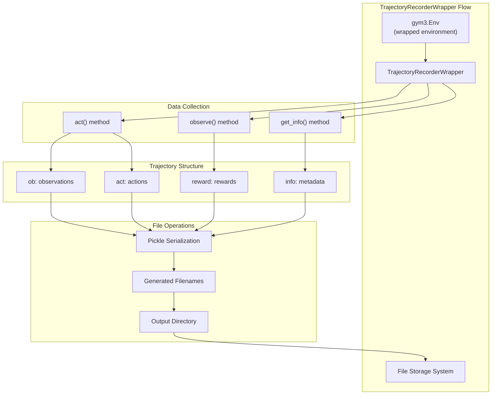
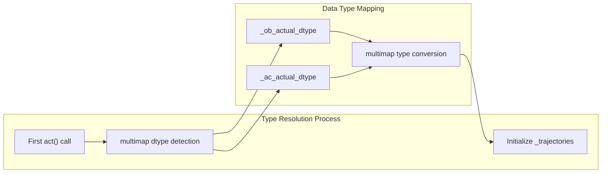
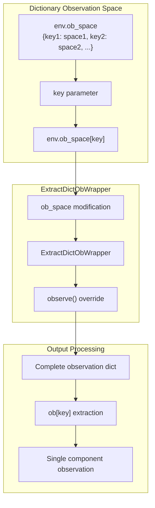

<!-- source: DeepWiki mcp.deepwiki.com · repo openai/gym3 · page 6 Advanced Features · fetched 2026-10-26 -->

# Advanced Features

<details>
<summary>Relevant source files</summary>

The following files were used as context for generating this wiki page:

- [gym3/extract_dict_ob.py](gym3/extract_dict_ob.py)
- [gym3/trajectory_recorder.py](gym3/trajectory_recorder.py)

</details>


This document covers gym3's advanced capabilities for data recording, observation processing, and specialized utilities that extend beyond basic environment execution. These features enable sophisticated data collection workflows, fine-grained observation manipulation, and integration with analysis pipelines.

For basic environment usage, see [Basic Usage Examples](#2.2). For visualization capabilities, see [Visualization and Interaction](#5). For framework integration, see [Interoperability](#7).

## Trajectory Recording

The `TrajectoryRecorderWrapper` provides comprehensive episode recording capabilities, capturing complete environment trajectories including observations, actions, rewards, and metadata. This wrapper saves each episode as a separate pickle file with a standardized data structure.

### TrajectoryRecorderWrapper Architecture



Sources: [gym3/trajectory_recorder.py:1-123]()

### Data Structure and Format

The `TrajectoryRecorderWrapper` creates trajectory files with a consistent dictionary structure:

| Key | Type | Description |
|-----|------|-------------|
| `ob` | List/Array | Observations at each timestep |
| `act` | List/Array | Actions taken after each observation |
| `reward` | numpy.ndarray | Rewards received from each action |
| `info` | List | Metadata dictionaries for each timestep |

The wrapper handles both simple array spaces and complex dictionary observation spaces through the `multimap` utility function, ensuring proper data type preservation and batch separation across multiple environments.

Sources: [gym3/trajectory_recorder.py:17-23](), [gym3/trajectory_recorder.py:50-66]()

### Implementation Details

#### Initialization and Setup

The wrapper initialization process involves directory creation and internal state management:

```python
# Key initialization parameters from TrajectoryRecorderWrapper.__init__
directory: str              # Output directory for trajectory files
filename_prefix: str = ""   # Optional prefix for generated filenames
```

The wrapper creates the output directory if it doesn't exist and maintains episode counting for unique filename generation.

Sources: [gym3/trajectory_recorder.py:35-44]()

#### Dynamic Type Handling

The `TrajectoryRecorderWrapper` implements sophisticated type handling to accommodate environments that return observations with dtypes different from their declared spaces:



This approach ensures that recorded data maintains the actual runtime dtypes rather than forcing conversion to declared space types.

Sources: [gym3/trajectory_recorder.py:84-90](), [gym3/trajectory_recorder.py:56-65]()

#### Episode Completion and File Writing

The wrapper detects episode completion through the `first` flag returned by `observe()` and triggers file writing:

```python
# File naming pattern: {prefix}{episode_count:09d}.pickle
filepath = os.path.join(directory, f"{prefix}{episode_count:09d}.pickle")
```

Each completed trajectory is immediately serialized using pickle and written to disk, with the internal trajectory buffer reset for the next episode.

Sources: [gym3/trajectory_recorder.py:68-76](), [gym3/trajectory_recorder.py:119-122]()

## Observation Processing

The `ExtractDictObWrapper` provides targeted extraction of specific components from dictionary observation spaces, enabling focused analysis of complex multi-component observations.

### ExtractDictObWrapper Architecture



Sources: [gym3/extract_dict_ob.py:1-12]()

### Usage Pattern

The `ExtractDictObWrapper` transforms multi-component dictionary observations into single-component observations:

| Before Wrapping | After Wrapping |
|----------------|----------------|
| `{"rgb": array, "depth": array, "semantic": array}` | `array` (rgb component only) |
| `ob_space = {"rgb": Box(...), "depth": Box(...)}` | `ob_space = Box(...)` (rgb space only) |

This wrapper is particularly useful when downstream processing or analysis requires only specific observation components, reducing memory usage and computational overhead.

Sources: [gym3/extract_dict_ob.py:7-11]()

### Implementation Details

The wrapper modifies the observation space during initialization and overrides the `observe()` method to perform key extraction:

```python
# Core extraction logic
def observe(self):
    rew, ob, done = super().observe()
    return rew, ob[self._key], done
```

The wrapper maintains the same reward and done semantics while transforming only the observation component.

Sources: [gym3/extract_dict_ob.py:4-11]()

## Internal Utilities

gym3 includes various internal utilities and helper functions that support the advanced features described above. These utilities handle type conversion, array manipulation, and cross-framework compatibility operations.

Key utility areas include:
- Type system utilities in `gym3.types`
- Numpy-specific operations in `gym3.types_np`
- Multi-environment coordination helpers
- Cross-language integration support

For specific utility documentation, refer to the source code and inline documentation within the respective modules.

Sources: [gym3/trajectory_recorder.py:8-9]() (imports showing utility usage)

---

