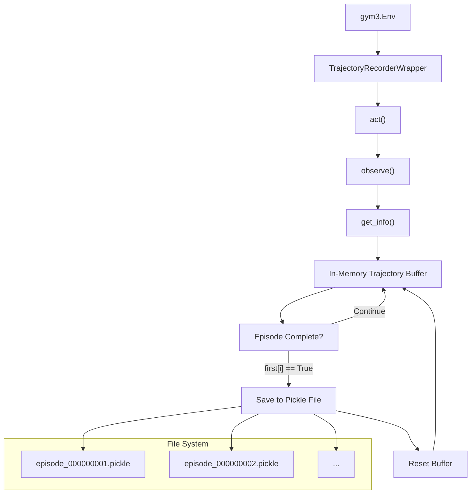
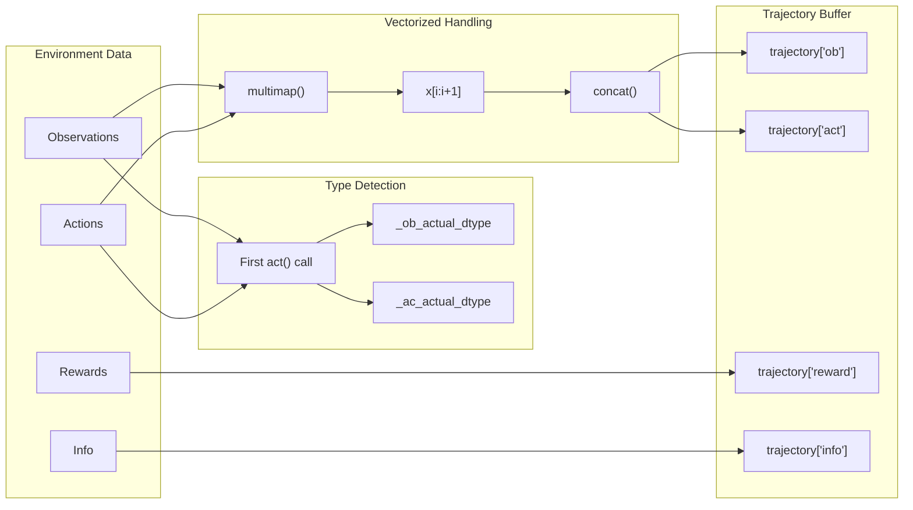
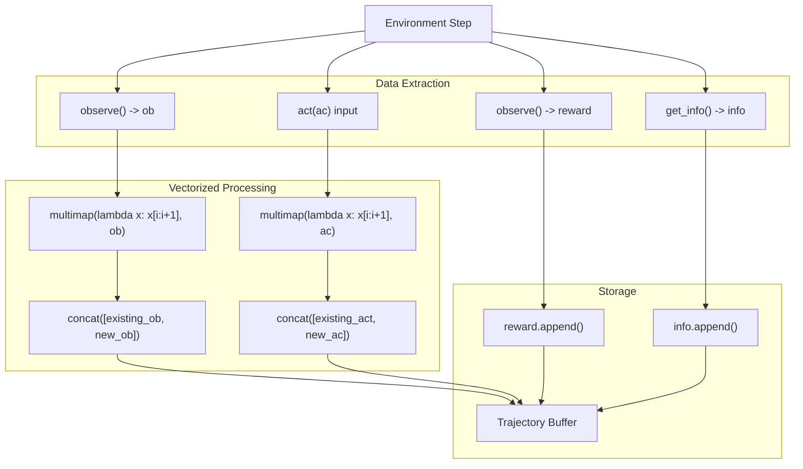

<!-- source: DeepWiki mcp.deepwiki.com · repo openai/gym3 · page 6.1 Trajectory Recording · fetched 2026-10-26 -->

# Trajectory Recording

<details>
<summary>Relevant source files</summary>

The following files were used as context for generating this wiki page:

- [gym3/trajectory_recorder.py](gym3/trajectory_recorder.py)

</details>


This document covers gym3's trajectory recording capabilities, which allow you to capture and save complete episode data for later analysis, replay, or training. The `TrajectoryRecorderWrapper` class automatically records observations, actions, rewards, and metadata during environment execution and saves them as pickle files.

For information about environment visualization during recording, see [Environment Viewer](#5.1). For details about the wrapper system that enables trajectory recording, see [Wrappers and Extensions](#3.3).

## Purpose and Data Format

The `TrajectoryRecorderWrapper` captures complete episodes from gym3 environments and saves them to disk in a standardized format. Each episode is saved as a separate pickle file containing a dictionary with four synchronized sequences:

| Key | Content | Description |
|-----|---------|-------------|
| `"ob"` | Observations | List of observations at each timestep |
| `"act"` | Actions | List of actions taken (act[i] follows ob[i]) |
| `"reward"` | Rewards | List of rewards received (reward[i] from act[i]) |
| `"info"` | Metadata | List of environment info dicts (info[i] at ob[i]) |

All sequences have the same length, representing the complete trajectory from episode start to termination.

**Sources:** [gym3/trajectory_recorder.py:17-23]()

## Trajectory Recording Flow



**Sources:** [gym3/trajectory_recorder.py:78-123]()

## Data Structure and Type Handling

The trajectory recorder handles complex observation and action spaces, including dictionary spaces and type conversion challenges:



**Sources:** [gym3/trajectory_recorder.py:45-66](), [gym3/trajectory_recorder.py:84-89](), [gym3/trajectory_recorder.py:103-111]()

## Implementation Components

### TrajectoryRecorderWrapper Class

The main recording functionality is implemented in `TrajectoryRecorderWrapper`, which extends the base `Wrapper` class:

- **Initialization**: Creates output directory and sets up episode counting [gym3/trajectory_recorder.py:35-44]()
- **Lazy Type Detection**: Determines actual data types on first `act()` call [gym3/trajectory_recorder.py:84-89]()
- **Vectorized Recording**: Handles multiple parallel environments [gym3/trajectory_recorder.py:87-89]()
- **Episode Completion**: Detects episode boundaries using `first` flags [gym3/trajectory_recorder.py:120-122]()

### Data Processing Pipeline



**Sources:** [gym3/trajectory_recorder.py:78-81](), [gym3/trajectory_recorder.py:103-111](), [gym3/trajectory_recorder.py:115-117]()

## File Format and Loading

### File Naming Convention

Trajectory files use a standardized naming pattern:
- Format: `{filename_prefix}{episode_number:09d}.pickle`
- Example: `episode_000000001.pickle`, `episode_000000002.pickle`
- Directory structure is created automatically if it doesn't exist

### Loading Trajectories

```python
import pickle
with open(filename, "rb") as f:
    trajectory = pickle.load(f)
```

The loaded trajectory is a dictionary where each value is a sequence of the same length as the episode duration.

**Sources:** [gym3/trajectory_recorder.py:24-28](), [gym3/trajectory_recorder.py:69-76]()

## Technical Considerations

### Memory Management

The wrapper maintains in-memory buffers for each parallel environment until episode completion. For long episodes or high-dimensional observations, this can consume significant memory.

### Type Consistency

The recorder handles cases where environment observations have different dtypes than declared in `ob_space`. Type detection occurs during the first `act()` call, and all subsequent data is converted to match the detected types [gym3/trajectory_recorder.py:85-86]().

### Vectorized Environment Support

For environments with `num > 1`, the recorder maintains separate trajectory buffers for each parallel environment and saves them independently when episodes complete [gym3/trajectory_recorder.py:87-89](), [gym3/trajectory_recorder.py:120-122]().

### Dictionary Space Handling

Complex observation and action spaces (nested dictionaries) are supported through the `multimap` utility, which applies operations recursively to nested structures [gym3/trajectory_recorder.py:56-65](), [gym3/trajectory_recorder.py:103-109]().

**Sources:** [gym3/trajectory_recorder.py:1-123]()

---

