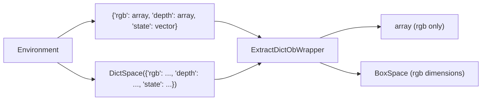
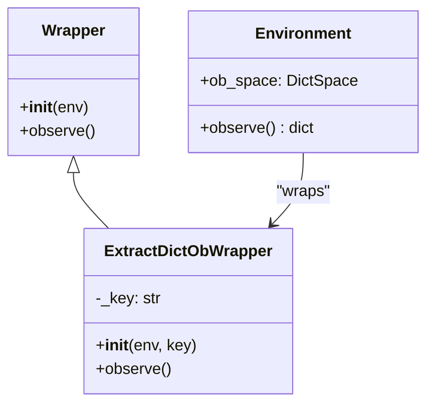
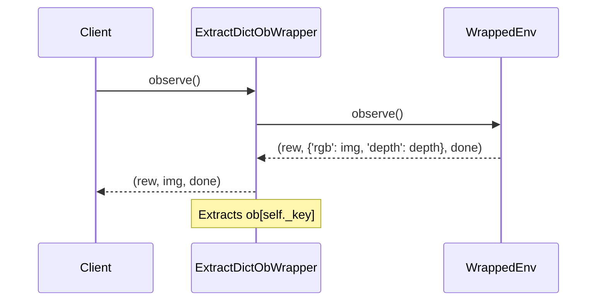
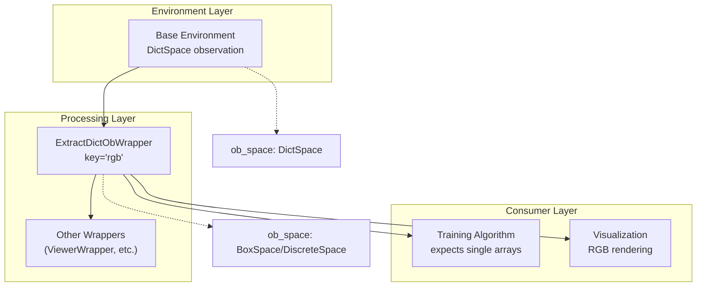

<!-- source: DeepWiki mcp.deepwiki.com · repo openai/gym3 · page 6.2 Observation Processing · fetched 2026-10-26 -->

# Observation Processing

<details>
<summary>Relevant source files</summary>

The following files were used as context for generating this wiki page:

- [gym3/extract_dict_ob.py](gym3/extract_dict_ob.py)

</details>


## Purpose and Scope

This document covers gym3's capabilities for processing and transforming environment observations, specifically focusing on extracting components from dictionary-structured observation spaces. The primary tool for this is the `ExtractDictObWrapper` class, which allows users to isolate specific fields from complex observation dictionaries.

For information about recording complete trajectories including observations, see [Trajectory Recording](#6.1). For broader environment modification patterns, see [Wrappers and Extensions](#3.3).

## Overview

Many gym3 environments provide observations as dictionaries containing multiple data fields (e.g., RGB images, depth maps, agent state vectors). In training scenarios, algorithms often need only specific components of these complex observations. The observation processing system provides a clean interface to extract and reshape observation data without modifying the underlying environment.



**Dictionary Observation Extraction Pipeline**

Sources: [gym3/extract_dict_ob.py:1-12]()

## ExtractDictObWrapper Class

The `ExtractDictObWrapper` is the core component for observation processing in gym3. It wraps an existing environment and extracts a single field from dictionary observations.

### Class Structure



**ExtractDictObWrapper Class Hierarchy**

The wrapper inherits from the base `Wrapper` class and modifies both the observation space and the observation values returned by the `observe()` method.

Sources: [gym3/extract_dict_ob.py:1-12]()

### Constructor Behavior

The `ExtractDictObWrapper` constructor takes two parameters:

| Parameter | Type | Description |
|-----------|------|-------------|
| `env` | `gym3.Env` | The environment to wrap |
| `key` | `str` | The dictionary key to extract from observations |

During initialization, the wrapper modifies the observation space by selecting only the space corresponding to the specified key: `env.ob_space[self._key]`. This ensures that downstream components see the correct observation space structure.

Sources: [gym3/extract_dict_ob.py:4-7]()

### Observation Extraction

The `observe()` method performs the actual extraction:



**Observation Extraction Sequence**

The method calls the parent's `observe()` method to get the original observation dictionary, then returns only the value at the specified key while preserving rewards and done flags.

Sources: [gym3/extract_dict_ob.py:9-11]()

## Integration with gym3 Architecture

The `ExtractDictObWrapper` integrates seamlessly with gym3's wrapper architecture and type system:



**Integration within gym3 Wrapper Ecosystem**

The wrapper can be combined with other gym3 wrappers and fits naturally into training pipelines that expect simplified observation formats.

Sources: [gym3/extract_dict_ob.py:1-12]()

## Usage Patterns

### Single Component Extraction

The most common usage pattern extracts a single sensory modality from multi-modal observations:

```python
# Extract RGB images from complex observations
rgb_env = ExtractDictObWrapper(env, key='rgb')

# Extract agent state vectors  
state_env = ExtractDictObWrapper(env, key='agent_state')
```

### Chaining with Other Wrappers

The wrapper composes naturally with other gym3 wrappers:

```python
# Extract RGB, then add visualization
env = ExtractDictObWrapper(base_env, key='rgb')
env = ViewerWrapper(env, info_key='rgb')
```

### Type System Compatibility

The wrapper preserves gym3's type system guarantees by correctly updating the observation space during initialization. This ensures that any downstream code that inspects `env.ob_space` will see the correct structure for the extracted observations.

Sources: [gym3/extract_dict_ob.py:4-7]()

## Implementation Details

### Memory Efficiency

The `ExtractDictObWrapper` does not copy observation data - it simply returns a reference to the existing array stored in the dictionary. This makes it memory-efficient for large observations like high-resolution images.

### Error Handling

The wrapper relies on Python's standard dictionary key access behavior. If the specified key does not exist in an observation, a `KeyError` will be raised during the `observe()` call.

### Space Validation

The observation space extraction `env.ob_space[self._key]` occurs during initialization and will raise a `KeyError` immediately if the key does not exist in the environment's observation space, providing early error detection.

Sources: [gym3/extract_dict_ob.py:7, 11]()

---

