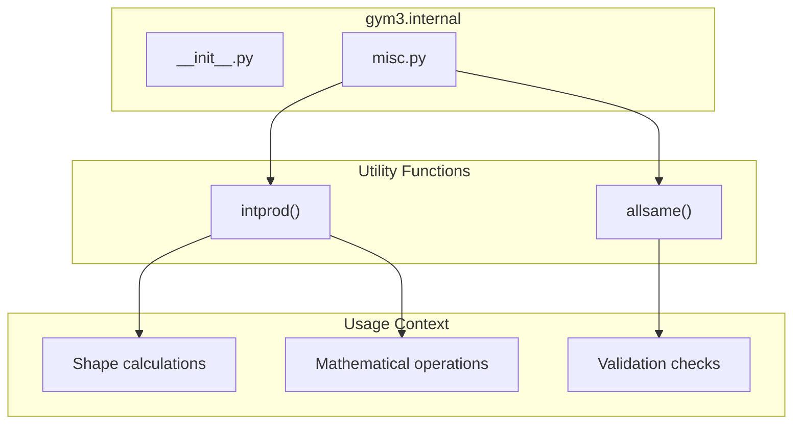
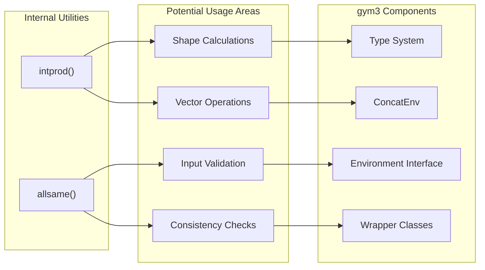

<!-- source: DeepWiki mcp.deepwiki.com · repo openai/gym3 · page 6.3 Internal Utilities · fetched 2026-10-26 -->

# Internal Utilities

<details>
<summary>Relevant source files</summary>

The following files were used as context for generating this wiki page:

- [gym3/internal/__init__.py](gym3/internal/__init__.py)
- [gym3/internal/misc.py](gym3/internal/misc.py)

</details>


## Purpose and Scope

This document covers the internal utility functions provided by gym3 for supporting operations throughout the codebase. These utilities consist of basic mathematical and comparison functions that serve as building blocks for other gym3 components.

For information about user-facing utilities and wrappers, see [Wrappers and Extensions](#3.3). For environment-specific recording and processing utilities, see [Trajectory Recording](#6.1) and [Observation Processing](#6.2).

## Overview

The `gym3.internal` package provides low-level utility functions that are used internally by various gym3 components. These utilities focus on basic mathematical operations and sequence comparisons that support the framework's core functionality.

**Module Structure**



Sources: [gym3/internal/__init__.py:1](), [gym3/internal/misc.py:1-17]()

## Mathematical Utilities

### Integer Product Function

The `intprod` function computes the product of a sequence of integers, commonly used for calculating tensor shapes and dimensional sizes.

**Function Signature and Implementation**

| Function | Parameters | Return Type | Purpose |
|----------|------------|-------------|---------|
| `intprod` | `xs: sequence` | `int` | Calculates product of integers in sequence |

The implementation iterates through the sequence, multiplying each element: [gym3/internal/misc.py:1-8]()

**Usage Pattern**
```python
# Example usage for shape calculations
total_elements = intprod([batch_size, height, width, channels])
```

Sources: [gym3/internal/misc.py:1-8]()

### Sequence Comparison Utilities

The `allsame` function validates whether all elements in a sequence are identical, useful for consistency checks across vectorized operations.

**Function Signature and Implementation**

| Function | Parameters | Return Type | Purpose |
|----------|------------|-------------|---------|
| `allsame` | `xs: sequence` | `bool` | Checks if all sequence elements are equal |

The function requires a non-empty sequence and compares all elements to the first element: [gym3/internal/misc.py:11-16]()

**Validation Requirements**
- Input sequence must not be empty (assertion at line 15)
- Returns `True` if all elements match the first element
- Returns `False` if any element differs

Sources: [gym3/internal/misc.py:11-16]()

## Integration with gym3 Framework

The internal utilities support various gym3 operations through basic mathematical and validation functions that are used throughout the codebase.

**Utility Integration Pattern**



Sources: [gym3/internal/misc.py:1-17]()

## Implementation Details

Both utility functions follow simple, efficient implementations suitable for frequent internal use:

**Mathematical Operations**
- `intprod`: Uses iterative multiplication with initial value of 1
- Handles empty sequences by returning 1 (multiplicative identity)
- No overflow protection for large integer products

**Comparison Operations**  
- `allsame`: Uses generator expression with `all()` for efficiency
- Short-circuits on first mismatch for optimal performance
- Requires explicit non-empty sequence validation

The functions provide basic building blocks without complex error handling, consistent with their role as internal utilities rather than user-facing APIs.

Sources: [gym3/internal/misc.py:1-17]()

---

