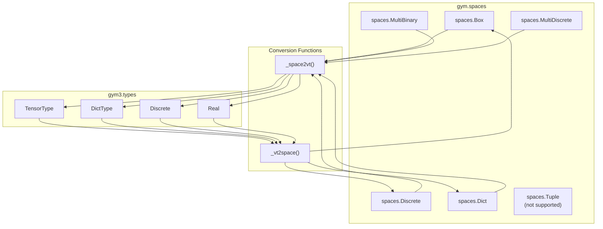
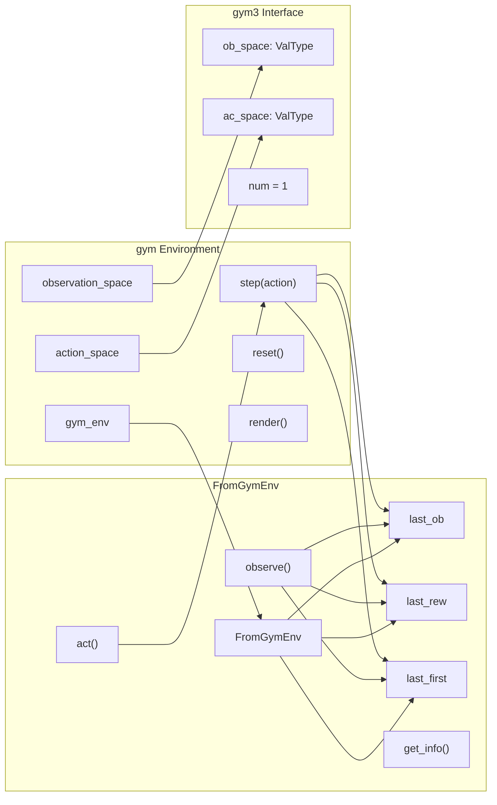
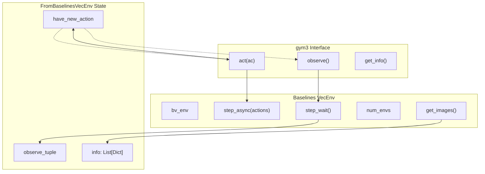
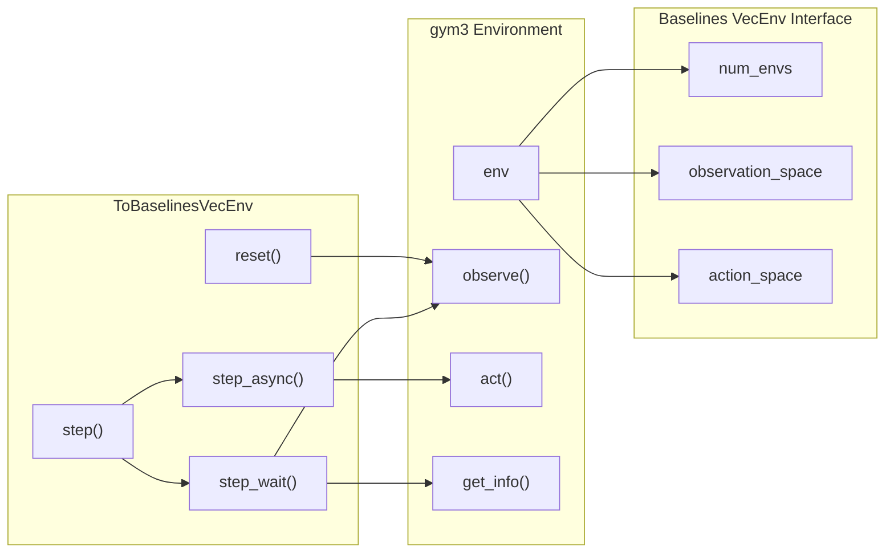
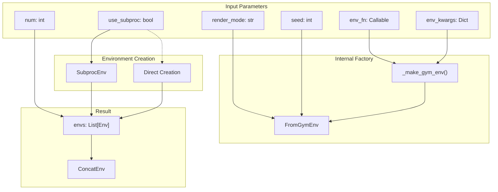

<!-- source: DeepWiki mcp.deepwiki.com · repo openai/gym3 · page 7 Interoperability · fetched 2026-10-26 -->

# Interoperability

<details>
<summary>Relevant source files</summary>

The following files were used as context for generating this wiki page:

- [docs/gym3-for-gym-users.md](docs/gym3-for-gym-users.md)
- [gym3/interop.py](gym3/interop.py)

</details>


This document covers gym3's adapter system for converting between gym3 environments and other reinforcement learning frameworks, specifically OpenAI Gym and Baselines VecEnv. The interoperability layer enables existing RL code to work with gym3 environments and allows gym3 to leverage the extensive ecosystem of existing environments.

For information about framework-specific migration guidance, see [Migration from OpenAI Gym](#7.2).

## Space Conversion System

At the core of gym3's interoperability is a bidirectional conversion system between gym's `Space` objects and gym3's `ValType` system. This conversion handles the fundamental differences in how the two frameworks define observation and action spaces.



**Space Conversion System Architecture**

The conversion functions enforce strict compatibility requirements. For `spaces.Box` with integer dtypes, only identical bounds across all dimensions are supported with low bounds of 0 [gym3/interop.py:34-36](). `spaces.MultiDiscrete` requires identical values across all dimensions [gym3/interop.py:51-53](). `spaces.Tuple` is not supported and must be wrapped as `spaces.Dict` [gym3/interop.py:67-69]().

Sources: [gym3/interop.py:28-106]()

## From External Frameworks to gym3

### FromGymEnv Adapter

The `FromGymEnv` class wraps individual gym environments to present them as gym3 environments with `num=1`. This adapter handles the fundamental difference between gym's step-based interface and gym3's observe-act pattern.



**FromGymEnv Internal State Management**

The adapter maintains episode state between gym3 method calls. When `act()` is called, it extracts the single environment action using `multimap(lambda x: x[0], ac)` [gym3/interop.py:162]() and calls the underlying gym environment's `step()` method. Episode boundaries are handled automatically - when `self.last_first` is True, `reset()` is called on the gym environment [gym3/interop.py:170-171]().

Optional rendering support is provided through the `render_mode` parameter. When set to `"rgb_array"`, the rendered frame is stored in the info dict under the key `"rgb"` [gym3/interop.py:166-167]().

Sources: [gym3/interop.py:118-179]()

### FromBaselinesVecEnv Adapter

The `FromBaselinesVecEnv` class adapts baselines vectorized environments to gym3. Unlike `FromGymEnv`, this adapter preserves the vectorized nature with `num=bv_env.num_envs` [gym3/interop.py:201]().



**FromBaselinesVecEnv Asynchronous State Machine**

The adapter implements a state machine using the `have_new_action` flag [gym3/interop.py:210](). When `act()` is called, it calls `step_async()` and sets the flag. When `observe()` is called with the flag set, it calls `step_wait()` to complete the asynchronous step [gym3/interop.py:217-220]().

Sources: [gym3/interop.py:181-243]()

## From gym3 to External Frameworks

### ToGymEnv Adapter

The `ToGymEnv` class presents a gym3 environment as a standard gym environment. It requires `env.num == 1` [gym3/interop.py:261]() and implements the gym interface methods.

| Method | gym3 Mapping | Special Behavior |
|--------|--------------|------------------|
| `reset()` | `observe()` then extract `[0]` | Warns if called mid-episode [gym3/interop.py:270-271]() |
| `step(action)` | `act([action])` then `observe()` | Returns previous observation if episode ended [gym3/interop.py:278-279]() |
| `render()` | Check `info["rgb"]` | Returns `info["rgb"]` in rgb_array mode [gym3/interop.py:287-288]() |
| `seed()` | No-op | Prints warning [gym3/interop.py:291]() |
| `close()` | No-op | |

Sources: [gym3/interop.py:245-299]()

### ToBaselinesVecEnv Adapter

The `ToBaselinesVecEnv` class exposes a gym3 environment through the baselines VecEnv interface, preserving vectorization with `num_envs = env.num` [gym3/interop.py:331-332]().



**ToBaselinesVecEnv Method Mapping**

Sources: [gym3/interop.py:301-344]()

## Vectorization Utilities

### vectorize_gym Function

The `vectorize_gym()` function provides a high-level interface for creating vectorized gym3 environments from gym environment specifications. It serves as a replacement for baselines' `SubprocVecEnv` and `DummyVecEnv`.



**vectorize_gym Architecture**

The function defaults to using `gym.make` as the environment factory [gym3/interop.py:374-376]() and creates environments either in subprocesses (default) or directly in the current process. Each environment is wrapped in `FromGymEnv` before being combined into a `ConcatEnv` [gym3/interop.py:394]().

Example usage patterns:

```python
# Using registered gym environment
env = vectorize_gym(num=4, env_kwargs={"id": "CartPole-v1"})

# Using custom environment function  
env = vectorize_gym(num=2, env_fn=MyCustomEnv, env_kwargs={"param": "value"})

# Disable subprocesses for debugging
env = vectorize_gym(num=2, env_kwargs={"id": "Pendulum-v0"}, use_subproc=False)
```

Sources: [gym3/interop.py:352-394](), [docs/gym3-for-gym-users.md:7-14]()

---

