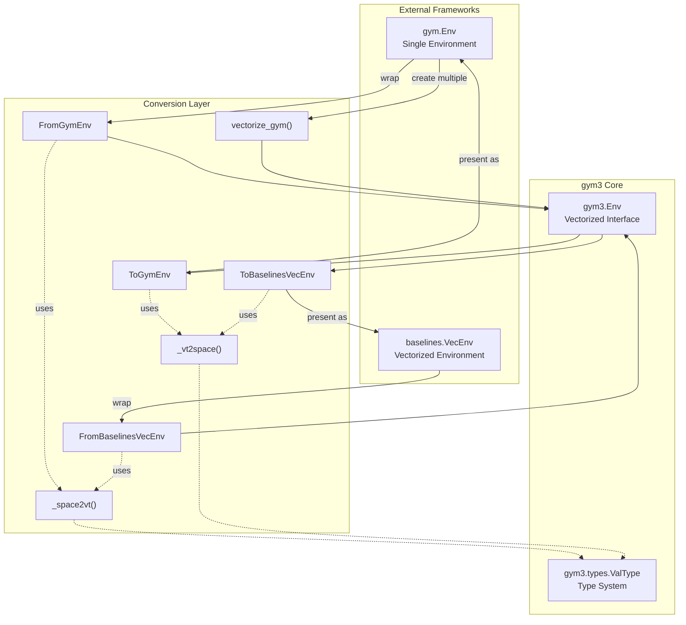
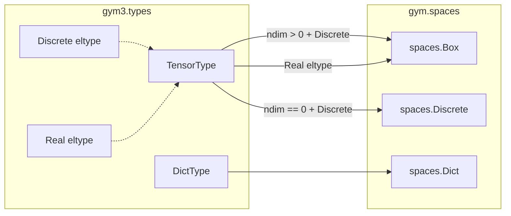
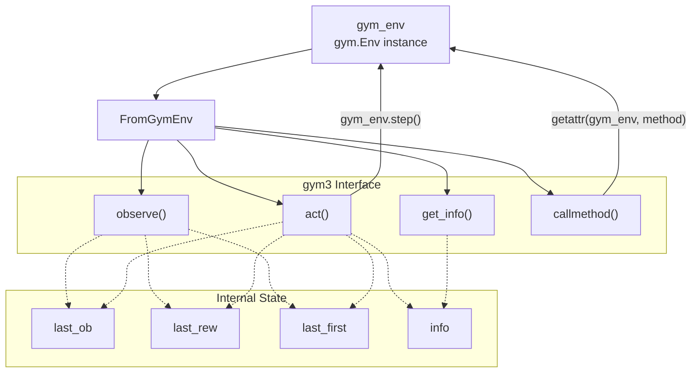
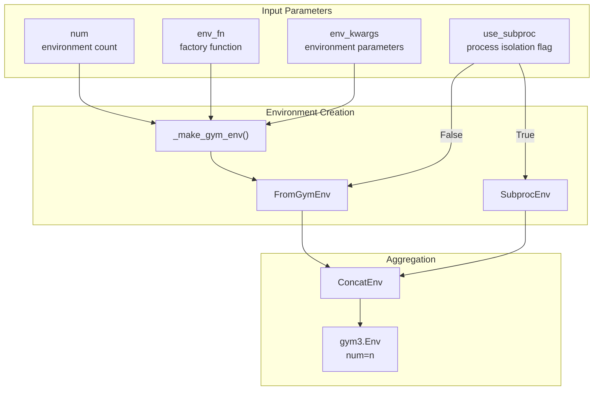

<!-- source: DeepWiki mcp.deepwiki.com · repo openai/gym3 · page 7.1 Framework Conversion · fetched 2026-10-26 -->

# Framework Conversion

Relevant source files

The following files were used as context for generating this wiki page:

- [gym3/interop.py](gym3/interop.py)

This page documents gym3's interoperability layer that provides bidirectional conversion between gym3 environments and other RL frameworks, specifically OpenAI Gym and Baselines VecEnv interfaces. The conversion system handles both environment wrapping and observation/action space translation.

For information about migrating existing codebases from OpenAI Gym to gym3, see [Migration from OpenAI Gym](#7.2).

## Conversion Architecture

The framework conversion system operates through adapter classes that wrap environments from one interface to present them as another. The core conversion logic handles space type translation between gym3's `ValType` system and the space definitions used by other frameworks.

**Framework Conversion Flow**

Sources: [gym3/interop.py:1-395]()

## Space Type Conversion

The conversion between space representations is handled by two core functions that translate between gym's space objects and gym3's `ValType` system.

### gym.spaces to gym3.types

The `_space2vt()` function converts OpenAI Gym space objects to gym3 `ValType` objects:

| gym.spaces Type | gym3.types Mapping | Constraints |
|-----------------|-------------------|-------------|
| `Box` (integer) | `TensorType` with `Discrete` eltype | Low must be 0, identical bounds across dimensions |
| `Box` (float) | `TensorType` with `Real` eltype | Must use supported float dtypes |
| `Discrete` | `TensorType` with scalar `Discrete` eltype | Direct mapping |
| `MultiDiscrete` | `TensorType` with vector `Discrete` eltype | All nvec values must be identical |
| `MultiBinary` | `TensorType` with `Discrete(2)` eltype | Mapped to binary discrete |
| `Dict` | `DictType` | Recursive conversion of sub-spaces |
| `Tuple` | Not supported | Must use `Dict` instead |

### gym3.types to gym.spaces

The `_vt2space()` function performs the inverse conversion from gym3 `ValType` to gym space objects:

**Space Type Mapping**

Sources: [gym3/interop.py:28-107]()

## Converting from Other Frameworks

### FromGymEnv

The `FromGymEnv` class wraps a single gym environment to present it as a gym3 environment with `num=1`. It handles the translation between gym's single-environment interface and gym3's vectorized interface.

Key features:
- Automatic episode reset when environment signals done
- Optional render mode support with `rgb_array` placed in info dict
- Method delegation through `callmethod()` 
- Seed support during initialization

**FromGymEnv Architecture**

Sources: [gym3/interop.py:118-179]()

### FromBaselinesVecEnv

The `FromBaselinesVecEnv` class adapts a baselines VecEnv to the gym3 interface, preserving the vectorized nature with `num=bv_env.num_envs`.

Key differences from `FromGymEnv`:
- Maintains the async step pattern from baselines
- Handles multiple environments natively
- Uses `step_async()` and `step_wait()` internally
- Supports vectorized rendering through `get_images()`

Sources: [gym3/interop.py:181-243]()

## Converting to Other Frameworks

### ToGymEnv

The `ToGymEnv` class presents a gym3 environment (with `num=1`) as a standard gym environment.

Important behavioral notes:
- Early `reset()` calls are ignored with a warning since gym3 environments auto-reset
- `seed()` and `close()` methods are no-ops
- Render mode `rgb_array` retrieves from info dict `rgb` key
- Episode transitions are handled automatically

### ToBaselinesVecEnv

The `ToBaselinesVecEnv` class exposes a gym3 environment as a baselines VecEnv, maintaining the vectorized interface.

Key features:
- Preserves `num_envs` property from the underlying gym3 environment
- Implements both sync (`step()`) and async (`step_async()`/`step_wait()`) interfaces
- Manual reset warnings since gym3 handles resets automatically

Sources: [gym3/interop.py:245-344]()

## Vectorization Utility

The `vectorize_gym()` function provides a convenient way to create multiple gym environments and combine them into a single gym3 environment, serving as a replacement for baselines' `SubprocVecEnv` and `DummyVecEnv`.

**vectorize_gym Process Flow**

Example usage patterns:
- Registered gym environments: `vectorize_gym(num=4, env_kwargs={"id": "CartPole-v1"})`
- Custom environments: `vectorize_gym(num=4, env_fn=my_env_factory, env_kwargs=my_params)`
- Same-process execution: `vectorize_gym(num=4, env_kwargs={"id": "CartPole-v1"}, use_subproc=False)`

Sources: [gym3/interop.py:346-395]()

---

