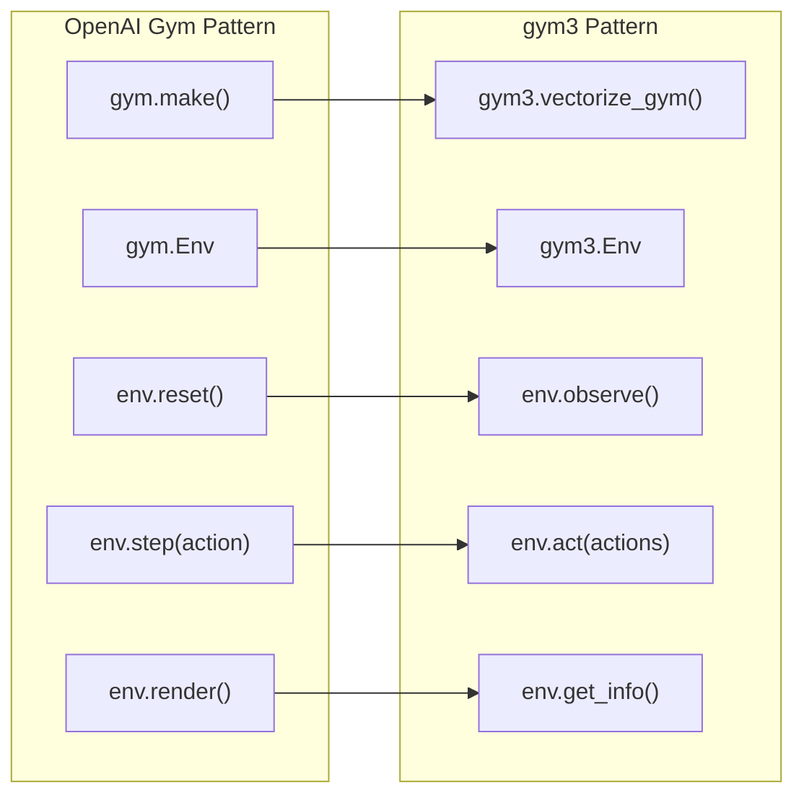
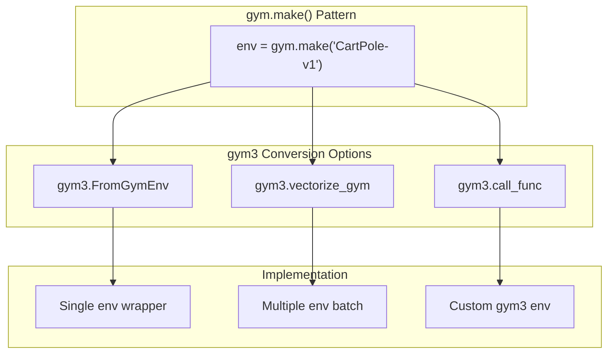
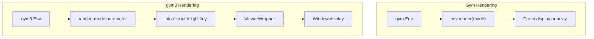
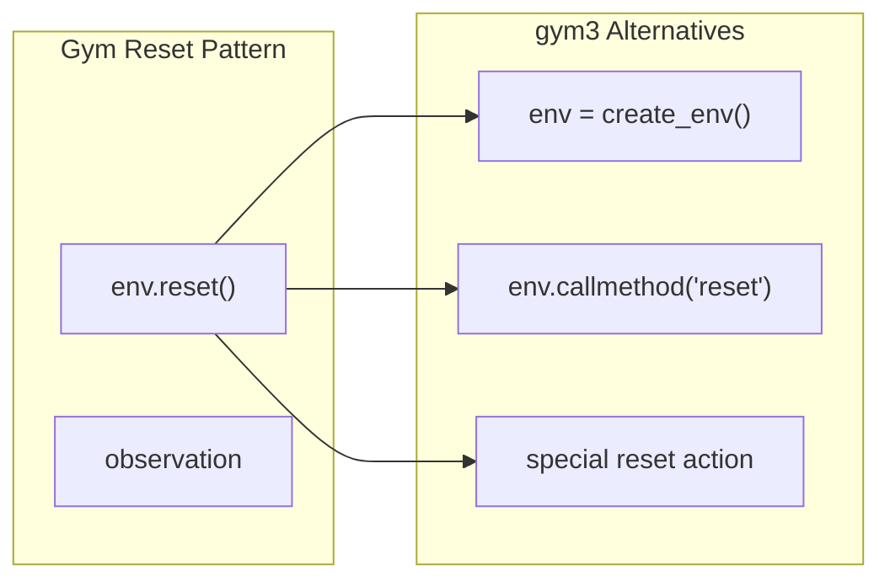
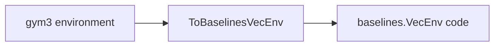

<!-- source: DeepWiki mcp.deepwiki.com · repo openai/gym3 · page 7.2 Migration from OpenAI Gym · fetched 2026-10-26 -->

# Migration from OpenAI Gym

<details>
<summary>Relevant source files</summary>

The following files were used as context for generating this wiki page:

- [docs/gym3-for-gym-users.md](docs/gym3-for-gym-users.md)

</details>


This document provides a practical guide for migrating code from OpenAI Gym to gym3. It covers the key differences between the frameworks and demonstrates how to adapt existing gym-based code to work with gym3's vectorized interface.

For detailed information about framework conversion utilities, see [Framework Conversion](#7.1). For basic gym3 usage patterns, see [Basic Usage Examples](#2.2). For comprehensive environment interface documentation, see [Environment Interface](#3.1).

## Core Architecture Differences

The fundamental difference between OpenAI Gym and gym3 is that gym3 is designed as a vectorized environment interface from the ground up, while gym focuses on single environment instances.

### Interface Comparison



**Sources:** [docs/gym3-for-gym-users.md:1-70]()

### Key Conceptual Changes

| Gym Concept | gym3 Equivalent | Key Difference |
|-------------|-----------------|----------------|
| Single environment | Vectorized by default | All operations work on batches |
| `env.reset()` | No standard reset | Re-creation or custom methods |
| `env.step(action)` | `env.act(actions)` + `env.observe()` | Separate action and observation phases |
| `env.render()` | `ViewerWrapper` or info dict | Rendering integrated into observation |
| `gym.make(id)` | `gym3.call_func(path)` | No global registry |

**Sources:** [docs/gym3-for-gym-users.md:16-26](), [docs/gym3-for-gym-users.md:56-63]()

## Environment Creation Migration

### From gym.make() to gym3



### Single Environment Conversion

To convert a single gym environment:

```python
# Old gym pattern
env = gym.make('CartPole-v1')

# gym3 equivalent
env = gym3.FromGymEnv(gym.make('CartPole-v1'))
```

The `FromGymEnv` class [gym3/interop.py]() wraps a single gym environment to provide the gym3 interface.

### Vectorized Environment Creation

For multiple environments (equivalent to `baselines.SubprocVecEnv`):

```python
# gym3 vectorized creation
env = gym3.vectorize_gym(num=4, env_kwargs={"id": "CartPole-v1"})
```

**Sources:** [docs/gym3-for-gym-users.md:3-14]()

### Custom Environment Registration

gym3 does not use a global registry. Instead, use `call_func` with Python paths:

```python
# Instead of gym.register() and gym.make()
env = gym3.call_func("gym3.testing:IdentityEnv", arg1=value1)
```

**Sources:** [docs/gym3-for-gym-users.md:16-26]()

## Rendering System Migration

### Rendering Architecture Changes



### Migration Patterns

For `mode="rgb_array"`:
- Pass `render_mode="rgb_array"` to environment constructor
- Access rendered frames via `env.get_info()['rgb']`
- Use `ViewerWrapper` for display

For `mode="human"`:
- Pass `render_mode="human"` to environment constructor  
- Environment handles window creation internally
- No explicit render calls needed

**Sources:** [docs/gym3-for-gym-users.md:28-38]()

## Episode Management Migration

### Reset Behavior Changes

gym3 environments do not have a standard `reset()` method. Migration options:

1. **Environment Recreation**: Create new environment instances
2. **Custom Methods**: Define reset methods and use `callmethod()`
3. **Reset Actions**: Include reset as a special action type



### Custom Method Implementation

For environments requiring reset functionality:

```python
class RestartableWrapper(gym3.Wrapper):
    def restart(self):
        # Custom restart logic
        pass
        
    def callmethod(self, method, *args, **kwargs):
        if method == "restart":
            return self.restart(*args, **kwargs)
        return self.env.callmethod(method, *args, **kwargs)
```

**Sources:** [docs/gym3-for-gym-users.md:39-54](), [docs/gym3-for-gym-users.md:56-63]()

## Integration with Existing Codebases

### Baselines VecEnv Compatibility

For code using `baselines.VecEnv`:



Use `ToBaselinesVecEnv` wrapper to adapt gym3 environments for baselines compatibility.

### Vector Environment Support

gym3 does not currently provide adapters for `gym.vector.VectorEnv`, but you can:
1. Convert gym3 to gym using `ToGymEnv`
2. Apply `gym.vector.VectorEnv` to the converted environment

**Sources:** [docs/gym3-for-gym-users.md:64-70]()

## Common Migration Patterns

### Pattern 1: Basic Single Environment

```python
# Before (gym)
env = gym.make('CartPole-v1')
obs = env.reset()
for _ in range(100):
    action = env.action_space.sample()
    obs, reward, done, info = env.step(action)
    if done:
        obs = env.reset()

# After (gym3)  
env = gym3.FromGymEnv(gym.make('CartPole-v1'))
obs, reward, done = env.observe()
for _ in range(100):
    action = env.action_space.sample()
    env.act([action])
    obs, reward, done = env.observe()
    # Handle episode termination as needed
```

### Pattern 2: Vectorized Environments

```python
# Before (using baselines)
from baselines.common.vec_env import SubprocVecEnv
env = SubprocVecEnv([lambda: gym.make('CartPole-v1') for _ in range(4)])

# After (gym3)
env = gym3.vectorize_gym(num=4, env_kwargs={"id": "CartPole-v1"})
```

### Pattern 3: Rendering

```python
# Before (gym)
env = gym.make('CartPole-v1')
frame = env.render(mode='rgb_array')

# After (gym3)
env = gym3.FromGymEnv(gym.make('CartPole-v1'), render_mode='rgb_array')
env = gym3.ViewerWrapper(env, info_key='rgb')
obs, reward, done = env.observe()
frame = env.get_info()['rgb'][0]  # Index 0 for single env
```

**Sources:** [docs/gym3-for-gym-users.md:1-70]()

---

