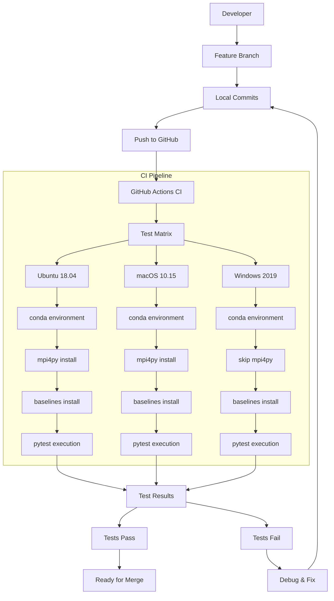
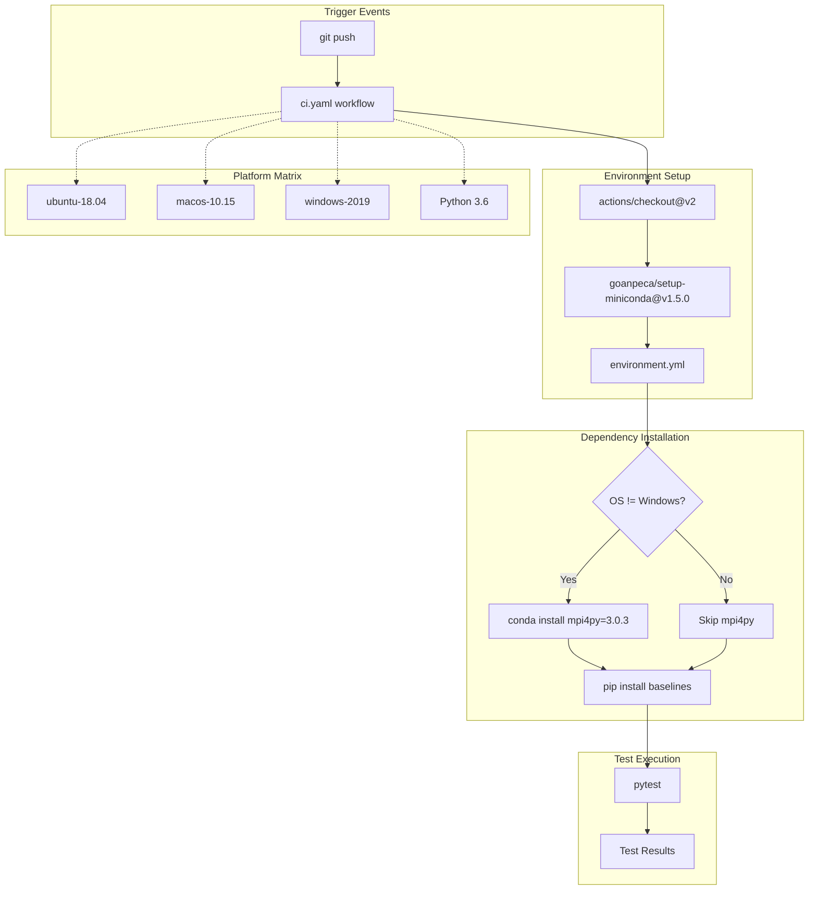
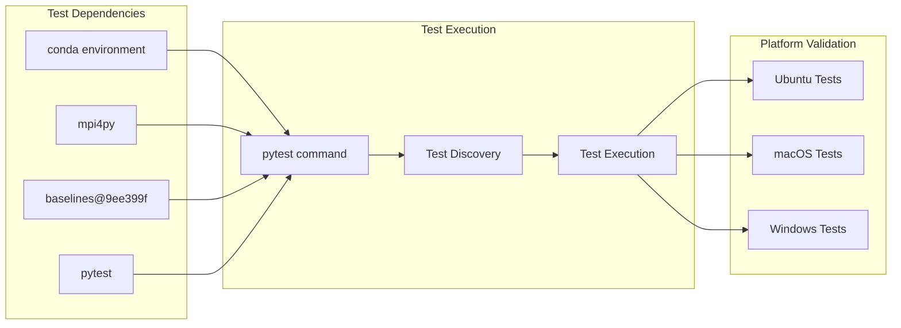
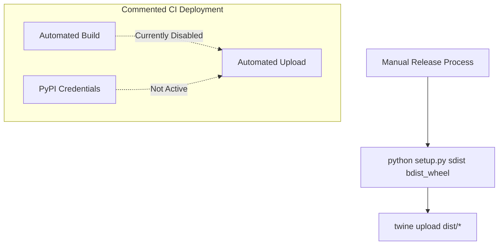

<!-- source: DeepWiki mcp.deepwiki.com · repo openai/gym3 · page 8 Development · fetched 2026-10-26 -->

# Development

Relevant source files

The following files were used as context for generating this wiki page:

- [.github/workflows/ci.yaml](.github/workflows/ci.yaml)
- [CONTRIBUTING.md](CONTRIBUTING.md)

This document covers the development infrastructure, testing setup, and contribution guidelines for the gym3 project. It includes information about the continuous integration pipeline, testing frameworks, and how to contribute to the codebase.

For information about using gym3's testing utilities in your own projects, see [Testing and CI](#8.1). For specific contribution guidelines and project policies, see [Contributing](#8.2).

## Development Workflow

The gym3 project follows a standard GitHub-based development workflow with automated testing and cross-platform validation. The development process emphasizes compatibility across multiple operating systems and integration with the broader RL ecosystem.

The development workflow ensures cross-platform compatibility by testing on Ubuntu, macOS, and Windows environments using Python 3.6. Each platform follows the same basic steps but with platform-specific adaptations for dependency installation.

Sources: [.github/workflows/ci.yaml:1-40]()

## Continuous Integration Pipeline

The project uses GitHub Actions for continuous integration, with a comprehensive test matrix that validates functionality across different operating systems and dependency configurations.

The CI pipeline includes several key components:

| Component | Purpose | Platform Support |
|-----------|---------|------------------|
| `actions/checkout@v2` | Source code retrieval | All platforms |
| `goanpeca/setup-miniconda@v1.5.0` | Conda environment setup | All platforms |
| `environment.yml` | Base dependencies | All platforms |
| `mpi4py=3.0.3` | Parallel processing support | Unix-like only |
| `baselines` | RL framework integration | All platforms |
| `pytest` | Test execution | All platforms |

The configuration specifically handles Windows compatibility by skipping `mpi4py` installation, as noted in the comment at [.github/workflows/ci.yaml:25](). The baselines dependency is installed from a specific GitHub commit to ensure reproducible builds.

Sources: [.github/workflows/ci.yaml:1-32]()

## Testing Infrastructure

The project uses `pytest` as the primary testing framework, executed through the CI pipeline after environment setup and dependency installation. The testing strategy focuses on cross-platform validation and integration testing with external RL frameworks.

The testing setup includes integration with external dependencies, particularly the OpenAI baselines library installed from a specific commit (`9ee399f5b20cd70ac0a871927a6cf043b478193f`) to ensure consistent behavior across test runs.

Sources: [.github/workflows/ci.yaml:28-32]()

## Project Contribution Policy

The gym3 project maintains a focused scope with specific guidelines for contributions and feature additions.

| Contribution Type | Policy | Reporting Method |
|-------------------|--------|------------------|
| Bug Reports | Welcomed | GitHub issue tracker |
| Installation Issues | Welcomed | GitHub issue tracker |
| Platform Support Issues | Welcomed | GitHub issue tracker |
| New Features | Not currently accepted | N/A |
| New Wrappers | Not currently accepted | N/A |

The project explicitly states that it is "not currently looking to add new features or wrappers to `gym3`", indicating a focus on stability and maintenance rather than feature expansion.

Sources: [CONTRIBUTING.md:1-4]()

## Release and Deployment

The CI configuration includes commented-out sections for automated package building and PyPI deployment, suggesting that releases are currently handled manually rather than through automated CI/CD.

The presence of commented-out deployment code at [.github/workflows/ci.yaml:33-39]() indicates that automated deployment infrastructure exists but is not currently active, likely requiring manual intervention for releases.

Sources: [.github/workflows/ci.yaml:33-39]()

---

