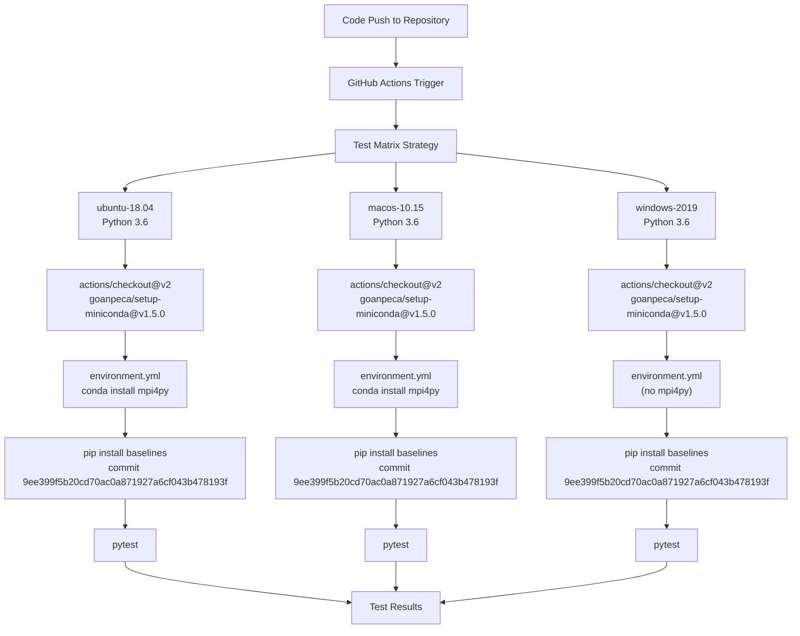
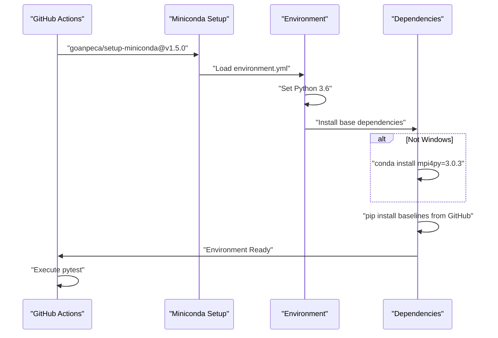
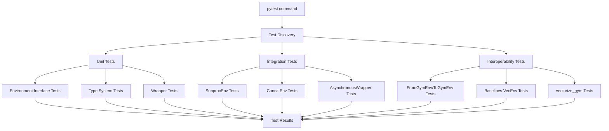

<!-- source: DeepWiki mcp.deepwiki.com · repo openai/gym3 · page 8.1 Testing and CI · fetched 2026-10-26 -->

# Testing and CI

Relevant source files

The following files were used as context for generating this wiki page:

- [.github/workflows/ci.yaml](.github/workflows/ci.yaml)

This document covers gym3's testing infrastructure and continuous integration (CI) setup. It explains how automated tests are executed across multiple platforms and how the CI pipeline ensures code quality and compatibility.

For information about contributing code changes, see [Contributing](#8.2). For details about the development environment setup, see [Installation and Dependencies](#2.1).

## Overview

Gym3 uses a comprehensive testing and CI strategy built around pytest for test execution and GitHub Actions for automated continuous integration. The system ensures compatibility across multiple operating systems and maintains code quality through automated testing on every code change.

## CI Pipeline Architecture

The continuous integration pipeline is defined in [.github/workflows/ci.yaml:1-40]() and orchestrates testing across multiple platforms and Python versions.

**CI Pipeline Flow**: The GitHub Actions workflow creates a test matrix that runs identical test suites across three operating systems, with platform-specific dependency handling.

Sources: [.github/workflows/ci.yaml:1-40]()

## Platform Support Matrix

The CI system tests gym3 across multiple platforms to ensure broad compatibility:

| Platform | OS Version | Python Version | Special Considerations |
|----------|------------|----------------|----------------------|
| Linux | ubuntu-18.04 | 3.6 | Full feature support including mpi4py |
| macOS | macos-10.15 | 3.6 | Full feature support including mpi4py |
| Windows | windows-2019 | 3.6 | Limited support - no mpi4py package available |

The platform matrix is configured with `fail-fast: false` [.github/workflows/ci.yaml:10](), ensuring that failures on one platform don't cancel tests on other platforms.

Sources: [.github/workflows/ci.yaml:7-14]()

## Environment Setup Process

The CI pipeline uses conda for environment management and follows a specific setup sequence:

**Environment Setup Sequence**: The CI pipeline follows a strict dependency installation order, with platform-specific handling for mpi4py.

The environment setup uses:
- `goanpeca/setup-miniconda@v1.5.0` action [.github/workflows/ci.yaml:17]()
- `environment.yml` file for base dependencies [.github/workflows/ci.yaml:20]()
- Conditional mpi4py installation for non-Windows platforms [.github/workflows/ci.yaml:22-26]()
- Specific baselines commit installation [.github/workflows/ci.yaml:27-29]()

Sources: [.github/workflows/ci.yaml:16-29]()

## Test Execution Framework

The testing system is built around pytest, which is executed after the environment setup completes:

**Test Execution Architecture**: pytest automatically discovers and runs tests across gym3's core functionality, environment execution patterns, and interoperability features.

The test execution is triggered with a simple `pytest` command [.github/workflows/ci.yaml:32](), which relies on pytest's automatic test discovery to find and execute all test files in the repository.

Sources: [.github/workflows/ci.yaml:30-32]()

## Dependency Management

The CI system handles several categories of dependencies with different installation methods:

### Core Dependencies
- Managed through `environment.yml` [.github/workflows/ci.yaml:20]()
- Includes base packages like numpy, cffi, and testing frameworks

### Platform-Specific Dependencies
- `mpi4py=3.0.3` installed via conda on Linux and macOS [.github/workflows/ci.yaml:26]()
- Skipped on Windows due to package availability [.github/workflows/ci.yaml:23-25]()

### External Framework Dependencies  
- OpenAI baselines installed from specific GitHub commit [.github/workflows/ci.yaml:29]()
- Ensures compatibility with exact version: `9ee399f5b20cd70ac0a871927a6cf043b478193f`

This dependency strategy ensures reproducible builds and consistent testing environments across all supported platforms.

Sources: [.github/workflows/ci.yaml:20-29]()

## CI Trigger Configuration

The CI pipeline is configured to run on all pushes to the repository [.github/workflows/ci.yaml:3](), providing immediate feedback on code changes. The workflow uses GitHub Actions' matrix strategy to parallelize testing across platforms, improving feedback speed while ensuring comprehensive coverage.

Future CI enhancements are prepared but commented out, including build and publish steps for package distribution [.github/workflows/ci.yaml:33-39]().

Sources: [.github/workflows/ci.yaml:1-3](), [.github/workflows/ci.yaml:33-39]()

---

