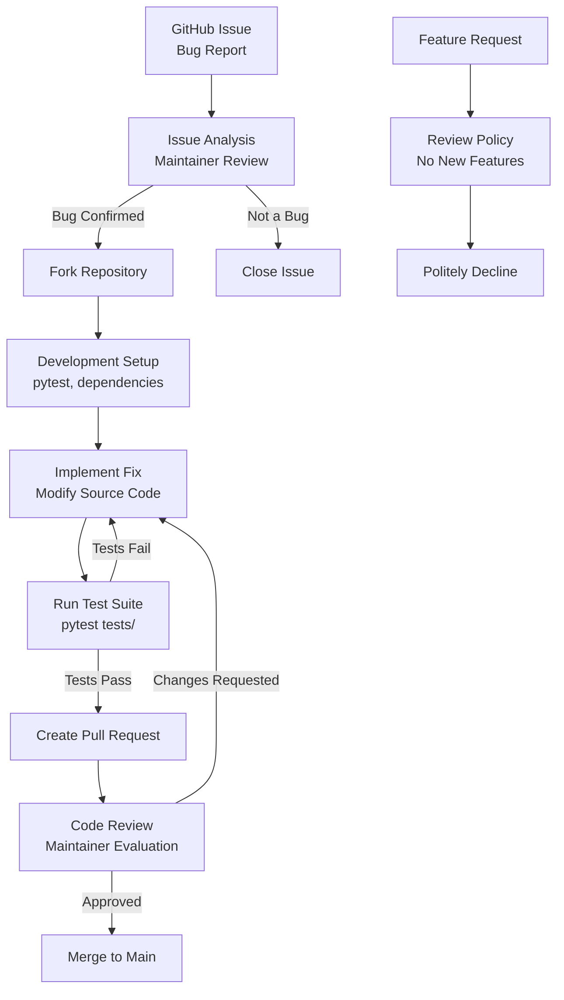
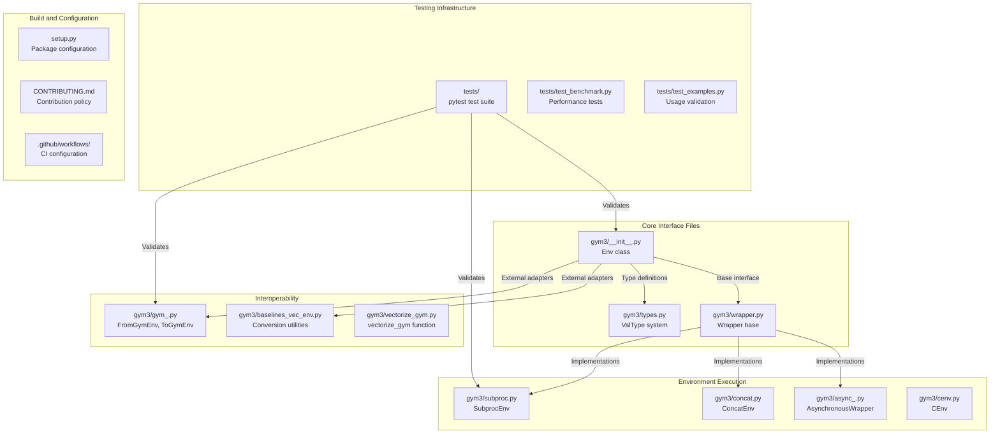

<!-- source: DeepWiki mcp.deepwiki.com · repo openai/gym3 · page 8.2 Contributing · fetched 2026-10-26 -->

# Contributing

<details>
<summary>Relevant source files</summary>

The following files were used as context for generating this wiki page:

- [CONTRIBUTING.md](CONTRIBUTING.md)

</details>


This document provides guidelines for contributing to the gym3 project, including how to report issues, understand the project structure, and make code contributions. This covers the development workflow and contribution policies specific to gym3.

For information about testing and continuous integration, see [Testing and CI](#8.1). For release management details, see [Release History](#8.3).

## Current Contribution Policy

The gym3 project has a focused scope and specific contribution guidelines. Currently, the project maintainers are **not actively seeking new features or wrappers** to be added to the core `gym3` library. The primary focus is on maintaining stability and compatibility of the existing codebase.

**Bug Reports and Platform Issues**: All bug reports and issues related to installation or running gym3 on supported platforms should be submitted through the GitHub issue tracker. This includes compatibility problems, documentation errors, and unexpected behavior.

Sources: [CONTRIBUTING.md:1-3]()

## Contribution Workflow

The following diagram illustrates the standard contribution process for gym3:

**Contribution Process Flow**


Sources: [CONTRIBUTING.md:1-3]()

## Understanding the Codebase Structure

Contributors need to understand the key components of gym3 to make effective contributions. The following diagram shows the main code entities and their relationships:

**Key Code Entities for Contributors**


Sources: [CONTRIBUTING.md:1-3]()

## Development Environment Setup

### Dependencies and Installation

Contributors should set up a development environment that includes all testing dependencies. The core requirements are defined in the package configuration, with additional development dependencies for testing and benchmarking.

| Component | Purpose | Key Files |
|-----------|---------|-----------|
| `pytest` | Primary testing framework | `tests/` directory |
| `pytest-benchmark` | Performance testing | `tests/test_benchmark.py` |
| Core dependencies | Runtime requirements | `setup.py` |
| Optional dependencies | Platform-specific features | `setup.py` extras |

### Testing Guidelines

All contributions should maintain or improve the existing test coverage. The test suite is organized into several categories:

- **Unit tests**: Test individual components like `Env`, `Wrapper`, and type system
- **Integration tests**: Test interoperability with external frameworks
- **Performance tests**: Validate that changes don't degrade performance
- **Example validation**: Ensure usage examples continue to work

Contributors should run the full test suite before submitting changes:

```bash
pytest tests/
```

Sources: [CONTRIBUTING.md:1-3]()

## Types of Acceptable Contributions

### Bug Fixes

Bug fixes are the primary type of contribution currently accepted. These include:

- **Compatibility issues**: Problems with specific Python versions or platforms
- **Interface violations**: Cases where implementations don't follow the `gym3.Env` contract
- **Performance regressions**: Unexpected slowdowns in core operations
- **Documentation errors**: Inaccuracies or unclear explanations

### Documentation Improvements

Documentation contributions are welcome, particularly:

- **API documentation**: Clarifying method signatures and behavior
- **Usage examples**: Demonstrating correct usage patterns
- **Migration guides**: Helping users transition from other frameworks
- **Error message improvements**: Making error conditions clearer

### Testing Enhancements

Improvements to the test suite are valuable contributions:

- **Coverage gaps**: Adding tests for untested code paths
- **Platform testing**: Validating behavior on different operating systems
- **Edge case testing**: Testing boundary conditions and error cases
- **Performance benchmarks**: Adding or improving performance tests

Sources: [CONTRIBUTING.md:1-3]()

## Submission Process

### Issue Reporting

When reporting bugs, include the following information:

1. **Environment details**: Python version, operating system, gym3 version
2. **Reproduction steps**: Minimal code example that demonstrates the issue
3. **Expected behavior**: What should happen
4. **Actual behavior**: What actually happens
5. **Error messages**: Full stack traces and error output

### Code Submissions

For bug fix submissions:

1. **Create an issue first**: Discuss the bug and proposed fix approach
2. **Fork the repository**: Work in your own copy of the codebase
3. **Create focused commits**: Each commit should address a single logical change
4. **Add or update tests**: Ensure the fix is covered by tests
5. **Update documentation**: If the fix affects public APIs or behavior
6. **Submit a pull request**: Reference the original issue in the PR description

### Review Process

All code contributions go through a review process:

- **Automated checks**: CI runs tests and checks code quality
- **Manual review**: Maintainers evaluate the change for correctness and style
- **Testing verification**: Changes are tested across supported platforms
- **Documentation review**: Ensure any documentation changes are accurate

Sources: [CONTRIBUTING.md:1-3]()

## Code Style and Standards

### Python Conventions

The gym3 codebase follows standard Python conventions:

- **PEP 8 compliance**: Standard Python style guidelines
- **Type hints**: Use type annotations where appropriate, especially in public APIs
- **Docstrings**: Document public methods and classes
- **Import organization**: Group imports logically

### Architecture Principles

When making changes, consider gym3's core architectural principles:

- **Vectorization first**: The interface assumes vectorized operations
- **Minimal dependencies**: Keep the core lightweight
- **Interoperability**: Maintain compatibility with existing RL frameworks
- **Performance**: Consider the impact on training loop performance

Sources: [CONTRIBUTING.md:1-3]()

## Getting Help

### Communication Channels

For questions about contributing:

- **GitHub Issues**: For bug reports and feature discussions
- **Pull Request discussions**: For code review conversations
- **Documentation**: Refer to other wiki sections for technical details

### Common Contribution Areas

The following table shows common areas where contributions are most helpful:

| Area | Code Location | Typical Issues |
|------|---------------|----------------|
| Platform compatibility | `gym3/subproc.py`, `gym3/async_.py` | Process/threading issues |
| Framework interop | `gym3/gym_.py`, `gym3/baselines_vec_env.py` | API changes in external libraries |
| Type system | `gym3/types.py` | Edge cases in space definitions |
| C integration | `gym3/cenv.py`, `libenv/` | Memory management, API bindings |
| Rendering | `gym3/viewer.py`, `gym3/interactive.py` | Graphics driver compatibility |

Sources: [CONTRIBUTING.md:1-3]()

---

