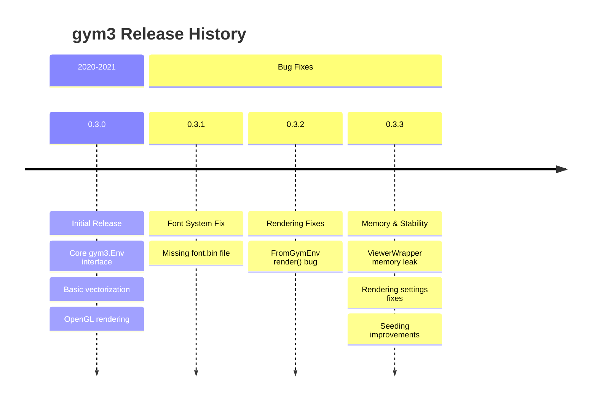
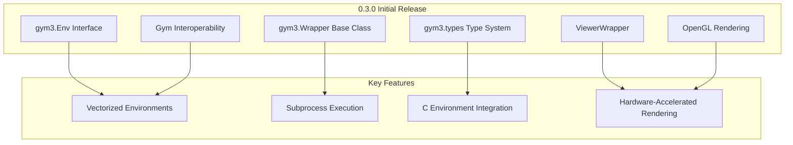

<!-- source: DeepWiki mcp.deepwiki.com · repo openai/gym3 · page 8.3 Release History · fetched 2026-10-26 -->

# Release History

Relevant source files

The following files were used as context for generating this wiki page:

- [CHANGES.md](CHANGES.md)

## Purpose and Scope

This document tracks the version history and notable changes in gym3 releases, documenting bug fixes, new features, and improvements across all published versions. For information about contributing to future releases, see [Contributing](#8.2). For installation instructions including version requirements, see [Installation and Dependencies](#2.1).

## Release Timeline

The following diagram shows the progression of gym3 releases and their major focus areas:

**Release Timeline and Focus Areas**

Sources: [CHANGES.md:1-20]()

## Version Details

### 0.3.3 (Current Release)

The most recent release focused on stability improvements and bug fixes:

| Component | Change | Impact |
|-----------|--------|---------|
| `ViewerWrapper` | Fixed memory leak | Improved long-running stability |
| Rendering system | Fixed rendering settings | Better visual output |
| `vectorize_gym` | Added seed argument | Deterministic environment initialization |
| `FromGymEnv` | Added seed argument | Consistent seeding before reset |

**Key Contributors**: @jyotishp (reporting/debugging), @mtrazzi (rendering fixes)

Sources: [CHANGES.md:3-8]()

### 0.3.2

This release addressed a critical rendering bug:

- **Bug Fix**: Fixed `render()` function in `FromGymEnv` wrapper
- **Impact**: Resolved visualization issues when using OpenAI Gym environments through gym3

Sources: [CHANGES.md:9-12]()

### 0.3.1

A maintenance release that addressed missing assets:

- **Asset Fix**: Added missing font file (`font.bin`)
- **Impact**: Resolved text rendering failures in the OpenGL visualization system

Sources: [CHANGES.md:13-16]()

### 0.3.0 (Initial Release)

The foundational release that established gym3's core architecture:

**Core Components Introduced**

Sources: [CHANGES.md:17-20]()

## Version Migration Notes

The following table summarizes compatibility considerations across releases:

| From Version | To Version | Breaking Changes | Migration Required |
|--------------|------------|------------------|-------------------|
| 0.3.0 → 0.3.1 | None | No | None |
| 0.3.1 → 0.3.2 | None | No | None |
| 0.3.2 → 0.3.3 | None | No | Optional seed parameter usage |

**Note**: All releases in the 0.3.x series maintain backward compatibility. The addition of seed parameters in 0.3.3 is optional and does not break existing code.

Sources: [CHANGES.md:1-20]()

---

