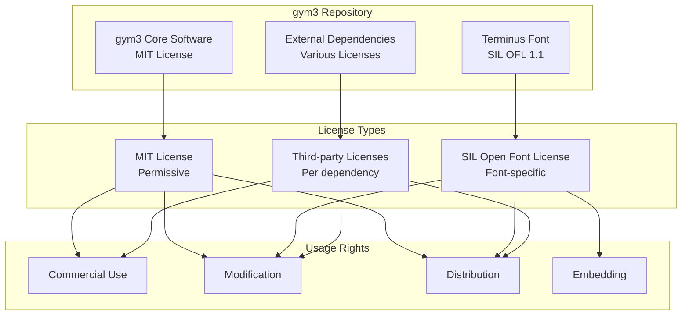
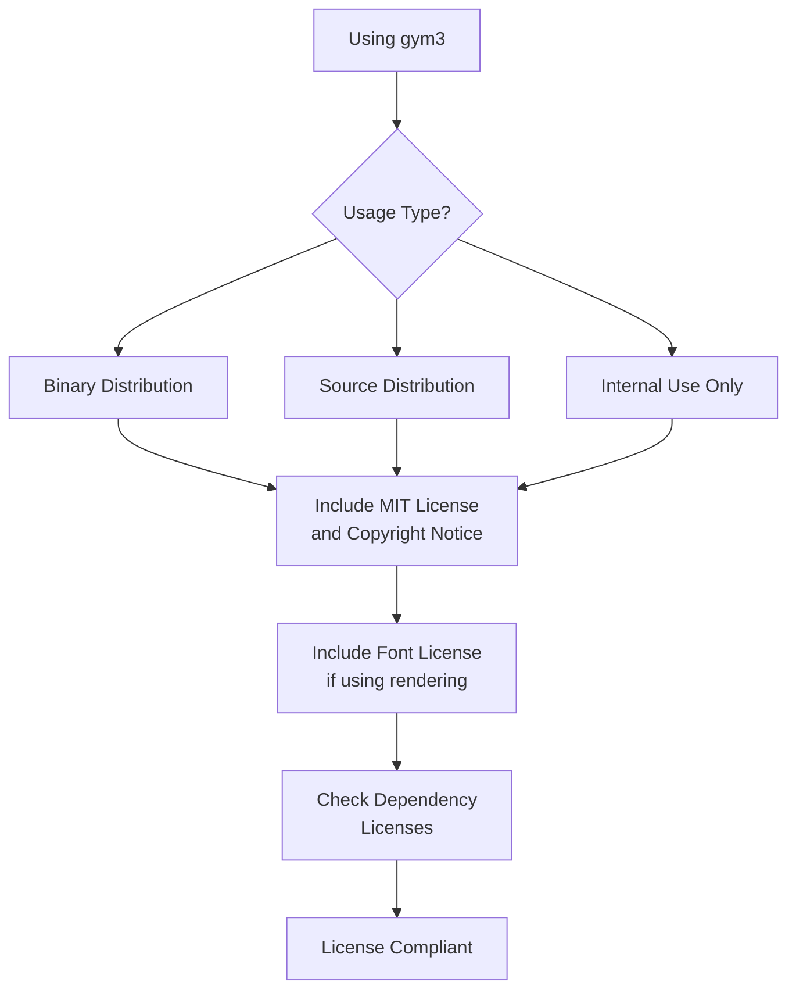
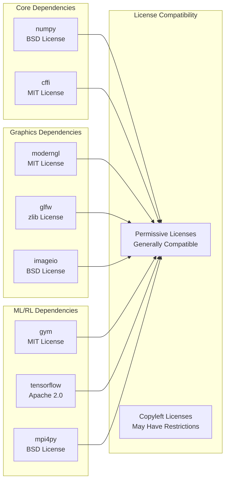

<!-- source: DeepWiki mcp.deepwiki.com · repo openai/gym3 · page 8.4 Licensing · fetched 2026-10-26 -->

# Licensing

<details>
<summary>Relevant source files</summary>

The following files were used as context for generating this wiki page:

- [.gitignore](.gitignore)
- [LICENSE](LICENSE)
- [LICENSES.md](LICENSES.md)

</details>


This document provides comprehensive information about the licensing terms and conditions for gym3 and its components. It covers the primary software license, licenses for bundled components, and guidance for users and contributors regarding license compliance.

For information about contributing to gym3, see [Contributing](#8.2). For details about the project's development infrastructure, see [Testing and CI](#8.1).

## Primary Software License

gym3 is released under the MIT License, which is a permissive open-source license that allows for commercial and non-commercial use with minimal restrictions.

### MIT License Terms

The main gym3 software is licensed under the MIT License with the following key characteristics:

| Permission | Granted |
|------------|---------|
| Commercial use | ✓ |
| Modification | ✓ |
| Distribution | ✓ |
| Private use | ✓ |
| Patent use | ✗ |

The complete license text is specified in [LICENSE:1-21]() and includes:

- **Copyright**: OpenAI (2020)
- **Attribution requirement**: Copyright notice and license must be included in all copies
- **Warranty disclaimer**: Software provided "as is" without warranties
- **Liability limitation**: No liability for damages arising from use

Sources: [LICENSE:1-21]()

## Component Licensing Structure

gym3 includes components under different licenses. The following diagram shows the licensing structure:

### Licensing Component Overview



Sources: [LICENSE:1-21](), [LICENSES.md:1-97]()

### Bundled Font License

The Terminus Font included with gym3 is licensed under the SIL Open Font License (OFL) Version 1.1:

- **Font name**: Terminus Font
- **Copyright holder**: Dimitar Toshkov Zhekov (2019)
- **Reserved font name**: "Terminus Font"
- **License compatibility**: Compatible with software distribution

Key OFL requirements from [LICENSES.md:50-96]():

1. **Distribution**: Font can be bundled and distributed with software
2. **Modification**: Modified versions allowed but cannot use reserved name
3. **Attribution**: Copyright notice and license must be included
4. **No standalone sales**: Font cannot be sold by itself
5. **License preservation**: Font must remain under OFL license

Sources: [LICENSES.md:1-97]()

## License Compliance Guidelines

### For Users

When using gym3 in your projects:



**Required actions**:
- Include MIT license text ([LICENSE:1-21]())
- Include copyright notice for OpenAI
- If using rendering features, include SIL OFL license ([LICENSES.md:1-97]())
- Review licenses of any additional dependencies

Sources: [LICENSE:1-21](), [LICENSES.md:1-97]()

### For Contributors

Contributors must ensure their contributions are compatible with gym3's MIT license:

| Contribution Type | License Requirements |
|-------------------|---------------------|
| Code contributions | Must be compatible with MIT |
| Documentation | Subject to MIT license |
| Test cases | Subject to MIT license |
| External dependencies | Must review and approve licenses |

Sources: [LICENSE:1-21]()

## Dependency Licensing Considerations

gym3 depends on various external libraries, each with their own licenses. Users should review the licenses of dependencies they use:

### Common Dependency Categories



**Recommendation**: Always review the specific license terms of dependencies used in your project, especially for commercial applications.

Sources: [LICENSE:1-21]()

## License Attribution Template

When distributing software that includes gym3, use this attribution template:

```
This software includes gym3 (https://github.com/openai/gym3)
Copyright (c) 2020 OpenAI
Licensed under the MIT License

[Include full MIT license text from LICENSE file]

This software includes Terminus Font
Copyright (c) 2019 Dimitar Toshkov Zhekov
Licensed under the SIL Open Font License, Version 1.1

[Include full SIL OFL text if using rendering features]
```

Sources: [LICENSE:1-21](), [LICENSES.md:1-97]()