# Page: Overview

# Overview

<details>
<summary>Relevant source files</summary>

The following files were used as context for generating this wiki page:

- [README.md](README.md)
- [setup.py](setup.py)

</details>


This document provides a comprehensive introduction to gym3, its architecture, and key capabilities. It covers the purpose of gym3 as a vectorized reinforcement learning environment interface and explains how its components work together to provide enhanced performance and functionality over traditional RL frameworks.

For detailed installation instructions and first steps, see [Getting Started](#2). For in-depth technical details about specific components, see [Core Architecture](#3), [Environment Execution](#4), and [Visualization and Interaction](#5).

## What is gym3?

gym3 is a vectorized reinforcement learning environment interface that improves upon OpenAI Gym's design with built-in vectorization for enhanced performance. Unlike traditional RL interfaces that handle single environments, gym3's `Env` class is designed to manage multiple environment instances simultaneously, with automatic episode resets and batch operations.

The core value proposition centers on three key improvements:
- **Vectorization**: Native support for running multiple environments in parallel
- **Performance**: Optimized execution patterns including subprocess isolation and asynchronous operations  
- **Interoperability**: Seamless integration with existing RL frameworks like OpenAI Gym and Baselines

gym3 serves as both an interface specification and a toolkit, providing the foundational components without including actual game environments (beyond simple test cases).

**Sources:** [README.md:1-95](), [setup.py:32]()

## Core Architecture

The gym3 architecture is built around a small set of fundamental interfaces that enable flexible composition and extension:

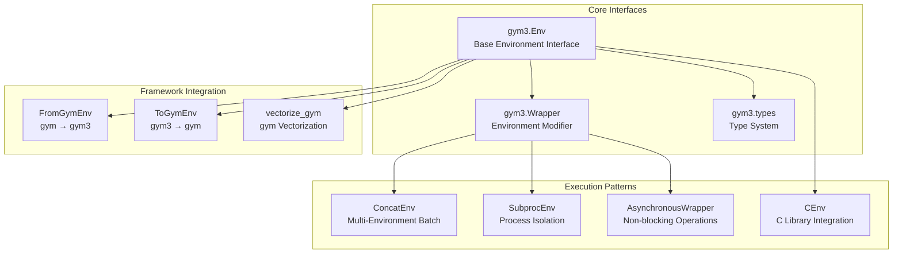
**Core Interface Architecture**

The `gym3.Env` base class defines the fundamental contract for all environments, with methods like `act()`, `observe()`, and properties like `ac_space` and `ob_space`. The `gym3.Wrapper` class enables behavior modification through composition, while `gym3.types` provides the type system for defining observation and action spaces.

**Sources:** [README.md:25-26](), [README.md:30-39]()

## Key Capabilities

gym3 provides several major capability areas that distinguish it from traditional RL interfaces:

| Capability | Purpose | Key Components |
|------------|---------|----------------|
| **Vectorized Execution** | Run multiple environments simultaneously | `ConcatEnv`, batch operations |
| **Process Isolation** | Environment stability and fault tolerance | `SubprocEnv`, subprocess management |
| **Asynchronous Operations** | Non-blocking environment interactions | `AsynchronousWrapper`, thread pools |
| **Visualization** | Real-time environment observation | `ViewerWrapper`, OpenGL rendering |
| **Cross-Language Integration** | High-performance C/C++ environments | `CEnv`, `libenv.h` API |
| **Framework Compatibility** | Interoperability with existing code | `FromGymEnv`, `ToGymEnv`, `vectorize_gym` |

### Vectorization Example

The vectorized interface allows batch operations across multiple environment instances:

```python
# Traditional gym approach (conceptual)
envs = [gym.make("CartPole-v0") for _ in range(4)]
actions = [env.action_space.sample() for env in envs]

# gym3 vectorized approach  
env = gym3.vectorize_gym(num=4, env_kwargs={"id": "CartPole-v0"})
env.act(gym3.types_np.sample(env.ac_space, bshape=(env.num,)))
```

**Sources:** [README.md:67-75](), [setup.py:12-19]()

## System Components

gym3's modular design enables flexible composition of functionality through well-defined component interfaces:

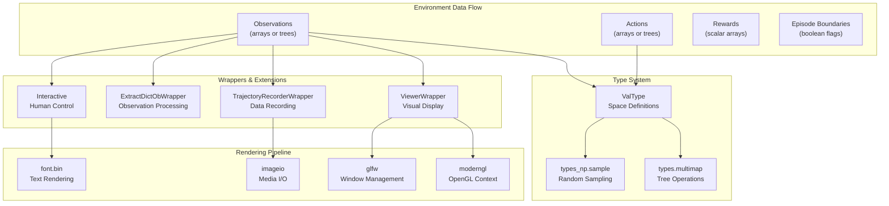
**System Component Relationships**

The type system handles complex data structures through the `ValType` hierarchy, supporting both simple arrays and nested dictionaries ("trees"). The `gym3.types.multimap` function enables operations across these tree structures, while `gym3.types_np.sample` generates random samples from space definitions.

**Sources:** [README.md:62-63](), [setup.py:20](), [setup.py:12-19]()

## Integration Ecosystem

gym3 serves as a bridge between different RL frameworks and execution environments, enabling gradual migration and compatibility:

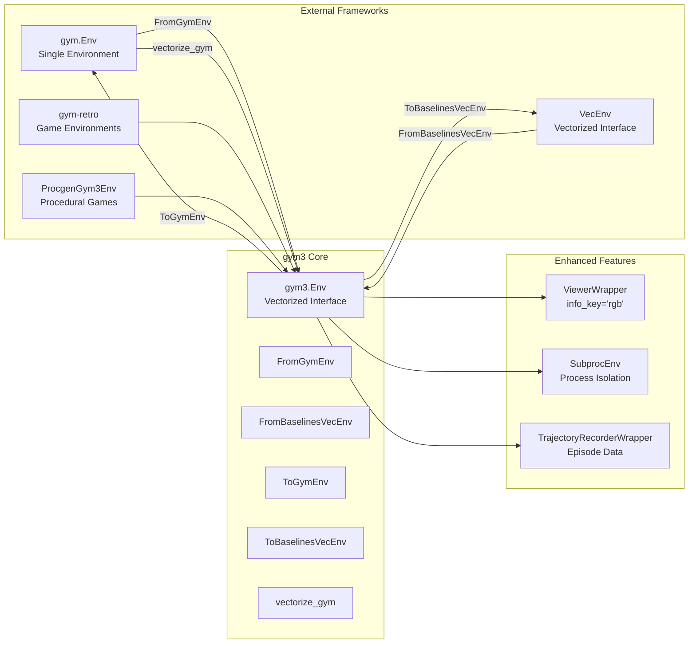
**Framework Integration and Migration Paths**

This integration layer allows existing gym and baselines code to leverage gym3's enhanced capabilities while maintaining compatibility. The conversion adapters handle differences in interface design, such as gym's single-environment model versus gym3's vectorized approach.

**Sources:** [README.md:64-75](), [README.md:41-54](), [README.md:27-39]()

## Development and Maintenance Status

gym3 is in maintenance mode, focusing on bug fixes and minor updates rather than major feature development. The project is primarily designed for use with OpenAI environments, though external users can leverage its capabilities for improved RL performance and visualization.

The codebase supports cross-platform deployment (Windows, macOS, Linux) and requires Python 3.6 or later. Core dependencies include `numpy` for numerical operations, `cffi` for C integration, and graphics libraries (`moderngl`, `glfw`) for visualization capabilities.

**Sources:** [README.md:1](), [README.md:7-8](), [README.md:9-17](), [setup.py:21](), [setup.py:12-19]()

---

# Page: Getting Started

# Getting Started

<details>
<summary>Relevant source files</summary>

The following files were used as context for generating this wiki page:

- [README.md](README.md)
- [environment.yml](environment.yml)
- [setup.py](setup.py)

</details>


This document provides a complete introduction to gym3, covering installation, basic concepts, and your first steps with the library. It is designed to get you up and running quickly with gym3's vectorized reinforcement learning environment interface.

For detailed installation instructions and dependency management, see [Installation and Dependencies](#2.1). For more comprehensive usage examples and patterns, see [Basic Usage Examples](#2.2). For understanding gym3's core architecture and design principles, see [Core Architecture](#3).

## What is gym3?

gym3 is a vectorized reinforcement learning environment interface that improves upon the OpenAI Gym interface. Unlike traditional `gym.Env` which handles single environments, `gym3.Env` natively supports running multiple environment instances simultaneously, providing significant performance benefits for RL training.

Key features include:
- **Vectorized execution**: Run multiple environments in parallel
- **Automatic episode management**: Environments reset automatically when episodes complete  
- **Rich type system**: Support for both array and nested dictionary observations/actions
- **Interoperability**: Seamless conversion to/from OpenAI Gym and Baselines VecEnv
- **Visualization**: Built-in rendering and human interaction capabilities

Sources: [README.md:5-6](), [setup.py:32]()

## Quick Installation

gym3 requires Python 3.6 or higher and can be installed via pip:

```bash
pip install gym3
```

This installs gym3 with its core dependencies including `numpy`, `cffi`, `moderngl`, `glfw`, and imaging libraries. For development or testing, additional dependencies like `pytest`, `gym-retro`, and `tensorflow` may be needed.

**System Requirements:**
- **Platforms**: Windows, macOS, Linux
- **Python**: >= 3.6.0
- **OpenGL**: Required for visualization features

Sources: [setup.py:12-19](), [setup.py:21](), [README.md:15-21]()

## Core gym3 Interface

The following diagram shows the essential components you'll interact with when getting started with gym3:

**gym3 Core Interface Components**
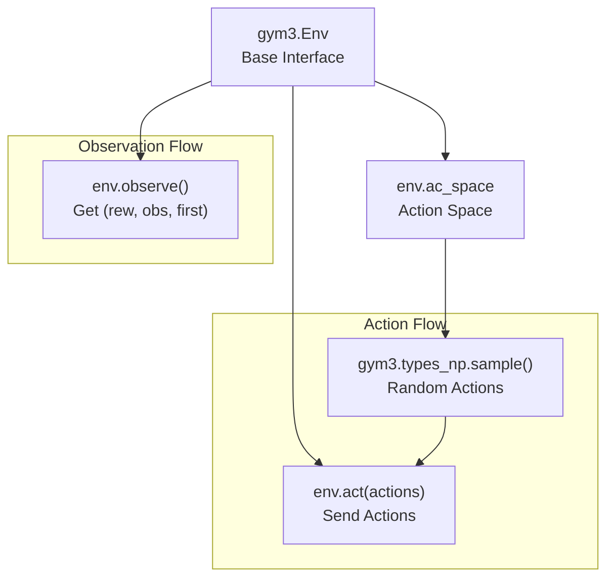

Sources: [README.md:29-39](), [README.md:62]()

## Your First gym3 Environment

Here's the minimal code to create and interact with a gym3 environment using the vectorized gym wrapper:

```python
import gym3

# Create a vectorized environment with 2 CartPole instances
env = gym3.vectorize_gym(num=2, env_kwargs={"id": "CartPole-v0"})

# Basic interaction loop
step = 0
while step < 10:  # Run for 10 steps
    # Sample random actions for both environments
    actions = gym3.types_np.sample(env.ac_space, bshape=(env.num,))
    
    # Send actions to environments
    env.act(actions)
    
    # Get observations, rewards, and episode flags
    rew, obs, first = env.observe()
    
    print(f"step {step} reward {rew} first {first}")
    step += 1
```

This example demonstrates the core gym3 pattern:
1. **`env.act(actions)`**: Send vectorized actions to all environments
2. **`env.observe()`**: Retrieve rewards, observations, and episode completion flags
3. **`gym3.types_np.sample()`**: Generate random actions matching the action space shape

Sources: [README.md:67-75]()

## Environment Interface Flow

**gym3 Environment Interaction Cycle**
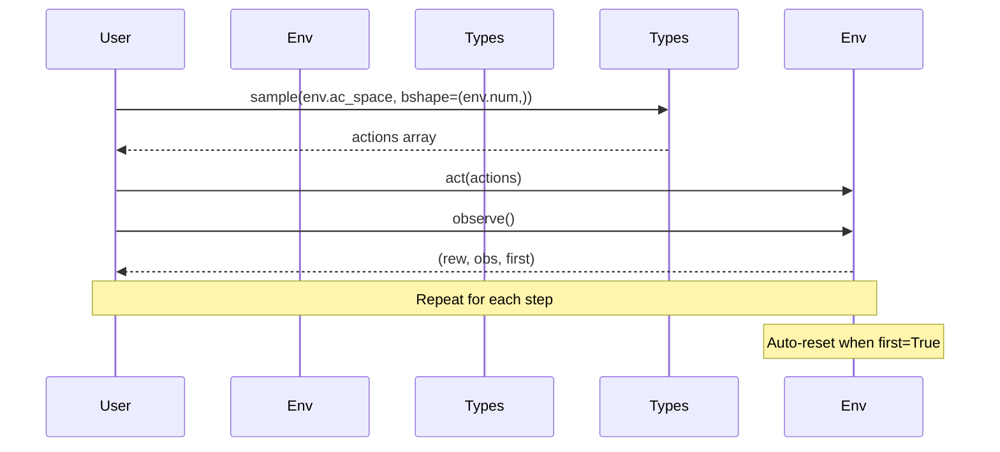

Sources: [README.md:35-36]()

## Adding Visualization

To see what your environments are doing, wrap them with `ViewerWrapper`:

```python
import gym3

# Create environment with rgb rendering
env = gym3.vectorize_gym(num=2, render_mode="rgb_array", 
                        env_kwargs={"id": "CartPole-v0"})

# Add visualization
env = gym3.ViewerWrapper(env, info_key="rgb")

# Same interaction loop as before - now with visual display
step = 0
while True:
    env.act(gym3.types_np.sample(env.ac_space, bshape=(env.num,)))
    rew, obs, first = env.observe()
    print(f"step {step} reward {rew} first {first}")
    step += 1
```

The `ViewerWrapper` extracts RGB arrays from the environment's info dictionary and displays them in a window using gym3's OpenGL-based rendering system.

Sources: [README.md:43-54]()

## Command Line Interface

gym3 includes a command-line script for quick experimentation:

```bash
python -m gym3.scripts.random_agent --fn_path procgen:ProcgenGym3Env --env_name coinrun --render_mode rgb_array
```

This runs a random agent on the specified environment with visualization enabled.

Sources: [README.md:56-60]()

## Next Steps

Once you've successfully run your first gym3 environment, explore these areas:

- **[Installation and Dependencies](#2.1)**: Detailed setup including optional dependencies and development environment
- **[Basic Usage Examples](#2.2)**: More comprehensive examples including different environment types and wrappers  
- **[Environment Interface](#3.1)**: Deep dive into the `gym3.Env` class and its methods
- **[Interoperability](#7)**: Converting between gym3, OpenAI Gym, and Baselines VecEnv formats
- **[Visualization and Interaction](#5)**: Advanced rendering features and human-in-the-loop interaction

The vectorized nature of gym3 makes it particularly powerful for RL research and training at scale, where running multiple environment instances simultaneously provides significant performance advantages over sequential execution.

Sources: [README.md:77-82]()

---

# Page: Installation and Dependencies

# Installation and Dependencies

<details>
<summary>Relevant source files</summary>

The following files were used as context for generating this wiki page:

- [environment.yml](environment.yml)
- [setup.py](setup.py)

</details>


This page covers installing gym3 and understanding its dependency requirements. For basic usage examples after installation, see [Basic Usage Examples](#2.2). For framework interoperability setup, see [Framework Conversion](#7.1).

## Installation Methods

### Package Installation

Install gym3 from PyPI using pip:

```bash
pip install gym3
```

The package requires Python 3.6 or higher as specified in [setup.py:21]().

### Development Installation

For development or to install from source:

```bash
git clone https://github.com/openai/gym3
cd gym3
pip install -e .
```

To install with test dependencies:

```bash
pip install -e .[test]
```

**Sources:** [setup.py:8-39]()

## Core Dependencies

gym3 has six core dependencies that enable its main functionality areas:

| Dependency | Version Range | Purpose |
|------------|---------------|---------|
| `numpy` | >=1.11.0,<2.0.0 | Numerical computing and array operations |
| `cffi` | >=1.13.0,<2.0.0 | C Foreign Function Interface for libenv integration |
| `imageio` | >=2.6.0,<3.0.0 | Image and video I/O operations |
| `imageio-ffmpeg` | >=0.3.0,<0.4.0 | FFmpeg backend for video processing |
| `glfw` | >=1.8.6,<2.0.0 | OpenGL window and context management |
| `moderngl` | >=5.5.4,<6.0.0 | Modern OpenGL rendering interface |

### Dependency Architecture

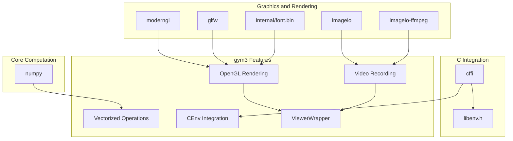

**Sources:** [setup.py:12-19](), [setup.py:20]()

### Core Dependency Functions

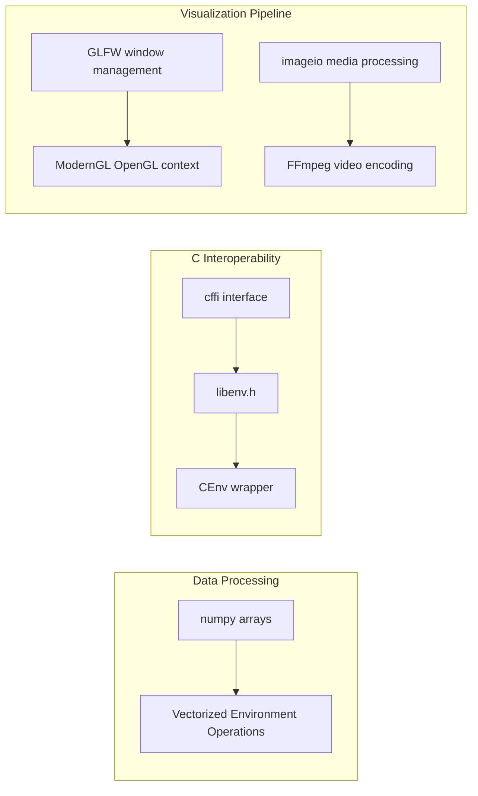

**Sources:** [setup.py:13-18]()

## Optional Dependencies

### Test Dependencies

The `test` extras group includes dependencies for running the test suite and benchmarks:

| Package | Version | Purpose |
|---------|---------|---------|
| `pytest` | 5.2.1 | Testing framework |
| `pytest-benchmark` | 3.2.2 | Performance benchmarking |
| `gym-retro` | 0.8.0 | Retro game environment testing |
| `gym` | 0.17.2 | OpenAI Gym interoperability testing |
| `tensorflow` | 1.15.0 | ML framework integration testing |
| `mpi4py` | 3.0.3 | MPI parallel processing testing |

### Development Environment

The conda environment configuration in [environment.yml:1-19]() pins specific versions for reproducible development:

```yaml
dependencies:
  - pip:
    - numpy==1.17.0
    - cffi==1.13.0
    - imageio==2.6.0
    - imageio-ffmpeg==0.3.0
    - glfw==1.8.6
    - moderngl==5.5.4
```

**Sources:** [setup.py:22-31](), [environment.yml:6-19]()

## System Requirements

### Platform Support

gym3 supports systems where the core dependencies are available:
- **Linux**: Full support with hardware-accelerated OpenGL
- **macOS**: Full support with system OpenGL
- **Windows**: Supported with appropriate OpenGL drivers

### Hardware Requirements

- **Graphics**: OpenGL 3.3+ compatible GPU for rendering features
- **Memory**: Sufficient RAM for vectorized environment operations
- **CPU**: Multi-core recommended for subprocess environments

### Package Data Files

gym3 includes essential data files:
- `libenv.h`: C header file for native environment integration
- `internal/font.bin`: Binary font data for text rendering

**Sources:** [setup.py:20]()

## Installation Verification

Verify installation by importing core modules:

```python
import gym3
import numpy as np

# Test basic functionality
env = gym3.Env()  # Base environment interface
print("gym3 version:", gym3.__version__)
```

For rendering verification:
```python
import moderngl
import glfw

# Test OpenGL context creation
if not glfw.init():
    print("GLFW initialization failed")
else:
    print("Graphics dependencies working")
```

For C integration verification:
```python
import cffi

# Test CFFI availability for CEnv
ffi = cffi.FFI()
print("C integration available")
```

**Sources:** [setup.py:8-39]()

---

# Page: Basic Usage Examples

# Basic Usage Examples

<details>
<summary>Relevant source files</summary>

The following files were used as context for generating this wiki page:

- [README.md](README.md)
- [docs/gym3-for-gym-users.md](docs/gym3-for-gym-users.md)

</details>


This page demonstrates fundamental patterns for creating and interacting with gym3 environments through practical examples. It covers the core environment lifecycle, action/observation handling, and basic wrapper usage. For advanced environment execution patterns, see [Environment Execution](#4). For visualization and rendering details, see [Visualization and Interaction](#5). For framework interoperability, see [Interoperability](#7).

## Environment Creation Patterns

### Direct Environment Construction

The simplest way to create a gym3 environment is through direct instantiation. Many gym3 environments accept configuration parameters during construction:

| Pattern | Description | Use Case |
|---------|-------------|----------|
| Direct instantiation | `env = SomeGym3Env(num=2, param=value)` | Custom gym3 environments |
| Function call | `gym3.call_func("module:ClassName")` | String-based environment creation |
| Gym conversion | `gym3.vectorize_gym(num=2, env_kwargs={"id": "CartPole-v0"})` | Using existing gym environments |

The following diagram shows the relationship between creation methods and core gym3 components:

**Environment Creation Architecture**
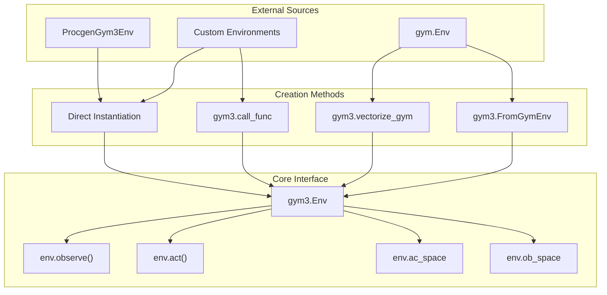

Sources: [README.md:29-39](), [docs/gym3-for-gym-users.md:10-14](), [docs/gym3-for-gym-users.md:20-24]()

### Vectorized Environment Creation

gym3 environments are inherently vectorized, meaning they can run multiple environment instances simultaneously. The `num` parameter controls how many parallel environments to create:

**Vectorization Patterns**
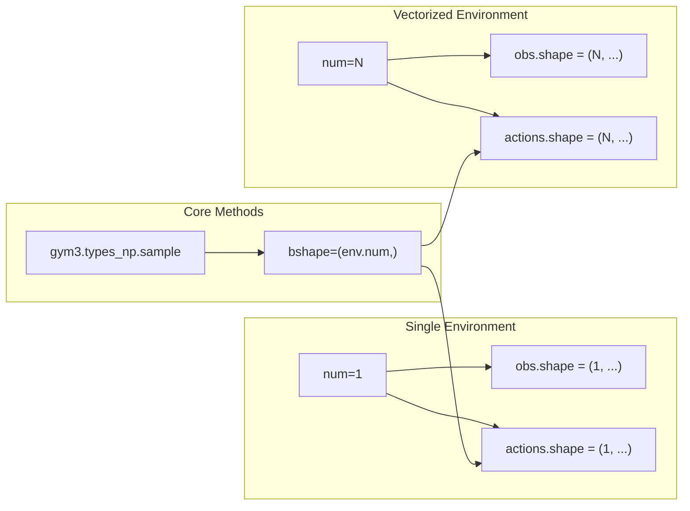

Sources: [README.md:32](), [README.md:35]()

## Basic Interaction Loop

### Core Environment Methods

All gym3 environments follow a consistent interaction pattern using two primary methods:

| Method | Purpose | Returns |
|--------|---------|---------|
| `env.act(actions)` | Submit actions for all environments | None |
| `env.observe()` | Get latest observations, rewards, episode status | `(rew, obs, first)` tuple |

**Interaction Flow**
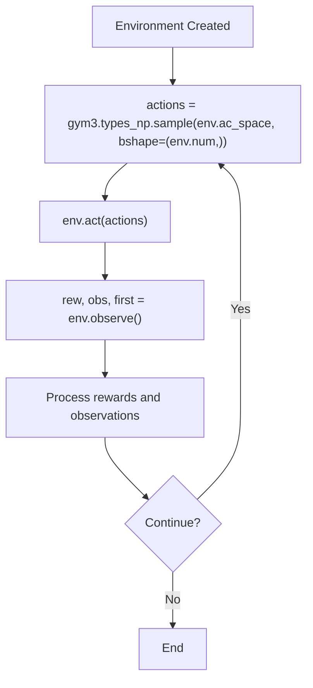

Sources: [README.md:34-38]()

### Action and Observation Handling

gym3 uses numpy arrays for all data exchange. Actions must be provided for all environments simultaneously:

- **Actions**: Shape `(env.num, *action_shape)` where `action_shape` depends on `env.ac_space`
- **Observations**: Shape `(env.num, *obs_shape)` where `obs_shape` depends on `env.ob_space`  
- **Rewards**: Shape `(env.num,)` - one scalar reward per environment
- **Episode status**: Shape `(env.num,)` - boolean array indicating episode starts

The `gym3.types_np.sample()` function generates random actions with the correct shape and data type for any action space.

Sources: [README.md:35](), [README.md:62]()

### Tree-Structured Data

gym3 supports "tree" observations and actions, which are nested dictionaries containing arrays:

**Data Structure Support**
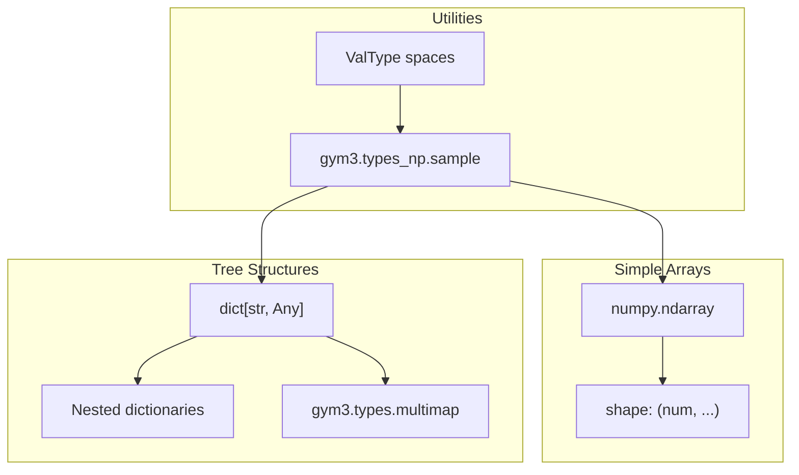

Sources: [README.md:62]()

## Visualization and Basic Wrappers

### ViewerWrapper Usage

The `ViewerWrapper` displays environment observations or rendered frames in a window. It typically looks for RGB arrays in the environment's info dictionary:

**Visualization Pipeline**
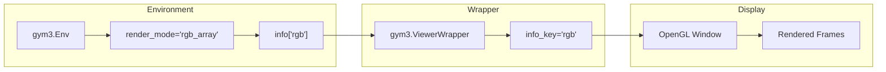

Sources: [README.md:46-47](), [docs/gym3-for-gym-users.md:32]()

### Common Wrapper Patterns

gym3's wrapper system allows modification of environment behavior without changing the underlying environment:

| Wrapper Type | Purpose | Example Usage |
|--------------|---------|---------------|
| `ViewerWrapper` | Visual display | Showing environment state |
| `TrajectoryRecorderWrapper` | Data recording | Saving episodes for analysis |
| `ExtractDictObWrapper` | Observation filtering | Extracting specific observation components |

Sources: [README.md:47]()

## Framework Integration Examples

### OpenAI Gym Compatibility

gym3 provides seamless integration with existing OpenAI Gym environments through vectorization:

**Gym Integration Architecture**
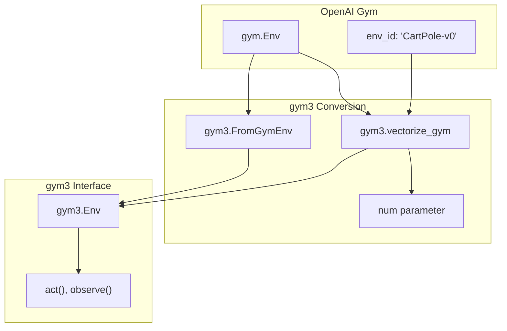

The `vectorize_gym` function creates multiple instances of a gym environment and wraps them in a single gym3 interface, while `FromGymEnv` converts a single gym environment instance.

Sources: [README.md:67-75](), [docs/gym3-for-gym-users.md:5-14]()

### Command Line Interface

gym3 includes utilities for running environments from the command line using string-based environment specification:

**CLI Environment Loading**
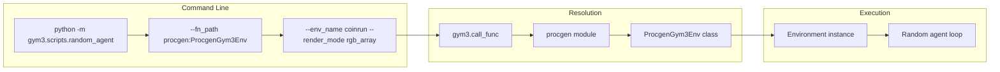

Sources: [README.md:58-60](), [docs/gym3-for-gym-users.md:20-24]()

---

# Page: Core Architecture

# Core Architecture

<details>
<summary>Relevant source files</summary>

The following files were used as context for generating this wiki page:

- [docs/design.md](docs/design.md)
- [gym3/env.py](gym3/env.py)
- [gym3/types.py](gym3/types.py)

</details>


This document explains the fundamental design principles, interfaces, and type system that form the foundation of gym3. It covers the core `gym3.Env` interface and the `gym3.types` module that defines how data is structured throughout the framework.

For detailed documentation of specific environment methods, see [Environment Interface](#3.1). For comprehensive coverage of the type system, see [Type System and Spaces](#3.2). For information on extending environments through composition, see [Wrappers and Extensions](#3.3).

## Fundamental Design Principles

gym3's architecture is built around several key design decisions that distinguish it from other RL frameworks:

**Vectorized-First Design**: Unlike traditional RL interfaces that treat single environments as the base case, gym3 treats vectorized environments (running multiple episodes simultaneously) as the primary abstraction. Single environments are simply the special case where `num=1`.

**No Reset Function**: Environments automatically reset themselves when episodes end. This eliminates undefined behavior that occurred in other frameworks when running environments after `done=True` without explicit resets.

**Structured Type System**: Instead of using space objects, gym3 uses a compositional type system (`ValType`) that can represent arbitrary nested structures of tensors and dictionaries.

**Return Value Reordering**: The `observe()` method returns `(reward, observation, first)` rather than the traditional `(observation, reward, done)` ordering to emphasize temporal relationships and reduce common indexing errors.

Sources: [docs/design.md:3-23]()

## Architecture Overview

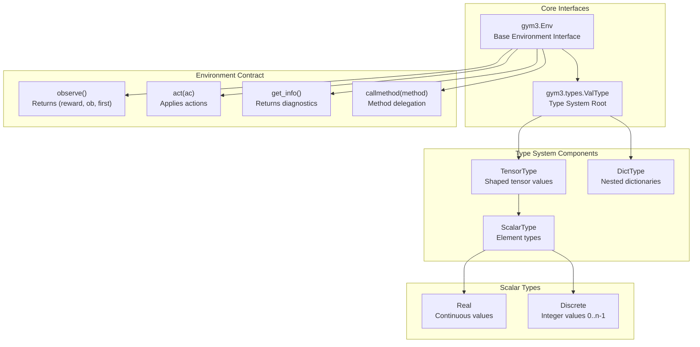

**Core Environment Interface Components**

| Component | Purpose | Key Properties |
|-----------|---------|----------------|
| `observe()` | Get current state | Idempotent, returns (reward, ob, first) |
| `act(ac)` | Apply actions | Advances environment state |
| `get_info()` | Get diagnostics | Returns list of dicts, one per environment |
| `callmethod()` | Delegate method calls | Enables wrapper method forwarding |

Sources: [gym3/env.py:6-82](), [gym3/types.py:79-162]()

## Environment Interface Overview

The `gym3.Env` class defines the core contract that all environments must implement. Every environment has three essential properties:

- `ob_space`: A `ValType` describing the structure of observations
- `ac_space`: A `ValType` describing the structure of actions  
- `num`: The number of parallel environments being run

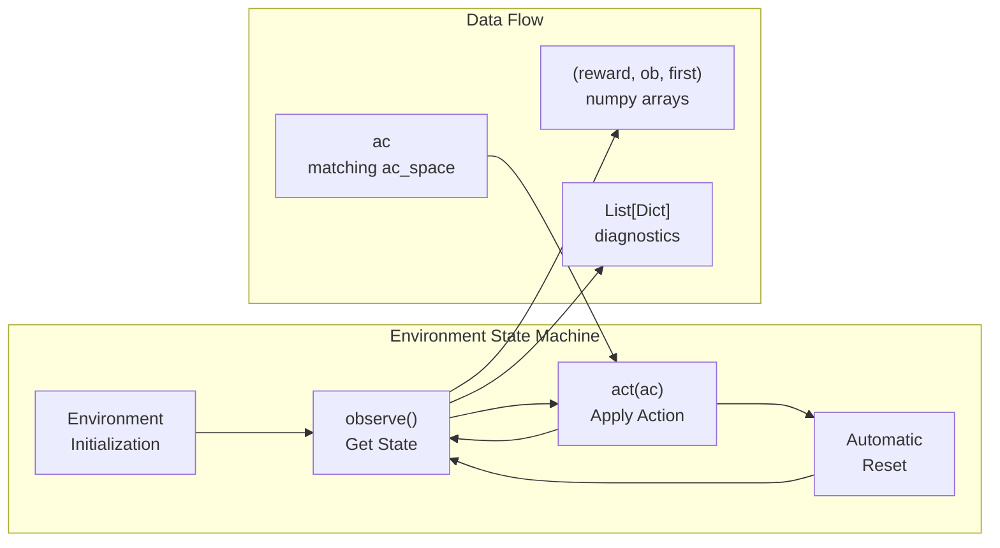

The `observe()` method is idempotent and can be called multiple times between `act()` calls. The `first` array indicates which environments have just started new episodes, enabling algorithms to handle episode boundaries without explicit reset calls.

Sources: [gym3/env.py:15-48](), [docs/design.md:3-7]()

## Type System Overview

gym3's type system provides a compositional way to describe the structure of observations and actions. The system is built around `ValType`, which can represent either tensors or nested dictionaries of tensors.

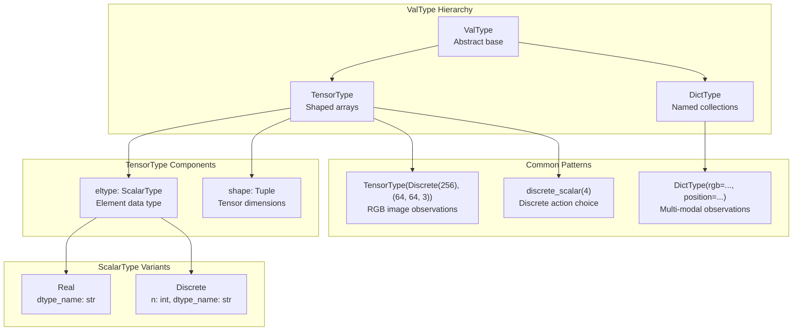

**Type System Key Features**:

| Feature | Description | Example |
|---------|-------------|---------|
| Composition | Types can be arbitrarily nested | `DictType(obs=TensorType(...), mask=TensorType(...))` |
| Scalar Types | `Real` for continuous, `Discrete(n)` for integers 0..n-1 | `Discrete(256)` for pixel values |
| Shape Specification | Explicit tensor shapes | `TensorType(Real(), (64, 64, 3))` |
| Type Checking | Validates data structure matches declared types | Runtime validation of observation/action shapes |

The `multimap()` function enables applying operations uniformly across nested type structures, supporting efficient data processing and validation.

Sources: [gym3/types.py:28-187](), [docs/design.md:12-17]()

## Core Components Interaction

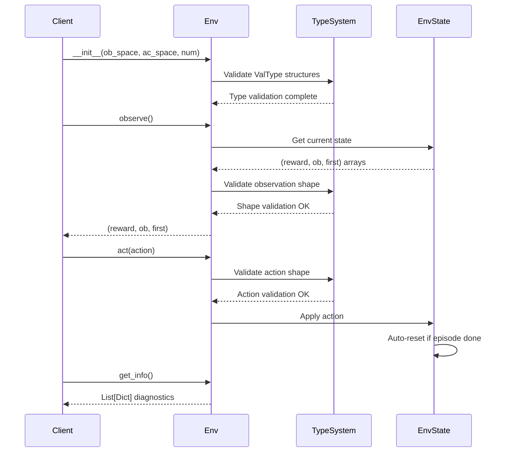

**Data Validation Flow**: The type system ensures that all data exchanged between clients and environments conforms to the declared `ob_space` and `ac_space` types. This validation happens at the boundaries between user code and environment implementations.

**Vectorization Handling**: All data structures automatically include a leading dimension of size `num` to handle vectorized environments. Single environments (`num=1`) are handled uniformly with multi-environment cases.

**Automatic Episode Management**: When environments detect episode completion, they automatically reset without requiring explicit client intervention. The `first` flag in observations indicates when new episodes have begun.

Sources: [gym3/env.py:20-66](), [gym3/types.py:163-187](), [docs/design.md:8-11]()

---

# Page: Environment Interface

# Environment Interface

<details>
<summary>Relevant source files</summary>

The following files were used as context for generating this wiki page:

- [docs/api.md](docs/api.md)
- [gym3/env.py](gym3/env.py)

</details>


This document covers the core `gym3.Env` interface, which defines the fundamental contract that all gym3 environments must implement. This interface provides a vectorized, synchronous API for reinforcement learning environments that supports multiple simultaneous episodes.

For information about specific environment implementations, see [Environment Execution](#4). For wrapper-based extensions to this interface, see [Wrappers and Extensions](#3.3). For the type system that defines observation and action spaces, see [Type System and Spaces](#3.2).

## Interface Overview

The `gym3.Env` class serves as the abstract base class for all environments in the gym3 framework. It establishes a standardized interface that enables consistent interaction patterns across different environment types and execution modes.

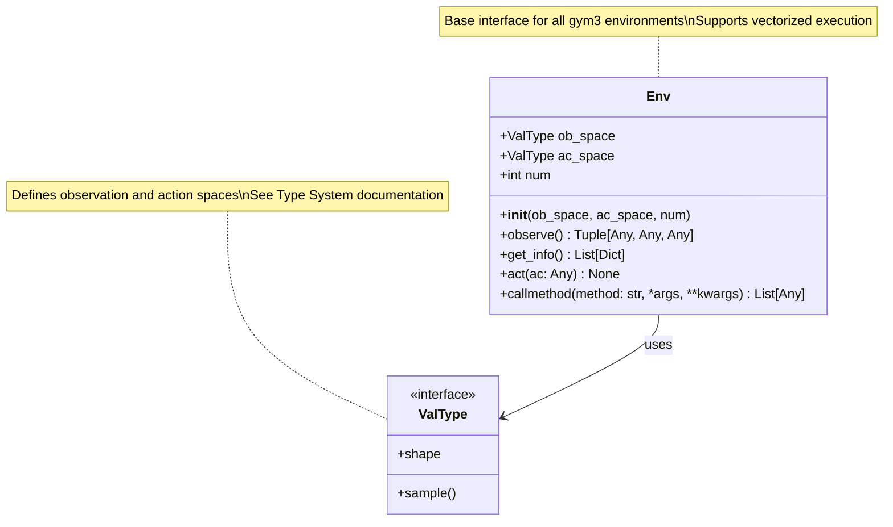

**Interface Structure and Responsibilities**

Sources: [gym3/env.py:6-82](), [docs/api.md:6-76]()

## Core Components

### Constructor Parameters

The `Env` constructor requires three essential parameters that define the environment's interface contract:

| Parameter | Type | Purpose |
|-----------|------|---------|
| `ob_space` | `ValType` | Defines the structure and constraints of observations |
| `ac_space` | `ValType` | Defines the structure and constraints of actions |
| `num` | `int` | Number of simultaneous episodes the environment manages |

The constructor implementation stores these parameters as instance attributes, establishing the environment's configuration for its entire lifecycle.

Sources: [gym3/env.py:15-18]()

### Primary Methods

#### observe() Method

The `observe()` method is the primary mechanism for retrieving environment state information. It returns a three-tuple containing reward, observation, and episode status data.

**Return Values:**
- `reward`: Float array shaped `(num,)` containing the reward from the last action
- `ob`: Observation data matching `ob_space` structure with `(num,)` prepended to each leaf shape
- `first`: Boolean array shaped `(num,)` indicating whether each episode has just started

**Key Properties:**
- Idempotent: Can be called multiple times without side effects
- State-consistent: Always returns data corresponding to the current environment state
- Initial state handling: The first call returns initial observations with ignored rewards

Sources: [gym3/env.py:20-48]()

#### act() Method

The `act()` method applies actions to advance the environment state. It accepts action data that must conform to the `ac_space` specification.

**Parameters:**
- `ac`: Action data matching `ac_space` structure with `(num,)` prepended to each leaf shape

**Behavior:**
- Synchronous execution: Method blocks until all environment steps complete
- Vectorized processing: Applies actions to all `num` environments simultaneously
- State modification: Updates internal environment state for subsequent `observe()` calls

Sources: [gym3/env.py:60-66]()

#### get_info() Method

The `get_info()` method provides access to auxiliary diagnostic information that is not part of the agent-observable state.

**Return Value:**
- List of dictionaries with length `self.num`, one per environment instance

**Common Use Cases:**
- Episode statistics and metrics
- Rendered images for visualization
- Debug information and performance metrics
- Custom environment-specific metadata

The default implementation returns empty dictionaries, allowing environments to override with specific diagnostic data.

Sources: [gym3/env.py:50-58]()

#### callmethod() Method

The `callmethod()` method provides a mechanism for invoking arbitrary methods on the underlying environment object, enabling extensibility beyond the core interface.

**Parameters:**
- `method`: String name of the method to invoke
- `*args`: Positional arguments, each must be a list of length `self.num`
- `**kwargs`: Keyword arguments, each must be a list of length `self.num`

**Return Value:**
- List of return values with length `self.num`

This method is particularly important for wrapper chains and subprocess environments where direct access to the underlying object may not be available.

Sources: [gym3/env.py:68-81]()

## Interaction Patterns

The gym3 environment interface follows a specific interaction pattern that differs from traditional single-environment APIs:

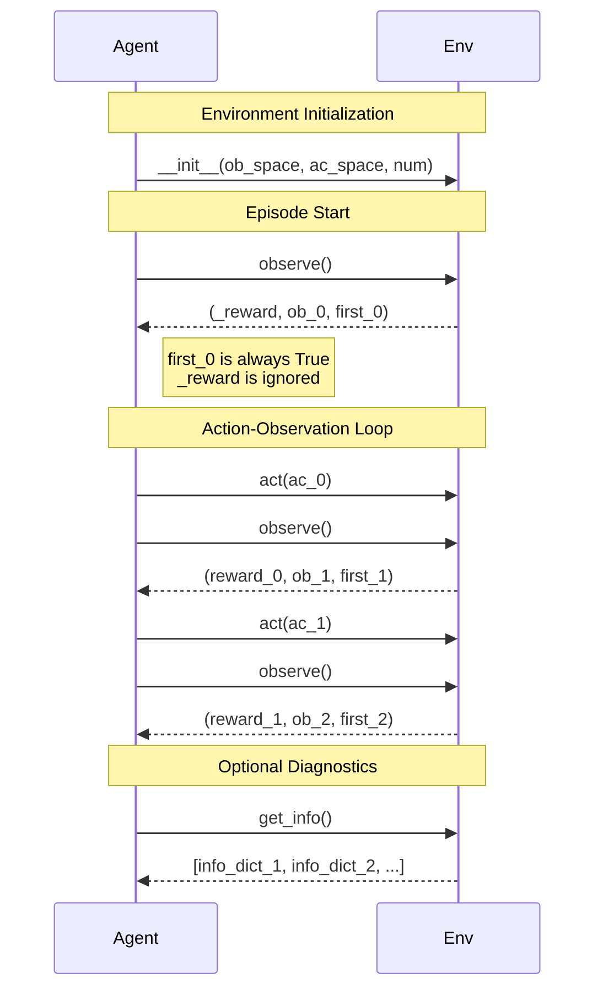

**Key Interaction Principles:**

1. **Initial Observation**: The first `observe()` call returns initial state with ignored rewards
2. **Action-Observation Cycle**: Each `act()` call should be followed by `observe()` to get the resulting state
3. **Vectorized Data**: All data flows handle `num` environments simultaneously
4. **Episode Boundaries**: The `first` flag indicates when episodes reset automatically

Sources: [gym3/env.py:27-41](), [docs/api.md:27-41]()

## Type System Integration

The environment interface is tightly coupled with gym3's type system through the `ob_space` and `ac_space` parameters:

```mermaid
graph TB
    subgraph "Environment Interface"
        ENV["Env"]
        OB_SPACE["ob_space: ValType"]
        AC_SPACE["ac_space: ValType"] 
        NUM["num: int"]
    end
    
    subgraph "Type System"
        VALTYPE["ValType"]
        TENSORTYPE["TensorType"]
        DICTTYPE["DictType"]
    end
    
    subgraph "Data Flow"
        OBSERVE["observe()"]
        ACT["act()"]
        REWARDS["rewards: (num,)"]
        OBS["observations: ob_space + (num,)"]
        ACTIONS["actions: ac_space + (num,)"]
    end
    
    ENV --> OB_SPACE
    ENV --> AC_SPACE
    ENV --> NUM
    
    OB_SPACE --> VALTYPE
    AC_SPACE --> VALTYPE
    VALTYPE --> TENSORTYPE
    VALTYPE --> DICTTYPE
    
    OBSERVE --> REWARDS
    OBSERVE --> OBS
    ACT --> ACTIONS
    
    OB_SPACE -.-> OBS
    AC_SPACE -.-> ACTIONS
```

**Type Constraints:**
- Observations must conform to `ob_space` structure
- Actions must conform to `ac_space` structure  
- All data includes an additional `(num,)` dimension for vectorization
- Type validation can be enforced using testing utilities

Sources: [gym3/env.py:10-12](), [gym3/env.py:44-45](), [gym3/env.py:64]()

## Implementation Requirements

When implementing a concrete environment, developers must:

1. **Override Abstract Methods**: Implement `observe()` and `act()` methods
2. **Respect Type Contracts**: Ensure data conforms to declared `ob_space` and `ac_space`
3. **Handle Vectorization**: Process all `num` environments simultaneously
4. **Manage Episode Lifecycle**: Set `first` flags appropriately when episodes end
5. **Optional Extensions**: Override `get_info()` and `callmethod()` as needed

The base `Env` class provides default implementations for `get_info()` and `callmethod()`, but `observe()` and `act()` must be implemented by concrete subclasses.

Sources: [gym3/env.py:48](), [gym3/env.py:66](), [gym3/env.py:58](), [gym3/env.py:81]()

---

# Page: Type System and Spaces

# Type System and Spaces

<details>
<summary>Relevant source files</summary>

The following files were used as context for generating this wiki page:

- [docs/design.md](docs/design.md)
- [gym3/types.py](gym3/types.py)

</details>


## Purpose and Scope

This document covers gym3's `ValType` system, which defines the structure and types of observations and actions in gym3 environments. Unlike OpenAI Gym's `gym.spaces` module, gym3 uses a more flexible and composable type system that eliminates redundancy and supports complex nested structures.

For information about the core environment interface that uses these types, see [Environment Interface](#3.1). For examples of using these types in practice with wrappers, see [Wrappers and Extensions](#3.3).

## Type System Overview

gym3's type system is built around two main hierarchies: scalar types that define the element types of tensors, and value types that define the overall structure of observations and actions.

**Type System Class Hierarchy**
```mermaid
graph TD
    ScalarType["ScalarType<br/>(Abstract Base)"]
    Real["Real<br/>Continuous values"]
    Discrete["Discrete<br/>Integer values in [0,n)"]
    
    ValType["ValType<br/>(Abstract Base)"]
    TensorType["TensorType<br/>Multi-dimensional arrays"]
    DictType["DictType<br/>Nested dictionaries"]
    
    ScalarType --> Real
    ScalarType --> Discrete
    ValType --> TensorType
    ValType --> DictType
    
    TensorType -.-> ScalarType
```

Sources: [gym3/types.py:28-162]()

## Scalar Types

Scalar types define the element types that can be stored in tensors. gym3 provides two concrete scalar type implementations.

### Real Type

The `Real` class represents continuous floating-point values:

```python
Real(dtype_name="float32")  # Default float32
Real(dtype_name="float64")  # Double precision
```

**Supported Data Types**
| Data Type | Description |
|-----------|-------------|
| `float32` | 32-bit floating point |
| `float64` | 64-bit floating point |

### Discrete Type

The `Discrete` class represents integer values in the range `[0, n)`:

```python
Discrete(n=10)                    # Values 0-9, stored as int64
Discrete(n=256, dtype_name="uint8")  # Values 0-255, stored as uint8
```

**Integer Data Types**
| Signed Types | Unsigned Types | Bit Width |
|--------------|----------------|-----------|
| `int8`       | `uint8`        | 8 bits    |
| `int16`      | `uint16`       | 16 bits   |
| `int32`      | `uint32`       | 32 bits   |
| `int64`      | `uint64`       | 64 bits   |

The constructor validates that `n` fits within the chosen data type's range.

Sources: [gym3/types.py:39-77](), [gym3/types.py:5-18]()

## Value Types

Value types define the structure of complete observations or actions. gym3 supports tensors and nested dictionaries.

### TensorType

`TensorType` represents multi-dimensional arrays with a specific scalar element type:

```python
# Scalar (0-dimensional tensor)
discrete_action = TensorType(eltype=Discrete(4), shape=())

# 1D tensor  
reward_history = TensorType(eltype=Real(), shape=(100,))

# 3D tensor (e.g., RGB image)
rgb_observation = TensorType(eltype=Discrete(256), shape=(64, 64, 3))
```

**TensorType Properties**
- `eltype`: The scalar type of elements
- `shape`: Tuple defining tensor dimensions
- `ndim`: Number of dimensions
- `size`: Total number of elements

### DictType

`DictType` represents nested dictionaries mapping string keys to other value types:

```python
observation_space = DictType(
    rgb=TensorType(eltype=Discrete(256), shape=(64, 64, 3)),
    position=TensorType(eltype=Real(), shape=(2,)),
    inventory=DictType(
        coins=TensorType(eltype=Discrete(1000), shape=()),
        health=TensorType(eltype=Real(), shape=())
    )
)
```

`DictType` supports dictionary-like operations: `keys()`, `values()`, `items()`, `__getitem__`, `__contains__`.

Sources: [gym3/types.py:87-161]()

## Convenience Functions

### discrete_scalar

Creates a scalar discrete tensor type:

```python
# Instead of TensorType(shape=(), eltype=Discrete(n))
action_space = discrete_scalar(4)  # 4 discrete actions
```

### multimap

Applies a function recursively to tree structures of dictionaries and `DictType` objects:

```python
def validate_shapes(val_type, data):
    """Validate that data matches the expected type structure"""
    return multimap(check_shape, val_type, data)
```

Sources: [gym3/types.py:122-186]()

## Design Rationale

**Type System Mapping to Data Structures**
```mermaid
graph LR
    subgraph "ValType Definitions"
        DT["DictType<br/>nested structure"]
        TT["TensorType<br/>array specification"]
    end
    
    subgraph "Runtime Data"
        Dict["dict<br/>{'rgb': array, 'pos': array}"]
        Array["numpy.ndarray<br/>actual tensor data"]
    end
    
    subgraph "ScalarType Specifications"
        Real["Real<br/>float32/float64"]
        Discrete["Discrete<br/>int8/16/32/64, uint8/16/32/64"]
    end
    
    DT --> Dict
    TT --> Array
    Real --> Array
    Discrete --> Array
```

The gym3 type system addresses several limitations of OpenAI Gym's `gym.spaces`:

1. **Eliminates Redundancy**: No separate `Discrete`/`MultiDiscrete` or `Binary`/`MultiBinary` classes
2. **Flexible Dimensions**: Any scalar type can be used in tensors of any dimensionality
3. **Nested Structures**: `DictType` naturally supports arbitrarily nested observation spaces
4. **Type Safety**: Clear separation between type specifications and runtime data

**Example: Image Observations**
```python
# gym3 approach - flexible and clear
rgb_space = TensorType(eltype=Discrete(256), shape=(84, 84, 3))

# Can easily extend to different image formats
grayscale_space = TensorType(eltype=Discrete(256), shape=(84, 84, 1))
depth_space = TensorType(eltype=Real(), shape=(84, 84, 1))
```

Sources: [docs/design.md:12-17](), [gym3/types.py:1-187]()

---

# Page: Wrappers and Extensions

# Wrappers and Extensions

<details>
<summary>Relevant source files</summary>

The following files were used as context for generating this wiki page:

- [docs/api.md](docs/api.md)
- [gym3/__init__.py](gym3/__init__.py)

</details>


This page covers gym3's wrapper system, which allows you to modify and extend environment behavior through composition. Wrappers enable adding functionality like recording, visualization, observation processing, and execution patterns to existing environments without modifying their core implementation.

For information about creating custom environments from scratch, see [3.1](#3.1). For environment execution patterns like subprocess and vectorization, see [4](#4). For visualization-specific features, see [5](#5).

## Base Wrapper Class

The `Wrapper` class in [gym3/wrapper.py]() serves as the foundation for all environment modifications in gym3. It implements the gym3 `Env` interface while wrapping another environment instance.

```mermaid
graph TB
    subgraph "Wrapper Pattern"
        ENV["gym3.Env<br/>Original Environment"]
        WRAPPER["gym3.Wrapper<br/>Base Wrapper Class"]
        CUSTOM["Custom Wrapper<br/>Your Implementation"]
    end
    
    subgraph "Core Methods"
        OBSERVE["observe()"]
        ACT["act()"]
        GETINFO["get_info()"]
        CALLMETHOD["callmethod()"]
    end
    
    ENV --> WRAPPER
    WRAPPER --> CUSTOM
    WRAPPER --> OBSERVE
    WRAPPER --> ACT
    WRAPPER --> GETINFO
    WRAPPER --> CALLMETHOD
    
    CUSTOM -.-> OBSERVE
    CUSTOM -.-> ACT
    CUSTOM -.-> GETINFO
```

**Wrapper Method Delegation Pattern**

The base `Wrapper` class provides default pass-through behavior for all `Env` methods. Custom wrappers override specific methods to modify behavior while delegating others to the wrapped environment.

**Sources:** [gym3/__init__.py:18](), [docs/api.md:81]()

## Included Wrappers

gym3 provides several pre-built wrappers for common use cases. Each wrapper addresses specific functionality needs while maintaining the standard gym3 interface.

```mermaid
graph TB
    subgraph "Execution Wrappers"
        ASYNC["AsynchronousWrapper<br/>async execution"]
    end
    
    subgraph "Data Processing Wrappers"
        EXTRACT["ExtractDictObWrapper<br/>dict observation extraction"]
    end
    
    subgraph "Recording Wrappers"
        TRAJ["TrajectoryRecorderWrapper<br/>episode recording"]
        VIDEO["VideoRecorderWrapper<br/>video recording"]
    end
    
    subgraph "Visualization Wrappers"
        VIEWER["ViewerWrapper<br/>window display"]
    end
    
    subgraph "Testing Wrappers"
        ASSERT["AssertSpacesWrapper<br/>validation"]
    end
    
    BASE["gym3.Wrapper<br/>Base Class"]
    
    BASE --> ASYNC
    BASE --> EXTRACT
    BASE --> TRAJ
    BASE --> VIDEO
    BASE --> VIEWER
    BASE --> ASSERT
```

**Wrapper Categories and Functions**

| Wrapper | Module | Primary Function |
|---------|--------|------------------|
| `AsynchronousWrapper` | `gym3.asynchronous` | Convert synchronous `act()` to asynchronous execution |
| `ExtractDictObWrapper` | `gym3.extract_dict_ob` | Extract single key from dictionary observation space |
| `TrajectoryRecorderWrapper` | `gym3.trajectory_recorder` | Record complete episodes to pickle files |
| `VideoRecorderWrapper` | `gym3.video_recorder` | Save RGB observations as video files |
| `ViewerWrapper` | `gym3.viewer` | Display RGB observations in interactive window |
| `AssertSpacesWrapper` | `gym3.testing` | Validate actions/observations match declared spaces |

**Sources:** [gym3/__init__.py:2,14,16-19](), [docs/api.md:87-94,103]()

## Wrapper Composition and Chaining

Multiple wrappers can be composed to combine functionality. The order of wrapping affects the data flow and processing sequence.

```mermaid
graph LR
    subgraph "Wrapper Chain Example"
        ENV["Base Environment"]
        EXTRACT["ExtractDictObWrapper"]
        VIDEO["VideoRecorderWrapper"] 
        VIEWER["ViewerWrapper"]
        AGENT["Agent"]
    end
    
    ENV --> EXTRACT
    EXTRACT --> VIDEO
    VIDEO --> VIEWER
    VIEWER --> AGENT
    
    subgraph "Data Flow"
        OBS1["Dict Observation"]
        OBS2["Extracted Observation"]
        OBS3["Recorded Observation"]
        OBS4["Displayed Observation"]
    end
    
    OBS1 --> OBS2
    OBS2 --> OBS3
    OBS3 --> OBS4
```

**Wrapper Chain Data Processing**

In a wrapper chain, each wrapper processes data before passing it to the next wrapper. The outermost wrapper receives the final processed data, while the innermost wrapper interacts directly with the base environment.

The `unwrap` utility function in [gym3/wrapper.py]() can access the base environment at the bottom of a wrapper stack, though `callmethod()` is preferred for cross-process compatibility.

**Sources:** [docs/api.md:107](), [gym3/__init__.py:18]()

## Creating Custom Wrappers

Custom wrappers extend the base `Wrapper` class and override specific methods to modify environment behavior.

```mermaid
graph TB
    subgraph "Custom Wrapper Implementation"
        INHERIT["class CustomWrapper(Wrapper)"]
        INIT["__init__(self, env)"]
        OVERRIDE["Override Methods"]
    end
    
    subgraph "Common Override Patterns"
        OBS_MOD["observe() modification"]
        ACT_MOD["act() modification"] 
        INFO_MOD["get_info() modification"]
        SPACE_MOD["space modification"]
    end
    
    subgraph "Method Override Examples"
        REWARD["Modify rewards"]
        FILTER["Filter observations"]
        TRANSFORM["Transform actions"]
        INJECT["Inject metadata"]
    end
    
    INHERIT --> INIT
    INIT --> OVERRIDE
    OVERRIDE --> OBS_MOD
    OVERRIDE --> ACT_MOD
    OVERRIDE --> INFO_MOD
    OVERRIDE --> SPACE_MOD
    
    OBS_MOD --> REWARD
    OBS_MOD --> FILTER
    ACT_MOD --> TRANSFORM
    INFO_MOD --> INJECT
```

**Custom Wrapper Implementation Pattern**

When creating custom wrappers:

1. **Inherit from `Wrapper`**: Use `gym3.Wrapper` as the base class
2. **Call super().__init__(env)**: Initialize the base wrapper with the wrapped environment
3. **Override selectively**: Only override methods that need modification
4. **Preserve interface**: Maintain gym3 `Env` interface contract
5. **Handle spaces**: Update `ob_space`/`ac_space` if modifying observation/action structure

**Sources:** [docs/api.md:81](), [gym3/__init__.py:18]()

## Method Delegation and `callmethod()`

The `callmethod()` interface allows wrappers to expose underlying environment methods while maintaining encapsulation. This is particularly important for environments running in subprocesses.

```mermaid
graph TB
    subgraph "Method Call Flow"
        CLIENT["Client Code"]
        WRAPPER1["Outer Wrapper"]
        WRAPPER2["Inner Wrapper"]
        ENV["Base Environment"]
    end
    
    subgraph "CallMethod Delegation"
        CALL["callmethod(method, *args, **kwargs)"]
        DELEGATE["Delegate to wrapped env"]
        EXECUTE["Execute on base env"]
        RETURN["Return results"]
    end
    
    CLIENT --> WRAPPER1
    WRAPPER1 --> WRAPPER2
    WRAPPER2 --> ENV
    
    CLIENT --> CALL
    CALL --> DELEGATE
    DELEGATE --> EXECUTE
    EXECUTE --> RETURN
    RETURN --> CLIENT
```

**Method Delegation Behavior**

- `callmethod()` passes through wrapper chains to reach the base environment
- Works across process boundaries (unlike `unwrap()`)
- Arguments and return values must be lists with length equal to `env.num`
- Wrappers can intercept and modify method calls by overriding `callmethod()`

**Sources:** [docs/api.md:63-76,107]()

---

# Page: Environment Execution

# Environment Execution

<details>
<summary>Relevant source files</summary>

The following files were used as context for generating this wiki page:

- [gym3/asynchronous.py](gym3/asynchronous.py)
- [gym3/concat.py](gym3/concat.py)
- [gym3/libenv_test.py](gym3/libenv_test.py)
- [gym3/subproc_test.py](gym3/subproc_test.py)

</details>


This document covers the different patterns for executing gym3 environments, including vectorized execution, process isolation, asynchronous execution, and cross-language integration. These execution patterns allow gym3 to scale from single environments to high-performance parallel training scenarios while maintaining the same interface.

For detailed information about the core environment interface, see [Environment Interface](#3.1). For visualization and interaction during execution, see [Visualization and Interaction](#5).

## Execution Patterns Overview

gym3 provides four primary execution patterns that can be combined to achieve different performance and isolation characteristics:

**Execution Pattern Architecture**
```mermaid
graph TB
    subgraph "Base Interface"
        ENV["gym3.Env"]
    end
    
    subgraph "Vectorized Execution"
        CONCAT["ConcatEnv"]
        ENVS["Multiple Environments"]
    end
    
    subgraph "Process Isolation"
        SUBPROC["SubprocEnv"]
        WORKER["Worker Process"]
    end
    
    subgraph "Asynchronous Execution"
        ASYNC["AsynchronousWrapper"]
        THREAD["ThreadPoolExecutor"]
    end
    
    subgraph "Cross-Language Integration"
        CENV["CEnv"]
        LIBENV["libenv.h"]
        CLIB["C/C++ Library"]
    end
    
    ENV --> CONCAT
    ENV --> SUBPROC
    ENV --> ASYNC
    ENV --> CENV
    
    CONCAT --> ENVS
    SUBPROC --> WORKER
    ASYNC --> THREAD
    CENV --> LIBENV
    LIBENV --> CLIB
```

Sources: [gym3/concat.py:21-33](), [gym3/asynchronous.py:8-19](), [gym3/subproc_test.py:39-48](), [gym3/libenv_test.py:26-31]()

## Execution Method Comparison

| Pattern | Class | Use Case | Isolation | Performance | Complexity |
|---------|-------|----------|-----------|-------------|------------|
| Vectorized | `ConcatEnv` | Batch processing multiple environments | Shared memory | High throughput | Low |
| Subprocess | `SubprocEnv` | Process isolation, fault tolerance | Full process | Medium | Medium |
| Asynchronous | `AsynchronousWrapper` | Non-blocking I/O, overlapped computation | Thread-level | Low latency | Low |
| C Integration | `CEnv` | High-performance native code | Shared memory | Highest | High |

## Core Execution Flow

All execution patterns follow the same basic gym3 interface while implementing different underlying execution strategies:

**Method Call Flow**
```mermaid
sequenceDiagram
    participant Client
    participant ExecutionPattern as "Execution Pattern"
    participant Environment as "Underlying Env(s)"
    
    Client->>ExecutionPattern: observe()
    ExecutionPattern->>Environment: observe()
    Environment-->>ExecutionPattern: rew, obs, first
    ExecutionPattern-->>Client: rew, obs, first
    
    Client->>ExecutionPattern: act(actions)
    ExecutionPattern->>Environment: act(actions)
    
    Client->>ExecutionPattern: get_info()
    ExecutionPattern->>Environment: get_info()
    Environment-->>ExecutionPattern: info_dicts
    ExecutionPattern-->>Client: info_dicts
```

Sources: [gym3/concat.py:35-48](), [gym3/asynchronous.py:29-39]()

### Vectorized Execution

The `ConcatEnv` class combines multiple environments into a single vectorized environment, enabling batch processing of actions and observations. This is the most commonly used pattern for training RL agents.

```python
# Example from concat.py
def observe(self) -> Tuple[Any, Any, Any]:
    rews, obs, firsts = zip(*[env.observe() for env in self.envs])
    return np.concatenate(rews), concat(obs), np.concatenate(firsts)
```

Sources: [gym3/concat.py:35-37]()

### Process Isolation

The `SubprocEnv` class runs environments in separate processes, providing fault tolerance and memory isolation. This pattern is essential when environments may crash or consume excessive resources.

Key features include:
- Exception handling with `SubprocError` [gym3/subproc_test.py:87-98]()
- Method delegation via `callmethod()` [gym3/subproc_test.py:57-59]()
- Support for cloudpickle serialization [gym3/subproc_test.py:131-138]()

Sources: [gym3/subproc_test.py:39-48](), [gym3/subproc_test.py:87-107]()

### Asynchronous Execution

The `AsynchronousWrapper` uses a `ThreadPoolExecutor` to run environment `act()` calls on a separate thread, allowing computation to overlap with environment stepping.

```python
# From asynchronous.py
def act(self, ac: Any) -> None:
    future = self._executor.submit(self.env.act, ac)
    self._futures.append(future)
```

The wrapper ensures thread safety by waiting for all pending actions to complete before returning observations.

Sources: [gym3/asynchronous.py:37-39](), [gym3/asynchronous.py:21-27]()

### C Environment Integration

The `CEnv` class enables integration with environments written in C/C++ using the `libenv.h` API. This provides the highest performance for computationally intensive environments.

The integration requires:
- A shared library implementing the libenv interface
- Environment options passed during initialization
- Proper handling of observation and action space mapping

Sources: [gym3/libenv_test.py:26-38](), [gym3/libenv_test.py:42-66]()

## Performance Considerations

Each execution pattern has different performance characteristics:

- **ConcatEnv**: Highest throughput for batch operations, minimal overhead
- **SubprocEnv**: Medium throughput, higher latency due to IPC overhead
- **AsynchronousWrapper**: Reduces blocking time, good for I/O-bound environments
- **CEnv**: Highest raw performance for compute-intensive environments

## Choosing an Execution Pattern

Select the execution pattern based on your requirements:

1. **Use ConcatEnv** for most RL training scenarios with multiple environments
2. **Use SubprocEnv** when you need fault tolerance or memory isolation
3. **Use AsynchronousWrapper** to overlap computation with environment stepping
4. **Use CEnv** for maximum performance with custom C/C++ environments

These patterns can be combined - for example, using `SubprocEnv` with `ConcatEnv` to create process-isolated vectorized environments.

Sources: [gym3/subproc_test.py:152-158](), [gym3/concat.py:21-33](), [gym3/asynchronous.py:8-19](), [gym3/libenv_test.py:26-31]()

---

# Page: Vectorized Environments

# Vectorized Environments

<details>
<summary>Relevant source files</summary>

The following files were used as context for generating this wiki page:

- [gym3/concat.py](gym3/concat.py)
- [gym3/concat_test.py](gym3/concat_test.py)

</details>


This page covers gym3's vectorized environment execution using the `ConcatEnv` class, which enables running multiple environment instances in parallel within a single process. For subprocess-based parallel execution, see [Subprocess Environments](#4.2). For asynchronous execution patterns, see [Asynchronous Execution](#4.3).

## Purpose and Benefits

Vectorized environments allow multiple environment instances to be executed together in batches, providing significant performance improvements for reinforcement learning training. Rather than stepping through environments one at a time, vectorized execution processes observations, actions, and rewards across multiple environments simultaneously using efficient numpy operations.

The primary implementation is the `ConcatEnv` class, which concatenates multiple gym3 environments into a single vectorized interface while maintaining the standard `gym3.Env` API.

## ConcatEnv Architecture

The `ConcatEnv` class implements vectorization by aggregating multiple environment instances and coordinating their execution:

```mermaid
graph TD
    ConcatEnv["ConcatEnv"]
    Env1["env[0]<br/>num=2"]
    Env2["env[1]<br/>num=1"] 
    Env3["env[2]<br/>num=3"]
    
    Actions["actions<br/>[6 elements]"]
    Observations["observations<br/>[6 elements]"]
    Rewards["rewards<br/>[6 elements]"]
    
    Actions --> ConcatEnv
    ConcatEnv --> Split1["split[0:2]"]
    ConcatEnv --> Split2["split[2:3]"]
    ConcatEnv --> Split3["split[3:6]"]
    
    Split1 --> Env1
    Split2 --> Env2
    Split3 --> Env3
    
    Env1 --> Concat1["concat"]
    Env2 --> Concat1
    Env3 --> Concat1
    
    Concat1 --> Observations
    Concat1 --> Rewards
```

**Data Flow in ConcatEnv Vectorization**

Sources: [gym3/concat.py:21-62]()

## Class Definition and Interface

The `ConcatEnv` class extends the base `gym3.Env` interface and requires all constituent environments to have matching observation and action spaces:

| Method | Purpose | Implementation |
|--------|---------|----------------|
| `__init__(envs)` | Initialize with sequence of environments | Validates space compatibility, calculates total `num` |
| `observe()` | Get observations from all environments | Concatenates rewards, observations, and first flags |
| `act(ac)` | Send actions to all environments | Splits actions by environment sizes |
| `get_info()` | Retrieve info dictionaries | Extends lists from all environments |
| `callmethod()` | Call method on all environments | Chunks arguments and extends results |

Sources: [gym3/concat.py:21-34](), [gym3/concat.py:35-61]()

## Core Methods Implementation

### Environment Initialization

The constructor validates that all environments have identical observation and action spaces, then calculates the total number of environment instances:

```mermaid
graph LR
    Input["envs: Sequence[Env]"]
    Validate["Validate Spaces<br/>allsame(ac_space)<br/>allsame(ob_space)"]
    Calculate["Calculate total_num<br/>sum(env.num for env in envs)"]
    Store["Store envs list<br/>self.envs = envs"]
    
    Input --> Validate
    Validate --> Calculate
    Calculate --> Store
```

**ConcatEnv Initialization Process**

The space validation uses `misc.allsame()` to ensure compatibility between environments [gym3/concat.py:31-32]().

Sources: [gym3/concat.py:28-33]()

### Observation Collection

The `observe()` method collects observations from all constituent environments and concatenates them into unified arrays:

- **Rewards**: Concatenated using `np.concatenate()`
- **Observations**: Concatenated using `concat()` from `gym3.types_np`
- **First flags**: Concatenated using `np.concatenate()`

Sources: [gym3/concat.py:35-37]()

### Action Distribution

The `act()` method splits incoming vectorized actions across the constituent environments based on their respective sizes:

The action splitting uses `split()` from `gym3.types_np` with cumulative size sections calculated by `np.cumsum([env.num for env in self.envs])` [gym3/concat.py:46]().

Sources: [gym3/concat.py:45-48]()

## Method Forwarding

The `callmethod()` implementation enables calling arbitrary methods on all constituent environments while properly handling argument distribution:

```mermaid
graph TD
    Input["method, args, kwargs"]
    ChunkArgs["Chunk arguments<br/>_chunk_seq(arg, sizes)"]
    ChunkKwargs["Chunk keyword args<br/>_chunk_seq(v, sizes)"]
    CallEnvs["Call on each env<br/>env.callmethod()"]
    ExtendResults["Extend results<br/>result.extend()"]
    
    Input --> ChunkArgs
    Input --> ChunkKwargs
    ChunkArgs --> CallEnvs
    ChunkKwargs --> CallEnvs
    CallEnvs --> ExtendResults
```

**Method Call Distribution in ConcatEnv**

The `_chunk_seq()` helper function splits sequences according to environment sizes, ensuring each environment receives the correct portion of arguments [gym3/concat.py:10-18]().

Sources: [gym3/concat.py:50-61](), [gym3/concat.py:10-18]()

## Usage Patterns

### Basic Vectorization

To create a vectorized environment from multiple instances:

```python
# Referenced pattern from test file
base_env1 = IdentityEnv(space=space, episode_len=1, seed=0)
base_env2 = IdentityEnv(space=space, episode_len=2, seed=1)
env = ConcatEnv([base_env1, base_env2])
```

The resulting environment will have `num = base_env1.num + base_env2.num` instances.

Sources: [gym3/concat_test.py:33-41]()

### Space Type Compatibility

`ConcatEnv` supports various space types including:

- **Discrete spaces**: `types.discrete_scalar(2)`
- **Dictionary spaces**: `types.DictType(degrees=types.discrete_scalar(360))`
- **Real-valued spaces**: `types.TensorType(shape=(), eltype=types.Real())`

All constituent environments must use the same space type [gym3/concat_test.py:22-31]().

Sources: [gym3/concat_test.py:22-31]()

## Performance Considerations

Vectorized execution with `ConcatEnv` provides several performance benefits:

- **Batch Operations**: Actions and observations are processed in batches using efficient numpy operations
- **Memory Efficiency**: Shared space definitions reduce memory overhead
- **Single Process**: Avoids inter-process communication overhead unlike subprocess-based approaches

The concatenation operations use gym3's optimized `concat()` and `split()` functions from `gym3.types_np`, which handle various data types efficiently.

Sources: [gym3/concat.py:1-8](), [gym3/concat.py:37](), [gym3/concat.py:46]()

---

# Page: Subprocess Environments

# Subprocess Environments

<details>
<summary>Relevant source files</summary>

The following files were used as context for generating this wiki page:

- [gym3/libenv_test.py](gym3/libenv_test.py)
- [gym3/subproc_test.py](gym3/subproc_test.py)

</details>


## Purpose and Scope

This page documents gym3's subprocess environment system, which allows running environments in separate processes for isolation, stability, and parallel execution. The `SubprocEnv` class enables environments to run in child processes while maintaining the standard gym3 interface.

For information about running multiple environments in the same process, see [Vectorized Environments](#4.1). For asynchronous execution patterns, see [Asynchronous Execution](#4.3).

## Overview

The `SubprocEnv` class provides process isolation by running environments in separate child processes. This approach offers several benefits:

- **Process isolation**: Environment crashes don't affect the main process
- **Memory isolation**: Each environment runs in its own memory space  
- **Parallel execution**: Multiple environments can run concurrently
- **Library isolation**: Environments using conflicting libraries can coexist

```mermaid
graph TB
    subgraph "Main Process"
        MP["Main Process"]
        SE["SubprocEnv"]
        API["gym3.Env API"]
    end
    
    subgraph "Child Process 1"
        CP1["Child Process"]
        ENV1["Environment Instance"]
        FN1["env_fn()"]
    end
    
    subgraph "Child Process 2" 
        CP2["Child Process"]
        ENV2["Environment Instance"]
        FN2["env_fn()"]
    end
    
    MP --> SE
    SE --> API
    SE -.->|"IPC"| CP1
    SE -.->|"IPC"| CP2
    CP1 --> ENV1
    CP2 --> ENV2
    FN1 --> ENV1
    FN2 --> ENV2
```
*Process Architecture: SubprocEnv manages child processes running environment instances*

Sources: [gym3/subproc_test.py:39-49]()

## Basic Usage

The `SubprocEnv` constructor takes an environment factory function and optional keyword arguments:

```python
env = SubprocEnv(env_fn=create_test_env, env_kwargs=dict(episode_len=2))
```

The environment factory function must return a gym3 environment instance and will be called in the child process.

```mermaid
sequenceDiagram
    participant MP as "Main Process"
    participant SP as "SubprocEnv" 
    participant CP as "Child Process"
    participant ENV as "Environment"
    
    MP->>SP: SubprocEnv(env_fn, env_kwargs)
    SP->>CP: spawn process
    CP->>ENV: env_fn(**env_kwargs)
    ENV-->>CP: environment instance
    CP-->>SP: ready signal
    
    MP->>SP: observe()
    SP->>CP: observe command
    CP->>ENV: observe()
    ENV-->>CP: rew, obs, first
    CP-->>SP: rew, obs, first
    SP-->>MP: rew, obs, first
    
    MP->>SP: act(action)
    SP->>CP: act command
    CP->>ENV: act(action)
```
*Method Call Flow: Communication between main process and child environment*

Sources: [gym3/subproc_test.py:33-49]()

## Core Methods

### Environment Interaction

The `SubprocEnv` implements the standard gym3 environment interface:

- `observe()`: Get current rewards, observations, and first flags
- `act(action)`: Send actions to the environment
- `get_info()`: Retrieve environment info dictionaries

All method calls are transparently forwarded to the child process.

Sources: [gym3/subproc_test.py:41-48]()

### Cross-Process Method Calls

The `callmethod()` function allows calling arbitrary methods on the remote environment:

```python
env = SubprocEnv(env_fn=create_callmethod_test_env)
result = env.callmethod("square", 2)  # Returns 4
```

This enables access to custom environment methods beyond the standard gym3 interface.

Sources: [gym3/subproc_test.py:51-59]()

## Error Handling

### SubprocError Exception

When errors occur in the child process, they are wrapped in a `SubprocError` and re-raised in the main process:

```mermaid
graph LR
    subgraph "Child Process"
        EXC["Exception\nRaised"]
        EXIT["Process Exit"]
    end
    
    subgraph "Main Process"
        SE["SubprocEnv"]
        SPE["SubprocError\nRaised"]
        USER["User Code"]
    end
    
    EXC --> SE
    EXIT --> SE
    SE --> SPE
    SPE --> USER
```
*Error Propagation: Child process errors become SubprocError in main process*

### Error Scenarios

The system handles several error conditions:

1. **Environment creation errors**: Exceptions during `env_fn()` execution
2. **Runtime errors**: Exceptions during environment method calls  
3. **Process exits**: Child process termination (normal or abnormal)

Note that errors during `act()` may not be detected until the next `observe()` call due to the asynchronous nature of the communication.

Sources: [gym3/subproc_test.py:87-107]()

## Advanced Features

### Serialization Support

The subprocess system uses `cloudpickle` for serializing environment factory functions, enabling support for lambda functions and closures:

```python
def make_env():
    env = IdentityEnv()
    env.square = lambda x: x ** 2  # Lambda function preserved
    return env

env = SubprocEnv(env_fn=make_env)
```

Sources: [gym3/subproc_test.py:131-138]()

### MPI Compatibility

The system is designed to work with MPI (Message Passing Interface) environments, though MPI initialization in child processes requires careful handling:

Sources: [gym3/subproc_test.py:109-128]()

### Library Isolation

A key use case is isolating environments that use conflicting libraries. For example, the retro game environment can only be instantiated once per process, but multiple `SubprocEnv` instances can each run their own copy:

```python
envs = [
    SubprocEnv(env_fn=make_retro_env, env_kwargs=dict(game="Airstriker-Genesis"))
    for _ in range(2)  # Multiple instances possible with subprocess isolation
]
```

Sources: [gym3/subproc_test.py:141-158]()

## Integration with Other Systems

### Vectorized Environments

`SubprocEnv` instances can be combined with `ConcatEnv` to create vectorized subprocess environments:

```python
from gym3.concat import ConcatEnv

envs = [SubprocEnv(env_fn=make_env) for _ in range(4)]
vec_env = ConcatEnv(envs)  # 4 environments running in separate processes
```

This pattern provides both vectorization and process isolation.

### Wrapper Compatibility

Subprocess environments work with the gym3 wrapper system. Wrappers can be applied either in the main process (around `SubprocEnv`) or in the child process (within the `env_fn`):

```python
def create_wrapped_env():
    env = IdentityEnv(episode_len=2)
    env = StepInfo(env)  # Wrapper applied in child process
    return env
```

Sources: [gym3/subproc_test.py:17-36]()

## Considerations

### Performance Overhead

Process creation and inter-process communication add overhead compared to same-process execution. This trade-off is worthwhile when:

- Environment stability is critical
- Environments use conflicting dependencies
- Parallel execution across CPU cores is needed

### Memory Usage

Each subprocess maintains its own memory space, which increases total memory usage but provides complete isolation between environments.

### Debugging

Debugging across process boundaries can be more complex. The `SubprocError` exception preserves stack traces from the child process to aid in troubleshooting.

Sources: [gym3/subproc_test.py:1-159]()

---

# Page: Asynchronous Execution

# Asynchronous Execution

<details>
<summary>Relevant source files</summary>

The following files were used as context for generating this wiki page:

- [gym3/asynchronous.py](gym3/asynchronous.py)
- [gym3/asynchronous_test.py](gym3/asynchronous_test.py)

</details>


This document covers gym3's asynchronous execution capabilities through the `AsynchronousWrapper` class, which enables non-blocking environment interactions by running `act()` calls on separate threads. This allows the main thread to continue processing while environment actions execute in the background.

For information about other execution patterns, see [Vectorized Environments](#4.1), [Subprocess Environments](#4.2), and [C Environment Integration](#4.4).

## Overview

The `AsynchronousWrapper` addresses a common performance bottleneck in reinforcement learning where environment `act()` calls are synchronous and can introduce significant latency. By moving these calls to a background thread, the wrapper enables overlapping computation and environment execution.

**Key Benefits:**
- Reduces perceived latency for `act()` calls
- Enables parallel processing while maintaining deterministic ordering  
- Provides transparent integration with existing gym3 environments
- Maintains proper exception propagation from background threads

Sources: [gym3/asynchronous.py:8-14]()

## AsynchronousWrapper Architecture

```mermaid
graph TB
    MainThread["Main Thread"]
    WorkerThread["Worker Thread"]
    
    subgraph "AsynchronousWrapper"
        ActMethod["act()"]
        ObserveMethod["observe()"]
        WaitMethod["_wait()"]
        Executor["ThreadPoolExecutor"]
        FuturesList["_futures[]"]
    end
    
    subgraph "Wrapped Environment"
        EnvAct["env.act()"]
        EnvObserve["env.observe()"]
    end
    
    MainThread --> ActMethod
    ActMethod --> Executor
    Executor --> WorkerThread
    WorkerThread --> EnvAct
    
    MainThread --> ObserveMethod
    ObserveMethod --> WaitMethod
    WaitMethod --> FuturesList
    WaitMethod --> EnvObserve
    
    ActMethod --> FuturesList
```

**Execution Flow:**
1. `act()` submissions are queued to `ThreadPoolExecutor` and return immediately
2. `Future` objects are stored in `_futures` list for tracking
3. `observe()` and `get_info()` calls trigger `_wait()` to synchronize
4. `_wait()` blocks until all pending futures complete

Sources: [gym3/asynchronous.py:16-40]()

## Implementation Details

### Core Components

The `AsynchronousWrapper` uses several key components to manage asynchronous execution:

| Component | Purpose | Implementation |
|-----------|---------|----------------|
| `ThreadPoolExecutor` | Manages worker thread for act() calls | Single worker thread (`max_workers=1`) |
| `_futures` | Tracks pending asynchronous operations | List of `Future` objects |
| `_wait()` | Synchronization point for pending operations | Blocks until futures complete |

```mermaid
sequenceDiagram
    participant Client
    participant AsynchronousWrapper
    participant ThreadPoolExecutor
    participant Environment
    
    Client->>AsynchronousWrapper: act(action1)
    AsynchronousWrapper->>ThreadPoolExecutor: submit(env.act, action1)
    ThreadPoolExecutor-->>AsynchronousWrapper: future1
    AsynchronousWrapper-->>Client: return immediately
    
    Client->>AsynchronousWrapper: act(action2)
    AsynchronousWrapper->>ThreadPoolExecutor: submit(env.act, action2)
    ThreadPoolExecutor-->>AsynchronousWrapper: future2
    AsynchronousWrapper-->>Client: return immediately
    
    par
        ThreadPoolExecutor->>Environment: env.act(action1)
        Environment-->>ThreadPoolExecutor: complete
    and
        Client->>AsynchronousWrapper: observe()
        AsynchronousWrapper->>AsynchronousWrapper: _wait()
        AsynchronousWrapper->>ThreadPoolExecutor: future1.result()
        AsynchronousWrapper->>ThreadPoolExecutor: future2.result()
    end
    
    AsynchronousWrapper->>Environment: env.observe()
    Environment-->>AsynchronousWrapper: observation
    AsynchronousWrapper-->>Client: observation
```

Sources: [gym3/asynchronous.py:18-19](), [gym3/asynchronous.py:21-27](), [gym3/asynchronous.py:29-31]()

### Synchronization Strategy

The wrapper ensures deterministic behavior through careful synchronization:

**Action Queuing:** Actions are submitted to the thread pool in order and executed sequentially by the single worker thread.

**Observation Synchronization:** Both `observe()` and `get_info()` trigger `_wait()`, ensuring all pending actions complete before returning environment state.

**Exception Handling:** Exceptions from the worker thread are re-raised in the main thread during `_wait()` calls.

Sources: [gym3/asynchronous.py:37-39](), [gym3/asynchronous.py:22-27]()

## Usage Patterns

### Basic Usage

```python
from gym3 import AsynchronousWrapper

# Wrap any gym3 environment
async_env = AsynchronousWrapper(base_env)

# Actions return immediately
async_env.act(action1)  # Non-blocking
async_env.act(action2)  # Non-blocking

# Synchronization occurs on observe
obs, reward, done = async_env.observe()  # Blocks until actions complete
```

### Performance Optimization

The wrapper is most effective when:
- Environment `act()` calls have significant latency
- Multiple actions can be queued before observation is needed
- The ratio of computation to environment interaction is high

Sources: [gym3/asynchronous_test.py:28-45]()

## Exception Handling

The `AsynchronousWrapper` maintains proper exception semantics by propagating exceptions from the worker thread to the main thread:

```mermaid
graph TB
    WorkerThread["Worker Thread"]
    MainThread["Main Thread"]
    
    subgraph "Exception Flow"
        EnvActException["env.act() raises Exception"]
        FutureException["Future stores exception"]
        WaitCall["_wait() called"]
        ExceptionReRaised["Exception re-raised"]
    end
    
    WorkerThread --> EnvActException
    EnvActException --> FutureException
    MainThread --> WaitCall
    WaitCall --> FutureException
    FutureException --> ExceptionReRaised
    ExceptionReRaised --> MainThread
```

**Exception Propagation:**
1. Exceptions in worker thread are captured by `Future` objects
2. `future.result()` re-raises the original exception in main thread
3. Exception timing matches synchronous behavior (on observe/get_info)

Sources: [gym3/asynchronous.py:24-26](), [gym3/asynchronous_test.py:58-65]()

## Performance Characteristics

### Timing Analysis

The asynchronous wrapper provides measurable performance improvements for environments with latency:

| Execution Pattern | Latency | Throughput |
|------------------|---------|------------|
| Synchronous | `act()` latency × num_actions | Sequential |
| Asynchronous | Minimal until `observe()` | Overlapped |

**Measured Benefits:**
- `act()` calls complete in sub-millisecond time
- Total execution time matches synchronous after `observe()`
- Enables computation overlap during environment processing

Sources: [gym3/asynchronous_test.py:33-44]()

### Ordering Guarantees

The single-threaded executor ensures deterministic action ordering:
- Actions execute in submission order
- Results maintain sequential consistency
- Environment state remains predictable

Sources: [gym3/asynchronous_test.py:47-55]()

## Limitations and Considerations

### Thread Safety Requirements
- Wrapped environment must be thread-safe for `act()` calls
- Single worker thread eliminates most concurrency issues
- State observation remains single-threaded

### Memory Overhead
- `Future` objects accumulate until `_wait()` is called
- ThreadPoolExecutor maintains persistent worker thread
- Minimal additional memory footprint

### Use Case Suitability
The `AsynchronousWrapper` is most beneficial when:
- Environment `act()` has measurable latency (>1ms)
- Multiple actions can be queued before observation
- Application can tolerate delayed exception reporting

Sources: [gym3/asynchronous.py:16-19](), [gym3/asynchronous_test.py:28-65]()

---

# Page: C Environment Integration

# C Environment Integration

<details>
<summary>Relevant source files</summary>

The following files were used as context for generating this wiki page:

- [gym3/libenv.h](gym3/libenv.h)
- [gym3/libenv_test.py](gym3/libenv_test.py)
- [gym3/subproc_test.py](gym3/subproc_test.py)

</details>


This document covers gym3's support for integrating environments written in C through the libenv API. This enables high-performance environment implementations in C while maintaining compatibility with gym3's vectorized interface. For information about running environments in separate processes, see [Subprocess Environments](#4.2). For asynchronous execution patterns, see [Asynchronous Execution](#4.3).

## Purpose and Scope

The C environment integration system allows developers to implement reinforcement learning environments in C and seamlessly use them within gym3's Python framework. This integration provides:

- **Performance**: Native C execution eliminates Python interpreter overhead
- **Language flexibility**: Any language that can export C shared libraries can be used
- **Vectorization**: Full support for gym3's vectorized environment interface
- **Zero-copy operation**: Direct memory access between Python and C for efficient data transfer

The integration is built around the `libenv` API defined in [gym3/libenv.h]() and the `CEnv` wrapper class that bridges Python and C.

## libenv API Architecture

The libenv API defines a standardized interface for C-based environments that can be loaded as shared libraries. The architecture separates the environment logic (implemented in C) from the gym3 integration layer (Python).

**libenv API Architecture**
```mermaid
graph TB
    subgraph "Python Layer"
        CEnv["CEnv"]
        CFFI["cffi.FFI"]
        GYM3["gym3.Env Interface"]
    end
    
    subgraph "C Shared Library"
        LIBENV_MAKE["libenv_make()"]
        LIBENV_OBSERVE["libenv_observe()"]
        LIBENV_ACT["libenv_act()"]
        LIBENV_CLOSE["libenv_close()"]
        ENV_IMPL["Environment Implementation"]
    end
    
    subgraph "Memory Buffers"
        OB_BUFFERS["Observation Buffers"]
        AC_BUFFERS["Action Buffers"]
        REW_BUFFERS["Reward Buffers"]
        INFO_BUFFERS["Info Buffers"]
    end
    
    GYM3 --> CEnv
    CEnv --> CFFI
    CFFI --> LIBENV_MAKE
    CFFI --> LIBENV_OBSERVE
    CFFI --> LIBENV_ACT
    CFFI --> LIBENV_CLOSE
    
    LIBENV_MAKE --> ENV_IMPL
    LIBENV_OBSERVE --> ENV_IMPL
    LIBENV_ACT --> ENV_IMPL
    LIBENV_CLOSE --> ENV_IMPL
    
    ENV_IMPL --> OB_BUFFERS
    ENV_IMPL --> AC_BUFFERS
    ENV_IMPL --> REW_BUFFERS
    ENV_IMPL --> INFO_BUFFERS
    
    OB_BUFFERS --> CFFI
    AC_BUFFERS --> CFFI
    REW_BUFFERS --> CFFI
    INFO_BUFFERS --> CFFI
```

Sources: [gym3/libenv.h:1-198]()

## Core Data Types and Structures

The libenv API defines several key data types that enable type-safe communication between Python and C environments.

### Fundamental Types

| Type | Purpose | Values |
|------|---------|--------|
| `libenv_dtype` | Data type enumeration | `UINT8`, `INT32`, `FLOAT32` |
| `libenv_scalar_type` | Logical type classification | `REAL`, `DISCRETE` |
| `libenv_space_name` | Space identification | `OBSERVATION`, `ACTION`, `INFO` |

### Data Structures

**libenv_tensortype Structure**
```mermaid
graph LR
    subgraph "libenv_tensortype"
        NAME["name[128]"]
        SCALAR["scalar_type"]
        DTYPE["dtype"]
        SHAPE["shape[16]"]
        NDIM["ndim"]
        LOW["low"]
        HIGH["high"]
    end
    
    NAME --> DESCRIPTION["Tensor identifier"]
    SCALAR --> TYPE_CLASS["REAL or DISCRETE"]
    DTYPE --> DATA_TYPE["uint8/int32/float32"]
    SHAPE --> DIMENSIONS["Array dimensions"]
    NDIM --> RANK["Number of dimensions"]
    LOW --> MIN_VALUE["Minimum value"]
    HIGH --> MAX_VALUE["Maximum value"]
```

Sources: [gym3/libenv.h:84-92]()

The `libenv_tensortype` structure [gym3/libenv.h:84-92]() describes the shape and constraints of each tensor in the environment's observation, action, and info spaces. This corresponds directly to gym3's `ValType` system but uses a flattened representation suitable for C.

### Environment Configuration

Environments are configured through the `libenv_options` structure [gym3/libenv.h:105-109](), which contains an array of key-value pairs. Each option has a name, data type, count, and pointer to the data:

```c
struct libenv_option {
    char name[LIBENV_MAX_NAME_LEN];
    enum libenv_dtype dtype;
    int count;
    void *data;
};
```

Sources: [gym3/libenv.h:98-103]()

## Environment Lifecycle

C environments follow a structured lifecycle managed through the libenv API functions.

**Environment Lifecycle Flow**
```mermaid
sequenceDiagram
    participant Python as "CEnv (Python)"
    participant C as "C Environment"
    participant Memory as "Shared Buffers"
    
    Python->>C: libenv_make(num_envs, options)
    C-->>Python: libenv_env* handle
    
    Python->>C: libenv_get_tensortypes(OBSERVATION)
    C-->>Python: tensortype[] specs
    
    Python->>C: libenv_get_tensortypes(ACTION)
    C-->>Python: tensortype[] specs
    
    Python->>C: libenv_get_tensortypes(INFO)
    C-->>Python: tensortype[] specs
    
    Python->>Memory: Allocate buffers
    Python->>C: libenv_set_buffers(handle, buffers)
    
    loop Environment Steps
        Python->>C: libenv_observe()
        C->>Memory: Write obs, rewards, first, info
        Memory-->>Python: Read data
        
        Python->>Memory: Write actions
        Python->>C: libenv_act()
        C->>Memory: Read actions
    end
    
    Python->>C: libenv_close(handle)
```

Sources: [gym3/libenv.h:146-190]()

### Key Lifecycle Functions

1. **`libenv_make()`** [gym3/libenv.h:160](): Creates environment instances with specified options
2. **`libenv_get_tensortypes()`** [gym3/libenv.h:165](): Retrieves space specifications for observations, actions, and info
3. **`libenv_set_buffers()`** [gym3/libenv.h:171](): Provides shared memory buffers for data exchange
4. **`libenv_observe()`** [gym3/libenv.h:176](): Generates observations, rewards, and episode flags
5. **`libenv_act()`** [gym3/libenv.h:187](): Processes actions from the shared buffer
6. **`libenv_close()`** [gym3/libenv.h:190](): Cleanup and resource deallocation

## Buffer Management and Memory Layout

The libenv API uses a structure-of-arrays memory layout to efficiently handle vectorized environments. This design minimizes memory access overhead and enables efficient batch processing.

**Vectorized Memory Layout**
```mermaid
graph TB
    subgraph "libenv_buffers Structure"
        OB_PTR["ob**"]
        REW_PTR["rew*"]
        FIRST_PTR["first*"]
        INFO_PTR["info**"]
        AC_PTR["ac**"]
    end
    
    subgraph "Memory Layout (2 envs, obs space: {a: [2], b: [1]})"
        OB_A["Env0 obs_a | Env1 obs_a"]
        OB_B["Env0 obs_b | Env1 obs_b"]
        REWARDS["Env0 rew | Env1 rew"]
        FIRSTS["Env0 first | Env1 first"]
    end
    
    OB_PTR --> OB_A
    OB_PTR --> OB_B
    REW_PTR --> REWARDS
    FIRST_PTR --> FIRSTS
```

Sources: [gym3/libenv.h:132-138](), [gym3/libenv.h:118-131]()

The buffer layout [gym3/libenv.h:118-131]() arranges data so that all instances of the same tensor are stored contiguously. For example, with 2 environments and observation space `{'a': [1], 'b': [1]}`, the memory layout groups all 'a' observations together, then all 'b' observations together.

### Buffer Allocation Strategy

1. **Python allocates all buffers**: The `CEnv` class manages memory allocation based on space specifications
2. **Pointers passed to C**: Only buffer pointers are shared, not buffer ownership
3. **Lifetime guarantee**: Buffers remain valid until `libenv_close()` is called
4. **Zero-copy operation**: Direct memory access eliminates copying overhead

## Integration with gym3

The `CEnv` class serves as the bridge between gym3's Python interface and the C libenv API. It handles library loading, buffer management, and type conversions.

**CEnv Integration Architecture**
```mermaid
graph TB
    subgraph "gym3 Python Layer"
        GYM3_ENV["gym3.Env"]
        C_ENV["CEnv"]
        CFFI_LIB["cffi library handle"]
    end
    
    subgraph "Type System Mapping"
        VALTYPE["gym3.types.ValType"]
        TENSORTYPE["libenv_tensortype"]
        NUMPY_ARRAYS["numpy arrays"]
        C_BUFFERS["C buffer pointers"]
    end
    
    subgraph "C Environment Library"
        SHARED_LIB["libenv.so/.dll/.dylib"]
        ENV_FUNCS["libenv_* functions"]
    end
    
    GYM3_ENV --> C_ENV
    C_ENV --> CFFI_LIB
    CFFI_LIB --> SHARED_LIB
    SHARED_LIB --> ENV_FUNCS
    
    VALTYPE --> TENSORTYPE
    NUMPY_ARRAYS --> C_BUFFERS
    
    C_ENV --> VALTYPE
    C_ENV --> NUMPY_ARRAYS
    C_ENV --> TENSORTYPE
    C_ENV --> C_BUFFERS
```

Sources: [gym3/libenv_test.py:26-38]()

### Example Usage Pattern

From the test implementation [gym3/libenv_test.py:26-38](), we can see how `CEnv` is typically subclassed:

```python
class CFixedSequenceEnv(CEnv):
    def __init__(self, num, n_actions, episode_len, sequence):
        options = dict(n_actions=n_actions, episode_len=episode_len, sequence=sequence)
        super().__init__(num=num, lib_dir=".", options=options)
        self.ob_space = self.ob_space["ignore"]
        self.ac_space = self.ac_space["action"]

    def observe(self):
        rew, ob, first = super().observe()
        return rew, ob["ignore"], first

    def act(self, ac):
        super().act({"action": ac})
```

This pattern shows how:
1. Environment-specific options are passed to the C library
2. Observation and action spaces can be adapted
3. Dictionary-based spaces are mapped to simpler interfaces

## Building and Testing C Environments

C environments must be compiled as shared libraries that export the required libenv functions. The build process varies by platform but follows consistent patterns.

### Build Requirements

| Platform | Compiler | Library Extension | Notes |
|----------|----------|-------------------|-------|
| Linux | gcc | `.so` | Position-independent code (`-fpic`) |
| macOS | clang/gcc | `.dylib` | Standard shared library flags |
| Windows | MSVC/MinGW | `.dll` | Export declarations required |

### Example Build Process

The test suite [gym3/libenv_test.py:47-59]() demonstrates building a C environment:

```bash
gcc -ggdb -shared -fpic libenv_fixedseq.c -o libenv.so
```

Key compiler flags:
- `-shared`: Create shared library
- `-fpic`: Position-independent code (required for shared libraries)
- `-ggdb`: Debug symbols for development

### Testing Integration

The test framework [gym3/libenv_test.py:42-78]() validates C environment behavior by:

1. **Building the C library**: Compiling source code to shared library
2. **Creating environment instances**: Using `CEnv` with the compiled library  
3. **Comparing against reference**: Verifying identical behavior to Python implementation
4. **Testing vectorization**: Ensuring correct multi-environment operation

**Testing Flow**
```mermaid
graph LR
    C_SOURCE["libenv_fixedseq.c"]
    COMPILE["gcc compilation"]
    SHARED_LIB["libenv.so"]
    C_ENV["CFixedSequenceEnv"]
    REF_ENV["FixedSequenceEnv"]
    COMPARE["Behavior comparison"]
    
    C_SOURCE --> COMPILE
    COMPILE --> SHARED_LIB
    SHARED_LIB --> C_ENV
    REF_ENV --> COMPARE
    C_ENV --> COMPARE
```

Sources: [gym3/libenv_test.py:42-78]()

The testing approach ensures that C environments produce identical results to their Python counterparts, validating both correctness and integration quality.

---

# Page: Visualization and Interaction

# Visualization and Interaction

<details>
<summary>Relevant source files</summary>

The following files were used as context for generating this wiki page:

- [gym3/interactive.py](gym3/interactive.py)
- [gym3/internal/renderer.py](gym3/internal/renderer.py)
- [gym3/viewer.py](gym3/viewer.py)

</details>


This document covers gym3's visualization and interaction capabilities, which enable human observation and control of environments through desktop windows. The system provides tools for displaying environment state visually and accepting keyboard input from users.

For information about recording environment data to files, see [Advanced Features](#6). For details about environment execution patterns, see [Environment Execution](#4).

## Overview

gym3's visualization system consists of three main components that work together to provide rich interactive experiences:

```mermaid
graph TB
    subgraph "High-Level Interfaces"
        ViewerWrapper["ViewerWrapper<br/>Display Only"]
        Interactive["Interactive<br/>Human Control"]
    end
    
    subgraph "Core Rendering Engine"
        Renderer["Renderer<br/>OpenGL Backend"]
        ModernGL["ModernGL<br/>Context Management"]
        GLFW["GLFW<br/>Window System"]
        FontSystem["Font System<br/>font.bin"]
    end
    
    subgraph "Environment Data"
        Env["gym3.Env"]
        Observations["observations"]
        InfoDict["info['rgb']"]
    end
    
    subgraph "User Interface"
        Window["Desktop Window"]
        Keyboard["Keyboard Input"]
        Display["Visual Output"]
    end
    
    Env --> Observations
    Env --> InfoDict
    Observations --> ViewerWrapper
    InfoDict --> ViewerWrapper
    Observations --> Interactive
    InfoDict --> Interactive
    
    ViewerWrapper --> Renderer
    Interactive --> Renderer
    
    Renderer --> ModernGL
    Renderer --> GLFW
    Renderer --> FontSystem
    
    ModernGL --> Window
    GLFW --> Window
    GLFW --> Keyboard
    Renderer --> Display
    
    Keyboard --> Interactive
```

**System Architecture Overview**

Sources: [gym3/viewer.py:1-138](), [gym3/interactive.py:1-278](), [gym3/internal/renderer.py:1-307]()

## Core Components

### ViewerWrapper

The `ViewerWrapper` class provides a simple way to display environment images in a window without user interaction capabilities. It wraps any gym3 environment and automatically displays frames after each action.

| Feature | Description |
|---------|-------------|
| **Purpose** | Display-only environment visualization |
| **Data Source** | Observations or info dict RGB data |
| **Controls** | Basic playback controls (pause, fast mode, overlay) |
| **Threading** | Synchronous with environment steps |

Key characteristics:
- Inherits from `gym3.Wrapper`
- Supports both observation-based and info-based image sources
- Built-in frame rate limiting
- Overlay system for help text and status

Sources: [gym3/viewer.py:18-137]()

### Interactive

The `Interactive` class enables human-in-the-loop environment control through keyboard input. Unlike `ViewerWrapper`, it allows users to control the environment directly.

| Feature | Description |
|---------|-------------|
| **Purpose** | Human control of environment actions |
| **Input Method** | Keyboard mapping to environment actions |
| **Execution Modes** | Synchronous and asynchronous |
| **Display** | Episode statistics and environment info |

Key characteristics:
- Requires `keys_to_act` function for keyboard-to-action mapping
- Supports both synchronous (step-by-step) and asynchronous (real-time) control
- Automatically tracks episode statistics
- Built-in episode completion display

Sources: [gym3/interactive.py:18-277]()

### Renderer

The `Renderer` class provides the low-level OpenGL rendering engine used by both high-level interfaces. It handles window management, graphics rendering, and input processing.

| Component | Technology |
|-----------|------------|
| **Graphics API** | OpenGL 3.3 Core Profile |
| **Window System** | GLFW |
| **Context Management** | ModernGL |
| **Font Rendering** | Custom bitmap font system |

Sources: [gym3/internal/renderer.py:88-307]()

## Rendering Pipeline

The visualization system follows a structured rendering pipeline from environment data to screen display:

```mermaid
flowchart TD
    subgraph "Data Extraction"
        EnvStep["env.act(action)"]
        Observe["env.observe()"]
        GetInfo["env.get_info()"]
    end
    
    subgraph "Image Acquisition"
        ObKey["ob[ob_key][env_index]"]
        InfoKey["info[env_index][info_key]"]
        ImageValidation["Validate RGB uint8<br/>(H,W,3) format"]
    end
    
    subgraph "Renderer Operations"
        RendererStart["renderer.start()"]
        DrawBitmap["renderer.draw_bitmap()"]
        DrawText["renderer.draw_text()"]
        RendererFinish["renderer.finish()"]
    end
    
    subgraph "OpenGL Pipeline"
        LoadTexture["Load image as OpenGL texture"]
        BitmapShader["Apply bitmap vertex/fragment shaders"]
        TextFont["Convert text to RGBA via font.bin"]
        BlendAlpha["Alpha blending for overlays"]
    end
    
    subgraph "Window Output"
        SwapBuffers["glfw.swap_buffers()"]
        Display["Display to screen"]
        InputEvents["Process keyboard events"]
    end
    
    EnvStep --> Observe
    EnvStep --> GetInfo
    Observe --> ObKey
    GetInfo --> InfoKey
    ObKey --> ImageValidation
    InfoKey --> ImageValidation
    
    ImageValidation --> RendererStart
    RendererStart --> DrawBitmap
    RendererStart --> DrawText
    DrawBitmap --> LoadTexture
    DrawText --> TextFont
    LoadTexture --> BitmapShader
    TextFont --> BlendAlpha
    BitmapShader --> BlendAlpha
    
    BlendAlpha --> RendererFinish
    RendererFinish --> SwapBuffers
    SwapBuffers --> Display
    SwapBuffers --> InputEvents
```

**Rendering Pipeline from Environment Data to Display**

Sources: [gym3/viewer.py:53-93](), [gym3/interactive.py:111-175](), [gym3/internal/renderer.py:195-284]()

## Usage Patterns

### Display-Only Visualization

For simple environment visualization without user interaction:

```python
# Basic usage pattern
env = SomeGym3Env()
env = ViewerWrapper(env, env_index=0, info_key="rgb")
# Viewer automatically displays frames during env.act() calls
```

The `ViewerWrapper` integrates into the environment's `act()` method, automatically displaying frames and handling basic controls like pause (`P`), fast mode (`F`), and overlay toggle (`O`).

Sources: [gym3/viewer.py:125-137]()

### Interactive Control

For human control of environment actions:

```python
# Interactive usage pattern  
env = SomeGym3Env(num=1)  # Must be single environment
interactive = Interactive(env, keys_to_act=my_key_mapping)
interactive.run()  # Enters main loop until window closed
```

The `Interactive` class requires a `keys_to_act` function that maps keyboard key names to environment actions. It supports both synchronous (step-by-step) and asynchronous (real-time) execution modes.

Sources: [gym3/interactive.py:268-277]()

## Technical Architecture

### Graphics System Stack

The rendering system is built on modern OpenGL with careful abstraction layers:

```mermaid
graph TB
    subgraph "Application Layer"
        ViewerWrapper_act["ViewerWrapper.act()"]
        Interactive_run["Interactive.run()"]
    end
    
    subgraph "Renderer API"
        start["Renderer.start()"]
        draw_bitmap["Renderer.draw_bitmap()"]
        draw_text["Renderer.draw_text()"] 
        finish["Renderer.finish()"]
    end
    
    subgraph "OpenGL Abstraction"
        mgl_context["moderngl.Context"]
        mgl_texture["moderngl.Texture"]
        mgl_shader["moderngl.Program"]
        mgl_vao["moderngl.VertexArray"]
    end
    
    subgraph "System Libraries"
        glfw_window["glfw window management"]
        opengl_driver["OpenGL 3.3 driver"]
        font_bin["font.bin bitmap data"]
    end
    
    ViewerWrapper_act --> start
    ViewerWrapper_act --> draw_bitmap
    ViewerWrapper_act --> finish
    
    Interactive_run --> start
    Interactive_run --> draw_bitmap
    Interactive_run --> draw_text
    Interactive_run --> finish
    
    draw_bitmap --> mgl_texture
    draw_bitmap --> mgl_shader
    draw_text --> font_bin
    draw_text --> mgl_texture
    
    start --> glfw_window
    finish --> glfw_window
    
    mgl_context --> opengl_driver
    mgl_texture --> opengl_driver
    mgl_shader --> opengl_driver
    mgl_vao --> opengl_driver
```

**Low-Level Graphics Architecture**

Sources: [gym3/internal/renderer.py:96-161](), [gym3/internal/renderer.py:152-154]()

### Font Rendering System

Text rendering uses a custom bitmap font system for reliable cross-platform display:

| Component | Details |
|-----------|---------|
| **Font Data** | Pre-rendered bitmap fonts in `font.bin` |
| **Text Processing** | `_str_to_array()` converts strings to character arrays |
| **Rendering** | `_convert_ascii_to_rgba()` maps characters to RGBA bitmaps |
| **Sizes** | Multiple font sizes available (16px, 32px, etc.) |

The font system converts text strings to numpy arrays, then maps each character to its corresponding bitmap in the font atlas, producing RGBA images that can be rendered as textures.

Sources: [gym3/internal/renderer.py:14-51](), [gym3/internal/renderer.py:253-284]()

### Input Processing

Keyboard input flows through GLFW's event system with custom key mapping:

```mermaid
sequenceDiagram
    participant GLFW as "GLFW Events"
    participant Renderer as "Renderer"
    participant Interactive as "Interactive"
    participant Environment as "gym3.Env"
    
    GLFW->>Renderer: Key press/release events
    Renderer->>Renderer: Update _keys_clicked/_keys_pressed sets
    Interactive->>Renderer: renderer.start()
    Renderer->>Interactive: Return (keys_clicked, keys_pressed)
    Interactive->>Interactive: keys_to_act(keys)
    Interactive->>Environment: env.act(action)
    Environment->>Interactive: New observation/reward
    Interactive->>Renderer: draw_bitmap()/draw_text()
    Interactive->>Renderer: renderer.finish()
```

**Input Processing Flow**

Sources: [gym3/internal/renderer.py:162-173](), [gym3/interactive.py:200-266]()

---

# Page: Environment Viewer

# Environment Viewer

<details>
<summary>Relevant source files</summary>

The following files were used as context for generating this wiki page:

- [CHANGES.md](CHANGES.md)
- [gym3/viewer.py](gym3/viewer.py)

</details>


## Purpose and Scope

The Environment Viewer provides real-time visualization of gym3 environments through the `ViewerWrapper` class. This wrapper displays environment observations or info dictionary images in a desktop window with interactive controls for pausing, stepping, and adjusting playback speed. The viewer enables human observation of environment dynamics and debugging of visual components.

For human-controlled environment interaction, see [Interactive Control](#5.2). For details about the underlying rendering engine, see [Rendering System](#5.3). For general information about gym3's wrapper system, see [Wrappers and Extensions](#3.3).

## ViewerWrapper Architecture

The `ViewerWrapper` integrates with gym3's rendering system to provide windowed visualization:

```mermaid
graph TB
    subgraph "ViewerWrapper System"
        VW["ViewerWrapper"]
        ENV["Wrapped gym3.Env"]
        RENDERER["internal.renderer.Renderer"]
        
        VW --> ENV
        VW --> RENDERER
        
        ENV --> OBS["observe()"]
        ENV --> INFO["get_info()"]
        
        RENDERER --> WINDOW["Desktop Window"]
        RENDERER --> KEYBOARD["Keyboard Input"]
        
        OBS --> IMAGE["Image Data"]
        INFO --> IMAGE
        IMAGE --> RENDERER
        
        KEYBOARD --> CONTROLS["Interactive Controls"]
        CONTROLS --> VW
    end
    
    subgraph "Control States"
        PAUSED["_paused"]
        FAST["_fast_mode"] 
        OVERLAY["_overlay_enabled"]
        
        CONTROLS --> PAUSED
        CONTROLS --> FAST
        CONTROLS --> OVERLAY
    end
```

**ViewerWrapper Core Components**

Sources: [gym3/viewer.py:18-52]()

## Basic Usage

The `ViewerWrapper` wraps any gym3 environment to add visualization capabilities:

| Parameter | Type | Description | Default |
|-----------|------|-------------|---------|
| `env` | `Env` | Environment to visualize | Required |
| `env_index` | `int` | Index of environment to display | `0` |
| `ob_key` | `Optional[str]` | Observation dictionary key | `None` |
| `info_key` | `Optional[str]` | Info dictionary key (e.g., "rgb") | `None` |
| `width` | `int` | Window width in pixels | `768` |
| `height` | `int` | Window height in pixels | `768` |
| `tps` | `int` | Timesteps per second | `15` |

The wrapper intercepts `act()` calls to display the current environment state before proceeding with the action.

Sources: [gym3/viewer.py:32-42]()

## Interactive Controls

The viewer provides keyboard controls defined in the help text overlay:

```mermaid
graph LR
    subgraph "Keyboard Input Processing"
        KC["keys_clicked"]
        START["renderer.start()"]
        
        START --> KC
        
        KC --> P_KEY["'P' key"]
        KC --> S_KEY["'S' key"] 
        KC --> F_KEY["'F' key"]
        KC --> O_KEY["'O' key"]
        
        P_KEY --> PAUSE_TOGGLE["Toggle _paused"]
        S_KEY --> SINGLE_STEP["Single step when paused"]
        F_KEY --> FAST_TOGGLE["Toggle _fast_mode"]
        O_KEY --> OVERLAY_TOGGLE["Toggle _overlay_enabled"]
    end
    
    subgraph "Control Effects"
        PAUSE_TOGGLE --> PAUSE_STATE["Pause/Resume execution"]
        SINGLE_STEP --> STEP_STATE["Execute one step"]
        FAST_TOGGLE --> FAST_STATE["Fast/Normal rendering"]
        OVERLAY_TOGGLE --> OVERLAY_STATE["Show/Hide help text"]
    end
```

**Interactive Control Implementation**

The control loop blocks execution when paused until the user presses step or unpause:

- **p**: Toggles pause state
- **s**: Single step when paused  
- **f**: Toggles fast mode (reduces rendering frequency)
- **o**: Toggles help text overlay

Sources: [gym3/viewer.py:11-15](), [gym3/viewer.py:112-122]()

## Image Source Selection

The viewer supports multiple image sources through a flexible selection system:

```mermaid
graph TD
    subgraph "Image Source Resolution"
        GET_IMAGE["_get_image()"]
        
        GET_IMAGE --> INFO_CHECK{"info_key is None?"}
        
        INFO_CHECK -->|Yes| OB_PATH["Use observation"]
        INFO_CHECK -->|No| INFO_PATH["Use info dict"]
        
        OB_PATH --> OB_KEY_CHECK{"ob_key is None?"}
        OB_KEY_CHECK -->|Yes| DIRECT_OB["ob[env_index]"]
        OB_KEY_CHECK -->|No| KEYED_OB["ob[ob_key][env_index]"]
        
        INFO_PATH --> INFO_EXTRACT["info[env_index][info_key]"]
        
        DIRECT_OB --> IMAGE_OUT["Final Image"]
        KEYED_OB --> IMAGE_OUT
        INFO_EXTRACT --> IMAGE_OUT
        
        IMAGE_OUT --> VALIDATION["Validate: (H,W,3) uint8"]
    end
```

**Image Source Priority**

1. **Info Dictionary**: When `info_key` is specified, extracts image from environment info
2. **Observation Dictionary**: When `ob_key` is specified, extracts from observation dictionary  
3. **Direct Observation**: Uses observation directly when no keys specified

The system validates that images are 3-channel RGB with uint8 dtype before rendering.

Sources: [gym3/viewer.py:53-61](), [gym3/viewer.py:98-101]()

## Rendering and Timing Control

The viewer manages frame timing and visual overlays through the rendering pipeline:

```mermaid
graph TB
    subgraph "Rendering Pipeline"
        RENDER_IMAGE["_render_image()"]
        
        RENDER_IMAGE --> DRAW_BITMAP["renderer.draw_bitmap()"]
        DRAW_BITMAP --> STATE_OVERLAY["State Overlays"]
        
        STATE_OVERLAY --> PAUSED_CHECK{"_paused?"}
        STATE_OVERLAY --> FAST_CHECK{"_fast_mode?"}
        STATE_OVERLAY --> OVERLAY_CHECK{"_overlay_enabled?"}
        
        PAUSED_CHECK -->|Yes| PAUSED_TEXT["'(PAUSED)' text"]
        FAST_CHECK -->|Yes| FAST_TEXT["'(FAST MODE)' text"]
        OVERLAY_CHECK -->|Yes| HELP_TEXT["Help text overlay"]
        
        PAUSED_TEXT --> FINISH["renderer.finish()"]
        FAST_TEXT --> FINISH
        HELP_TEXT --> FINISH
        STATE_OVERLAY --> FINISH
        
        FINISH --> TIMING["Frame Timing"]
        TIMING --> SLEEP["time.sleep() if needed"]
    end
    
    subgraph "Timing Control"
        SLEEP --> SEC_PER_TIMESTEP["1/tps seconds"]
        SLEEP --> FAST_MODE_CHECK{"_fast_mode?"}
        FAST_MODE_CHECK -->|No| NORMAL_SLEEP["Sleep to maintain framerate"]
        FAST_MODE_CHECK -->|Yes| SKIP_SLEEP["Skip sleep for speed"]
    end
```

**Frame Rate Management**

The viewer maintains consistent timing by calculating sleep duration based on the configured timesteps per second (`tps`). In fast mode, sleep is skipped to maximize rendering speed.

Sources: [gym3/viewer.py:63-93]()

## Integration Example

The viewer integrates with procgen environments as demonstrated in the main function:

| Component | Implementation |
|-----------|----------------|
| Environment | `procgen.ProcgenGym3Env` with `render_mode="rgb_array"` |
| Wrapper | `ViewerWrapper` with `info_key="rgb"` |
| Action Sampling | `types_np.sample()` for random actions |
| Execution Loop | Continuous `act()` calls with performance monitoring |

This pattern works with any gym3 environment that provides RGB image data through observations or info dictionary.

Sources: [gym3/viewer.py:125-137]()

---

# Page: Interactive Control

# Interactive Control

<details>
<summary>Relevant source files</summary>

The following files were used as context for generating this wiki page:

- [gym3/interactive.py](gym3/interactive.py)

</details>


## Purpose and Scope

The Interactive Control system enables human-in-the-loop interaction with gym3 environments through keyboard input and visual display. This system allows users to manually control environments, observe their behavior, and gather debugging information through an interactive graphical interface.

For basic environment visualization without human control, see [Environment Viewer](#5.1). For details on the underlying rendering engine, see [Rendering System](#5.3).

## Core Architecture

The Interactive Control system is built around the `Interactive` class, which coordinates keyboard input, environment stepping, visual rendering, and timing control.

### Interactive Class Overview

```mermaid
graph TB
    subgraph "User Input"
        KEYBOARD["Keyboard Input"]
        GLFW_KEYS["GLFW Key Events"]
    end
    
    subgraph "Interactive Class"
        INTERACTIVE["Interactive"]
        KEYS_TO_ACT["keys_to_act()"]
        GET_IMAGE["_get_image()"]
        FORMAT_INFO["_format_info()"]
        UPDATE["_update()"]
        DRAW["_draw()"]
        ACT["_act()"]
    end
    
    subgraph "Environment"
        ENV["gym3.Env"]
        OBSERVE["observe()"]
        GET_INFO["get_info()"]
        ENV_ACT["act()"]
    end
    
    subgraph "Rendering"
        RENDERER["Renderer"]
        DRAW_BITMAP["draw_bitmap()"]
        DRAW_TEXT["draw_text()"]
    end
    
    KEYBOARD --> GLFW_KEYS
    GLFW_KEYS --> INTERACTIVE
    INTERACTIVE --> KEYS_TO_ACT
    KEYS_TO_ACT --> UPDATE
    UPDATE --> ACT
    ACT --> ENV_ACT
    ENV_ACT --> ENV
    ENV --> OBSERVE
    ENV --> GET_INFO
    OBSERVE --> GET_IMAGE
    GET_INFO --> FORMAT_INFO
    GET_IMAGE --> DRAW
    FORMAT_INFO --> DRAW
    DRAW --> DRAW_BITMAP
    DRAW --> DRAW_TEXT
    DRAW_BITMAP --> RENDERER
    DRAW_TEXT --> RENDERER
```

Sources: [gym3/interactive.py:18-83]()

### Key Components

The `Interactive` class manages several core components:

| Component | Purpose | Key Methods |
|-----------|---------|-------------|
| Environment Interface | Manages gym3 environment interaction | `_act()`, `observe()`, `get_info()` |
| Input Handling | Processes keyboard input and maps to actions | `keys_to_act()` |
| Rendering Pipeline | Displays environment state and overlays | `_get_image()`, `_draw_step()` |
| Timing Control | Manages frame rate and simulation speed | `_update()` |
| Episode Tracking | Monitors episode statistics and completion | Episode counters, return tracking |

Sources: [gym3/interactive.py:45-83]()

## Interaction Modes

The Interactive Control system supports two distinct interaction modes that affect how keyboard input drives environment stepping.

### Synchronous Mode

```mermaid
flowchart TD
    START["Start Frame"]
    KEYS["Get Clicked Keys"]
    CHECK{"keys_to_act() returns action?"}
    ACT["Execute Environment Step"]
    PRINT["Print Step Info"]
    DRAW["Draw Frame"]
    WAIT["Wait for Next Frame"]
    
    START --> KEYS
    KEYS --> CHECK
    CHECK -->|"Yes"| ACT
    CHECK -->|"No"| DRAW
    ACT --> PRINT
    PRINT --> DRAW
    DRAW --> WAIT
    WAIT --> START
```

In synchronous mode (`synchronous=True`), the environment only advances when the `keys_to_act` function returns a non-None action. This is useful for turn-based interaction or careful step-by-step debugging.

Sources: [gym3/interactive.py:208-223]()

### Asynchronous Mode

```mermaid
flowchart TD
    START["Start Frame"]
    UPDATE_TIME["Update Current Time"]
    LOOP{"Simulation Behind?"}
    KEYS["Get Pressed Keys"]
    ACTION["Get Action from keys_to_act()"]
    DEFAULT{"Action is None?"}
    ZERO_ACTION["Use Zero Action"]
    STEP["Execute Environment Step"]
    ADVANCE["Advance Simulation Time"]
    DRAW["Draw Frame"]
    WAIT["Wait for Next Frame"]
    
    START --> UPDATE_TIME
    UPDATE_TIME --> LOOP
    LOOP -->|"Yes"| KEYS
    LOOP -->|"No"| DRAW
    KEYS --> ACTION
    ACTION --> DEFAULT
    DEFAULT -->|"Yes"| ZERO_ACTION
    DEFAULT -->|"No"| STEP
    ZERO_ACTION --> STEP
    STEP --> ADVANCE
    ADVANCE --> LOOP
    DRAW --> WAIT
    WAIT --> START
```

In asynchronous mode (`synchronous=False`), the environment runs continuously at a specified frame rate, with held keys providing continuous input. The system catches up simulation time to real time while respecting frame rate limits.

Sources: [gym3/interactive.py:224-259]()

## Display and Rendering

The Interactive Control system provides rich visual feedback through environment rendering and information overlays.

### Image Sources

The system can display images from multiple sources within the environment:

```mermaid
graph LR
    subgraph "Environment Data"
        OBS["Observation"]
        INFO["Info Dict"]
    end
    
    subgraph "Image Selection"
        OB_KEY["ob_key parameter"]
        INFO_KEY["info_key parameter"]
        GET_IMAGE["_get_image()"]
    end
    
    subgraph "Display Output"
        BITMAP["Rendered Bitmap"]
        OVERLAY["Text Overlay"]
    end
    
    OBS --> GET_IMAGE
    INFO --> GET_IMAGE
    OB_KEY --> GET_IMAGE
    INFO_KEY --> GET_IMAGE
    GET_IMAGE --> BITMAP
    GET_IMAGE --> OVERLAY
```

The image source priority is:
1. `info_key` - Key within environment info dictionary
2. `ob_key` - Key within observation dictionary  
3. Direct observation - Raw observation as image

Sources: [gym3/interactive.py:111-123]()

### Information Overlay

The system displays real-time episode statistics and environment information:

- **Episode Metrics**: Steps, return, reward
- **Environment Info**: Custom key-value pairs from `get_info()`
- **Toggle Control**: Press 'O' to toggle overlay visibility
- **Episode Completion**: Special display when episodes end

Sources: [gym3/interactive.py:124-151](), [gym3/interactive.py:152-176]()

## Configuration Options

The `Interactive` class provides extensive configuration for customizing the interaction experience:

| Parameter | Type | Default | Purpose |
|-----------|------|---------|---------|
| `env` | `Env` | Required | gym3 environment (must have `num=1`) |
| `keys_to_act` | `Callable` | `None` | Function mapping key lists to actions |
| `synchronous` | `bool` | `False` | Whether to wait for input before stepping |
| `ob_key` | `str` | `None` | Key in observation dict for display |
| `info_key` | `str` | `None` | Key in info dict for display (overrides `ob_key`) |
| `width` | `int` | `768` | Window width in pixels |
| `height` | `int` | `768` | Window height in pixels |
| `tps` | `int` | `15` | Target timesteps per second |

### Key Mapping Function

The `keys_to_act` function is the core interface for translating keyboard input to environment actions:

```python
# Function signature
def keys_to_act(keys: Sequence[str]) -> Optional[np.ndarray]:
    # keys contains GLFW key names (without "GLFW_KEY_" prefix)
    # Return None for no action, or numpy array for environment action
```

If not provided, the system calls `env.callmethod("keys_to_act", [keys])` to delegate key mapping to the environment.

Sources: [gym3/interactive.py:32-35](), [gym3/interactive.py:64-66]()

## Usage Patterns

### Basic Interactive Session

```python
# Create environment
env = SomeGym3Env(num=1)

# Define key mapping
def keys_to_act(keys):
    if "SPACE" in keys:
        return np.array([1])  # Some action
    return None  # No action

# Start interactive session  
interactive = Interactive(env, keys_to_act=keys_to_act)
interactive.run()  # Blocks until window closed
```

### Environment-Provided Key Mapping

Many environments provide their own `keys_to_act` method:

```python
# Environment handles key mapping internally
env = ProcgenGym3Env(num=1, env_name="coinrun")
interactive = Interactive(env)  # Uses env.callmethod("keys_to_act")
interactive.run()
```

### Custom Display Configuration

```python
# Use info dict for display with custom window size
interactive = Interactive(
    env,
    info_key="rgb",       # Display from info["rgb"]
    width=1024,           # Larger window
    height=768,
    tps=30,              # Higher frame rate
    synchronous=True     # Wait for input
)
```

Sources: [gym3/interactive.py:268-277]()

### Timing and Performance Control

The system includes several mechanisms for managing performance:

- **Frame Rate Limiting**: `tps` parameter controls maximum timesteps per second
- **Catch-up Logic**: Asynchronous mode catches up simulation to real time
- **Frame Dropping**: `_max_sim_frames_per_update` limits frames processed per render cycle
- **Sleep Control**: Automatic sleeping to maintain target frame rate

Sources: [gym3/interactive.py:80-83](), [gym3/interactive.py:224-258]()

---

# Page: Rendering System

# Rendering System

<details>
<summary>Relevant source files</summary>

The following files were used as context for generating this wiki page:

- [gym3/internal/font.bin](gym3/internal/font.bin)
- [gym3/internal/renderer.py](gym3/internal/renderer.py)

</details>


This document covers gym3's low-level OpenGL-based rendering engine that provides hardware-accelerated bitmap and text rendering capabilities. The rendering system forms the foundation for gym3's visualization features, enabling efficient display of environment observations and text overlays in interactive windows.

For higher-level environment visualization using this rendering system, see [Environment Viewer](#5.1). For human interaction capabilities that build on this renderer, see [Interactive Control](#5.2).

## Architecture Overview

The rendering system is built around the `Renderer` class which provides a hardware-accelerated OpenGL-based rendering pipeline. It integrates multiple external libraries to create a complete graphics stack.

**Rendering System Architecture**
```mermaid
graph TB
    subgraph "External Libraries"
        GLFW["glfw<br/>(Window Management)"]
        MODERNGL["moderngl<br/>(OpenGL Context)"]
        NUMPY["numpy<br/>(Data Arrays)"]
    end
    
    subgraph "Renderer Class"
        RENDERER["Renderer<br/>gym3/internal/renderer.py"]
        INIT["__init__<br/>(Setup)"]
        START["start()<br/>(Frame Begin)"]
        DRAW_BITMAP["draw_bitmap()<br/>(Image Rendering)"]
        DRAW_TEXT["draw_text()<br/>(Text Rendering)"]
        FINISH["finish()<br/>(Frame End)"]
    end
    
    subgraph "Graphics Pipeline"
        VERTEX_SHADER["BITMAP_VERTEX_SHADER<br/>(Vertex Processing)"]
        FRAGMENT_SHADER["BITMAP_FRAGMENT_SHADER<br/>(Fragment Processing)"]
        VBO["_vbo<br/>(Vertex Buffer)"]
        VAO["_vao<br/>(Vertex Array)"]
        TEXTURE["Texture Objects<br/>(Image Data)"]
    end
    
    subgraph "Font System"
        FONT_BIN["font.bin<br/>(Font Data)"]
        STR_TO_ARRAY["_str_to_array()<br/>(Text Processing)"]
        ASCII_TO_RGBA["_convert_ascii_to_rgba()<br/>(Font Rendering)"]
    end
    
    subgraph "Input System"
        KEY_CALLBACK["_on_key_event()<br/>(Keyboard Handler)"]
        KEYS_CLICKED["_keys_clicked<br/>(Key Events)"]
        KEYS_PRESSED["_keys_pressed<br/>(Key State)"]
    end
    
    RENDERER --> INIT
    RENDERER --> START
    RENDERER --> DRAW_BITMAP
    RENDERER --> DRAW_TEXT
    RENDERER --> FINISH
    
    INIT --> GLFW
    INIT --> MODERNGL
    START --> KEY_CALLBACK
    DRAW_BITMAP --> VERTEX_SHADER
    DRAW_BITMAP --> FRAGMENT_SHADER
    DRAW_BITMAP --> VBO
    DRAW_BITMAP --> VAO
    DRAW_BITMAP --> TEXTURE
    DRAW_TEXT --> STR_TO_ARRAY
    DRAW_TEXT --> ASCII_TO_RGBA
    DRAW_TEXT --> DRAW_BITMAP
    
    ASCII_TO_RGBA --> FONT_BIN
    KEY_CALLBACK --> KEYS_CLICKED
    KEY_CALLBACK --> KEYS_PRESSED
    
    GLFW --> NUMPY
    MODERNGL --> NUMPY
```

Sources: [gym3/internal/renderer.py:1-307]()

## Core Renderer Class

The `Renderer` class provides the main interface for creating and managing an OpenGL rendering context. It handles window creation, OpenGL setup, and provides methods for drawing bitmaps and text.

| Method | Purpose | Key Parameters |
|--------|---------|----------------|
| `__init__(width, height)` | Initialize renderer with window dimensions | `width`, `height` in pixels |
| `start()` | Begin new frame, process input events | Returns `keys_clicked`, `keys_pressed` |
| `draw_bitmap(x, y, w, h, image)` | Render bitmap at specified location | Position, size, `numpy` image array |
| `draw_text(x, y, text)` | Render text string using built-in font | Position, text string, font size |
| `finish()` | Complete frame and swap buffers | Handles window close events |
| `get_time()` | Get high-precision timestamp | Uses `glfw.get_time()` |

The renderer uses OpenGL 3.3 Core Profile with specific window hints for optimal compatibility and performance. Window creation includes double buffering and 24-bit depth buffer configuration.

**Renderer Initialization Flow**
```mermaid
sequenceDiagram
    participant USER as "User Code"
    participant RENDERER as "Renderer.__init__"
    participant GLFW as "glfw"
    participant MODERNGL as "moderngl"
    participant SHADERS as "Shader Setup"
    
    USER->>RENDERER: "Renderer(width, height)"
    RENDERER->>GLFW: "glfw.init()"
    RENDERER->>GLFW: "window_hint() calls"
    RENDERER->>GLFW: "create_window()"
    RENDERER->>GLFW: "set_key_callback()"
    RENDERER->>GLFW: "make_context_current()"
    RENDERER->>MODERNGL: "create_context()"
    RENDERER->>MODERNGL: "enable_only(BLEND)"
    RENDERER->>SHADERS: "ctx.program(vertex, fragment)"
    RENDERER->>SHADERS: "set uniform values"
    RENDERER-->>USER: "Renderer instance"
```

Sources: [gym3/internal/renderer.py:96-161]()

## Font System

The font system converts text strings into rendered bitmap images using a precompiled font atlas stored in `font.bin`. This system supports multiple font sizes and handles multi-line text rendering.

| Component | Function | Implementation |
|-----------|----------|----------------|
| `font.bin` | Font atlas data | Numpy-serialized font bitmaps for different sizes |
| `_str_to_array()` | Text to array conversion | Converts UTF-8 strings to 2D character arrays |
| `_convert_ascii_to_rgba()` | Font rendering | Maps ASCII codes to RGBA bitmap using font atlas |
| `FONT` global | Font cache | Lazy-loaded font data from disk |

The font system supports different pixel sizes (e.g., "32px") and handles text alignment through the `centered` parameter in `draw_text()`. Background rendering is controlled via the `bg_alpha` parameter.

**Font Rendering Pipeline**
```mermaid
graph LR
    subgraph "Input Processing"
        TEXT["Text String<br/>(Multi-line)"]
        STR_TO_ARRAY["_str_to_array()<br/>lines 14-28"]
        CHAR_ARRAY["2D Character Array<br/>(numpy.uint8)"]
    end
    
    subgraph "Font Atlas Loading"
        FONT_BIN["font.bin<br/>Binary Font Data"]
        FONT_GLOBAL["FONT global variable<br/>line 11"]
        CHARSET["charset[size_px]<br/>Font bitmap atlas"]
    end
    
    subgraph "Bitmap Generation"
        ASCII_TO_RGBA["_convert_ascii_to_rgba()<br/>lines 31-51"]
        RGBA_IMAGE["RGBA Image Array<br/>(height×width×4)"]
        DRAW_BITMAP["draw_bitmap()<br/>Final rendering"]
    end
    
    TEXT --> STR_TO_ARRAY
    STR_TO_ARRAY --> CHAR_ARRAY
    CHAR_ARRAY --> ASCII_TO_RGBA
    FONT_BIN --> FONT_GLOBAL
    FONT_GLOBAL --> CHARSET
    CHARSET --> ASCII_TO_RGBA
    ASCII_TO_RGBA --> RGBA_IMAGE
    RGBA_IMAGE --> DRAW_BITMAP
```

Sources: [gym3/internal/renderer.py:11-51](), [gym3/internal/renderer.py:253-285](), [gym3/internal/font.bin:1-27]()

## Shader System

The rendering pipeline uses OpenGL shaders for efficient GPU-accelerated bitmap rendering. The system includes vertex and fragment shaders optimized for 2D bitmap display.

| Shader | Purpose | Key Features |
|--------|---------|--------------|
| `BITMAP_VERTEX_SHADER` | Vertex processing | Screen pixel to NDC conversion, texture coordinate passthrough |
| `BITMAP_FRAGMENT_SHADER` | Fragment processing | Texture sampling, configurable alpha blending |

The vertex shader converts screen pixel coordinates to normalized device coordinates (NDC) and handles texture coordinate mapping. The fragment shader supports both fixed alpha values and original texture alpha channels.

**Shader Uniforms and Attributes**

| Type | Name | Purpose |
|------|------|---------|
| Uniform | `in_width`, `in_height` | Screen dimensions for coordinate conversion |
| Uniform | `in_alpha` | Global alpha value (-1.0 uses texture alpha) |
| Uniform | `sampler` | Texture sampler for bitmap data |
| Attribute | `in_pos` | Vertex position in screen pixels |
| Attribute | `in_tex_coord` | Texture coordinates (0.0-1.0) |

The rendering uses `TRIANGLE_STRIP` mode with four vertices to create rectangles for bitmap display. Texture coordinates are flipped vertically to match OpenGL's bottom-left origin with numpy's top-left array indexing.

Sources: [gym3/internal/renderer.py:54-85](), [gym3/internal/renderer.py:152-157](), [gym3/internal/renderer.py:230-251]()

## Input Handling

The renderer provides keyboard input processing through GLFW event callbacks. It maintains both instantaneous key events and continuous key state tracking.

| Input State | Storage | Purpose |
|-------------|---------|---------|
| `_keys_clicked` | Set of key names | Keys pressed since last `finish()` call |
| `_keys_pressed` | Set of key names | Keys currently held down |
| `_key_to_name` | Dictionary mapping | GLFW key codes to readable names |

The input system handles special cases like macOS function key behavior and provides automatic window close detection via the ESCAPE key. Key events are processed during `start()` and reset during `finish()`.

**Input Processing Flow**
```mermaid
graph TB
    subgraph "GLFW Events"
        KEY_PRESS["Key Press Event"]
        KEY_RELEASE["Key Release Event"]
        WINDOW_CLOSE["Window Close Event"]
    end
    
    subgraph "Event Callback"
        ON_KEY_EVENT["_on_key_event()<br/>lines 162-173"]
        KEY_TO_NAME["_key_to_name lookup<br/>lines 137-141"]
    end
    
    subgraph "State Management"
        KEYS_CLICKED["_keys_clicked<br/>(Event tracking)"]
        KEYS_PRESSED["_keys_pressed<br/>(State tracking)"]
        SHOULD_CLOSE["_should_close<br/>(Window management)"]
    end
    
    subgraph "User Interface"
        START_METHOD["start()<br/>Returns key states"]
        FINISH_METHOD["finish()<br/>Resets events"]
    end
    
    KEY_PRESS --> ON_KEY_EVENT
    KEY_RELEASE --> ON_KEY_EVENT
    ON_KEY_EVENT --> KEY_TO_NAME
    KEY_TO_NAME --> KEYS_CLICKED
    KEY_TO_NAME --> KEYS_PRESSED
    WINDOW_CLOSE --> SHOULD_CLOSE
    
    START_METHOD --> KEYS_CLICKED
    START_METHOD --> KEYS_PRESSED
    FINISH_METHOD --> SHOULD_CLOSE
```

Sources: [gym3/internal/renderer.py:137-173](), [gym3/internal/renderer.py:180-195](), [gym3/internal/renderer.py:286-295]()

## Usage Patterns

The renderer follows a frame-based rendering pattern suitable for real-time applications. Each frame begins with `start()`, includes drawing operations, and ends with `finish()`.

```python
# Typical usage pattern
renderer = Renderer(width=800, height=600)
while renderer.is_open:
    keys_clicked, keys_pressed = renderer.start()
    
    # Handle input
    if "SPACE" in keys_clicked:
        # Process space key press
        
    # Draw content
    renderer.draw_bitmap(x=100, y=200, w=64, h=64, image=bitmap_array)
    renderer.draw_text(x=10, y=10, text="Score: 100", size_px=24)
    
    renderer.finish()
```

The renderer supports various bitmap formats through numpy arrays and provides flexible text rendering with positioning options. Performance is optimized through OpenGL vertex buffer reuse and efficient texture management.

Sources: [gym3/internal/renderer.py:297-306]()

---

# Page: Advanced Features

# Advanced Features

<details>
<summary>Relevant source files</summary>

The following files were used as context for generating this wiki page:

- [gym3/extract_dict_ob.py](gym3/extract_dict_ob.py)
- [gym3/trajectory_recorder.py](gym3/trajectory_recorder.py)

</details>


This document covers gym3's advanced capabilities for data recording, observation processing, and specialized utilities that extend beyond basic environment execution. These features enable sophisticated data collection workflows, fine-grained observation manipulation, and integration with analysis pipelines.

For basic environment usage, see [Basic Usage Examples](#2.2). For visualization capabilities, see [Visualization and Interaction](#5). For framework integration, see [Interoperability](#7).

## Trajectory Recording

The `TrajectoryRecorderWrapper` provides comprehensive episode recording capabilities, capturing complete environment trajectories including observations, actions, rewards, and metadata. This wrapper saves each episode as a separate pickle file with a standardized data structure.

### TrajectoryRecorderWrapper Architecture

```mermaid
graph TB
    subgraph "TrajectoryRecorderWrapper Flow"
        ENV["gym3.Env\n(wrapped environment)"]
        WRAPPER["TrajectoryRecorderWrapper"]
        STORAGE["File Storage System"]
    end
    
    subgraph "Data Collection"
        ACT["act() method"]
        OBSERVE["observe() method"]
        GETINFO["get_info() method"]
    end
    
    subgraph "Trajectory Structure"
        OB["ob: observations"]
        ACTION["act: actions"]
        REWARD["reward: rewards"]
        INFO["info: metadata"]
    end
    
    subgraph "File Operations"
        PICKLE["Pickle Serialization"]
        FILEPATH["Generated Filenames"]
        DIRECTORY["Output Directory"]
    end
    
    ENV --> WRAPPER
    WRAPPER --> ACT
    WRAPPER --> OBSERVE
    WRAPPER --> GETINFO
    
    ACT --> OB
    ACT --> ACTION
    OBSERVE --> REWARD
    GETINFO --> INFO
    
    OB --> PICKLE
    ACTION --> PICKLE
    REWARD --> PICKLE
    INFO --> PICKLE
    
    PICKLE --> FILEPATH
    FILEPATH --> DIRECTORY
    DIRECTORY --> STORAGE
```

Sources: [gym3/trajectory_recorder.py:1-123]()

### Data Structure and Format

The `TrajectoryRecorderWrapper` creates trajectory files with a consistent dictionary structure:

| Key | Type | Description |
|-----|------|-------------|
| `ob` | List/Array | Observations at each timestep |
| `act` | List/Array | Actions taken after each observation |
| `reward` | numpy.ndarray | Rewards received from each action |
| `info` | List | Metadata dictionaries for each timestep |

The wrapper handles both simple array spaces and complex dictionary observation spaces through the `multimap` utility function, ensuring proper data type preservation and batch separation across multiple environments.

Sources: [gym3/trajectory_recorder.py:17-23](), [gym3/trajectory_recorder.py:50-66]()

### Implementation Details

#### Initialization and Setup

The wrapper initialization process involves directory creation and internal state management:

```python
# Key initialization parameters from TrajectoryRecorderWrapper.__init__
directory: str              # Output directory for trajectory files
filename_prefix: str = ""   # Optional prefix for generated filenames
```

The wrapper creates the output directory if it doesn't exist and maintains episode counting for unique filename generation.

Sources: [gym3/trajectory_recorder.py:35-44]()

#### Dynamic Type Handling

The `TrajectoryRecorderWrapper` implements sophisticated type handling to accommodate environments that return observations with dtypes different from their declared spaces:

```mermaid
graph LR
    subgraph "Type Resolution Process"
        FIRST_ACT["First act() call"]
        DTYPE_DETECT["multimap dtype detection"]
        TRAJ_INIT["Initialize _trajectories"]
    end
    
    subgraph "Data Type Mapping"
        OB_DTYPE["_ob_actual_dtype"]
        AC_DTYPE["_ac_actual_dtype"]
        MULTIMAP["multimap type conversion"]
    end
    
    FIRST_ACT --> DTYPE_DETECT
    DTYPE_DETECT --> OB_DTYPE
    DTYPE_DETECT --> AC_DTYPE
    OB_DTYPE --> MULTIMAP
    AC_DTYPE --> MULTIMAP
    MULTIMAP --> TRAJ_INIT
```

This approach ensures that recorded data maintains the actual runtime dtypes rather than forcing conversion to declared space types.

Sources: [gym3/trajectory_recorder.py:84-90](), [gym3/trajectory_recorder.py:56-65]()

#### Episode Completion and File Writing

The wrapper detects episode completion through the `first` flag returned by `observe()` and triggers file writing:

```python
# File naming pattern: {prefix}{episode_count:09d}.pickle
filepath = os.path.join(directory, f"{prefix}{episode_count:09d}.pickle")
```

Each completed trajectory is immediately serialized using pickle and written to disk, with the internal trajectory buffer reset for the next episode.

Sources: [gym3/trajectory_recorder.py:68-76](), [gym3/trajectory_recorder.py:119-122]()

## Observation Processing

The `ExtractDictObWrapper` provides targeted extraction of specific components from dictionary observation spaces, enabling focused analysis of complex multi-component observations.

### ExtractDictObWrapper Architecture

```mermaid
graph TB
    subgraph "Dictionary Observation Space"
        DICT_OB["env.ob_space\n{key1: space1, key2: space2, ...}"]
        KEY_SELECT["key parameter"]
        TARGET_SPACE["env.ob_space[key]"]
    end
    
    subgraph "ExtractDictObWrapper"
        WRAPPER["ExtractDictObWrapper"]
        OBSERVE_METHOD["observe() override"]
        SPACE_UPDATE["ob_space modification"]
    end
    
    subgraph "Output Processing"
        FULL_OB["Complete observation dict"]
        EXTRACT_OP["ob[key] extraction"]
        SINGLE_OB["Single component observation"]
    end
    
    DICT_OB --> KEY_SELECT
    KEY_SELECT --> TARGET_SPACE
    TARGET_SPACE --> SPACE_UPDATE
    SPACE_UPDATE --> WRAPPER
    
    WRAPPER --> OBSERVE_METHOD
    OBSERVE_METHOD --> FULL_OB
    FULL_OB --> EXTRACT_OP
    EXTRACT_OP --> SINGLE_OB
```

Sources: [gym3/extract_dict_ob.py:1-12]()

### Usage Pattern

The `ExtractDictObWrapper` transforms multi-component dictionary observations into single-component observations:

| Before Wrapping | After Wrapping |
|----------------|----------------|
| `{"rgb": array, "depth": array, "semantic": array}` | `array` (rgb component only) |
| `ob_space = {"rgb": Box(...), "depth": Box(...)}` | `ob_space = Box(...)` (rgb space only) |

This wrapper is particularly useful when downstream processing or analysis requires only specific observation components, reducing memory usage and computational overhead.

Sources: [gym3/extract_dict_ob.py:7-11]()

### Implementation Details

The wrapper modifies the observation space during initialization and overrides the `observe()` method to perform key extraction:

```python
# Core extraction logic
def observe(self):
    rew, ob, done = super().observe()
    return rew, ob[self._key], done
```

The wrapper maintains the same reward and done semantics while transforming only the observation component.

Sources: [gym3/extract_dict_ob.py:4-11]()

## Internal Utilities

gym3 includes various internal utilities and helper functions that support the advanced features described above. These utilities handle type conversion, array manipulation, and cross-framework compatibility operations.

Key utility areas include:
- Type system utilities in `gym3.types`
- Numpy-specific operations in `gym3.types_np`
- Multi-environment coordination helpers
- Cross-language integration support

For specific utility documentation, refer to the source code and inline documentation within the respective modules.

Sources: [gym3/trajectory_recorder.py:8-9]() (imports showing utility usage)

---

# Page: Trajectory Recording

# Trajectory Recording

<details>
<summary>Relevant source files</summary>

The following files were used as context for generating this wiki page:

- [gym3/trajectory_recorder.py](gym3/trajectory_recorder.py)

</details>


This document covers gym3's trajectory recording capabilities, which allow you to capture and save complete episode data for later analysis, replay, or training. The `TrajectoryRecorderWrapper` class automatically records observations, actions, rewards, and metadata during environment execution and saves them as pickle files.

For information about environment visualization during recording, see [Environment Viewer](#5.1). For details about the wrapper system that enables trajectory recording, see [Wrappers and Extensions](#3.3).

## Purpose and Data Format

The `TrajectoryRecorderWrapper` captures complete episodes from gym3 environments and saves them to disk in a standardized format. Each episode is saved as a separate pickle file containing a dictionary with four synchronized sequences:

| Key | Content | Description |
|-----|---------|-------------|
| `"ob"` | Observations | List of observations at each timestep |
| `"act"` | Actions | List of actions taken (act[i] follows ob[i]) |
| `"reward"` | Rewards | List of rewards received (reward[i] from act[i]) |
| `"info"` | Metadata | List of environment info dicts (info[i] at ob[i]) |

All sequences have the same length, representing the complete trajectory from episode start to termination.

**Sources:** [gym3/trajectory_recorder.py:17-23]()

## Trajectory Recording Flow

```mermaid
flowchart TD
    ENV["gym3.Env"]
    WRAPPER["TrajectoryRecorderWrapper"]
    ACT["act()"]
    OBS["observe()"]
    INFO["get_info()"]
    
    BUFFER["In-Memory Trajectory Buffer"]
    CHECK["Episode Complete?"]
    SAVE["Save to Pickle File"]
    RESET["Reset Buffer"]
    
    ENV --> WRAPPER
    WRAPPER --> ACT
    ACT --> OBS
    OBS --> INFO
    INFO --> BUFFER
    
    BUFFER --> CHECK
    CHECK -->|"first[i] == True"| SAVE
    CHECK -->|"Continue"| BUFFER
    SAVE --> RESET
    RESET --> BUFFER
    
    subgraph "File System"
        PICKLE["episode_000000001.pickle"]
        PICKLE2["episode_000000002.pickle"]
        PICKLE3["..."]
    end
    
    SAVE --> PICKLE
    SAVE --> PICKLE2
    SAVE --> PICKLE3
```

**Sources:** [gym3/trajectory_recorder.py:78-123]()

## Data Structure and Type Handling

The trajectory recorder handles complex observation and action spaces, including dictionary spaces and type conversion challenges:

```mermaid
flowchart LR
    subgraph "Environment Data"
        OB["Observations"]
        AC["Actions"]
        REW["Rewards"]
        INF["Info"]
    end
    
    subgraph "Type Detection"
        OB_DTYPE["_ob_actual_dtype"]
        AC_DTYPE["_ac_actual_dtype"]
        DETECT["First act() call"]
    end
    
    subgraph "Trajectory Buffer"
        TRAJ_OB["trajectory['ob']"]
        TRAJ_AC["trajectory['act']"]
        TRAJ_REW["trajectory['reward']"]
        TRAJ_INF["trajectory['info']"]
    end
    
    subgraph "Vectorized Handling"
        MULTIMAP["multimap()"]
        CONCAT["concat()"]
        SLICE["x[i:i+1]"]
    end
    
    OB --> DETECT
    AC --> DETECT
    DETECT --> OB_DTYPE
    DETECT --> AC_DTYPE
    
    OB --> MULTIMAP
    AC --> MULTIMAP
    MULTIMAP --> SLICE
    SLICE --> CONCAT
    CONCAT --> TRAJ_OB
    CONCAT --> TRAJ_AC
    
    REW --> TRAJ_REW
    INF --> TRAJ_INF
```

**Sources:** [gym3/trajectory_recorder.py:45-66](), [gym3/trajectory_recorder.py:84-89](), [gym3/trajectory_recorder.py:103-111]()

## Implementation Components

### TrajectoryRecorderWrapper Class

The main recording functionality is implemented in `TrajectoryRecorderWrapper`, which extends the base `Wrapper` class:

- **Initialization**: Creates output directory and sets up episode counting [gym3/trajectory_recorder.py:35-44]()
- **Lazy Type Detection**: Determines actual data types on first `act()` call [gym3/trajectory_recorder.py:84-89]()
- **Vectorized Recording**: Handles multiple parallel environments [gym3/trajectory_recorder.py:87-89]()
- **Episode Completion**: Detects episode boundaries using `first` flags [gym3/trajectory_recorder.py:120-122]()

### Data Processing Pipeline

```mermaid
flowchart TD
    INPUT["Environment Step"]
    
    subgraph "Data Extraction"
        OB_GET["observe() -> ob"]
        INFO_GET["get_info() -> info"]
        ACT_INPUT["act(ac) input"]
        REW_GET["observe() -> reward"]
    end
    
    subgraph "Vectorized Processing"
        SLICE_OB["multimap(lambda x: x[i:i+1], ob)"]
        SLICE_AC["multimap(lambda x: x[i:i+1], ac)"]
        CONCAT_OB["concat([existing_ob, new_ob])"]
        CONCAT_AC["concat([existing_act, new_ac])"]
    end
    
    subgraph "Storage"
        APPEND_REW["reward.append()"]
        APPEND_INFO["info.append()"]
        BUFFER["Trajectory Buffer"]
    end
    
    INPUT --> OB_GET
    INPUT --> INFO_GET
    INPUT --> ACT_INPUT
    INPUT --> REW_GET
    
    OB_GET --> SLICE_OB
    ACT_INPUT --> SLICE_AC
    SLICE_OB --> CONCAT_OB
    SLICE_AC --> CONCAT_AC
    
    CONCAT_OB --> BUFFER
    CONCAT_AC --> BUFFER
    REW_GET --> APPEND_REW
    INFO_GET --> APPEND_INFO
    APPEND_REW --> BUFFER
    APPEND_INFO --> BUFFER
```

**Sources:** [gym3/trajectory_recorder.py:78-81](), [gym3/trajectory_recorder.py:103-111](), [gym3/trajectory_recorder.py:115-117]()

## File Format and Loading

### File Naming Convention

Trajectory files use a standardized naming pattern:
- Format: `{filename_prefix}{episode_number:09d}.pickle`
- Example: `episode_000000001.pickle`, `episode_000000002.pickle`
- Directory structure is created automatically if it doesn't exist

### Loading Trajectories

```python
import pickle
with open(filename, "rb") as f:
    trajectory = pickle.load(f)
```

The loaded trajectory is a dictionary where each value is a sequence of the same length as the episode duration.

**Sources:** [gym3/trajectory_recorder.py:24-28](), [gym3/trajectory_recorder.py:69-76]()

## Technical Considerations

### Memory Management

The wrapper maintains in-memory buffers for each parallel environment until episode completion. For long episodes or high-dimensional observations, this can consume significant memory.

### Type Consistency

The recorder handles cases where environment observations have different dtypes than declared in `ob_space`. Type detection occurs during the first `act()` call, and all subsequent data is converted to match the detected types [gym3/trajectory_recorder.py:85-86]().

### Vectorized Environment Support

For environments with `num > 1`, the recorder maintains separate trajectory buffers for each parallel environment and saves them independently when episodes complete [gym3/trajectory_recorder.py:87-89](), [gym3/trajectory_recorder.py:120-122]().

### Dictionary Space Handling

Complex observation and action spaces (nested dictionaries) are supported through the `multimap` utility, which applies operations recursively to nested structures [gym3/trajectory_recorder.py:56-65](), [gym3/trajectory_recorder.py:103-109]().

**Sources:** [gym3/trajectory_recorder.py:1-123]()

---

# Page: Observation Processing

# Observation Processing

<details>
<summary>Relevant source files</summary>

The following files were used as context for generating this wiki page:

- [gym3/extract_dict_ob.py](gym3/extract_dict_ob.py)

</details>


## Purpose and Scope

This document covers gym3's capabilities for processing and transforming environment observations, specifically focusing on extracting components from dictionary-structured observation spaces. The primary tool for this is the `ExtractDictObWrapper` class, which allows users to isolate specific fields from complex observation dictionaries.

For information about recording complete trajectories including observations, see [Trajectory Recording](#6.1). For broader environment modification patterns, see [Wrappers and Extensions](#3.3).

## Overview

Many gym3 environments provide observations as dictionaries containing multiple data fields (e.g., RGB images, depth maps, agent state vectors). In training scenarios, algorithms often need only specific components of these complex observations. The observation processing system provides a clean interface to extract and reshape observation data without modifying the underlying environment.

```mermaid
graph LR
    ENV["Environment"] --> DICT_OB["{'rgb': array, 'depth': array, 'state': vector}"]
    DICT_OB --> EXTRACT["ExtractDictObWrapper"]
    EXTRACT --> SINGLE_OB["array (rgb only)"]
    
    ENV --> OB_SPACE["DictSpace({'rgb': ..., 'depth': ..., 'state': ...})"]
    OB_SPACE --> EXTRACT
    EXTRACT --> NEW_SPACE["BoxSpace (rgb dimensions)"]
```

**Dictionary Observation Extraction Pipeline**

Sources: [gym3/extract_dict_ob.py:1-12]()

## ExtractDictObWrapper Class

The `ExtractDictObWrapper` is the core component for observation processing in gym3. It wraps an existing environment and extracts a single field from dictionary observations.

### Class Structure

```mermaid
classDiagram
    class Wrapper {
        +__init__(env)
        +observe() 
    }
    
    class ExtractDictObWrapper {
        -_key: str
        +__init__(env, key)
        +observe()
    }
    
    Wrapper <|-- ExtractDictObWrapper
    
    class Environment {
        +ob_space: DictSpace
        +observe() dict
    }
    
    Environment --> ExtractDictObWrapper : "wraps"
```

**ExtractDictObWrapper Class Hierarchy**

The wrapper inherits from the base `Wrapper` class and modifies both the observation space and the observation values returned by the `observe()` method.

Sources: [gym3/extract_dict_ob.py:1-12]()

### Constructor Behavior

The `ExtractDictObWrapper` constructor takes two parameters:

| Parameter | Type | Description |
|-----------|------|-------------|
| `env` | `gym3.Env` | The environment to wrap |
| `key` | `str` | The dictionary key to extract from observations |

During initialization, the wrapper modifies the observation space by selecting only the space corresponding to the specified key: `env.ob_space[self._key]`. This ensures that downstream components see the correct observation space structure.

Sources: [gym3/extract_dict_ob.py:4-7]()

### Observation Extraction

The `observe()` method performs the actual extraction:

```mermaid
sequenceDiagram
    participant Client
    participant ExtractDictObWrapper
    participant WrappedEnv
    
    Client->>ExtractDictObWrapper: observe()
    ExtractDictObWrapper->>WrappedEnv: observe()
    WrappedEnv-->>ExtractDictObWrapper: (rew, {'rgb': img, 'depth': depth}, done)
    ExtractDictObWrapper-->>Client: (rew, img, done)
    
    Note over ExtractDictObWrapper: Extracts ob[self._key]
```

**Observation Extraction Sequence**

The method calls the parent's `observe()` method to get the original observation dictionary, then returns only the value at the specified key while preserving rewards and done flags.

Sources: [gym3/extract_dict_ob.py:9-11]()

## Integration with gym3 Architecture

The `ExtractDictObWrapper` integrates seamlessly with gym3's wrapper architecture and type system:

```mermaid
graph TB
    subgraph "Environment Layer"
        BASE_ENV["Base Environment<br/>DictSpace observation"]
    end
    
    subgraph "Processing Layer"
        EXTRACT["ExtractDictObWrapper<br/>key='rgb'"]
        OTHER_WRAPPERS["Other Wrappers<br/>(ViewerWrapper, etc.)"]
    end
    
    subgraph "Consumer Layer"
        TRAINING["Training Algorithm<br/>expects single arrays"]
        VISUALIZATION["Visualization<br/>RGB rendering"]
    end
    
    BASE_ENV --> EXTRACT
    EXTRACT --> OTHER_WRAPPERS
    EXTRACT --> TRAINING
    EXTRACT --> VISUALIZATION
    
    BASE_ENV -.-> OB_SPACE_DICT["ob_space: DictSpace"]
    EXTRACT -.-> OB_SPACE_SINGLE["ob_space: BoxSpace/DiscreteSpace"]
```

**Integration within gym3 Wrapper Ecosystem**

The wrapper can be combined with other gym3 wrappers and fits naturally into training pipelines that expect simplified observation formats.

Sources: [gym3/extract_dict_ob.py:1-12]()

## Usage Patterns

### Single Component Extraction

The most common usage pattern extracts a single sensory modality from multi-modal observations:

```python
# Extract RGB images from complex observations
rgb_env = ExtractDictObWrapper(env, key='rgb')

# Extract agent state vectors  
state_env = ExtractDictObWrapper(env, key='agent_state')
```

### Chaining with Other Wrappers

The wrapper composes naturally with other gym3 wrappers:

```python
# Extract RGB, then add visualization
env = ExtractDictObWrapper(base_env, key='rgb')
env = ViewerWrapper(env, info_key='rgb')
```

### Type System Compatibility

The wrapper preserves gym3's type system guarantees by correctly updating the observation space during initialization. This ensures that any downstream code that inspects `env.ob_space` will see the correct structure for the extracted observations.

Sources: [gym3/extract_dict_ob.py:4-7]()

## Implementation Details

### Memory Efficiency

The `ExtractDictObWrapper` does not copy observation data - it simply returns a reference to the existing array stored in the dictionary. This makes it memory-efficient for large observations like high-resolution images.

### Error Handling

The wrapper relies on Python's standard dictionary key access behavior. If the specified key does not exist in an observation, a `KeyError` will be raised during the `observe()` call.

### Space Validation

The observation space extraction `env.ob_space[self._key]` occurs during initialization and will raise a `KeyError` immediately if the key does not exist in the environment's observation space, providing early error detection.

Sources: [gym3/extract_dict_ob.py:7, 11]()

---

# Page: Internal Utilities

# Internal Utilities

<details>
<summary>Relevant source files</summary>

The following files were used as context for generating this wiki page:

- [gym3/internal/__init__.py](gym3/internal/__init__.py)
- [gym3/internal/misc.py](gym3/internal/misc.py)

</details>


## Purpose and Scope

This document covers the internal utility functions provided by gym3 for supporting operations throughout the codebase. These utilities consist of basic mathematical and comparison functions that serve as building blocks for other gym3 components.

For information about user-facing utilities and wrappers, see [Wrappers and Extensions](#3.3). For environment-specific recording and processing utilities, see [Trajectory Recording](#6.1) and [Observation Processing](#6.2).

## Overview

The `gym3.internal` package provides low-level utility functions that are used internally by various gym3 components. These utilities focus on basic mathematical operations and sequence comparisons that support the framework's core functionality.

**Module Structure**

```mermaid
graph TB
    subgraph "gym3.internal"
        INIT["__init__.py"]
        MISC["misc.py"]
    end
    
    subgraph "Utility Functions"
        INTPROD["intprod()"]
        ALLSAME["allsame()"]
    end
    
    MISC --> INTPROD
    MISC --> ALLSAME
    
    subgraph "Usage Context"
        SHAPES["Shape calculations"]
        VALIDATION["Validation checks"]
        MATH["Mathematical operations"]
    end
    
    INTPROD --> SHAPES
    INTPROD --> MATH
    ALLSAME --> VALIDATION
```

Sources: [gym3/internal/__init__.py:1](), [gym3/internal/misc.py:1-17]()

## Mathematical Utilities

### Integer Product Function

The `intprod` function computes the product of a sequence of integers, commonly used for calculating tensor shapes and dimensional sizes.

**Function Signature and Implementation**

| Function | Parameters | Return Type | Purpose |
|----------|------------|-------------|---------|
| `intprod` | `xs: sequence` | `int` | Calculates product of integers in sequence |

The implementation iterates through the sequence, multiplying each element: [gym3/internal/misc.py:1-8]()

**Usage Pattern**
```python
# Example usage for shape calculations
total_elements = intprod([batch_size, height, width, channels])
```

Sources: [gym3/internal/misc.py:1-8]()

### Sequence Comparison Utilities

The `allsame` function validates whether all elements in a sequence are identical, useful for consistency checks across vectorized operations.

**Function Signature and Implementation**

| Function | Parameters | Return Type | Purpose |
|----------|------------|-------------|---------|
| `allsame` | `xs: sequence` | `bool` | Checks if all sequence elements are equal |

The function requires a non-empty sequence and compares all elements to the first element: [gym3/internal/misc.py:11-16]()

**Validation Requirements**
- Input sequence must not be empty (assertion at line 15)
- Returns `True` if all elements match the first element
- Returns `False` if any element differs

Sources: [gym3/internal/misc.py:11-16]()

## Integration with gym3 Framework

The internal utilities support various gym3 operations through basic mathematical and validation functions that are used throughout the codebase.

**Utility Integration Pattern**

```mermaid
graph LR
    subgraph "Internal Utilities"
        INTPROD["intprod()"]
        ALLSAME["allsame()"]
    end
    
    subgraph "Potential Usage Areas"
        SHAPES["Shape Calculations"]
        VECTOROPS["Vector Operations"]
        VALIDATION["Input Validation"]
        CONSISTENCY["Consistency Checks"]
    end
    
    subgraph "gym3 Components"
        ENV["Environment Interface"]
        TYPES["Type System"]
        WRAPPERS["Wrapper Classes"]
        CONCAT["ConcatEnv"]
    end
    
    INTPROD --> SHAPES
    INTPROD --> VECTOROPS
    ALLSAME --> VALIDATION
    ALLSAME --> CONSISTENCY
    
    SHAPES --> TYPES
    VECTOROPS --> CONCAT
    VALIDATION --> ENV
    CONSISTENCY --> WRAPPERS
```

Sources: [gym3/internal/misc.py:1-17]()

## Implementation Details

Both utility functions follow simple, efficient implementations suitable for frequent internal use:

**Mathematical Operations**
- `intprod`: Uses iterative multiplication with initial value of 1
- Handles empty sequences by returning 1 (multiplicative identity)
- No overflow protection for large integer products

**Comparison Operations**  
- `allsame`: Uses generator expression with `all()` for efficiency
- Short-circuits on first mismatch for optimal performance
- Requires explicit non-empty sequence validation

The functions provide basic building blocks without complex error handling, consistent with their role as internal utilities rather than user-facing APIs.

Sources: [gym3/internal/misc.py:1-17]()

---

# Page: Interoperability

# Interoperability

<details>
<summary>Relevant source files</summary>

The following files were used as context for generating this wiki page:

- [docs/gym3-for-gym-users.md](docs/gym3-for-gym-users.md)
- [gym3/interop.py](gym3/interop.py)

</details>


This document covers gym3's adapter system for converting between gym3 environments and other reinforcement learning frameworks, specifically OpenAI Gym and Baselines VecEnv. The interoperability layer enables existing RL code to work with gym3 environments and allows gym3 to leverage the extensive ecosystem of existing environments.

For information about framework-specific migration guidance, see [Migration from OpenAI Gym](#7.2).

## Space Conversion System

At the core of gym3's interoperability is a bidirectional conversion system between gym's `Space` objects and gym3's `ValType` system. This conversion handles the fundamental differences in how the two frameworks define observation and action spaces.

```mermaid
graph TB
    subgraph "gym.spaces"
        BOX["spaces.Box"]
        DISCRETE["spaces.Discrete"] 
        MULTIBIN["spaces.MultiBinary"]
        MULTIDISC["spaces.MultiDiscrete"]
        DICT["spaces.Dict"]
        TUPLE["spaces.Tuple<br/>(not supported)"]
    end
    
    subgraph "Conversion Functions"
        SPACE2VT["_space2vt()"]
        VT2SPACE["_vt2space()"]
    end
    
    subgraph "gym3.types"
        TENSORTYPE["TensorType"]
        DICTTYPE["DictType"]
        DISCRETE3["Discrete"]
        REAL["Real"]
    end
    
    BOX --> SPACE2VT
    DISCRETE --> SPACE2VT
    MULTIBIN --> SPACE2VT
    MULTIDISC --> SPACE2VT
    DICT --> SPACE2VT
    
    SPACE2VT --> TENSORTYPE
    SPACE2VT --> DICTTYPE
    SPACE2VT --> DISCRETE3
    SPACE2VT --> REAL
    
    TENSORTYPE --> VT2SPACE
    DICTTYPE --> VT2SPACE
    DISCRETE3 --> VT2SPACE
    REAL --> VT2SPACE
    
    VT2SPACE --> BOX
    VT2SPACE --> DISCRETE
    VT2SPACE --> DICT
```

**Space Conversion System Architecture**

The conversion functions enforce strict compatibility requirements. For `spaces.Box` with integer dtypes, only identical bounds across all dimensions are supported with low bounds of 0 [gym3/interop.py:34-36](). `spaces.MultiDiscrete` requires identical values across all dimensions [gym3/interop.py:51-53](). `spaces.Tuple` is not supported and must be wrapped as `spaces.Dict` [gym3/interop.py:67-69]().

Sources: [gym3/interop.py:28-106]()

## From External Frameworks to gym3

### FromGymEnv Adapter

The `FromGymEnv` class wraps individual gym environments to present them as gym3 environments with `num=1`. This adapter handles the fundamental difference between gym's step-based interface and gym3's observe-act pattern.

```mermaid
graph LR
    subgraph "gym Environment"
        GYMENV["gym_env"]
        GYMOBS["observation_space"]
        GYMACT["action_space"]
        STEP["step(action)"]
        RESET["reset()"]
        RENDER["render()"]
    end
    
    subgraph "FromGymEnv"
        ADAPTER["FromGymEnv"]
        LASTOB["last_ob"]
        LASTREW["last_rew"]
        LASTFIRST["last_first"]
        OBSERVE["observe()"]
        ACT["act()"]
        GETINFO["get_info()"]
    end
    
    subgraph "gym3 Interface"
        OBSPACE["ob_space: ValType"]
        ACSPACE["ac_space: ValType"]
        NUM["num = 1"]
    end
    
    GYMOBS --> OBSPACE
    GYMACT --> ACSPACE
    GYMENV --> ADAPTER
    
    ADAPTER --> LASTOB
    ADAPTER --> LASTREW
    ADAPTER --> LASTFIRST
    
    OBSERVE --> LASTOB
    OBSERVE --> LASTREW
    OBSERVE --> LASTFIRST
    
    ACT --> STEP
    STEP --> LASTOB
    STEP --> LASTREW
    STEP --> LASTFIRST
```

**FromGymEnv Internal State Management**

The adapter maintains episode state between gym3 method calls. When `act()` is called, it extracts the single environment action using `multimap(lambda x: x[0], ac)` [gym3/interop.py:162]() and calls the underlying gym environment's `step()` method. Episode boundaries are handled automatically - when `self.last_first` is True, `reset()` is called on the gym environment [gym3/interop.py:170-171]().

Optional rendering support is provided through the `render_mode` parameter. When set to `"rgb_array"`, the rendered frame is stored in the info dict under the key `"rgb"` [gym3/interop.py:166-167]().

Sources: [gym3/interop.py:118-179]()

### FromBaselinesVecEnv Adapter

The `FromBaselinesVecEnv` class adapts baselines vectorized environments to gym3. Unlike `FromGymEnv`, this adapter preserves the vectorized nature with `num=bv_env.num_envs` [gym3/interop.py:201]().

```mermaid
graph TB
    subgraph "Baselines VecEnv"
        BVENV["bv_env"]
        STEPA["step_async(actions)"]
        STEPW["step_wait()"]
        NUMENVS["num_envs"]
        GETIMG["get_images()"]
    end
    
    subgraph "FromBaselinesVecEnv State"
        OBSTUPLE["observe_tuple"]
        HAVENEW["have_new_action"]
        INFO["info: List[Dict]"]
    end
    
    subgraph "gym3 Interface"
        OBSERVE["observe()"]
        ACT["act(ac)"]
        GETINFO["get_info()"]
    end
    
    ACT --> STEPA
    ACT --> HAVENEW
    OBSERVE --> STEPW
    STEPW --> OBSTUPLE
    GETIMG --> INFO
    
    HAVENEW -.-> OBSERVE
    HAVENEW -.-> ACT
```

**FromBaselinesVecEnv Asynchronous State Machine**

The adapter implements a state machine using the `have_new_action` flag [gym3/interop.py:210](). When `act()` is called, it calls `step_async()` and sets the flag. When `observe()` is called with the flag set, it calls `step_wait()` to complete the asynchronous step [gym3/interop.py:217-220]().

Sources: [gym3/interop.py:181-243]()

## From gym3 to External Frameworks

### ToGymEnv Adapter

The `ToGymEnv` class presents a gym3 environment as a standard gym environment. It requires `env.num == 1` [gym3/interop.py:261]() and implements the gym interface methods.

| Method | gym3 Mapping | Special Behavior |
|--------|--------------|------------------|
| `reset()` | `observe()` then extract `[0]` | Warns if called mid-episode [gym3/interop.py:270-271]() |
| `step(action)` | `act([action])` then `observe()` | Returns previous observation if episode ended [gym3/interop.py:278-279]() |
| `render()` | Check `info["rgb"]` | Returns `info["rgb"]` in rgb_array mode [gym3/interop.py:287-288]() |
| `seed()` | No-op | Prints warning [gym3/interop.py:291]() |
| `close()` | No-op | |

Sources: [gym3/interop.py:245-299]()

### ToBaselinesVecEnv Adapter

The `ToBaselinesVecEnv` class exposes a gym3 environment through the baselines VecEnv interface, preserving vectorization with `num_envs = env.num` [gym3/interop.py:331-332]().

```mermaid
graph LR
    subgraph "gym3 Environment"
        ENV3["env"]
        ENV3OBS["observe()"]
        ENV3ACT["act()"]
        ENV3INFO["get_info()"]
    end
    
    subgraph "ToBaselinesVecEnv"
        RESET["reset()"]
        STEPA["step_async()"]
        STEPW["step_wait()"] 
        STEP["step()"]
    end
    
    subgraph "Baselines VecEnv Interface"
        NUMENVS["num_envs"]
        OBSPACE["observation_space"]
        ACSPACE["action_space"]
    end
    
    RESET --> ENV3OBS
    STEPA --> ENV3ACT
    STEPW --> ENV3OBS
    STEPW --> ENV3INFO
    STEP --> STEPA
    STEP --> STEPW
    
    ENV3 --> NUMENVS
    ENV3 --> OBSPACE
    ENV3 --> ACSPACE
```

**ToBaselinesVecEnv Method Mapping**

Sources: [gym3/interop.py:301-344]()

## Vectorization Utilities

### vectorize_gym Function

The `vectorize_gym()` function provides a high-level interface for creating vectorized gym3 environments from gym environment specifications. It serves as a replacement for baselines' `SubprocVecEnv` and `DummyVecEnv`.

```mermaid
graph TB
    subgraph "Input Parameters"
        NUM["num: int"]
        ENVFN["env_fn: Callable"]
        ENVKW["env_kwargs: Dict"]
        SUBPROC["use_subproc: bool"]
        RENDER["render_mode: str"]
        SEED["seed: int"]
    end
    
    subgraph "Internal Factory"
        MAKEGYM["_make_gym_env()"]
        FROMGYM["FromGymEnv"]
    end
    
    subgraph "Environment Creation"
        SUBPROCESS["SubprocEnv"]
        DIRECT["Direct Creation"]
    end
    
    subgraph "Result"
        CONCAT["ConcatEnv"]
        ENVLIST["envs: List[Env]"]
    end
    
    NUM --> ENVLIST
    ENVFN --> MAKEGYM
    ENVKW --> MAKEGYM
    RENDER --> FROMGYM
    SEED --> FROMGYM
    
    MAKEGYM --> FROMGYM
    SUBPROC --> SUBPROCESS
    SUBPROC -.-> DIRECT
    
    SUBPROCESS --> ENVLIST
    DIRECT --> ENVLIST
    ENVLIST --> CONCAT
```

**vectorize_gym Architecture**

The function defaults to using `gym.make` as the environment factory [gym3/interop.py:374-376]() and creates environments either in subprocesses (default) or directly in the current process. Each environment is wrapped in `FromGymEnv` before being combined into a `ConcatEnv` [gym3/interop.py:394]().

Example usage patterns:

```python
# Using registered gym environment
env = vectorize_gym(num=4, env_kwargs={"id": "CartPole-v1"})

# Using custom environment function  
env = vectorize_gym(num=2, env_fn=MyCustomEnv, env_kwargs={"param": "value"})

# Disable subprocesses for debugging
env = vectorize_gym(num=2, env_kwargs={"id": "Pendulum-v0"}, use_subproc=False)
```

Sources: [gym3/interop.py:352-394](), [docs/gym3-for-gym-users.md:7-14]()

---

# Page: Framework Conversion

# Framework Conversion

<details>
<summary>Relevant source files</summary>

The following files were used as context for generating this wiki page:

- [gym3/interop.py](gym3/interop.py)

</details>


This page documents gym3's interoperability layer that provides bidirectional conversion between gym3 environments and other RL frameworks, specifically OpenAI Gym and Baselines VecEnv interfaces. The conversion system handles both environment wrapping and observation/action space translation.

For information about migrating existing codebases from OpenAI Gym to gym3, see [Migration from OpenAI Gym](#7.2).

## Conversion Architecture

The framework conversion system operates through adapter classes that wrap environments from one interface to present them as another. The core conversion logic handles space type translation between gym3's `ValType` system and the space definitions used by other frameworks.

```mermaid
graph TB
    subgraph "External Frameworks"
        GYM["gym.Env<br/>Single Environment"]
        BASELINES["baselines.VecEnv<br/>Vectorized Environment"]
    end
    
    subgraph "gym3 Core"
        ENV3["gym3.Env<br/>Vectorized Interface"]
        TYPES["gym3.types.ValType<br/>Type System"]
    end
    
    subgraph "Conversion Layer"
        FROMGYM["FromGymEnv"]
        FROMBASE["FromBaselinesVecEnv"]
        TOGYM["ToGymEnv"]
        TOBASE["ToBaselinesVecEnv"]
        SPACE2VT["_space2vt()"]
        VT2SPACE["_vt2space()"]
        VECTORIZE["vectorize_gym()"]
    end
    
    GYM -->|"wrap"| FROMGYM
    BASELINES -->|"wrap"| FROMBASE
    FROMGYM --> ENV3
    FROMBASE --> ENV3
    
    ENV3 --> TOGYM
    ENV3 --> TOBASE
    TOGYM -->|"present as"| GYM
    TOBASE -->|"present as"| BASELINES
    
    GYM -->|"create multiple"| VECTORIZE
    VECTORIZE --> ENV3
    
    FROMGYM -.->|"uses"| SPACE2VT
    FROMBASE -.->|"uses"| SPACE2VT
    TOGYM -.->|"uses"| VT2SPACE
    TOBASE -.->|"uses"| VT2SPACE
    
    SPACE2VT -.-> TYPES
    VT2SPACE -.-> TYPES
```

**Framework Conversion Flow**

Sources: [gym3/interop.py:1-395]()

## Space Type Conversion

The conversion between space representations is handled by two core functions that translate between gym's space objects and gym3's `ValType` system.

### gym.spaces to gym3.types

The `_space2vt()` function converts OpenAI Gym space objects to gym3 `ValType` objects:

| gym.spaces Type | gym3.types Mapping | Constraints |
|-----------------|-------------------|-------------|
| `Box` (integer) | `TensorType` with `Discrete` eltype | Low must be 0, identical bounds across dimensions |
| `Box` (float) | `TensorType` with `Real` eltype | Must use supported float dtypes |
| `Discrete` | `TensorType` with scalar `Discrete` eltype | Direct mapping |
| `MultiDiscrete` | `TensorType` with vector `Discrete` eltype | All nvec values must be identical |
| `MultiBinary` | `TensorType` with `Discrete(2)` eltype | Mapped to binary discrete |
| `Dict` | `DictType` | Recursive conversion of sub-spaces |
| `Tuple` | Not supported | Must use `Dict` instead |

### gym3.types to gym.spaces

The `_vt2space()` function performs the inverse conversion from gym3 `ValType` to gym space objects:

```mermaid
graph LR
    subgraph "gym3.types"
        TENSORTYPE["TensorType"]
        DICTTYPE["DictType"]
        DISCRETE["Discrete eltype"]
        REAL["Real eltype"]
    end
    
    subgraph "gym.spaces"
        BOX["spaces.Box"]
        GYMDISC["spaces.Discrete"]
        DICTSPACE["spaces.Dict"]
    end
    
    TENSORTYPE -->|"ndim == 0 + Discrete"| GYMDISC
    TENSORTYPE -->|"ndim > 0 + Discrete"| BOX
    TENSORTYPE -->|"Real eltype"| BOX
    DICTTYPE --> DICTSPACE
    
    DISCRETE -.-> TENSORTYPE
    REAL -.-> TENSORTYPE
```

**Space Type Mapping**

Sources: [gym3/interop.py:28-107]()

## Converting from Other Frameworks

### FromGymEnv

The `FromGymEnv` class wraps a single gym environment to present it as a gym3 environment with `num=1`. It handles the translation between gym's single-environment interface and gym3's vectorized interface.

Key features:
- Automatic episode reset when environment signals done
- Optional render mode support with `rgb_array` placed in info dict
- Method delegation through `callmethod()` 
- Seed support during initialization

```mermaid
graph TB
    GYMENV["gym_env<br/>gym.Env instance"]
    FROMGYM["FromGymEnv"]
    
    subgraph "gym3 Interface"
        OBSERVE["observe()"]
        ACT["act()"]
        GETINFO["get_info()"]
        CALLMETHOD["callmethod()"]
    end
    
    subgraph "Internal State"
        LASTOB["last_ob"]
        LASTREW["last_rew"]
        LASTFIRST["last_first"]
        INFO["info"]
    end
    
    GYMENV --> FROMGYM
    FROMGYM --> OBSERVE
    FROMGYM --> ACT
    FROMGYM --> GETINFO
    FROMGYM --> CALLMETHOD
    
    OBSERVE -.-> LASTOB
    OBSERVE -.-> LASTREW
    OBSERVE -.-> LASTFIRST
    
    ACT -->|"gym_env.step()"| GYMENV
    ACT -.-> LASTOB
    ACT -.-> LASTREW
    ACT -.-> LASTFIRST
    ACT -.-> INFO
    
    GETINFO -.-> INFO
    CALLMETHOD -->|"getattr(gym_env, method)"| GYMENV
```

**FromGymEnv Architecture**

Sources: [gym3/interop.py:118-179]()

### FromBaselinesVecEnv

The `FromBaselinesVecEnv` class adapts a baselines VecEnv to the gym3 interface, preserving the vectorized nature with `num=bv_env.num_envs`.

Key differences from `FromGymEnv`:
- Maintains the async step pattern from baselines
- Handles multiple environments natively
- Uses `step_async()` and `step_wait()` internally
- Supports vectorized rendering through `get_images()`

Sources: [gym3/interop.py:181-243]()

## Converting to Other Frameworks

### ToGymEnv

The `ToGymEnv` class presents a gym3 environment (with `num=1`) as a standard gym environment.

Important behavioral notes:
- Early `reset()` calls are ignored with a warning since gym3 environments auto-reset
- `seed()` and `close()` methods are no-ops
- Render mode `rgb_array` retrieves from info dict `rgb` key
- Episode transitions are handled automatically

### ToBaselinesVecEnv

The `ToBaselinesVecEnv` class exposes a gym3 environment as a baselines VecEnv, maintaining the vectorized interface.

Key features:
- Preserves `num_envs` property from the underlying gym3 environment
- Implements both sync (`step()`) and async (`step_async()`/`step_wait()`) interfaces
- Manual reset warnings since gym3 handles resets automatically

Sources: [gym3/interop.py:245-344]()

## Vectorization Utility

The `vectorize_gym()` function provides a convenient way to create multiple gym environments and combine them into a single gym3 environment, serving as a replacement for baselines' `SubprocVecEnv` and `DummyVecEnv`.

```mermaid
graph TB
    subgraph "Input Parameters"
        NUM["num<br/>environment count"]
        ENVFN["env_fn<br/>factory function"]
        ENVKWARGS["env_kwargs<br/>environment parameters"]
        USESUBPROC["use_subproc<br/>process isolation flag"]
    end
    
    subgraph "Environment Creation"
        MAKEGYMENV["_make_gym_env()"]
        FROMGYMENV["FromGymEnv"]
        SUBPROCENV["SubprocEnv"]
    end
    
    subgraph "Aggregation"
        CONCATENV["ConcatEnv"]
        RESULT["gym3.Env<br/>num=n"]
    end
    
    NUM --> MAKEGYMENV
    ENVFN --> MAKEGYMENV
    ENVKWARGS --> MAKEGYMENV
    
    MAKEGYMENV --> FROMGYMENV
    
    USESUBPROC -->|"True"| SUBPROCENV
    USESUBPROC -->|"False"| FROMGYMENV
    
    FROMGYMENV --> CONCATENV
    SUBPROCENV --> CONCATENV
    CONCATENV --> RESULT
```

**vectorize_gym Process Flow**

Example usage patterns:
- Registered gym environments: `vectorize_gym(num=4, env_kwargs={"id": "CartPole-v1"})`
- Custom environments: `vectorize_gym(num=4, env_fn=my_env_factory, env_kwargs=my_params)`
- Same-process execution: `vectorize_gym(num=4, env_kwargs={"id": "CartPole-v1"}, use_subproc=False)`

Sources: [gym3/interop.py:346-395]()

---

# Page: Migration from OpenAI Gym

# Migration from OpenAI Gym

<details>
<summary>Relevant source files</summary>

The following files were used as context for generating this wiki page:

- [docs/gym3-for-gym-users.md](docs/gym3-for-gym-users.md)

</details>


This document provides a practical guide for migrating code from OpenAI Gym to gym3. It covers the key differences between the frameworks and demonstrates how to adapt existing gym-based code to work with gym3's vectorized interface.

For detailed information about framework conversion utilities, see [Framework Conversion](#7.1). For basic gym3 usage patterns, see [Basic Usage Examples](#2.2). For comprehensive environment interface documentation, see [Environment Interface](#3.1).

## Core Architecture Differences

The fundamental difference between OpenAI Gym and gym3 is that gym3 is designed as a vectorized environment interface from the ground up, while gym focuses on single environment instances.

### Interface Comparison

```mermaid
graph LR
    subgraph "OpenAI Gym Pattern"
        GYMMAKE["gym.make()"]
        GYMENV["gym.Env"]
        GYMRESET["env.reset()"]
        GYMSTEP["env.step(action)"]
        GYMRENDER["env.render()"]
    end
    
    subgraph "gym3 Pattern"
        GYM3CREATE["gym3.vectorize_gym()"]
        GYM3ENV["gym3.Env"]
        GYM3OBS["env.observe()"]
        GYM3ACT["env.act(actions)"]
        GYM3INFO["env.get_info()"]
    end
    
    GYMMAKE --> GYM3CREATE
    GYMENV --> GYM3ENV
    GYMRESET --> GYM3OBS
    GYMSTEP --> GYM3ACT
    GYMRENDER --> GYM3INFO
```

**Sources:** [docs/gym3-for-gym-users.md:1-70]()

### Key Conceptual Changes

| Gym Concept | gym3 Equivalent | Key Difference |
|-------------|-----------------|----------------|
| Single environment | Vectorized by default | All operations work on batches |
| `env.reset()` | No standard reset | Re-creation or custom methods |
| `env.step(action)` | `env.act(actions)` + `env.observe()` | Separate action and observation phases |
| `env.render()` | `ViewerWrapper` or info dict | Rendering integrated into observation |
| `gym.make(id)` | `gym3.call_func(path)` | No global registry |

**Sources:** [docs/gym3-for-gym-users.md:16-26](), [docs/gym3-for-gym-users.md:56-63]()

## Environment Creation Migration

### From gym.make() to gym3

```mermaid
graph TD
    subgraph "gym.make() Pattern"
        OLDCODE["env = gym.make('CartPole-v1')"]
    end
    
    subgraph "gym3 Conversion Options"
        FROMGYM["gym3.FromGymEnv"]
        VECTORIZE["gym3.vectorize_gym"]
        CALLFUNC["gym3.call_func"]
    end
    
    subgraph "Implementation"
        SINGLE["Single env wrapper"]
        MULTI["Multiple env batch"]
        CUSTOM["Custom gym3 env"]
    end
    
    OLDCODE --> FROMGYM
    OLDCODE --> VECTORIZE
    OLDCODE --> CALLFUNC
    
    FROMGYM --> SINGLE
    VECTORIZE --> MULTI
    CALLFUNC --> CUSTOM
```

### Single Environment Conversion

To convert a single gym environment:

```python
# Old gym pattern
env = gym.make('CartPole-v1')

# gym3 equivalent
env = gym3.FromGymEnv(gym.make('CartPole-v1'))
```

The `FromGymEnv` class [gym3/interop.py]() wraps a single gym environment to provide the gym3 interface.

### Vectorized Environment Creation

For multiple environments (equivalent to `baselines.SubprocVecEnv`):

```python
# gym3 vectorized creation
env = gym3.vectorize_gym(num=4, env_kwargs={"id": "CartPole-v1"})
```

**Sources:** [docs/gym3-for-gym-users.md:3-14]()

### Custom Environment Registration

gym3 does not use a global registry. Instead, use `call_func` with Python paths:

```python
# Instead of gym.register() and gym.make()
env = gym3.call_func("gym3.testing:IdentityEnv", arg1=value1)
```

**Sources:** [docs/gym3-for-gym-users.md:16-26]()

## Rendering System Migration

### Rendering Architecture Changes

```mermaid
graph TB
    subgraph "Gym Rendering"
        GYMENV["gym.Env"]
        GYMRENDER["env.render(mode)"]
        GYMOUTPUT["Direct display or array"]
    end
    
    subgraph "gym3 Rendering"
        GYM3ENV["gym3.Env"]
        RENDERMODE["render_mode parameter"]
        INFODICT["info dict with 'rgb' key"]
        VIEWER["ViewerWrapper"]
        DISPLAY["Window display"]
    end
    
    GYMENV --> GYMRENDER
    GYMRENDER --> GYMOUTPUT
    
    GYM3ENV --> RENDERMODE
    RENDERMODE --> INFODICT
    INFODICT --> VIEWER
    VIEWER --> DISPLAY
```

### Migration Patterns

For `mode="rgb_array"`:
- Pass `render_mode="rgb_array"` to environment constructor
- Access rendered frames via `env.get_info()['rgb']`
- Use `ViewerWrapper` for display

For `mode="human"`:
- Pass `render_mode="human"` to environment constructor  
- Environment handles window creation internally
- No explicit render calls needed

**Sources:** [docs/gym3-for-gym-users.md:28-38]()

## Episode Management Migration

### Reset Behavior Changes

gym3 environments do not have a standard `reset()` method. Migration options:

1. **Environment Recreation**: Create new environment instances
2. **Custom Methods**: Define reset methods and use `callmethod()`
3. **Reset Actions**: Include reset as a special action type

```mermaid
graph LR
    subgraph "Gym Reset Pattern"
        GYMRESET["env.reset()"]
        GYMOBS["observation"]
    end
    
    subgraph "gym3 Alternatives"
        RECREATE["env = create_env()"]
        CALLMETHOD["env.callmethod('reset')"]
        RESETACTION["special reset action"]
    end
    
    GYMRESET --> RECREATE
    GYMRESET --> CALLMETHOD  
    GYMRESET --> RESETACTION
```

### Custom Method Implementation

For environments requiring reset functionality:

```python
class RestartableWrapper(gym3.Wrapper):
    def restart(self):
        # Custom restart logic
        pass
        
    def callmethod(self, method, *args, **kwargs):
        if method == "restart":
            return self.restart(*args, **kwargs)
        return self.env.callmethod(method, *args, **kwargs)
```

**Sources:** [docs/gym3-for-gym-users.md:39-54](), [docs/gym3-for-gym-users.md:56-63]()

## Integration with Existing Codebases

### Baselines VecEnv Compatibility

For code using `baselines.VecEnv`:

```mermaid
graph LR
    BASELINES["baselines.VecEnv code"]
    TOGYM3["gym3 environment"]
    ADAPTER["ToBaselinesVecEnv"]
    
    TOGYM3 --> ADAPTER
    ADAPTER --> BASELINES
```

Use `ToBaselinesVecEnv` wrapper to adapt gym3 environments for baselines compatibility.

### Vector Environment Support

gym3 does not currently provide adapters for `gym.vector.VectorEnv`, but you can:
1. Convert gym3 to gym using `ToGymEnv`
2. Apply `gym.vector.VectorEnv` to the converted environment

**Sources:** [docs/gym3-for-gym-users.md:64-70]()

## Common Migration Patterns

### Pattern 1: Basic Single Environment

```python
# Before (gym)
env = gym.make('CartPole-v1')
obs = env.reset()
for _ in range(100):
    action = env.action_space.sample()
    obs, reward, done, info = env.step(action)
    if done:
        obs = env.reset()

# After (gym3)  
env = gym3.FromGymEnv(gym.make('CartPole-v1'))
obs, reward, done = env.observe()
for _ in range(100):
    action = env.action_space.sample()
    env.act([action])
    obs, reward, done = env.observe()
    # Handle episode termination as needed
```

### Pattern 2: Vectorized Environments

```python
# Before (using baselines)
from baselines.common.vec_env import SubprocVecEnv
env = SubprocVecEnv([lambda: gym.make('CartPole-v1') for _ in range(4)])

# After (gym3)
env = gym3.vectorize_gym(num=4, env_kwargs={"id": "CartPole-v1"})
```

### Pattern 3: Rendering

```python
# Before (gym)
env = gym.make('CartPole-v1')
frame = env.render(mode='rgb_array')

# After (gym3)
env = gym3.FromGymEnv(gym.make('CartPole-v1'), render_mode='rgb_array')
env = gym3.ViewerWrapper(env, info_key='rgb')
obs, reward, done = env.observe()
frame = env.get_info()['rgb'][0]  # Index 0 for single env
```

**Sources:** [docs/gym3-for-gym-users.md:1-70]()

---

# Page: Development

# Development

<details>
<summary>Relevant source files</summary>

The following files were used as context for generating this wiki page:

- [.github/workflows/ci.yaml](.github/workflows/ci.yaml)
- [CONTRIBUTING.md](CONTRIBUTING.md)

</details>


This document covers the development infrastructure, testing setup, and contribution guidelines for the gym3 project. It includes information about the continuous integration pipeline, testing frameworks, and how to contribute to the codebase.

For information about using gym3's testing utilities in your own projects, see [Testing and CI](#8.1). For specific contribution guidelines and project policies, see [Contributing](#8.2).

## Development Workflow

The gym3 project follows a standard GitHub-based development workflow with automated testing and cross-platform validation. The development process emphasizes compatibility across multiple operating systems and integration with the broader RL ecosystem.

```mermaid
graph TD
    DEV["Developer"] --> BRANCH["Feature Branch"]
    BRANCH --> COMMIT["Local Commits"]
    COMMIT --> PUSH["Push to GitHub"]
    PUSH --> CI["GitHub Actions CI"]
    
    subgraph "CI Pipeline"
        CI --> MATRIX["Test Matrix"]
        MATRIX --> UBUNTU["Ubuntu 18.04"]
        MATRIX --> MACOS["macOS 10.15"] 
        MATRIX --> WINDOWS["Windows 2019"]
        
        UBUNTU --> CONDA_U["conda environment"]
        MACOS --> CONDA_M["conda environment"]
        WINDOWS --> CONDA_W["conda environment"]
        
        CONDA_U --> MPI_U["mpi4py install"]
        CONDA_M --> MPI_M["mpi4py install"]
        CONDA_W --> SKIP_MPI["skip mpi4py"]
        
        MPI_U --> BASELINES_U["baselines install"]
        MPI_M --> BASELINES_M["baselines install"] 
        SKIP_MPI --> BASELINES_W["baselines install"]
        
        BASELINES_U --> PYTEST_U["pytest execution"]
        BASELINES_M --> PYTEST_M["pytest execution"]
        BASELINES_W --> PYTEST_W["pytest execution"]
    end
    
    PYTEST_U --> RESULTS["Test Results"]
    PYTEST_M --> RESULTS
    PYTEST_W --> RESULTS
    
    RESULTS --> PASS["Tests Pass"]
    RESULTS --> FAIL["Tests Fail"]
    
    PASS --> MERGE["Ready for Merge"]
    FAIL --> DEBUG["Debug & Fix"]
    DEBUG --> COMMIT
```

The development workflow ensures cross-platform compatibility by testing on Ubuntu, macOS, and Windows environments using Python 3.6. Each platform follows the same basic steps but with platform-specific adaptations for dependency installation.

Sources: [.github/workflows/ci.yaml:1-40]()

## Continuous Integration Pipeline

The project uses GitHub Actions for continuous integration, with a comprehensive test matrix that validates functionality across different operating systems and dependency configurations.

```mermaid
graph TB
    subgraph "Trigger Events"
        PUSH["git push"] --> WORKFLOW["ci.yaml workflow"]
    end
    
    subgraph "Environment Setup"
        WORKFLOW --> CHECKOUT["actions/checkout@v2"]
        CHECKOUT --> MINICONDA["goanpeca/setup-miniconda@v1.5.0"]
        MINICONDA --> ENV_FILE["environment.yml"]
    end
    
    subgraph "Dependency Installation"
        ENV_FILE --> MPI_CHECK{"OS != Windows?"}
        MPI_CHECK -->|Yes| MPI_INSTALL["conda install mpi4py=3.0.3"]
        MPI_CHECK -->|No| SKIP_MPI["Skip mpi4py"]
        MPI_INSTALL --> BASELINES_INSTALL["pip install baselines"]
        SKIP_MPI --> BASELINES_INSTALL
    end
    
    subgraph "Test Execution"
        BASELINES_INSTALL --> PYTEST_RUN["pytest"]
        PYTEST_RUN --> TEST_RESULTS["Test Results"]
    end
    
    subgraph "Platform Matrix"
        UBUNTU_1804["ubuntu-18.04"]
        MACOS_1015["macos-10.15"]
        WINDOWS_2019["windows-2019"]
        PYTHON_36["Python 3.6"]
    end
    
    WORKFLOW -.-> UBUNTU_1804
    WORKFLOW -.-> MACOS_1015  
    WORKFLOW -.-> WINDOWS_2019
    WORKFLOW -.-> PYTHON_36
```

The CI pipeline includes several key components:

| Component | Purpose | Platform Support |
|-----------|---------|------------------|
| `actions/checkout@v2` | Source code retrieval | All platforms |
| `goanpeca/setup-miniconda@v1.5.0` | Conda environment setup | All platforms |
| `environment.yml` | Base dependencies | All platforms |
| `mpi4py=3.0.3` | Parallel processing support | Unix-like only |
| `baselines` | RL framework integration | All platforms |
| `pytest` | Test execution | All platforms |

The configuration specifically handles Windows compatibility by skipping `mpi4py` installation, as noted in the comment at [.github/workflows/ci.yaml:25](). The baselines dependency is installed from a specific GitHub commit to ensure reproducible builds.

Sources: [.github/workflows/ci.yaml:1-32]()

## Testing Infrastructure

The project uses `pytest` as the primary testing framework, executed through the CI pipeline after environment setup and dependency installation. The testing strategy focuses on cross-platform validation and integration testing with external RL frameworks.

```mermaid
graph LR
    subgraph "Test Dependencies"
        CONDA_ENV["conda environment"]
        MPI4PY["mpi4py"] 
        BASELINES["baselines@9ee399f"]
        PYTEST["pytest"]
    end
    
    subgraph "Test Execution"
        PYTEST_CMD["pytest command"]
        TEST_DISCOVERY["Test Discovery"]
        TEST_RUN["Test Execution"]
    end
    
    subgraph "Platform Validation"
        UBUNTU_TESTS["Ubuntu Tests"]
        MACOS_TESTS["macOS Tests"] 
        WINDOWS_TESTS["Windows Tests"]
    end
    
    CONDA_ENV --> PYTEST_CMD
    MPI4PY --> PYTEST_CMD
    BASELINES --> PYTEST_CMD
    PYTEST --> PYTEST_CMD
    
    PYTEST_CMD --> TEST_DISCOVERY
    TEST_DISCOVERY --> TEST_RUN
    
    TEST_RUN --> UBUNTU_TESTS
    TEST_RUN --> MACOS_TESTS
    TEST_RUN --> WINDOWS_TESTS
```

The testing setup includes integration with external dependencies, particularly the OpenAI baselines library installed from a specific commit (`9ee399f5b20cd70ac0a871927a6cf043b478193f`) to ensure consistent behavior across test runs.

Sources: [.github/workflows/ci.yaml:28-32]()

## Project Contribution Policy

The gym3 project maintains a focused scope with specific guidelines for contributions and feature additions.

| Contribution Type | Policy | Reporting Method |
|-------------------|--------|------------------|
| Bug Reports | Welcomed | GitHub issue tracker |
| Installation Issues | Welcomed | GitHub issue tracker |
| Platform Support Issues | Welcomed | GitHub issue tracker |
| New Features | Not currently accepted | N/A |
| New Wrappers | Not currently accepted | N/A |

The project explicitly states that it is "not currently looking to add new features or wrappers to `gym3`", indicating a focus on stability and maintenance rather than feature expansion.

Sources: [CONTRIBUTING.md:1-4]()

## Release and Deployment

The CI configuration includes commented-out sections for automated package building and PyPI deployment, suggesting that releases are currently handled manually rather than through automated CI/CD.

```mermaid
graph TD
    MANUAL_RELEASE["Manual Release Process"]
    BUILD_STEP["python setup.py sdist bdist_wheel"]
    PYPI_UPLOAD["twine upload dist/*"]
    
    MANUAL_RELEASE --> BUILD_STEP
    BUILD_STEP --> PYPI_UPLOAD
    
    subgraph "Commented CI Deployment"
        AUTO_BUILD["Automated Build"]
        AUTO_UPLOAD["Automated Upload"]
        SECRETS["PyPI Credentials"]
    end
    
    AUTO_BUILD -.->|"Currently Disabled"| AUTO_UPLOAD
    SECRETS -.->|"Not Active"| AUTO_UPLOAD
```

The presence of commented-out deployment code at [.github/workflows/ci.yaml:33-39]() indicates that automated deployment infrastructure exists but is not currently active, likely requiring manual intervention for releases.

Sources: [.github/workflows/ci.yaml:33-39]()

---

# Page: Testing and CI

# Testing and CI

<details>
<summary>Relevant source files</summary>

The following files were used as context for generating this wiki page:

- [.github/workflows/ci.yaml](.github/workflows/ci.yaml)

</details>


This document covers gym3's testing infrastructure and continuous integration (CI) setup. It explains how automated tests are executed across multiple platforms and how the CI pipeline ensures code quality and compatibility.

For information about contributing code changes, see [Contributing](#8.2). For details about the development environment setup, see [Installation and Dependencies](#2.1).

## Overview

Gym3 uses a comprehensive testing and CI strategy built around pytest for test execution and GitHub Actions for automated continuous integration. The system ensures compatibility across multiple operating systems and maintains code quality through automated testing on every code change.

## CI Pipeline Architecture

The continuous integration pipeline is defined in [.github/workflows/ci.yaml:1-40]() and orchestrates testing across multiple platforms and Python versions.

```mermaid
flowchart TD
    PUSH["Code Push to Repository"] --> TRIGGER["GitHub Actions Trigger"]
    
    TRIGGER --> MATRIX["Test Matrix Strategy"]
    
    MATRIX --> UBUNTU["ubuntu-18.04<br/>Python 3.6"]
    MATRIX --> MACOS["macos-10.15<br/>Python 3.6"] 
    MATRIX --> WINDOWS["windows-2019<br/>Python 3.6"]
    
    UBUNTU --> SETUP_U["actions/checkout@v2<br/>goanpeca/setup-miniconda@v1.5.0"]
    MACOS --> SETUP_M["actions/checkout@v2<br/>goanpeca/setup-miniconda@v1.5.0"]
    WINDOWS --> SETUP_W["actions/checkout@v2<br/>goanpeca/setup-miniconda@v1.5.0"]
    
    SETUP_U --> CONDA_U["environment.yml<br/>conda install mpi4py"]
    SETUP_M --> CONDA_M["environment.yml<br/>conda install mpi4py"]
    SETUP_W --> CONDA_W["environment.yml<br/>(no mpi4py)"]
    
    CONDA_U --> BASELINES_U["pip install baselines<br/>commit 9ee399f5b20cd70ac0a871927a6cf043b478193f"]
    CONDA_M --> BASELINES_M["pip install baselines<br/>commit 9ee399f5b20cd70ac0a871927a6cf043b478193f"]
    CONDA_W --> BASELINES_W["pip install baselines<br/>commit 9ee399f5b20cd70ac0a871927a6cf043b478193f"]
    
    BASELINES_U --> PYTEST_U["pytest"]
    BASELINES_M --> PYTEST_M["pytest"]
    BASELINES_W --> PYTEST_W["pytest"]
    
    PYTEST_U --> RESULTS["Test Results"]
    PYTEST_M --> RESULTS
    PYTEST_W --> RESULTS
```

**CI Pipeline Flow**: The GitHub Actions workflow creates a test matrix that runs identical test suites across three operating systems, with platform-specific dependency handling.

Sources: [.github/workflows/ci.yaml:1-40]()

## Platform Support Matrix

The CI system tests gym3 across multiple platforms to ensure broad compatibility:

| Platform | OS Version | Python Version | Special Considerations |
|----------|------------|----------------|----------------------|
| Linux | ubuntu-18.04 | 3.6 | Full feature support including mpi4py |
| macOS | macos-10.15 | 3.6 | Full feature support including mpi4py |
| Windows | windows-2019 | 3.6 | Limited support - no mpi4py package available |

The platform matrix is configured with `fail-fast: false` [.github/workflows/ci.yaml:10](), ensuring that failures on one platform don't cancel tests on other platforms.

Sources: [.github/workflows/ci.yaml:7-14]()

## Environment Setup Process

The CI pipeline uses conda for environment management and follows a specific setup sequence:

```mermaid
sequenceDiagram
    participant GHA as "GitHub Actions"
    participant CONDA as "Miniconda Setup"
    participant ENV as "Environment"
    participant DEPS as "Dependencies"
    
    GHA->>CONDA: "goanpeca/setup-miniconda@v1.5.0"
    CONDA->>ENV: "Load environment.yml"
    ENV->>ENV: "Set Python 3.6"
    ENV->>DEPS: "Install base dependencies"
    
    alt Not Windows
        DEPS->>DEPS: "conda install mpi4py=3.0.3"
    end
    
    DEPS->>DEPS: "pip install baselines from GitHub"
    DEPS->>GHA: "Environment Ready"
    GHA->>GHA: "Execute pytest"
```

**Environment Setup Sequence**: The CI pipeline follows a strict dependency installation order, with platform-specific handling for mpi4py.

The environment setup uses:
- `goanpeca/setup-miniconda@v1.5.0` action [.github/workflows/ci.yaml:17]()
- `environment.yml` file for base dependencies [.github/workflows/ci.yaml:20]()
- Conditional mpi4py installation for non-Windows platforms [.github/workflows/ci.yaml:22-26]()
- Specific baselines commit installation [.github/workflows/ci.yaml:27-29]()

Sources: [.github/workflows/ci.yaml:16-29]()

## Test Execution Framework

The testing system is built around pytest, which is executed after the environment setup completes:

```mermaid
graph TB
    PYTEST["pytest command"] --> DISCOVERY["Test Discovery"]
    
    DISCOVERY --> UNIT["Unit Tests"]
    DISCOVERY --> INTEGRATION["Integration Tests"] 
    DISCOVERY --> INTEROP["Interoperability Tests"]
    
    UNIT --> ENV_TESTS["Environment Interface Tests"]
    UNIT --> TYPE_TESTS["Type System Tests"]
    UNIT --> WRAPPER_TESTS["Wrapper Tests"]
    
    INTEGRATION --> SUBPROCESS["SubprocEnv Tests"]
    INTEGRATION --> CONCAT["ConcatEnv Tests"]
    INTEGRATION --> ASYNC["AsynchronousWrapper Tests"]
    
    INTEROP --> GYM_COMPAT["FromGymEnv/ToGymEnv Tests"]
    INTEROP --> BASELINES_COMPAT["Baselines VecEnv Tests"]
    INTEROP --> VECTORIZE["vectorize_gym Tests"]
    
    ENV_TESTS --> RESULTS["Test Results"]
    TYPE_TESTS --> RESULTS
    WRAPPER_TESTS --> RESULTS
    SUBPROCESS --> RESULTS
    CONCAT --> RESULTS
    ASYNC --> RESULTS
    GYM_COMPAT --> RESULTS
    BASELINES_COMPAT --> RESULTS
    VECTORIZE --> RESULTS
```

**Test Execution Architecture**: pytest automatically discovers and runs tests across gym3's core functionality, environment execution patterns, and interoperability features.

The test execution is triggered with a simple `pytest` command [.github/workflows/ci.yaml:32](), which relies on pytest's automatic test discovery to find and execute all test files in the repository.

Sources: [.github/workflows/ci.yaml:30-32]()

## Dependency Management

The CI system handles several categories of dependencies with different installation methods:

### Core Dependencies
- Managed through `environment.yml` [.github/workflows/ci.yaml:20]()
- Includes base packages like numpy, cffi, and testing frameworks

### Platform-Specific Dependencies
- `mpi4py=3.0.3` installed via conda on Linux and macOS [.github/workflows/ci.yaml:26]()
- Skipped on Windows due to package availability [.github/workflows/ci.yaml:23-25]()

### External Framework Dependencies  
- OpenAI baselines installed from specific GitHub commit [.github/workflows/ci.yaml:29]()
- Ensures compatibility with exact version: `9ee399f5b20cd70ac0a871927a6cf043b478193f`

This dependency strategy ensures reproducible builds and consistent testing environments across all supported platforms.

Sources: [.github/workflows/ci.yaml:20-29]()

## CI Trigger Configuration

The CI pipeline is configured to run on all pushes to the repository [.github/workflows/ci.yaml:3](), providing immediate feedback on code changes. The workflow uses GitHub Actions' matrix strategy to parallelize testing across platforms, improving feedback speed while ensuring comprehensive coverage.

Future CI enhancements are prepared but commented out, including build and publish steps for package distribution [.github/workflows/ci.yaml:33-39]().

Sources: [.github/workflows/ci.yaml:1-3](), [.github/workflows/ci.yaml:33-39]()

---

# Page: Contributing

# Contributing

<details>
<summary>Relevant source files</summary>

The following files were used as context for generating this wiki page:

- [CONTRIBUTING.md](CONTRIBUTING.md)

</details>


This document provides guidelines for contributing to the gym3 project, including how to report issues, understand the project structure, and make code contributions. This covers the development workflow and contribution policies specific to gym3.

For information about testing and continuous integration, see [Testing and CI](#8.1). For release management details, see [Release History](#8.3).

## Current Contribution Policy

The gym3 project has a focused scope and specific contribution guidelines. Currently, the project maintainers are **not actively seeking new features or wrappers** to be added to the core `gym3` library. The primary focus is on maintaining stability and compatibility of the existing codebase.

**Bug Reports and Platform Issues**: All bug reports and issues related to installation or running gym3 on supported platforms should be submitted through the GitHub issue tracker. This includes compatibility problems, documentation errors, and unexpected behavior.

Sources: [CONTRIBUTING.md:1-3]()

## Contribution Workflow

The following diagram illustrates the standard contribution process for gym3:

**Contribution Process Flow**
```mermaid
flowchart TD
    Issue["GitHub Issue<br/>Bug Report"] --> Analysis["Issue Analysis<br/>Maintainer Review"]
    Analysis --> |"Bug Confirmed"| Fork["Fork Repository"]
    Analysis --> |"Not a Bug"| Close["Close Issue"]
    
    Fork --> Setup["Development Setup<br/>pytest, dependencies"]
    Setup --> Fix["Implement Fix<br/>Modify Source Code"]
    Fix --> Test["Run Test Suite<br/>pytest tests/"]
    Test --> |"Tests Fail"| Fix
    Test --> |"Tests Pass"| PR["Create Pull Request"]
    
    PR --> Review["Code Review<br/>Maintainer Evaluation"]
    Review --> |"Changes Requested"| Fix
    Review --> |"Approved"| Merge["Merge to Main"]
    
    NewFeature["Feature Request"] --> Policy["Review Policy<br/>No New Features"]
    Policy --> Decline["Politely Decline"]
```

Sources: [CONTRIBUTING.md:1-3]()

## Understanding the Codebase Structure

Contributors need to understand the key components of gym3 to make effective contributions. The following diagram shows the main code entities and their relationships:

**Key Code Entities for Contributors**
```mermaid
graph TB
    subgraph "Core Interface Files"
        EnvPy["gym3/__init__.py<br/>Env class"]
        TypesPy["gym3/types.py<br/>ValType system"]
        WrapperPy["gym3/wrapper.py<br/>Wrapper base"]
    end
    
    subgraph "Environment Execution"
        SubprocPy["gym3/subproc.py<br/>SubprocEnv"]
        ConcatPy["gym3/concat.py<br/>ConcatEnv"]
        AsyncPy["gym3/async_.py<br/>AsynchronousWrapper"]
        CenvPy["gym3/cenv.py<br/>CEnv"]
    end
    
    subgraph "Interoperability"
        FromGymPy["gym3/gym_.py<br/>FromGymEnv, ToGymEnv"]
        BaselinesPy["gym3/baselines_vec_env.py<br/>Conversion utilities"]
        VectorizePy["gym3/vectorize_gym.py<br/>vectorize_gym function"]
    end
    
    subgraph "Testing Infrastructure"
        TestsPy["tests/<br/>pytest test suite"]
        BenchmarkPy["tests/test_benchmark.py<br/>Performance tests"]
        ExamplesPy["tests/test_examples.py<br/>Usage validation"]
    end
    
    subgraph "Build and Configuration"
        SetupPy["setup.py<br/>Package configuration"]
        ContribMd["CONTRIBUTING.md<br/>Contribution policy"]
        CIMd[".github/workflows/<br/>CI configuration"]
    end
    
    EnvPy --> |"Base interface"| WrapperPy
    EnvPy --> |"Type definitions"| TypesPy
    WrapperPy --> |"Implementations"| SubprocPy
    WrapperPy --> |"Implementations"| ConcatPy
    WrapperPy --> |"Implementations"| AsyncPy
    
    EnvPy --> |"External adapters"| FromGymPy
    EnvPy --> |"External adapters"| BaselinesPy
    
    TestsPy --> |"Validates"| EnvPy
    TestsPy --> |"Validates"| SubprocPy
    TestsPy --> |"Validates"| FromGymPy
```

Sources: [CONTRIBUTING.md:1-3]()

## Development Environment Setup

### Dependencies and Installation

Contributors should set up a development environment that includes all testing dependencies. The core requirements are defined in the package configuration, with additional development dependencies for testing and benchmarking.

| Component | Purpose | Key Files |
|-----------|---------|-----------|
| `pytest` | Primary testing framework | `tests/` directory |
| `pytest-benchmark` | Performance testing | `tests/test_benchmark.py` |
| Core dependencies | Runtime requirements | `setup.py` |
| Optional dependencies | Platform-specific features | `setup.py` extras |

### Testing Guidelines

All contributions should maintain or improve the existing test coverage. The test suite is organized into several categories:

- **Unit tests**: Test individual components like `Env`, `Wrapper`, and type system
- **Integration tests**: Test interoperability with external frameworks
- **Performance tests**: Validate that changes don't degrade performance
- **Example validation**: Ensure usage examples continue to work

Contributors should run the full test suite before submitting changes:

```bash
pytest tests/
```

Sources: [CONTRIBUTING.md:1-3]()

## Types of Acceptable Contributions

### Bug Fixes

Bug fixes are the primary type of contribution currently accepted. These include:

- **Compatibility issues**: Problems with specific Python versions or platforms
- **Interface violations**: Cases where implementations don't follow the `gym3.Env` contract
- **Performance regressions**: Unexpected slowdowns in core operations
- **Documentation errors**: Inaccuracies or unclear explanations

### Documentation Improvements

Documentation contributions are welcome, particularly:

- **API documentation**: Clarifying method signatures and behavior
- **Usage examples**: Demonstrating correct usage patterns
- **Migration guides**: Helping users transition from other frameworks
- **Error message improvements**: Making error conditions clearer

### Testing Enhancements

Improvements to the test suite are valuable contributions:

- **Coverage gaps**: Adding tests for untested code paths
- **Platform testing**: Validating behavior on different operating systems
- **Edge case testing**: Testing boundary conditions and error cases
- **Performance benchmarks**: Adding or improving performance tests

Sources: [CONTRIBUTING.md:1-3]()

## Submission Process

### Issue Reporting

When reporting bugs, include the following information:

1. **Environment details**: Python version, operating system, gym3 version
2. **Reproduction steps**: Minimal code example that demonstrates the issue
3. **Expected behavior**: What should happen
4. **Actual behavior**: What actually happens
5. **Error messages**: Full stack traces and error output

### Code Submissions

For bug fix submissions:

1. **Create an issue first**: Discuss the bug and proposed fix approach
2. **Fork the repository**: Work in your own copy of the codebase
3. **Create focused commits**: Each commit should address a single logical change
4. **Add or update tests**: Ensure the fix is covered by tests
5. **Update documentation**: If the fix affects public APIs or behavior
6. **Submit a pull request**: Reference the original issue in the PR description

### Review Process

All code contributions go through a review process:

- **Automated checks**: CI runs tests and checks code quality
- **Manual review**: Maintainers evaluate the change for correctness and style
- **Testing verification**: Changes are tested across supported platforms
- **Documentation review**: Ensure any documentation changes are accurate

Sources: [CONTRIBUTING.md:1-3]()

## Code Style and Standards

### Python Conventions

The gym3 codebase follows standard Python conventions:

- **PEP 8 compliance**: Standard Python style guidelines
- **Type hints**: Use type annotations where appropriate, especially in public APIs
- **Docstrings**: Document public methods and classes
- **Import organization**: Group imports logically

### Architecture Principles

When making changes, consider gym3's core architectural principles:

- **Vectorization first**: The interface assumes vectorized operations
- **Minimal dependencies**: Keep the core lightweight
- **Interoperability**: Maintain compatibility with existing RL frameworks
- **Performance**: Consider the impact on training loop performance

Sources: [CONTRIBUTING.md:1-3]()

## Getting Help

### Communication Channels

For questions about contributing:

- **GitHub Issues**: For bug reports and feature discussions
- **Pull Request discussions**: For code review conversations
- **Documentation**: Refer to other wiki sections for technical details

### Common Contribution Areas

The following table shows common areas where contributions are most helpful:

| Area | Code Location | Typical Issues |
|------|---------------|----------------|
| Platform compatibility | `gym3/subproc.py`, `gym3/async_.py` | Process/threading issues |
| Framework interop | `gym3/gym_.py`, `gym3/baselines_vec_env.py` | API changes in external libraries |
| Type system | `gym3/types.py` | Edge cases in space definitions |
| C integration | `gym3/cenv.py`, `libenv/` | Memory management, API bindings |
| Rendering | `gym3/viewer.py`, `gym3/interactive.py` | Graphics driver compatibility |

Sources: [CONTRIBUTING.md:1-3]()

---

# Page: Release History

# Release History

<details>
<summary>Relevant source files</summary>

The following files were used as context for generating this wiki page:

- [CHANGES.md](CHANGES.md)

</details>


## Purpose and Scope

This document tracks the version history and notable changes in gym3 releases, documenting bug fixes, new features, and improvements across all published versions. For information about contributing to future releases, see [Contributing](#8.2). For installation instructions including version requirements, see [Installation and Dependencies](#2.1).

## Release Timeline

The following diagram shows the progression of gym3 releases and their major focus areas:

**Release Timeline and Focus Areas**

```mermaid
timeline
    title gym3 Release History
    
    section 2020-2021
        0.3.0 : Initial Release
              : Core gym3.Env interface
              : Basic vectorization
              : OpenGL rendering
    
    section Bug Fixes
        0.3.1 : Font System Fix
              : Missing font.bin file
        
        0.3.2 : Rendering Fixes  
              : FromGymEnv render() bug
        
        0.3.3 : Memory & Stability
              : ViewerWrapper memory leak
              : Rendering settings fixes
              : Seeding improvements
```

Sources: [CHANGES.md:1-20]()

## Version Details

### 0.3.3 (Current Release)

The most recent release focused on stability improvements and bug fixes:

| Component | Change | Impact |
|-----------|--------|---------|
| `ViewerWrapper` | Fixed memory leak | Improved long-running stability |
| Rendering system | Fixed rendering settings | Better visual output |
| `vectorize_gym` | Added seed argument | Deterministic environment initialization |
| `FromGymEnv` | Added seed argument | Consistent seeding before reset |

**Key Contributors**: @jyotishp (reporting/debugging), @mtrazzi (rendering fixes)

Sources: [CHANGES.md:3-8]()

### 0.3.2

This release addressed a critical rendering bug:

- **Bug Fix**: Fixed `render()` function in `FromGymEnv` wrapper
- **Impact**: Resolved visualization issues when using OpenAI Gym environments through gym3

Sources: [CHANGES.md:9-12]()

### 0.3.1

A maintenance release that addressed missing assets:

- **Asset Fix**: Added missing font file (`font.bin`)
- **Impact**: Resolved text rendering failures in the OpenGL visualization system

Sources: [CHANGES.md:13-16]()

### 0.3.0 (Initial Release)

The foundational release that established gym3's core architecture:

**Core Components Introduced**

```mermaid
graph TB
    subgraph "0.3.0 Initial Release"
        ENV["gym3.Env Interface"]
        TYPES["gym3.types Type System"] 
        WRAPPER["gym3.Wrapper Base Class"]
        VIEWER["ViewerWrapper"]
        INTEROP["Gym Interoperability"]
        RENDER["OpenGL Rendering"]
    end
    
    subgraph "Key Features"
        VECTORIZED["Vectorized Environments"]
        SUBPROCESS["Subprocess Execution"]  
        CINTEGRATION["C Environment Integration"]
        VISUALIZATION["Hardware-Accelerated Rendering"]
    end
    
    ENV --> VECTORIZED
    WRAPPER --> SUBPROCESS
    VIEWER --> VISUALIZATION
    INTEROP --> VECTORIZED
    RENDER --> VISUALIZATION
    TYPES --> CINTEGRATION
```

Sources: [CHANGES.md:17-20]()

## Version Migration Notes

The following table summarizes compatibility considerations across releases:

| From Version | To Version | Breaking Changes | Migration Required |
|--------------|------------|------------------|-------------------|
| 0.3.0 → 0.3.1 | None | No | None |
| 0.3.1 → 0.3.2 | None | No | None |
| 0.3.2 → 0.3.3 | None | No | Optional seed parameter usage |

**Note**: All releases in the 0.3.x series maintain backward compatibility. The addition of seed parameters in 0.3.3 is optional and does not break existing code.

Sources: [CHANGES.md:1-20]()

---

# Page: Licensing

# Licensing

<details>
<summary>Relevant source files</summary>

The following files were used as context for generating this wiki page:

- [.gitignore](.gitignore)
- [LICENSE](LICENSE)
- [LICENSES.md](LICENSES.md)

</details>


This document provides comprehensive information about the licensing terms and conditions for gym3 and its components. It covers the primary software license, licenses for bundled components, and guidance for users and contributors regarding license compliance.

For information about contributing to gym3, see [Contributing](#8.2). For details about the project's development infrastructure, see [Testing and CI](#8.1).

## Primary Software License

gym3 is released under the MIT License, which is a permissive open-source license that allows for commercial and non-commercial use with minimal restrictions.

### MIT License Terms

The main gym3 software is licensed under the MIT License with the following key characteristics:

| Permission | Granted |
|------------|---------|
| Commercial use | ✓ |
| Modification | ✓ |
| Distribution | ✓ |
| Private use | ✓ |
| Patent use | ✗ |

The complete license text is specified in [LICENSE:1-21]() and includes:

- **Copyright**: OpenAI (2020)
- **Attribution requirement**: Copyright notice and license must be included in all copies
- **Warranty disclaimer**: Software provided "as is" without warranties
- **Liability limitation**: No liability for damages arising from use

Sources: [LICENSE:1-21]()

## Component Licensing Structure

gym3 includes components under different licenses. The following diagram shows the licensing structure:

### Licensing Component Overview

```mermaid
graph TB
    subgraph "gym3 Repository"
        CORE["gym3 Core Software<br/>MIT License"]
        FONT["Terminus Font<br/>SIL OFL 1.1"]
        DEPS["External Dependencies<br/>Various Licenses"]
    end
    
    subgraph "License Types"
        MIT["MIT License<br/>Permissive"]
        OFL["SIL Open Font License<br/>Font-specific"]
        THIRD["Third-party Licenses<br/>Per dependency"]
    end
    
    subgraph "Usage Rights"
        COMMERCIAL["Commercial Use"]
        MODIFY["Modification"]
        DISTRIBUTE["Distribution"]
        EMBED["Embedding"]
    end
    
    CORE --> MIT
    FONT --> OFL
    DEPS --> THIRD
    
    MIT --> COMMERCIAL
    MIT --> MODIFY
    MIT --> DISTRIBUTE
    
    OFL --> EMBED
    OFL --> MODIFY
    OFL --> DISTRIBUTE
    
    THIRD --> COMMERCIAL
    THIRD --> MODIFY
    THIRD --> DISTRIBUTE
```

Sources: [LICENSE:1-21](), [LICENSES.md:1-97]()

### Bundled Font License

The Terminus Font included with gym3 is licensed under the SIL Open Font License (OFL) Version 1.1:

- **Font name**: Terminus Font
- **Copyright holder**: Dimitar Toshkov Zhekov (2019)
- **Reserved font name**: "Terminus Font"
- **License compatibility**: Compatible with software distribution

Key OFL requirements from [LICENSES.md:50-96]():

1. **Distribution**: Font can be bundled and distributed with software
2. **Modification**: Modified versions allowed but cannot use reserved name
3. **Attribution**: Copyright notice and license must be included
4. **No standalone sales**: Font cannot be sold by itself
5. **License preservation**: Font must remain under OFL license

Sources: [LICENSES.md:1-97]()

## License Compliance Guidelines

### For Users

When using gym3 in your projects:

```mermaid
flowchart TD
    START["Using gym3"]
    
    USE_TYPE{"Usage Type?"}
    BINARY["Binary Distribution"]
    SOURCE["Source Distribution"]
    INTERNAL["Internal Use Only"]
    
    INCLUDE_MIT["Include MIT License<br/>and Copyright Notice"]
    INCLUDE_FONT["Include Font License<br/>if using rendering"]
    CHECK_DEPS["Check Dependency<br/>Licenses"]
    
    COMPLY["License Compliant"]
    
    START --> USE_TYPE
    USE_TYPE --> BINARY
    USE_TYPE --> SOURCE
    USE_TYPE --> INTERNAL
    
    BINARY --> INCLUDE_MIT
    SOURCE --> INCLUDE_MIT
    INTERNAL --> INCLUDE_MIT
    
    INCLUDE_MIT --> INCLUDE_FONT
    INCLUDE_FONT --> CHECK_DEPS
    CHECK_DEPS --> COMPLY
```

**Required actions**:
- Include MIT license text ([LICENSE:1-21]())
- Include copyright notice for OpenAI
- If using rendering features, include SIL OFL license ([LICENSES.md:1-97]())
- Review licenses of any additional dependencies

Sources: [LICENSE:1-21](), [LICENSES.md:1-97]()

### For Contributors

Contributors must ensure their contributions are compatible with gym3's MIT license:

| Contribution Type | License Requirements |
|-------------------|---------------------|
| Code contributions | Must be compatible with MIT |
| Documentation | Subject to MIT license |
| Test cases | Subject to MIT license |
| External dependencies | Must review and approve licenses |

Sources: [LICENSE:1-21]()

## Dependency Licensing Considerations

gym3 depends on various external libraries, each with their own licenses. Users should review the licenses of dependencies they use:

### Common Dependency Categories

```mermaid
graph LR
    subgraph "Core Dependencies"
        NUMPY["numpy<br/>BSD License"]
        CFFI["cffi<br/>MIT License"]
    end
    
    subgraph "Graphics Dependencies"
        MODERNGL["moderngl<br/>MIT License"]
        GLFW["glfw<br/>zlib License"]
        IMAGEIO["imageio<br/>BSD License"]
    end
    
    subgraph "ML/RL Dependencies"
        GYM["gym<br/>MIT License"]
        TENSORFLOW["tensorflow<br/>Apache 2.0"]
        MPI["mpi4py<br/>BSD License"]
    end
    
    subgraph "License Compatibility"
        PERMISSIVE["Permissive Licenses<br/>Generally Compatible"]
        COPYLEFT["Copyleft Licenses<br/>May Have Restrictions"]
    end
    
    NUMPY --> PERMISSIVE
    CFFI --> PERMISSIVE
    MODERNGL --> PERMISSIVE
    GLFW --> PERMISSIVE
    IMAGEIO --> PERMISSIVE
    GYM --> PERMISSIVE
    TENSORFLOW --> PERMISSIVE
    MPI --> PERMISSIVE
```

**Recommendation**: Always review the specific license terms of dependencies used in your project, especially for commercial applications.

Sources: [LICENSE:1-21]()

## License Attribution Template

When distributing software that includes gym3, use this attribution template:

```
This software includes gym3 (https://github.com/openai/gym3)
Copyright (c) 2020 OpenAI
Licensed under the MIT License

[Include full MIT license text from LICENSE file]

This software includes Terminus Font
Copyright (c) 2019 Dimitar Toshkov Zhekov
Licensed under the SIL Open Font License, Version 1.1

[Include full SIL OFL text if using rendering features]
```

Sources: [LICENSE:1-21](), [LICENSES.md:1-97]()