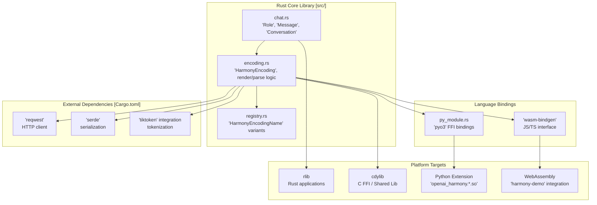
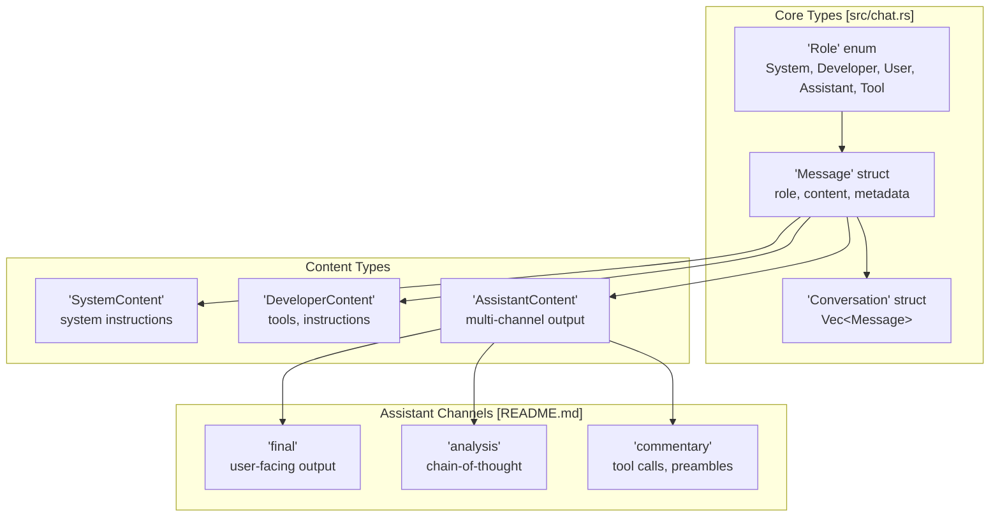
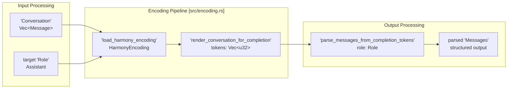
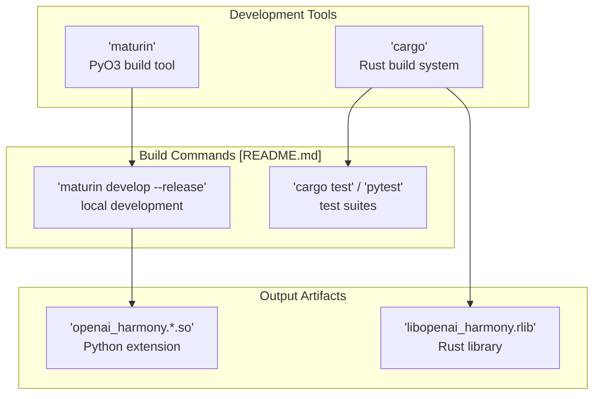

<!-- source: DeepWiki mcp.deepwiki.com · repo openai/harmony · page 1 Overview · fetched 2026-10-26 -->

# Overview

Relevant source files

The following files were used as context for generating this wiki page:

- [AGENTS.md](AGENTS.md)
- [Cargo.toml](Cargo.toml)
- [README.md](README.md)
- [run_checks.sh](run_checks.sh)

This document provides a comprehensive overview of the `openai-harmony` repository, a multi-platform library implementing OpenAI's harmony response format for the gpt-oss model series. The harmony format defines conversation structures, reasoning output channels, and function calling mechanisms specifically designed for open-weight models [README.md:1-13]().

For detailed information about the library's internal Rust structure, see [Core Library Architecture](#1.1). For information on how the Rust core is exposed to other environments, see [Language Bindings](#1.2).

## System Purpose and Architecture

The `openai-harmony` library serves as the canonical implementation for parsing and rendering conversations in the harmony format [README.md:48-53](). The system is architected as a high-performance Rust core with language bindings for Python and WebAssembly environments [README.md:132-141]().

### Core System Architecture

**Sources:** [Cargo.toml:9-16](), [README.md:144-159](), [AGENTS.md:1-5]()

### Multi-Platform Compilation Strategy

The library uses Cargo's `crate-type` configuration and feature flags to generate multiple compilation targets from a single Rust codebase [Cargo.toml:9-16]().

*   **Rust Native**: Compiled as an `rlib` for use in other Rust projects [Cargo.toml:11]().
*   **Python**: Uses the `python-binding` feature and `pyo3` to create a native extension [Cargo.toml:15](), [Cargo.toml:45-48]().
*   **WebAssembly**: Uses the `wasm-binding` feature and `wasm-bindgen` for browser-based environments like the harmony-demo [Cargo.toml:16](), [Cargo.toml:49-53]().

**Sources:** [Cargo.toml:9-16](), [Cargo.toml:45-53]()

## Core Data Structures and Message Flow

The harmony format centers around structured conversations with specific role-based message types and multi-channel assistant responses.

### Message Type Hierarchy

The core data structures are defined in `src/chat.rs` and mirrored in the Python wrapper `python/openai_harmony/__init__.py` [README.md:144-159]().

**Sources:** [README.md:72-93](), [README.md:116-126](), [README.md:148-155]()

### Encoding and Parsing Pipeline

The `HarmonyEncoding` handles the conversion between structured objects and token sequences [README.md:48-53]().

**Sources:** [README.md:72-99](), [README.md:116-128](), [README.md:149]()

## Dependency Ecosystem and Integration Points

The library integrates with a specific set of dependencies to provide comprehensive functionality while maintaining cross-platform compatibility.

| Dependency | Purpose | Configuration |
|------------|---------|---------------|
| `pyo3` | Python FFI bindings | Optional feature `python-binding` [Cargo.toml:15, 45]() |
| `wasm-bindgen` | WebAssembly FFI bindings | Optional feature `wasm-binding` [Cargo.toml:16, 49]() |
| `reqwest` | HTTP client for tool/image fetching | Uses `rustls-tls` for cross-platform CI [Cargo.toml:32-42]() |
| `serde` | Serialization/Deserialization | Derived for most chat structures [Cargo.toml:22]() |
| `tiktoken` | Tokenization engine | Integrated via `encoding.rs` [README.md:139, 149]() |

**Sources:** [Cargo.toml:13-53](), [README.md:132-141]()

## Build System Integration

The project uses `maturin` for Python packaging and `cargo` for the native Rust core.

**Sources:** [README.md:163-207](), [AGENTS.md:7-9](), [run_checks.sh:5-7]()

For more details on the architecture, see [Core Library Architecture](#1.1). For more on language-specific implementations, see [Language Bindings](#1.2).

---

