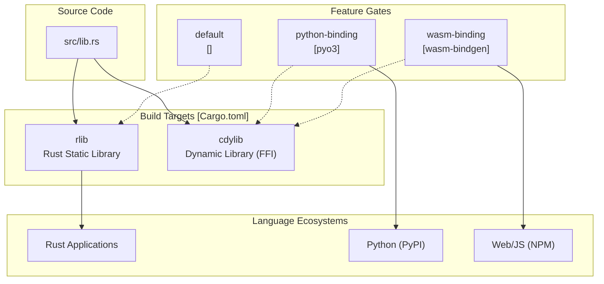
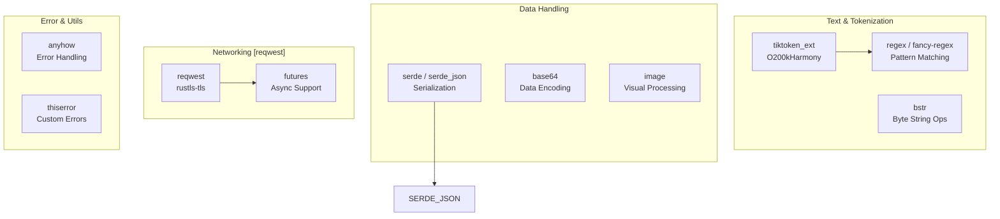
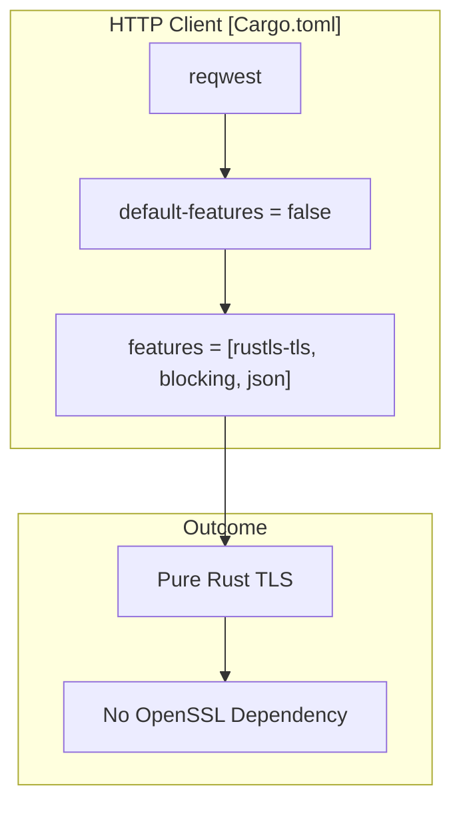

<!-- source: DeepWiki mcp.deepwiki.com · repo openai/harmony · page 1.1 Core Library Architecture · fetched 2026-10-26 -->

# Core Library Architecture

Relevant source files

The following files were used as context for generating this wiki page:

- [Cargo.lock](Cargo.lock)
- [Cargo.toml](Cargo.toml)
- [src/lib.rs](src/lib.rs)
- [src/registry.rs](src/registry.rs)

This document describes the core architecture of the `openai-harmony` Rust library, including its crate structure, multi-platform compilation targets, and dependency graph. The library serves as the reference implementation for the harmony response format used in OpenAI's `gpt-oss` model series.

## Library Structure and Build Configuration

The `openai-harmony` crate is organized as a multi-target library. The internal module structure separates core encoding logic, registry management, and platform-specific bindings.

### Module Organization
The root of the library `src/lib.rs` defines the public API and manages conditional compilation for language bindings.

| Module | File | Purpose |
| :--- | :--- | :--- |
| `chat` | `src/chat.rs` | Defines the high-level chat message structures. |
| `encoding` | `src/encoding.rs` | Contains the core `HarmonyEncoding` and `StreamableParser` logic. |
| `registry` | `src/registry.rs` | Manages the instantiation of specific harmony configurations (e.g., `HarmonyGptOss`). |
| `tiktoken` | `src/tiktoken.rs` | Internal BPE tokenizer integration. |
| `tiktoken_ext` | `src/tiktoken_ext.rs` | Extensions for specific OpenAI tokenizers like `O200kHarmony`. |
| `py_module` | `src/py_module.rs` | Python FFI logic (enabled via `python-binding`). |
| `wasm_module` | `src/wasm_module.rs` | WebAssembly FFI logic (enabled via `wasm-binding`). |

Sources: [src/lib.rs:3-21]()

### Build Targets and Features
The library supports several compilation targets through Cargo's `crate-type` and feature gates.

Sources: [Cargo.toml:9-16](), [src/lib.rs:16-20]()

## Core Dependencies Architecture

The library relies on a specific set of dependencies to handle text processing, networking, and serialization.

Sources: [Cargo.toml:18-43]()

## Platform-Specific Implementation

The library uses conditional compilation to handle architectural differences, particularly between standard targets and WebAssembly.

### Registry and Encoding Loading
The `load_harmony_encoding` function is the primary entry point for obtaining a `HarmonyEncoding` instance. Its implementation differs based on the target architecture to accommodate `wasm32` constraints.

*   **Standard Targets:** Uses a synchronous `load_harmony_encoding` function. [src/registry.rs:45-82]()
*   **Wasm Targets:** Uses an `async` version of `load_harmony_encoding` to handle asynchronous resource fetching in browser environments. [src/registry.rs:85-123]()

### Token Mapping Configuration
The library defines a specific set of `FormattingToken` variants mapped to special string sequences used by the `gpt-oss` models.

| FormattingToken Variant | String Literal |
| :--- | :--- |
| `Start` | `<|start|>` |
| `Message` | `<|message|>` |
| `EndMessage` | `<|end|>` |
| `EndMessageDoneSampling` | `<|return|>` |
| `Refusal` | `<|refusal|>` |
| `ConstrainedFormat` | `<|constrain|>` |
| `Channel` | `<|channel|>` |
| `EndMessageAssistantToTool` | `<|call|>` |
| `BeginUntrusted` | `<|untrusted|>` |
| `EndUntrusted` | `<|end_untrusted|>` |

Sources: [src/registry.rs:58-69](), [src/registry.rs:98-109]()

## Multi-Platform Compilation Strategy

### TLS Backend Configuration
To ensure compatibility across CI runners and avoid local OpenSSL dependencies, the library explicitly configures `reqwest` to use the `rustls-tls` backend.

Sources: [Cargo.toml:32-42]()

### Package Metadata
The library is versioned and licensed for open-weight model ecosystem support.

| Field | Value |
| :--- | :--- |
| Package Name | `openai-harmony` |
| Version | `0.0.8` |
| License | `Apache-2.0` |
| Edition | `2021` |

Sources: [Cargo.toml:1-5]()

---

