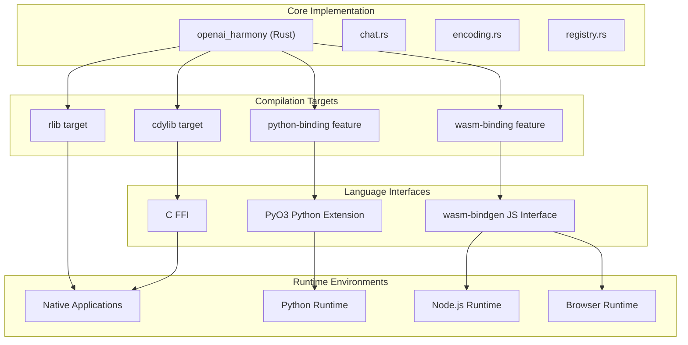
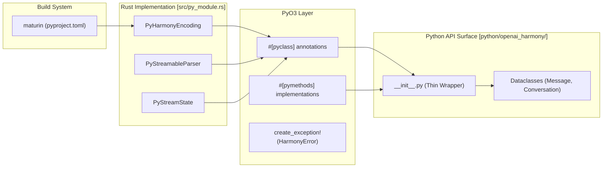
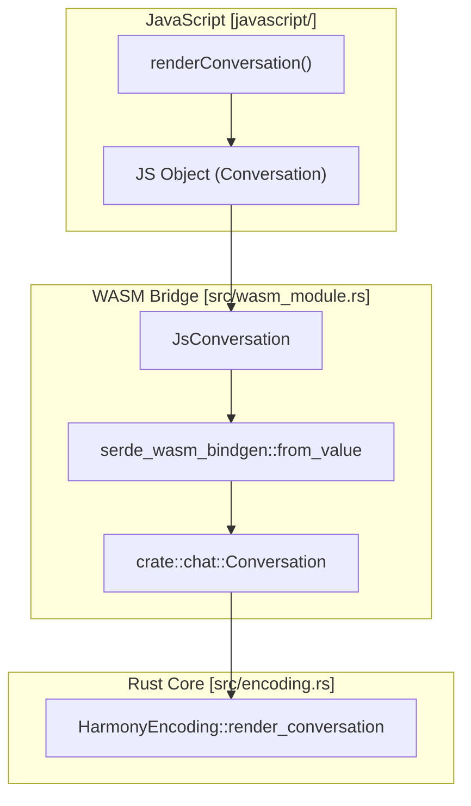

<!-- source: DeepWiki mcp.deepwiki.com · repo openai/harmony · page 1.2 Language Bindings · fetched 2026-10-26 -->

# Language Bindings

Relevant source files

The following files were used as context for generating this wiki page:

- [javascript/README.md](javascript/README.md)
- [javascript/package.json](javascript/package.json)
- [pyproject.toml](pyproject.toml)
- [src/py_module.rs](src/py_module.rs)
- [src/wasm_module.rs](src/wasm_module.rs)

This document covers how the core Rust implementation of `openai-harmony` is exposed to other programming languages through language bindings. The library provides native interfaces for Python applications via PyO3 and for JavaScript/Web environments via WebAssembly.

For information about the core Rust library architecture, see [Core Library Architecture](). For Python-specific API documentation, see [Python API Reference]().

## Binding Architecture Overview

The `openai-harmony` library uses a multi-target compilation strategy to expose its Rust core to different runtime environments. The core logic remains in Rust while language-specific bindings provide idiomatic interfaces for each target platform.

### Multi-Target Compilation Strategy

**Sources:** [pyproject.toml:21-23](), [src/py_module.rs:1-13](), [src/wasm_module.rs:1-10]()

## Python Bindings via PyO3

The Python bindings expose the Rust functionality through the `pyo3` crate, creating a native Python extension module. To keep the FFI boundary light-weight, complex data structures like `Conversation` and `Message` are passed as JSON strings and deserialized within the Rust binding layer.

### PyO3 Integration Architecture

**Sources:** [src/py_module.rs:1-13](), [src/py_module.rs:35-52](), [pyproject.toml:1-14]()

### Data Flow and Serialization

The Python interface uses `serde_json` to bridge the gap between Python's high-level types and Rust's internal representation.

*   **Rendering:** Python dataclasses are serialized to JSON in the Python wrapper and passed to `PyHarmonyEncoding::render_conversation_for_completion` [src/py_module.rs:87-92]().
*   **Parsing:** Tokens are passed to `PyHarmonyEncoding::parse_messages_from_completion_tokens`, which returns a JSON string [src/py_module.rs:242-263](). This string is then parsed back into Python objects.
*   **Error Handling:** A custom `HarmonyError` exception is defined using `create_exception!` to allow Python users to catch library-specific failures [src/py_module.rs:25-26]().

**Sources:** [src/py_module.rs:94-100](), [src/py_module.rs:264-266]()

## WebAssembly Bindings via wasm-bindgen

The WebAssembly bindings enable the harmony library to run in browser and Node.js environments. Unlike the Python bindings which use JSON strings, the WASM layer uses `serde-wasm-bindgen` to convert between JavaScript objects and Rust structs directly.

### WASM Implementation Detail

The `JsHarmonyEncoding` struct wraps the core `HarmonyEncoding` and exposes methods via `#[wasm_bindgen]` [src/wasm_module.rs:61-67]().

**Sources:** [src/wasm_module.rs:104-112](), [src/wasm_module.rs:127-130]()

### TypeScript Definitions

To ensure type safety in the demo application and for library consumers, a `typescript_custom_section` defines the interfaces for `Message`, `Author`, and `Content` [src/wasm_module.rs:26-59]().

| JS Interface | Rust Equivalent | Role |
|--------------|-----------------|------|
| `Message` | `crate::chat::Message` | Represents a single message in a thread [src/wasm_module.rs:38-44]() |
| `Content` | `crate::chat::Content` | Sum type for text, system, or developer content [src/wasm_module.rs:33-36]() |
| `JsHarmonyEncoding` | `crate::encoding::HarmonyEncoding` | Main entry point for rendering and parsing [src/wasm_module.rs:61-64]() |

**Sources:** [src/wasm_module.rs:26-59]()

## Cross-Language API Surface

The language bindings maintain API parity while adapting to each language's idioms and type systems.

### Key Shared Functionality

Both bindings expose the following critical operations from the Rust core:

1.  **Rendering:** `render_conversation_for_completion` converts high-level conversation objects into a sequence of token IDs (`Vec<u32>`) [src/py_module.rs:87-122](), [src/wasm_module.rs:73-102]().
2.  **Parsing:** `parse_messages_from_completion_tokens` converts model-generated tokens back into structured `Message` objects [src/py_module.rs:242-267](), [src/wasm_module.rs:164-188]().
3.  **Decoding:** Access to the underlying tokenizer for `decode_utf8` and `decode_bytes` [src/py_module.rs:269-282](), [src/wasm_module.rs:190-202]().
4.  **Streaming:** The `StreamableParser` is exposed to support incremental parsing of model output [src/py_module.rs:41-44](), [src/wasm_module.rs:205-208]().

### Distribution and Packaging

| Language | Package Name | Build Tool | Configuration |
|----------|--------------|------------|---------------|
| Python | `openai-harmony` | `maturin` | [pyproject.toml:1-25]() |
| JavaScript | `@openai/harmony` | `wasm-pack` | [javascript/package.json:1-12]() |

**Sources:** [pyproject.toml:5-15](), [javascript/package.json:1-4]()

---

