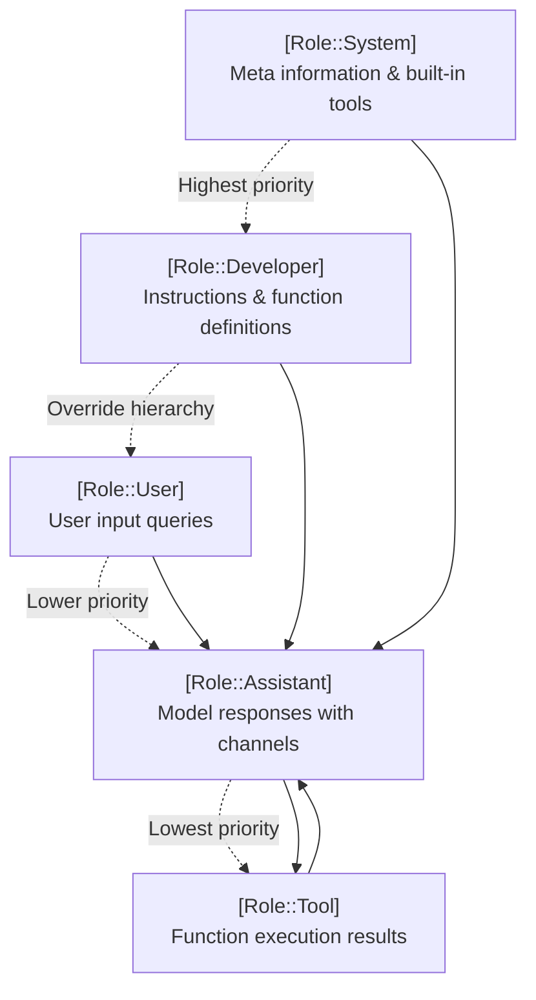
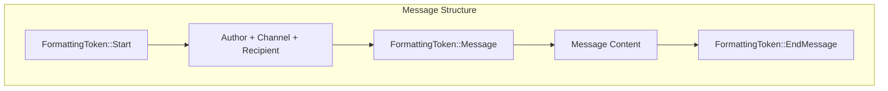

<!-- source: DeepWiki mcp.deepwiki.com · repo openai/harmony · page 2 Harmony Response Format · fetched 2026-10-26 -->

# Harmony Response Format

<details>
<summary>Relevant source files</summary>

The following files were used as context for generating this wiki page:

- [docs/format.md](docs/format.md)
- [src/chat.rs](src/chat.rs)
- [src/encoding.rs](src/encoding.rs)

</details>


## Purpose and Scope

This document provides a comprehensive technical specification of the harmony response format used by OpenAI's `gpt-oss` model series. The harmony format defines structured conversation patterns, multi-channel output routing, tool calling mechanisms, and special token sequences that enable sophisticated model behaviors including chain-of-thought reasoning and function execution.

The format is designed to mimic the OpenAI Responses API while providing a specific token-level structure required for `gpt-oss` to function correctly [docs/format.md:1-3]().

For information about the Python API implementation details, see [Python API Reference](#2.1). For the Rust core implementation, see [Rust API Reference](#2.2).

## Core Format Concepts

The harmony response format is built around several fundamental concepts that structure how messages flow between different participants in a conversation.

### Message Roles and Hierarchy

The format defines five distinct message roles with a clear instruction hierarchy:

| Role | Purpose |
| :--- | :--- |
| `system` | Specifies reasoning effort, knowledge cutoff, and built-in tools [docs/format.md:13](). |
| `developer` | Contains instructions (system prompt) and available function tools [docs/format.md:14](). |
| `user` | Represents the input to the model [docs/format.md:15](). |
| `assistant` | Model output (tool calls or messages) associated with a "channel" [docs/format.md:16](). |
| `tool` | Represents the output of a tool call [docs/format.md:17](). |



Sources: [docs/format.md:7-19](), [src/chat.rs:31-39]()

### Assistant Channel System

Assistant messages are routed through three distinct channels that separate content by intended audience and purpose:

| Channel | Purpose | Safety Level |
| :--- | :--- | :--- |
| `final` | Intended for the end-user [docs/format.md:27](). | Full safety standards. |
| `analysis` | Used for Chain of Thought (CoT) and built-in tools [docs/format.md:28-29](). | **Reduced safety standards.** |
| `commentary` | Function tool calls and preambles [docs/format.md:29](). | Standard safety. |

```mermaid
graph LR
    assistant["`Role::Assistant`"]
    
    final["`final` channel<br/>User responses"]
    analysis["`analysis` channel<br/>Chain-of-thought"]
    commentary["`commentary` channel<br/>Tool calls & preambles"]
    
    functions["`functions.*`<br/>Custom tools"]
    browser["`browser.*`<br/>Built-in Search"]
    python["`python`<br/>Code execution"]
    
    assistant --> final
    assistant --> analysis
    assistant --> commentary
    
    commentary --> functions
    commentary --> browser
    analysis --> python
```

Sources: [docs/format.md:22-30](), [src/chat.rs:126-138]()

## Special Token Specifications

The harmony format uses specific `FormattingToken` variants that are mapped to actual vocabulary tokens during rendering [src/encoding.rs:42-55]().

| Token (Internal) | String Representation | Purpose |
| :--- | :--- | :--- |
| `Start` | `<\|start\|>` | Message beginning marker [src/encoding.rs:60](). |
| `EndMessage` | `<\|end\|>` | Message completion marker [src/encoding.rs:62](). |
| `Message` | `<\|message\|>` | Separates metadata/header from content [src/encoding.rs:61](). |
| `Channel` | `<\|channel\|>` | Channel specification marker [src/encoding.rs:67](). |
| `ConstrainedFormat` | `<\|constrain\|>` | Data type specification (e.g., json) [src/encoding.rs:66](). |
| `EndMessageAssistantToTool` | `<\|call\|>` | Stop token for tool invocation [src/encoding.rs:64](). |
| `EndMessageDoneSampling` | `<\|return\|>` | Stop token for final response [src/encoding.rs:63](). |



Sources: [src/encoding.rs:57-74](), [docs/format.md:184-206]()

## Implementation Class Structure

The harmony format is implemented through a hierarchy of Rust data structures in `src/chat.rs` and `src/encoding.rs`.

```mermaid
graph TB
    subgraph "Core Data Types [src/chat.rs]"
        Role["`Role` (enum)"]
        Message["`Message` (struct)"]
        Conversation["`Conversation` (struct)"]
        Author["`Author` (struct)"]
    end
    
    subgraph "Content Types [src/chat.rs]"
        SystemContent["`SystemContent`"]
        DeveloperContent["`DeveloperContent`"]
        ToolDescription["`ToolDescription`"]
    end
    
    subgraph "Encoding System [src/encoding.rs]"
        HarmonyEncoding["`HarmonyEncoding`"]
        FormattingToken["`FormattingToken` (enum)"]
        ParsedHeader["`ParsedHeader` (struct)"]
    end
    
    Role --> Author
    Author --> Message
    Message --> Conversation
    SystemContent --> Message
    DeveloperContent --> Message
    ToolDescription --> DeveloperContent
    
    HarmonyEncoding --> FormattingToken
    HarmonyEncoding --> ParsedHeader
```

Sources: [src/chat.rs:11-138](), [src/encoding.rs:15-94]()

## Built-in Tool Specifications

### Browser Tool Namespace
The `browser` tool provides search and navigation. It typically triggers on the `analysis` channel [docs/format.md:29]().
- **Methods**: `search`, `open`, `find` [docs/format.md:515-575]().
- **Citations**: Uses the `【{cursor}†L{line}】` format for grounding [docs/format.md:550]().

### Python Tool Integration
The `python` tool enables code execution.
- **Channel**: Always routes to the `analysis` channel [docs/format.md:576]().
- **Recipient**: The string `python` [docs/format.md:576]().
- **Environment**: Stateful Jupyter notebook with access to `/mnt/data` [docs/format.md:580-590]().

## Reasoning and Chain-of-Thought

The format supports three reasoning levels via `ReasoningEffort` [src/chat.rs:209-213]():
1. **Low**: Minimal internal processing.
2. **Medium**: Balanced reasoning.
3. **High**: Extensive chain-of-thought in the `analysis` channel.

**Important**: Content in the `analysis` channel should be hidden from end-users as it does not adhere to standard safety filters [docs/format.md:28]().

Sources: [docs/format.md:278-309](), [src/chat.rs:209-213]()

---

