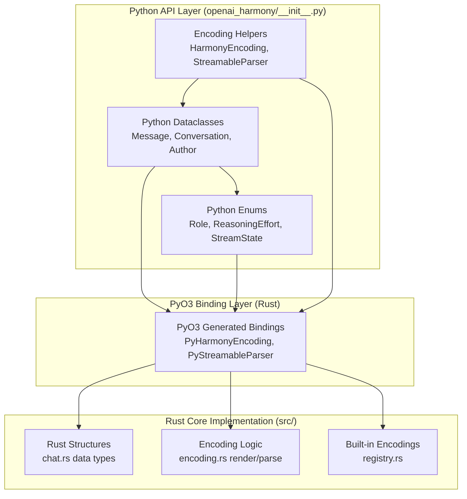
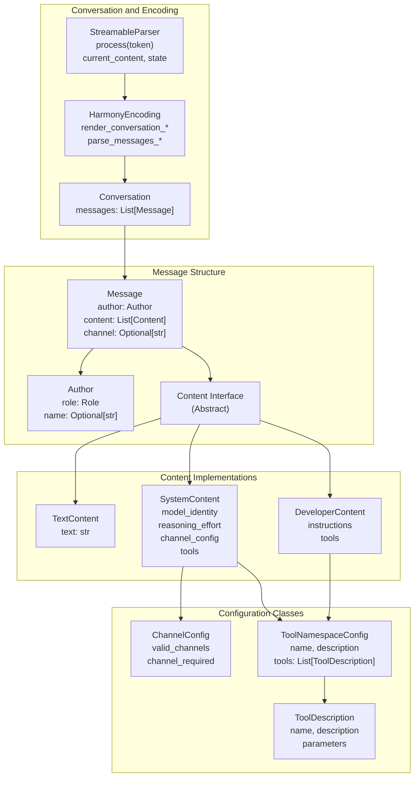
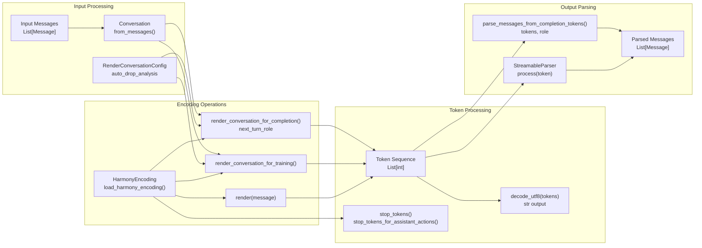

<!-- source: DeepWiki mcp.deepwiki.com · repo openai/harmony · page 2.1 Python API Reference · fetched 2026-10-26 -->

# Python API Reference

<details>
<summary>Relevant source files</summary>

The following files were used as context for generating this wiki page:

- [docs/python.md](docs/python.md)
- [python/openai_harmony/__init__.py](python/openai_harmony/__init__.py)
- [tests/test_harmony.py](tests/test_harmony.py)

</details>


This document provides comprehensive reference documentation for the Python bindings of the `openai-harmony` library. The Python API exposes the core Rust functionality through PyO3-generated bindings, providing dataclasses that mirror Rust structures and encoding helpers for working with the harmony response format.

## Installation and Imports

The `openai-harmony` package is distributed via PyPI and installs a module named `openai_harmony`. The package provides a complete Python interface to the harmony format renderer and parser.

Installation:
```bash
pip install openai-harmony
```

Common import patterns include importing specific classes or using wildcard imports for convenience:

```python
from openai_harmony import Message, Conversation, load_harmony_encoding
# or
from openai_harmony import *
```

Sources: [docs/python.md:5-17]()

## Python Bindings Architecture

The Python API is built on PyO3 bindings that expose the Rust core functionality. The architecture follows a layered approach where Python dataclasses mirror Rust structures, and encoding helpers provide high-level interfaces to the underlying tokenization and parsing logic.

**Python to Rust Entity Mapping**


Sources: [python/openai_harmony/__init__.py:1-46](), [docs/python.md:1-3]()

## Core Data Structures and Relationships

The Python API provides a rich set of dataclasses that represent messages, conversations, and configuration. These classes form a hierarchy where `Message` objects contain `Content` implementations, and `Conversation` objects aggregate multiple messages.

**Class Relationship Diagram**


Sources: [python/openai_harmony/__init__.py:89-250](), [docs/python.md:32-92]()

## Encoding and Parsing Workflow

The encoding workflow transforms conversations into tokens for model consumption and parses model outputs back into structured messages. The `HarmonyEncoding` class provides the primary interface, with `StreamableParser` offering incremental parsing capabilities.

**Data Flow: Natural Language to Token Space**


Sources: [python/openai_harmony/__init__.py:438-550](), [docs/python.md:101-119]()

## Enumerations

The Python API includes several enumerations that mirror the Rust implementation:

| Enumeration | Values | Purpose |
|-------------|--------|---------|
| `Role` | `USER`, `ASSISTANT`, `SYSTEM`, `DEVELOPER`, `TOOL` | Identifies message author type [python/openai_harmony/__init__.py:89-96]() |
| `ReasoningEffort` | `LOW`, `MEDIUM`, `HIGH` | Controls assistant reasoning depth [python/openai_harmony/__init__.py:142-145]() |
| `StreamState` | `EXPECT_START`, `HEADER`, `CONTENT` | Tracks incremental parser state [docs/python.md:28-28]() |
| `HarmonyEncodingName` | `HARMONY_GPT_OSS` | Available encoding identifiers [tests/test_harmony.py:74-74]() |

Sources: [python/openai_harmony/__init__.py:89-145](), [docs/python.md:21-28]()

## Message Construction and Content Types

Messages are constructed using the `Message` class with various content types. The library provides convenience constructors and builder patterns for common use cases:

```python
# Basic message construction
Message.from_role_and_content(Role.USER, "Hello")
Message.from_role_and_contents(Role.ASSISTANT, [TextContent("Response")])

# System message with configuration
SystemContent.new() \
    .with_model_identity("Custom identity") \
    .with_reasoning_effort(ReasoningEffort.HIGH) \
    .with_channel_config(ChannelConfig.require_channels(["analysis", "final"])) \
    .with_browser_tool()

# Developer message with instructions
DeveloperContent.new() \
    .with_instructions("Use these tools carefully")
```

Sources: [python/openai_harmony/__init__.py:181-280](), [docs/python.md:62-85]()

## Tool Configuration

The API provides built-in tool configurations and supports custom tool definitions:

| Tool Component | Purpose | Key Methods |
|----------------|---------|-------------|
| `ToolDescription` | Individual tool definition | `new(name, description, parameters)` [python/openai_harmony/__init__.py:130-140]() |
| `ToolNamespaceConfig` | Tool grouping | `browser()`, `python()` [python/openai_harmony/__init__.py:157-179]() |

Custom tools can be defined using `ToolDescription` objects and grouped into namespaces via `ToolNamespaceConfig`.

Sources: [python/openai_harmony/__init__.py:130-179](), [docs/python.md:44-54]()

## Serialization and Persistence

Conversations and messages support JSON serialization for persistence and data exchange:

```python
# Conversation serialization
conversation.to_json()  # -> str
Conversation.from_json(json_str)  # -> Conversation

# Message serialization
message.to_dict()  # -> dict
Message.from_dict(message_dict)  # -> Message
```

Sources: [python/openai_harmony/__init__.py:365-430](), [docs/python.md:85-91]()

## Error Handling

The Python bindings raise standard Python exceptions and custom `HarmonyError` instances for error conditions:

| Exception Type | Common Causes | Usage Context |
|----------------|---------------|---------------|
| `HarmonyError` | Disallowed special tokens, Rust-level logic errors | Core library operations [python/openai_harmony/__init__.py:38-39]() |
| `RuntimeError` | Rendering/parsing failures, malformed tokens | Encoding operations [docs/python.md:165-167]() |
| `ValueError` | Invalid arguments, unknown enum values | Parameter validation [python/openai_harmony/__init__.py:100-100]() |
| `ModuleNotFoundError` | Missing compiled extension | Installation/Build issues [python/openai_harmony/__init__.py:48-59]() |

Recommended error handling pattern:
```python
try:
    tokens = encoding.render_conversation_for_completion(conversation, Role.ASSISTANT)
    parsed = encoding.parse_messages_from_completion_tokens(tokens, Role.ASSISTANT)
except (RuntimeError, HarmonyError) as err:
    print(f"Encoding/parsing failed: {err}")
```

Sources: [python/openai_harmony/__init__.py:38-73](), [docs/python.md:160-179]()

## Complete Usage Example

The following example demonstrates the complete workflow from message creation through token rendering and parsing:

```python
from openai_harmony import (
    Role, Message, Conversation, SystemContent,
    load_harmony_encoding, HarmonyEncodingName
)

# Create messages
system = Message.from_role_and_content(Role.SYSTEM, SystemContent.new())
user = Message.from_role_and_content(Role.USER, "What is 2 + 2?")

# Build conversation
conversation = Conversation.from_messages([system, user])

# Load encoding and render
encoding = load_harmony_encoding(HarmonyEncodingName.HARMONY_GPT_OSS)
tokens = encoding.render_conversation_for_completion(conversation, Role.ASSISTANT)

# Parse and decode
text_output = encoding.decode_utf8(tokens)
parsed_messages = encoding.parse_messages_from_completion_tokens(tokens, role=Role.ASSISTANT)
```

Sources: [tests/test_harmony.py:77-101](), [docs/python.md:126-158]()

---

