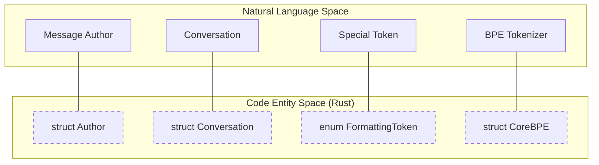
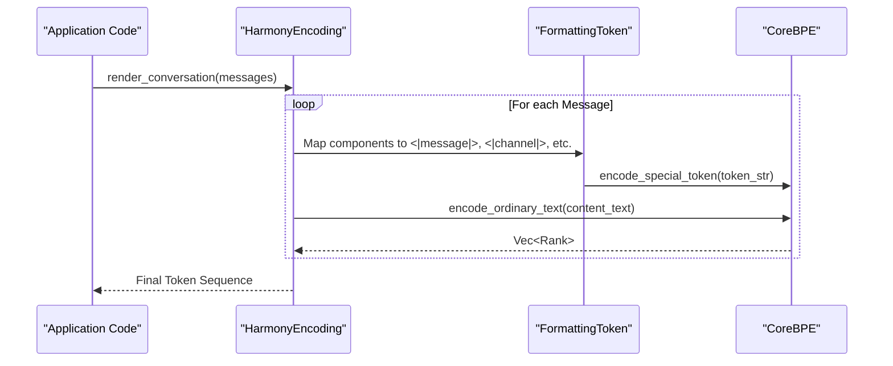

<!-- source: DeepWiki mcp.deepwiki.com · repo openai/harmony · page 2.2 Rust API Reference · fetched 2026-10-26 -->

# Rust API Reference

<details>
<summary>Relevant source files</summary>

The following files were used as context for generating this wiki page:

- [docs/rust.md](docs/rust.md)
- [src/chat.rs](src/chat.rs)
- [src/encoding.rs](src/encoding.rs)
- [src/tiktoken.rs](src/tiktoken.rs)
- [src/tiktoken_ext/mod.rs](src/tiktoken_ext/mod.rs)
- [src/tiktoken_ext/public_encodings.rs](src/tiktoken_ext/public_encodings.rs)

</details>


The Rust crate serves as the core engine for the Harmony format, providing high-performance tokenization, rendering, and parsing logic. It is designed to be used both as a native Rust library and as the foundation for Python and WebAssembly bindings.

## Crate Architecture

The crate is organized into several key modules, with primary entities re-exported at the root for ease of use [docs/rust.md:3-27]().

| Module | Responsibility |
| :--- | :--- |
| `chat` | Data structures for messages, authors, and conversation state [src/chat.rs:1-240](). |
| `encoding` | The core `HarmonyEncoding` logic, including token rendering and parsing [src/encoding.rs:84-160](). |
| `registry` | Utilities for loading predefined encodings like `HarmonyGptOss` [docs/rust.md:103-117](). |
| `tiktoken` | A Rust-native implementation of OpenAI's Byte Pair Encoding (BPE) [src/tiktoken.rs:164-183](). |

### Entity Mapping: Natural Language to Code Space

The following diagram maps high-level Harmony concepts to their specific Rust implementations.

**Harmony Concept Mapping**

Sources: [src/chat.rs:11-14](), [src/chat.rs:273-276](), [src/encoding.rs:42-55](), [src/tiktoken.rs:164-172]()

---

## Core Data Structures

### Chat Module
The `chat` module defines the structural components of a Harmony interaction.

*   **`Role`**: An enum representing the participant type: `User`, `Assistant`, `System`, `Developer`, or `Tool` [src/chat.rs:33-39]().
*   **`Author`**: Combines a `Role` with an optional `name` string [src/chat.rs:11-14]().
*   **`Message`**: The primary unit of communication. It includes the `author`, `recipient`, a vector of `Content`, and optional `channel` or `content_type` fields [src/chat.rs:106-138]().
*   **`Content`**: An enum that can be `Text`, `SystemContent`, or `DeveloperContent` [src/chat.rs:75-81]().

Sources: [src/chat.rs:11-138](), [docs/rust.md:34-75]()

---

## HarmonyEncoding

`HarmonyEncoding` is the central struct used for converting between high-level `Message` objects and low-level token sequences (`Vec<Rank>`).

### Key Methods
*   **`render_conversation_for_completion`**: Renders a conversation and appends the necessary tokens to prompt the model for a specific role's response [docs/rust.md:87-87]().
*   **`parse_messages_from_completion_tokens`**: Converts a sequence of tokens back into `Message` objects using strict validation [docs/rust.md:91-91]().
*   **`stop_tokens()`**: Returns a `HashSet<Rank>` of tokens that should trigger the end of generation [src/encoding.rs:132-144]().

### Token Rendering Data Flow
The diagram below illustrates how a `Message` is transformed into tokens using `HarmonyEncoding`.

**Message Rendering Pipeline**

Sources: [src/encoding.rs:164-210](), [src/encoding.rs:42-74](), [src/tiktoken.rs:69-77]()

---

## StreamableParser

The `StreamableParser` provides an incremental way to parse model output as it is being generated (streaming).

*   **Initialization**: Created via `StreamableParser::new(encoding, role)` [docs/rust.md:98-98]().
*   **Processing**: Tokens are fed one-by-one into the `process(token)` method.
*   **State Access**: Developers can query the current state of the parser, including `current_content`, `current_role`, and the accumulated `messages` [docs/rust.md:98-99]().
*   **Options**: Supports `ParseOptions` to toggle `strict` validation. Disabling strict mode allows the parser to attempt recovery from malformed model output [docs/rust.md:95-99]().

Sources: [docs/rust.md:97-100](), [src/encoding.rs:16-21]()

---

## Tiktoken Integration

Harmony relies on a custom implementation of the Tiktoken tokenizer for performance and environment flexibility (e.g., WASM support).

### CoreBPE
The `CoreBPE` struct manages the vocabulary and the regex-based splitting logic [src/tiktoken.rs:164-183]().
*   **Thread Safety**: Uses a vector of Regex instances (`regex_tls`) to avoid contention across multiple threads [src/tiktoken.rs:175-180]().
*   **Encoding**: Implements `byte_pair_encode` to merge byte sequences into ranks based on the provided vocabulary [src/tiktoken.rs:69-77]().

### Loading Encodings
Encodings are loaded via the `registry` module, which handles downloading vocab files or loading them from a local cache.

```rust
use openai_harmony::{load_harmony_encoding, HarmonyEncodingName};

// Load the standard Harmony GPT-OSS encoding
let enc = load_harmony_encoding(HarmonyEncodingName::HarmonyGptOss)?;
```
Sources: [docs/rust.md:103-117](), [src/tiktoken_ext/public_encodings.rs:78-105]()

---

## Usage Example: Render and Parse

This example demonstrates the round-trip flow from a Rust `Conversation` to tokens and back to parsed messages.

```rust
use openai_harmony::chat::{Conversation, Message, Role};
use openai_harmony::{load_harmony_encoding, HarmonyEncodingName};

fn main() -> anyhow::Result<()> {
    // 1. Initialize Encoding
    let enc = load_harmony_encoding(HarmonyEncodingName::HarmonyGptOss)?;

    // 2. Build Conversation
    let convo = Conversation::from_messages([
        Message::from_role_and_content(Role::User, "Hello, world!"),
    ]);

    // 3. Render for Completion (Assistant response)
    let tokens = enc.render_conversation_for_completion(&convo, Role::Assistant, None)?;

    // 4. Parse tokens back to messages
    let parsed = enc.parse_messages_from_completion_tokens(tokens, Some(Role::Assistant))?;
    
    Ok(())
}
```
Sources: [docs/rust.md:128-151](), [src/encoding.rs:164-169]()

---

