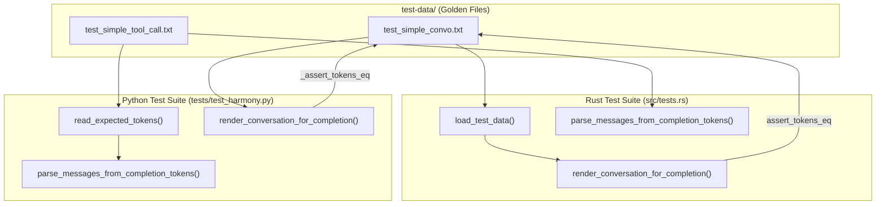
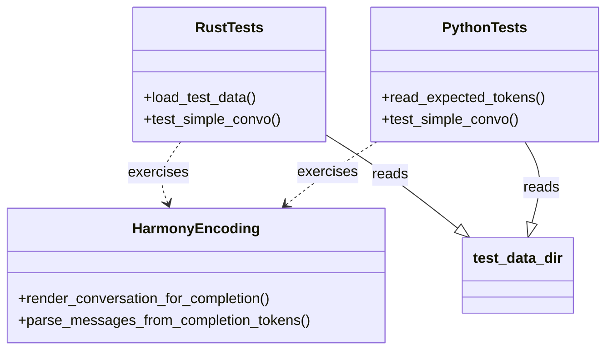

<!-- source: DeepWiki mcp.deepwiki.com · repo openai/harmony · page 2.3 Test Fixtures and Golden Files · fetched 2026-10-26 -->

# Test Fixtures and Golden Files

Relevant source files

The following files were used as context for generating this wiki page:

- [src/tests.rs](src/tests.rs)
- [test-data/test_dropping_cot_by_default.txt](test-data/test_dropping_cot_by_default.txt)
- [test-data/test_reasoning_system_message.txt](test-data/test_reasoning_system_message.txt)
- [test-data/test_simple_convo.txt](test-data/test_simple_convo.txt)
- [test-data/test_simple_tool_call.txt](test-data/test_simple_tool_call.txt)
- [test-data/test_streamable_parser.txt](test-data/test_streamable_parser.txt)
- [tests/test_harmony.py](tests/test_harmony.py)

The `openai-harmony` repository utilizes a central repository of "golden" test fixtures located in the `test-data/` directory. These fixtures provide a source of truth for validating the rendering and parsing logic across both the Rust core and the Python bindings. By using shared text and token files, the system ensures that the Harmony response format is handled identically regardless of the host language.

### Data Flow and Verification

The testing strategy relies on comparing the output of the library's rendering functions against pre-defined golden files. Conversely, parsing tests use these golden files as input to ensure they produce the expected high-level `Message` and `Conversation` objects.

#### Shared Testing Architecture
The following diagram illustrates how the `test-data/` directory serves as the synchronization point between the two language implementations.

**Harmony Test Synchronization**

**Sources:** [src/tests.rs:22-32](), [tests/test_harmony.py:61-63](), [tests/test_harmony.py:80-85]()

### Implementation Details

#### Rust Test Utilities
In the Rust crate, tests are primarily defined in `src/tests.rs`. The utility function `load_test_data` is used to resolve paths relative to the `CARGO_MANIFEST_DIR` and normalize line endings to `\n` to ensure cross-platform consistency [src/tests.rs:22-32]().

Key Rust functions involved in fixture testing:
*   `parse_tokens`: Converts a whitespace-separated string of integers from a fixture file into a `Vec<Rank>` (token IDs) [src/tests.rs:15-20]().
*   `assert_tokens_eq`: A helper that compares two token sequences and provides a human-readable diff using `pretty_assertions` if they mismatch [src/tests.rs:12]().

#### Python Test Utilities
The Python suite in `tests/test_harmony.py` is a 1-1 port of the Rust tests [tests/test_harmony.py:1-6](). It uses `pytest` and `pathlib` to locate the same `test-data/` directory.

Key Python entities:
*   `read_expected_tokens`: Reads files containing space-separated token IDs [tests/test_harmony.py:61-63]().
*   `_assert_tokens_eq`: Mimics the Rust assertion logic, providing decoded UTF-8 strings in the error message to help debug tokenization issues [tests/test_harmony.py:46-59]().

### Fixture Formats

The fixtures are stored in two primary formats:

1.  **Plain Text (`.txt`)**: Contains the raw string representation of a Harmony conversation, including special tokens like `<|start|>` and `<|message|>`. These are used to verify that the `render_conversation_for_completion` method produces the correct sequence [test-data/test_simple_convo.txt:1-6]().
2.  **Token Sequences**: Some fixtures (like `test_simple_tool_call.txt`) contain space-separated integer token IDs. These are used to test the `StreamableParser` and `parse_messages_from_completion_tokens` methods without relying on the tokenizer's current state [test-data/test_simple_tool_call.txt:1-5]().

| Fixture Name | Type | Purpose |
| :--- | :--- | :--- |
| `test_simple_convo.txt` | Text | Validates standard system/user message rendering [src/tests.rs:37-61]() |
| `test_simple_convo_low_effort.txt` | Text | Validates rendering of reasoning effort parameters [src/tests.rs:64-70]() |
| `test_simple_reasoning_response.txt` | Tokens | Validates parsing of analysis/final channel splits [src/tests.rs:137-140]() |
| `test_simple_tool_call.txt` | Tokens | Validates parsing of tool calls and recipients [src/tests.rs:162-186]() |
| `test_streamable_parser.txt` | Text | Validates the incremental `StreamableParser` logic [test-data/test_streamable_parser.txt:1-2]() |

### Cross-Language Consistency
The tests ensure that the `HarmonyEncoding` loaded via `load_harmony_encoding` behaves identically in both environments. For example, `test_simple_convo` in Rust [src/tests.rs:37]() and `test_simple_convo` in Python [tests/test_harmony.py:77]() both load the `HarmonyGptOss` encoding and verify against `test_simple_convo.txt`.

**Code Entity Mapping**

**Sources:** [src/tests.rs:39-59](), [tests/test_harmony.py:78-102](), [test-data/test_simple_convo.txt:1-6]()

---

