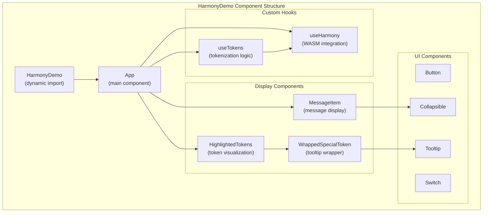
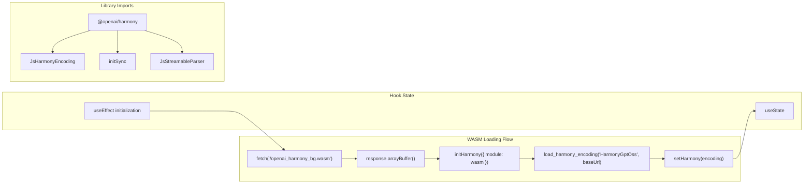
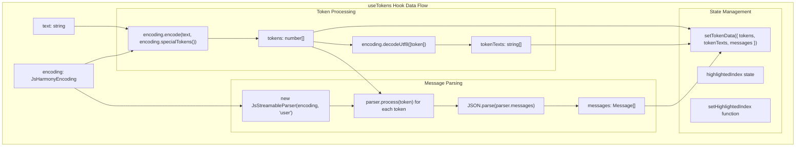
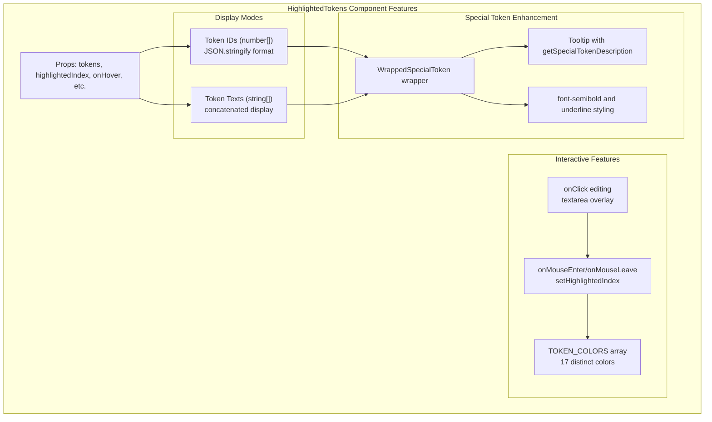
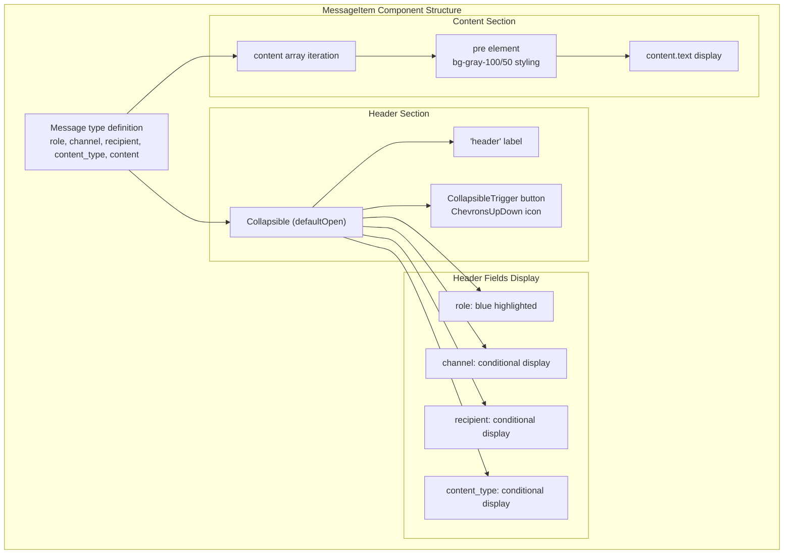
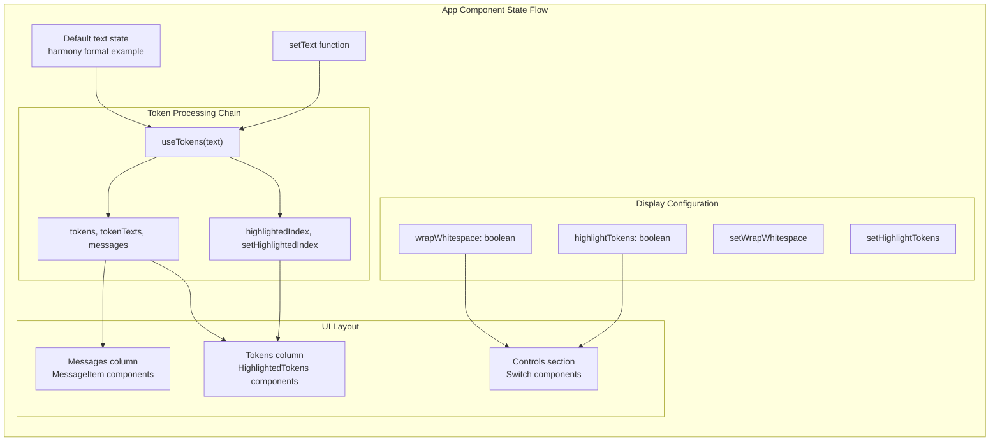

<!-- source: DeepWiki mcp.deepwiki.com · repo openai/harmony · page 3.1 Demo Core Component · fetched 2026-10-26 -->

# Demo Core Component

Relevant source files

The following files were used as context for generating this wiki page:

- [demo/harmony-demo/src/app/layout.tsx](demo/harmony-demo/src/app/layout.tsx)
- [demo/harmony-demo/src/app/page.tsx](demo/harmony-demo/src/app/page.tsx)
- [demo/harmony-demo/src/components/HarmonyDemo.tsx](demo/harmony-demo/src/components/HarmonyDemo.tsx)

This document covers the `HarmonyDemo` React component, which serves as the primary demonstration interface for the openai-harmony library's WebAssembly integration. The component provides an interactive playground for exploring harmony response format tokenization, message parsing, and visualization.

For information about the broader demo application architecture, see [Demo Application Architecture](#3.2). For details on the UI component system used throughout the demo, see [UI Component System](#3.3).

## Purpose and Scope

The `HarmonyDemo` component demonstrates the core functionality of the openai-harmony library in a web browser environment. It showcases WebAssembly integration, real-time tokenization, message parsing, and interactive token visualization. The component serves as both a functional demo and a reference implementation for integrating the harmony library into web applications.

## Component Architecture

The demo is built using a modular React architecture with specialized hooks for harmony library integration and custom components for token visualization.

Sources: [demo/harmony-demo/src/components/HarmonyDemo.tsx:1-487]()

## WebAssembly Integration Pattern

The component implements a comprehensive WebAssembly loading and initialization pattern for the harmony library.

The `useHarmony` hook manages WebAssembly module loading and harmony encoding initialization. It fetches the WASM binary from the public directory, initializes the module using `initSync`, and creates a `HarmonyGptOss` encoding instance.

Sources: [demo/harmony-demo/src/components/HarmonyDemo.tsx:293-312](), [demo/harmony-demo/src/components/HarmonyDemo.tsx:17-22]()

## Token Processing and State Management

The `useTokens` hook orchestrates the core harmony library operations, converting text input into tokens, token texts, and parsed messages.

Sources: [demo/harmony-demo/src/components/HarmonyDemo.tsx:314-356](), [demo/harmony-demo/src/components/HarmonyDemo.tsx:326-349]()

## Special Token System

The component implements a comprehensive special token recognition and documentation system using predefined token mappings.

| Token | ID | Description |
|-------|----|----|
| `<|start|>` | 200006 | Indicates the start of a new message |
| `<|end|>` | 200007 | Indicates the end of a message |
| `<|message|>` | 200008 | Completes the message header |
| `<|channel|>` | 200005 | Part of message header to indicate channel |
| `<|constrain|>` | 200003 | Indicates content type constraint |
| `<|call|>` | 200012 | Stop token for function call completion |
| `<|return|>` | 200002 | Stop token indicating response completion |

The `isSpecialToken` function checks both string and numeric representations, while `getSpecialTokenDescription` provides contextual documentation for each token type in tooltip displays.

Sources: [demo/harmony-demo/src/components/HarmonyDemo.tsx:32-101]()

## Token Visualization Components

The `HighlightedTokens` component provides sophisticated token display with interactive highlighting, editing capabilities, and special token recognition.

The component supports both read-only and editable modes, with a `textarea` overlay for text editing. Token highlighting uses a 17-color rotation system defined in the `TOKEN_COLORS` array, enabling visual distinction between adjacent tokens.

Sources: [demo/harmony-demo/src/components/HarmonyDemo.tsx:121-214](), [demo/harmony-demo/src/components/HarmonyDemo.tsx:52-70]()

## Message Structure Display

The `MessageItem` component renders parsed harmony messages with collapsible headers and structured content display.

Each message field uses conditional rendering and consistent styling with `bg-blue-300/50` highlighting for field values. The content section handles both string and structured content formats through type transformation.

Sources: [demo/harmony-demo/src/components/HarmonyDemo.tsx:227-291](), [demo/harmony-demo/src/components/HarmonyDemo.tsx:216-225]()

## Application State and Integration

The main `App` component coordinates all subsystems and maintains the primary application state for text input, token processing, and display configuration.

The component uses a two-column grid layout with responsive design, displaying parsed messages on the left and token visualizations on the right. Interactive features include hover highlighting coordination between token displays and editable token text input.

Sources: [demo/harmony-demo/src/components/HarmonyDemo.tsx:358-481](), [demo/harmony-demo/src/components/HarmonyDemo.tsx:483-487]()

---

