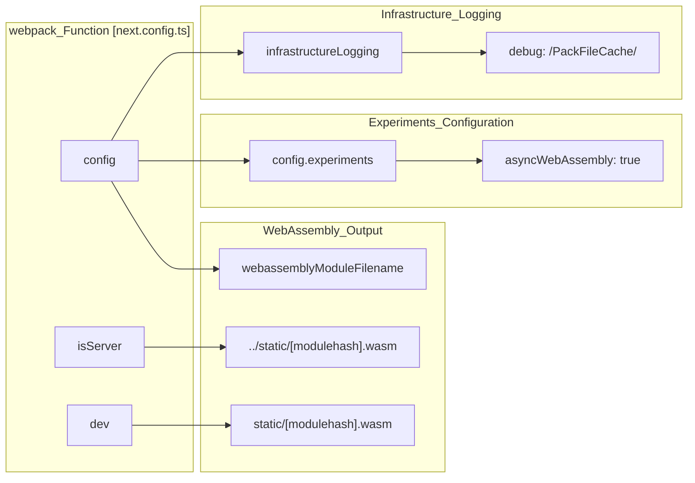
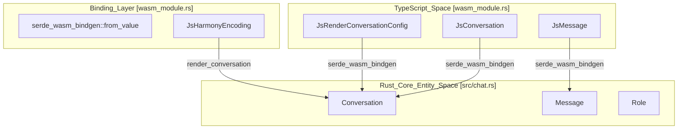

<!-- source: DeepWiki mcp.deepwiki.com · repo openai/harmony · page 3.2 Demo Application Architecture · fetched 2026-10-26 -->

# Demo Application Architecture

Relevant source files

The following files were used as context for generating this wiki page:

- [demo/harmony-demo/next.config.ts](demo/harmony-demo/next.config.ts)
- [demo/harmony-demo/package-lock.json](demo/harmony-demo/package-lock.json)
- [demo/harmony-demo/package.json](demo/harmony-demo/package.json)
- [demo/harmony-demo/tsconfig.json](demo/harmony-demo/tsconfig.json)
- [src/wasm_module.rs](src/wasm_module.rs)

This document covers the technical architecture of the Next.js demonstration application located in `demo/harmony-demo/`. It details the application structure, WebAssembly integration configuration, and build system setup that enables the harmony library to run in a web browser environment.

## Next.js Application Structure

The demo application follows Next.js 15 App Router conventions, utilizing React 19 and a specialized post-install build step to bridge the Rust-based harmony library with the web frontend.

### Dependency and Asset Orchestration

The application architecture relies on a critical `postinstall` script to stage binary assets and model data required for the harmony environment.

| Asset | Source | Destination | Purpose |
|-------|--------|-------------|---------|
| `*.wasm` | `@openai/harmony/dist/web/` | `public/` | WebAssembly binary containing the compiled Rust core. |
| `o200k_base.tiktoken` | OpenAI Public Blob | `public/` | Tokenizer vocabulary for the `o200k_base` encoding. |

**Sources:** [demo/harmony-demo/package.json:6-6](), [demo/harmony-demo/package.json:12-26]()

### Component Path Resolution

The application uses a comprehensive alias system defined in `tsconfig.json` for clean import statements and maintainable code organization:

| Alias | Target Path | Purpose |
|-------|-------------|---------|
| `@/*` | `./src/*` | Main source directory access |

**Sources:** [demo/harmony-demo/tsconfig.json:21-23]()

## WebAssembly Integration Configuration

The demo application requires specialized Next.js configuration to support WebAssembly modules exported by the harmony library.

### Webpack Configuration Architecture

The `webpack` function in `next.config.ts` handles critical WebAssembly integration concerns:

1.  **Module Path Resolution**: Configures different WASM file paths for server-side rendering versus client-side execution to prevent prerendering failures. [demo/harmony-demo/next.config.ts:7-10]()
2.  **Async WebAssembly Support**: Manually enables `asyncWebAssembly` in `config.experiments`, as Webpack 5 does not enable it by default. [demo/harmony-demo/next.config.ts:13-13]()
3.  **Build Debugging**: Configures `infrastructureLogging` to monitor `PackFileCache`, addressing potential issues with Next.js persistent caching and WASM modules. [demo/harmony-demo/next.config.ts:24-24]()

**Sources:** [demo/harmony-demo/next.config.ts:3-28]()

## Wasm Module Bridge

The harmony library is exposed to the Next.js application via `wasm-bindgen` bindings. This bridge translates TypeScript interfaces to Rust data structures.

### Data Flow: TS to Rust

The `JsHarmonyEncoding` struct acts as the primary interface for the frontend. Key methods include:
*   `render_conversation`: Converts a `JsConversation` into a token sequence (`Vec<u32>`). [src/wasm_module.rs:105-130]()
*   `parse_messages_from_completion_tokens`: Deserializes raw tokens back into JSON-compatible message strings. [src/wasm_module.rs:164-188]()
*   `decode_utf8`: Decodes token IDs back into human-readable text. [src/wasm_module.rs:190-196]()

**Sources:** [src/wasm_module.rs:61-130](), [src/wasm_module.rs:164-196]()

## UI and Styling Integration

The application utilizes a modern frontend stack to provide a responsive interface for exploring the harmony format.

### Tech Stack

*   **Next.js 15.4.10**: React framework with App Router. [demo/harmony-demo/package.json:23-23]()
*   **React 19.1.0**: UI library. [demo/harmony-demo/package.json:24-24]()
*   **Tailwind CSS 4**: Utility-first styling with `@tailwindcss/postcss`. [demo/harmony-demo/package.json:29-33]()
*   **Radix UI**: Primitive components for accessibility (Collapsible, Switch, Tooltip, etc.). [demo/harmony-demo/package.json:14-18]()
*   **TanStack Query**: State management for asynchronous data fetching and WASM module loading. [demo/harmony-demo/package.json:19-19]()

### Development and Build Pipeline

The application supports standard Next.js scripts:
*   `npm run dev`: Starts the development server.
*   `npm run build`: Generates the production build, triggering the WASM-aware Webpack configuration.
*   `npm run postinstall`: Essential for local development as it links the local library via `file:../../javascript`.

**Sources:** [demo/harmony-demo/package.json:5-13]()

---

