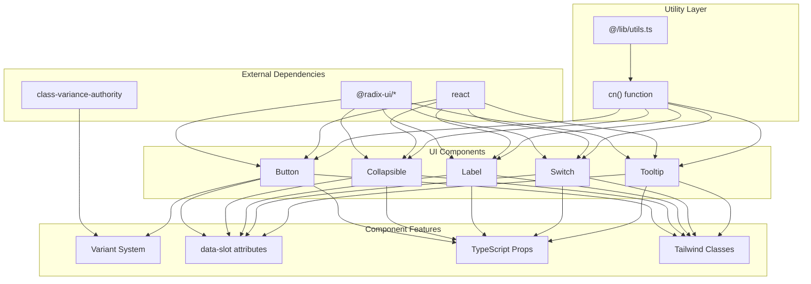
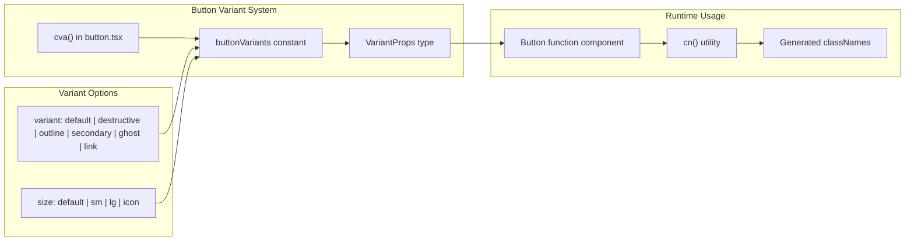
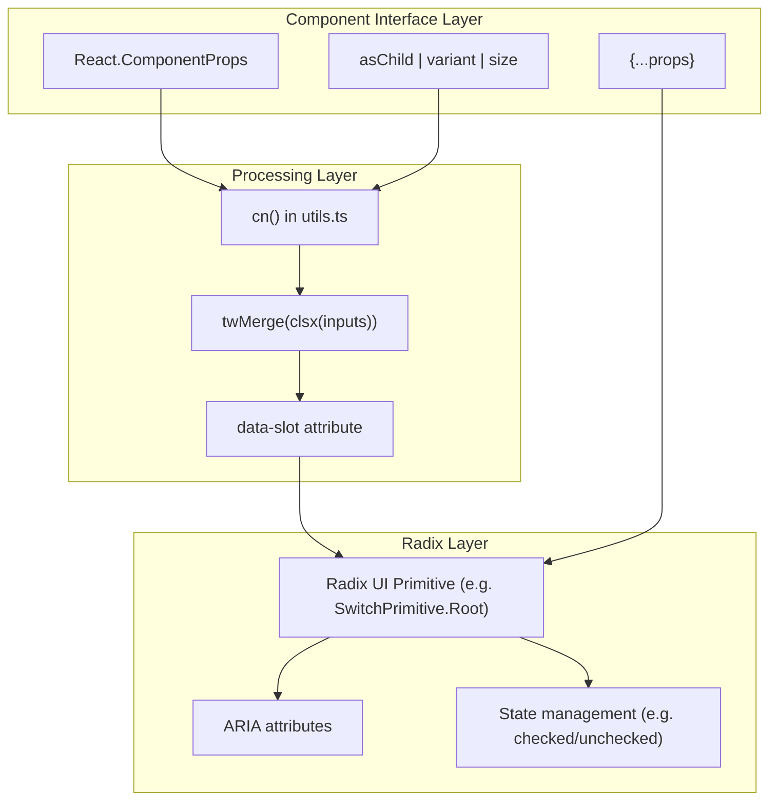

<!-- source: DeepWiki mcp.deepwiki.com · repo openai/harmony · page 3.3 UI Component System · fetched 2026-10-26 -->

# UI Component System

<details>
<summary>Relevant source files</summary>

The following files were used as context for generating this wiki page:

- [.gitignore](.gitignore)
- [demo/harmony-demo/src/components/ui/button.tsx](demo/harmony-demo/src/components/ui/button.tsx)
- [demo/harmony-demo/src/components/ui/collapsible.tsx](demo/harmony-demo/src/components/ui/collapsible.tsx)
- [demo/harmony-demo/src/components/ui/label.tsx](demo/harmony-demo/src/components/ui/label.tsx)
- [demo/harmony-demo/src/components/ui/switch.tsx](demo/harmony-demo/src/components/ui/switch.tsx)
- [demo/harmony-demo/src/components/ui/tooltip.tsx](demo/harmony-demo/src/components/ui/tooltip.tsx)
- [demo/harmony-demo/src/lib/utils.ts](demo/harmony-demo/src/lib/utils.ts)

</details>


This document covers the UI component library used in the `harmony-demo` Next.js application. The component system provides a set of reusable React components built on top of Radix UI primitives with consistent styling and behavior patterns.

For information about the overall demo application architecture, see [Demo Application Architecture](#3.2). For details about the core demo functionality, see [Demo Core Component](#3.1).

## Architecture Overview

The UI component system is implemented as a collection of React components located in [demo/harmony-demo/src/components/ui/](), following a standardized architecture pattern built on Radix UI primitives.

### Component Foundation Architecture



**Sources:** [demo/harmony-demo/src/components/ui/button.tsx:1-59](), [demo/harmony-demo/src/components/ui/collapsible.tsx:1-34](), [demo/harmony-demo/src/components/ui/label.tsx:1-24](), [demo/harmony-demo/src/components/ui/switch.tsx:1-31](), [demo/harmony-demo/src/components/ui/tooltip.tsx:1-61](), [demo/harmony-demo/src/lib/utils.ts:1-7]()

## Component Patterns

### Common Implementation Pattern

All UI components follow a consistent implementation pattern with the following characteristics:

| Pattern Element | Implementation | Purpose |
|----------------|---------------|---------|
| **Radix Primitive** | Import from `@radix-ui/react-*` | Provides accessible, unstyled component logic |
| **TypeScript Props** | `React.ComponentProps<typeof Primitive>` | Ensures type safety and prop forwarding |
| **Data Slots** | `data-slot="component-name"` | Enables component identification for testing/styling |
| **Class Merging** | `cn()` utility function | Combines default and custom classes safely using `clsx` and `tailwind-merge` |
| **Prop Spreading** | `{...props}` pattern | Forwards all additional props to underlying element |

**Sources:** [demo/harmony-demo/src/lib/utils.ts:4-6](), [demo/harmony-demo/src/components/ui/button.tsx:51-56](), [demo/harmony-demo/src/components/ui/label.tsx:13-21]()

### Variant System Architecture

The system uses `class-variance-authority` (CVA) to manage complex component states, particularly for the `Button` component.



**Sources:** [demo/harmony-demo/src/components/ui/button.tsx:7-36](), [demo/harmony-demo/src/lib/utils.ts:4-6]()

## Component Implementations

### Button Component

The `Button` component implements a comprehensive variant system and supports the `asChild` pattern via `@radix-ui/react-slot` to allow for polymorphic rendering (e.g., rendering a button as a link).

```typescript
// Key implementation details from button.tsx
const buttonVariants = cva(
  "inline-flex items-center justify-center gap-2 ...",
  {
    variants: {
      variant: {
        default: "bg-primary text-primary-foreground shadow-xs hover:bg-primary/90",
        destructive: "bg-destructive text-white shadow-xs hover:bg-destructive/90 ...",
        outline: "border bg-background shadow-xs hover:bg-accent ...",
        secondary: "bg-secondary text-secondary-foreground shadow-xs hover:bg-secondary/80",
        ghost: "hover:bg-accent hover:text-accent-foreground dark:hover:bg-accent/50",
        link: "text-primary underline-offset-4 hover:underline",
      },
      size: {
        default: "h-9 px-4 py-2 has-[>svg]:px-3",
        sm: "h-8 rounded-md gap-1.5 px-3 has-[>svg]:px-2.5",
        lg: "h-10 rounded-md px-6 has-[>svg]:px-4",
        icon: "size-9",
      },
    },
    defaultVariants: {
      variant: "default",
      size: "default",
    },
  }
)
```

**Sources:** [demo/harmony-demo/src/components/ui/button.tsx:7-36](), [demo/harmony-demo/src/components/ui/button.tsx:38-57]()

### Primitive-Based Components

These components wrap Radix UI primitives to apply consistent Tailwind CSS styling and accessibility behaviors.

| Component | Radix Primitive | Key Features |
|-----------|----------------|--------------|
| **Collapsible** | `@radix-ui/react-collapsible` | Exports `Collapsible`, `CollapsibleTrigger`, and `CollapsibleContent`. [demo/harmony-demo/src/components/ui/collapsible.tsx:5-33]() |
| **Label** | `@radix-ui/react-label` | Handles peer-disabled states and medium font weights. [demo/harmony-demo/src/components/ui/label.tsx:8-22]() |
| **Switch** | `@radix-ui/react-switch` | Custom thumb translation using `data-[state=checked]:translate-x-[calc(100%-2px)]`. [demo/harmony-demo/src/components/ui/switch.tsx:8-29]() |
| **Tooltip** | `@radix-ui/react-tooltip` | Includes `TooltipProvider`, `TooltipTrigger`, and `TooltipContent` with portal and arrow. [demo/harmony-demo/src/components/ui/tooltip.tsx:8-61]() |

### Component Interface Pattern



**Sources:** [demo/harmony-demo/src/lib/utils.ts:4-6](), [demo/harmony-demo/src/components/ui/switch.tsx:11-28](), [demo/harmony-demo/src/components/ui/tooltip.tsx:43-58]()

## Component Integration

### Data Slot System

All components implement a `data-slot` attribute system for consistent component identification in the DOM:

- `data-slot="button"`: [demo/harmony-demo/src/components/ui/button.tsx:52-52]()
- `data-slot="collapsible"`: [demo/harmony-demo/src/components/ui/collapsible.tsx:8-8]()
- `data-slot="label"`: [demo/harmony-demo/src/components/ui/label.tsx:14-14]()
- `data-slot="switch"`: [demo/harmony-demo/src/components/ui/switch.tsx:14-14]()
- `data-slot="tooltip-content"`: [demo/harmony-demo/src/components/ui/tooltip.tsx:47-47]()

### Styling Integration

The components integrate with the demo's Tailwind CSS configuration through:

- **Theme tokens**: Uses variables like `bg-primary`, `text-primary-foreground`, and `focus-visible:ring-ring/50`. [demo/harmony-demo/src/components/ui/button.tsx:13-15]()
- **Transitions**: Components utilize `transition-all` and `transition-transform` for smooth UI interactions. [demo/harmony-demo/src/components/ui/switch.tsx:16-24]()
- **Animations**: Tooltips use `animate-in`, `fade-in-0`, and `zoom-in-95` classes for entrance/exit effects. [demo/harmony-demo/src/components/ui/tooltip.tsx:49-49]()
- **Dark Mode**: Explicit support via `dark:` prefixes (e.g., `dark:bg-input/30`). [demo/harmony-demo/src/components/ui/button.tsx:17-17]()

**Sources:** [demo/harmony-demo/src/components/ui/button.tsx:7-35](), [demo/harmony-demo/src/components/ui/switch.tsx:15-26](), [demo/harmony-demo/src/components/ui/tooltip.tsx:48-55]()

---

