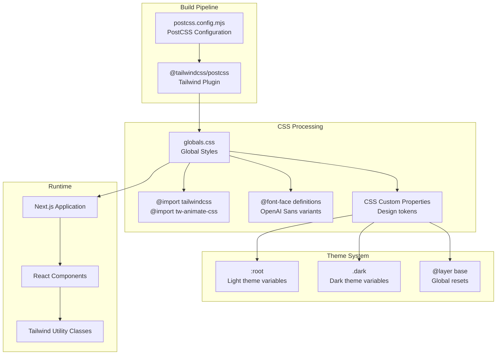
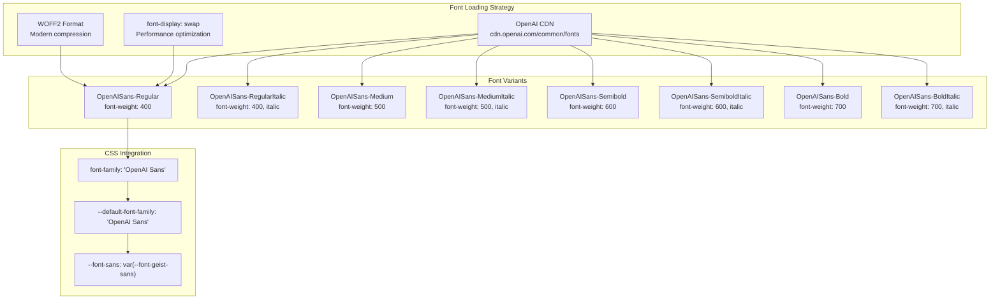
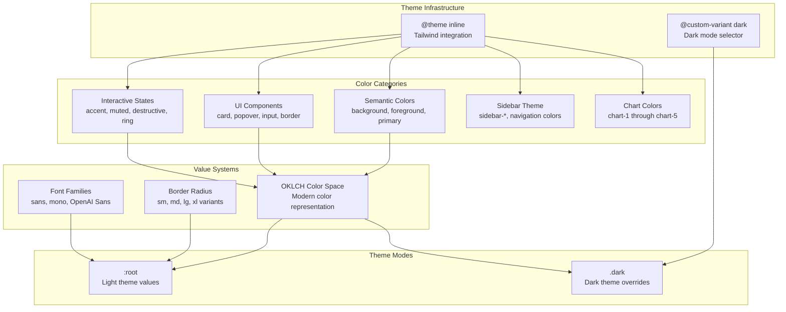
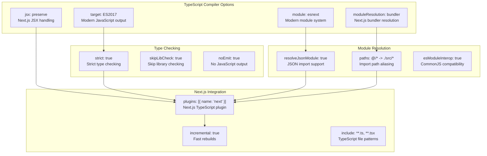
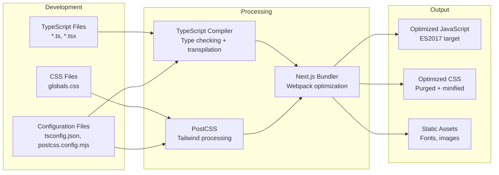

<!-- source: DeepWiki mcp.deepwiki.com · repo openai/harmony · page 3.4 Demo Styling and Configuration · fetched 2026-10-26 -->

# Demo Styling and Configuration

<details>
<summary>Relevant source files</summary>

The following files were used as context for generating this wiki page:

- [demo/harmony-demo/postcss.config.mjs](demo/harmony-demo/postcss.config.mjs)
- [demo/harmony-demo/public/openai_logo.svg](demo/harmony-demo/public/openai_logo.svg)
- [demo/harmony-demo/src/app/globals.css](demo/harmony-demo/src/app/globals.css)
- [demo/harmony-demo/tsconfig.json](demo/harmony-demo/tsconfig.json)

</details>


This document covers the styling system and configuration setup for the `harmony-demo` Next.js application, including PostCSS integration, Tailwind CSS configuration, typography system, theme management, and TypeScript compiler settings. For information about the UI component library used in the demo, see [UI Component System](3.3). For details about the overall demo architecture, see [Demo Application Architecture](3.2).

## Styling System Architecture

The demo application uses a modern CSS-in-JS approach built on Tailwind CSS with PostCSS processing, custom font loading, and a comprehensive design token system.



Sources: [demo/harmony-demo/postcss.config.mjs:1-5](), [demo/harmony-demo/src/app/globals.css:1-197]()

## PostCSS and Tailwind Integration

The build system uses PostCSS with the Tailwind CSS plugin for processing styles. The configuration is minimal and leverages Tailwind's built-in PostCSS integration.

### PostCSS Configuration

| Configuration Key | Value | Purpose |
|-------------------|-------|---------|
| `plugins` | `["@tailwindcss/postcss"]` | Enables Tailwind CSS processing |

The `postcss.config.mjs` file exports a simple configuration that delegates style processing to Tailwind's PostCSS plugin, which handles CSS generation, purging, and optimization automatically [demo/harmony-demo/postcss.config.mjs:1-5]().

Sources: [demo/harmony-demo/postcss.config.mjs:1-5]()

## Typography System

The demo application implements a comprehensive typography system using OpenAI's custom font family with multiple weights and styles loaded from the OpenAI CDN [demo/harmony-demo/src/app/globals.css:4-74]().



### Font Face Definitions

The typography system defines eight font variants with optimized loading:

| Weight | Style | File | CSS Declaration |
|--------|-------|------|----------------|
| 400 | Normal | `OpenAISans-Regular.woff2` | [demo/harmony-demo/src/app/globals.css:4-11]() |
| 400 | Italic | `OpenAISans-RegularItalic.woff2` | [demo/harmony-demo/src/app/globals.css:13-20]() |
| 500 | Normal | `OpenAISans-Medium.woff2` | [demo/harmony-demo/src/app/globals.css:22-29]() |
| 500 | Italic | `OpenAISans-MediumItalic.woff2` | [demo/harmony-demo/src/app/globals.css:31-38]() |
| 600 | Normal | `OpenAISans-Semibold.woff2` | [demo/harmony-demo/src/app/globals.css:40-47]() |
| 600 | Italic | `OpenAISans-SemiboldItalic.woff2` | [demo/harmony-demo/src/app/globals.css:49-56]() |
| 700 | Normal | `OpenAISans-Bold.woff2` | [demo/harmony-demo/src/app/globals.css:58-65]() |
| 700 | Italic | `OpenAISans-BoldItalic.woff2` | [demo/harmony-demo/src/app/globals.css:67-74]() |

All fonts use `font-display: swap` for optimal loading performance and WOFF2 format for compression efficiency [demo/harmony-demo/src/app/globals.css:5-10]().

Sources: [demo/harmony-demo/src/app/globals.css:4-74]()

## Theme and Design Token System

The application implements a comprehensive design token system using CSS custom properties with support for light and dark themes [demo/harmony-demo/src/app/globals.css:78-187]().

### CSS Custom Property Architecture



### Color System Mapping

The theme system maps semantic color names to CSS custom properties for both light and dark modes using the OKLCH color space:

| Token Category | Light Mode | Dark Mode | Purpose |
|----------------|------------|-----------|---------|
| `--background` | `oklch(1 0 0)` | `oklch(0.145 0 0)` | Page background [demo/harmony-demo/src/app/globals.css:120,155]() |
| `--foreground` | `oklch(0.145 0 0)` | `oklch(0.985 0 0)` | Primary text [demo/harmony-demo/src/app/globals.css:121,156]() |
| `--primary` | `oklch(0.205 0 0)` | `oklch(0.922 0 0)` | Primary actions [demo/harmony-demo/src/app/globals.css:126,161]() |
| `--secondary` | `oklch(0.97 0 0)` | `oklch(0.269 0 0)` | Secondary elements [demo/harmony-demo/src/app/globals.css:128,163]() |
| `--muted` | `oklch(0.97 0 0)` | `oklch(0.269 0 0)` | Subdued content [demo/harmony-demo/src/app/globals.css:130,165]() |
| `--border` | `oklch(0.922 0 0)` | `oklch(1 0 0 / 10%)` | Element borders [demo/harmony-demo/src/app/globals.css:135,170]() |
| `--destructive` | `oklch(0.577 0.245 27.325)` | `oklch(0.704 0.191 22.216)` | Error states [demo/harmony-demo/src/app/globals.css:134,169]() |

### Border Radius System

The design system includes a consistent border radius scale defined in the `@theme inline` block [demo/harmony-demo/src/app/globals.css:112-116]():

```css
--radius: 0.625rem;           /* Base radius [demo/harmony-demo/src/app/globals.css:119] */
--radius-sm: calc(var(--radius) - 4px);   /* 6px [demo/harmony-demo/src/app/globals.css:112] */
--radius-md: calc(var(--radius) - 2px);   /* 8px [demo/harmony-demo/src/app/globals.css:113] */
--radius-lg: var(--radius);               /* 10px [demo/harmony-demo/src/app/globals.css:114] */
--radius-xl: calc(var(--radius) + 4px);   /* 14px [demo/harmony-demo/src/app/globals.css:115] */
```

Sources: [demo/harmony-demo/src/app/globals.css:76-187]()

## Global Styles and Base Layer

The application applies global styles through Tailwind's layer system to ensure consistent baseline styling across all components.

### Base Layer Implementation

The `@layer base` directive applies global resets and default styles:

| Selector | Properties | Purpose |
|----------|------------|---------|
| `*` | `@apply border-border outline-ring/50` | Consistent borders and focus rings [demo/harmony-demo/src/app/globals.css:190-192]() |
| `body` | `@apply bg-background text-foreground` | Theme-aware background and text [demo/harmony-demo/src/app/globals.css:193-195]() |

This approach ensures that all elements inherit consistent styling while allowing component-level overrides through Tailwind utilities.

Sources: [demo/harmony-demo/src/app/globals.css:189-196]()

## TypeScript Configuration

The demo application uses a modern TypeScript configuration (`tsconfig.json`) optimized for Next.js development with strict type checking and modern ECMAScript features.



### Compiler Configuration Details

| Option | Value | Purpose |
|--------|-------|---------|
| `target` | `"ES2017"` | Modern JavaScript features [demo/harmony-demo/tsconfig.json:3]() |
| `lib` | `["dom", "dom.iterable", "esnext"]` | Browser and modern JavaScript APIs [demo/harmony-demo/tsconfig.json:4]() |
| `moduleResolution` | `"bundler"` | Next.js-compatible module resolution [demo/harmony-demo/tsconfig.json:11]() |
| `jsx` | `"preserve"` | Let Next.js handle JSX transformation [demo/harmony-demo/tsconfig.json:14]() |
| `paths` | `{"@/*": ["./src/*"]}` | Absolute imports from src directory [demo/harmony-demo/tsconfig.json:21-23]() |

The configuration enables strict type checking [demo/harmony-demo/tsconfig.json:7]() while optimizing for development experience and build performance via incremental builds [demo/harmony-demo/tsconfig.json:15]().

Sources: [demo/harmony-demo/tsconfig.json:1-27]()

## Build Integration

The styling and configuration systems integrate seamlessly with the Next.js build pipeline to provide optimized production builds and efficient development workflows.

### Build Process Flow



The build system automatically handles CSS purging, font optimization, and TypeScript compilation while maintaining the design system's integrity and performance characteristics. Static assets such as the `openai_logo.svg` [demo/harmony-demo/public/openai_logo.svg:1-21]() are served from the public directory.

Sources: [demo/harmony-demo/postcss.config.mjs:1-5](), [demo/harmony-demo/tsconfig.json:1-27](), [demo/harmony-demo/src/app/globals.css:1-197](), [demo/harmony-demo/public/openai_logo.svg:1-21]()

---

