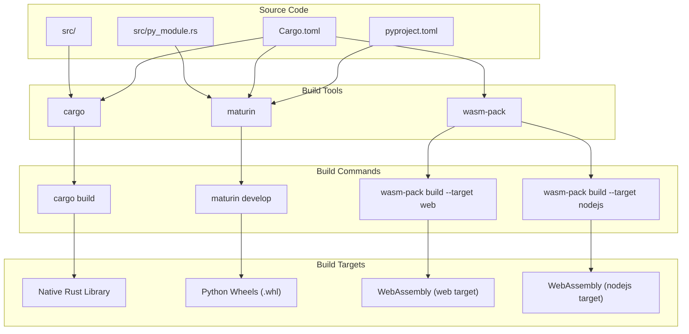
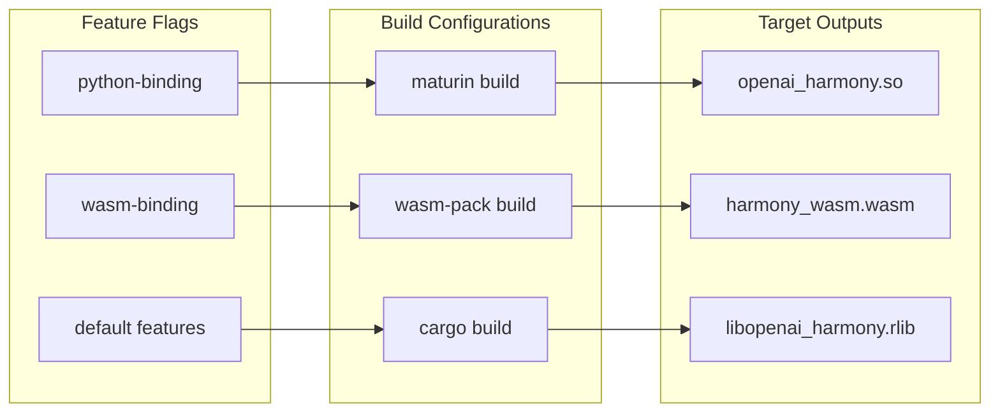

<!-- source: DeepWiki mcp.deepwiki.com · repo openai/harmony · page 4 Development and Build System · fetched 2026-10-26 -->

# Development and Build System

<details>
<summary>Relevant source files</summary>

The following files were used as context for generating this wiki page:

- [README.md](README.md)
- [run_checks.sh](run_checks.sh)
- [test_python.sh](test_python.sh)

</details>


This document covers the development workflow, build system, and continuous integration pipeline for the `openai-harmony` project. It explains how to set up a local development environment, build the library for different target platforms, and understand the automated release process.

For details about the CI/CD pipeline specifically, see [CI/CD Pipeline](#4.1). For information about project metadata and licensing, see [Project Configuration](#4.2).

## Overview

The `openai-harmony` project uses a multi-target build system centered around Rust's `cargo` build tool, with specialized builders for Python (`maturin`) and WebAssembly (`wasm-pack`) targets. The development workflow supports local iteration across all target platforms while maintaining automated cross-platform builds and PyPI releases through GitHub Actions.

## Build System Architecture

The build system employs different tools for each compilation target, bridging the Rust core to other ecosystems.

Title: Harmony Build Flow

Sources: [README.md:143-161](), [README.md:181-188](), [Cargo.toml:1-15]()

## Local Development Setup

### Python Development

For local Python development, the project uses `maturin` to build and install the Python extension. The extension is compiled as a native shared object (e.g., `openai_harmony.<abi>.so`) and placed within the `python/openai_harmony/` directory [README.md:152-155]().

```bash
# Compile Rust and install in editable mode
maturin develop --release
```

This command uses `pyo3` bindings defined in `src/py_module.rs` to expose Rust logic to the Python wrapper [README.md:132-141]().

### Testing Strategy

The project maintains 100% test parity between the Rust and Python suites [README.md:52-53](). 

| Suite | Command | File Reference |
|-------|---------|----------------|
| Rust | `cargo test` | `src/tests.rs` |
| Python | `pytest` | `tests/` |

A convenience script `run_checks.sh` is provided to run formatting, linting, and tests in sequence [run_checks.sh:1-8](). For Python-specific iteration, `test_python.sh` automates the `maturin develop` and `pytest` cycle [test_python.sh:1-7]().

Sources: [README.md:189-208](), [run_checks.sh:1-8](), [test_python.sh:1-7]()

## Build Configuration and Features

The build system uses Cargo feature flags and conditional compilation to manage the `pyo3` and `wasm-bindgen` dependencies.

Title: Feature-Based Compilation

Sources: [README.md:132-141](), [README.md:152-152](), [Cargo.toml:1-20]()

## Release and Distribution Pipeline

The project utilizes a comprehensive CI/CD pipeline for cross-platform distribution. For a detailed breakdown of the GitHub Actions workflow, including the build matrix for Linux, Windows, and macOS, see [CI/CD Pipeline](#4.1).

### Distribution Artifacts
- **PyPI Wheels**: Compiled for various Python versions and architectures using `maturin`.
- **Rust Crate**: Available via Git dependency for Rust projects [README.md:107-112]().
- **WASM Modules**: Used by the Next.js demo application.

Sources: [README.md:60-68](), [README.md:105-112](), [README.md:181-188]()

## Development Commands Reference

| Task | Command | Description |
|------|---------|-------------|
| Full Check | `./run_checks.sh` | Runs `fmt`, `clippy`, and `cargo test` [run_checks.sh:1-8]() |
| Python Iteration | `./test_python.sh` | Rebuilds extension and runs `pytest` [test_python.sh:1-7]() |
| Local Install | `maturin develop --release` | Installs the library into the active venv [README.md:182-182]() |
| Rust Tests | `cargo test` | Runs the canonical Rust test suite [README.md:194-194]() |
| Python Tests | `pytest` | Runs the mirrored Python test suite [README.md:200-200]() |

Sources: [README.md:181-208](), [run_checks.sh:1-8](), [test_python.sh:1-7]()

---

