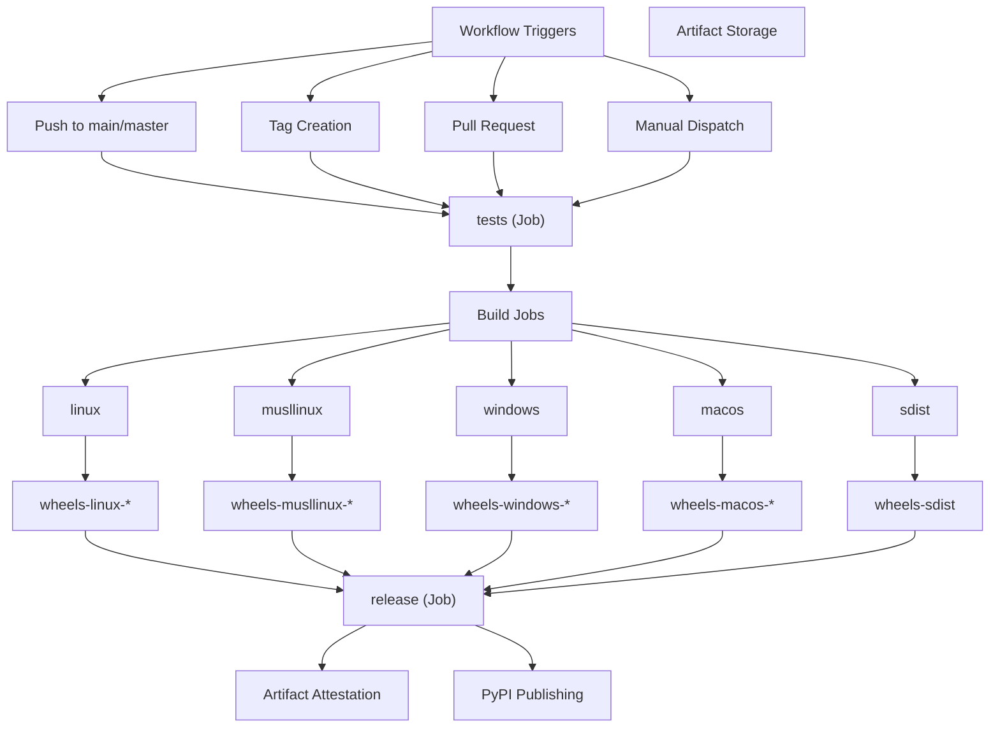
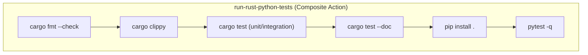

<!-- source: DeepWiki mcp.deepwiki.com · repo openai/harmony · page 4.1 CI/CD Pipeline · fetched 2026-10-26 -->

# CI/CD Pipeline

Relevant source files

The following files were used as context for generating this wiki page:

- [.github/actions/run-rust-python-tests/action.yml](.github/actions/run-rust-python-tests/action.yml)
- [.github/workflows/CI.yml](.github/workflows/CI.yml)

This document provides a comprehensive overview of the automated continuous integration and continuous deployment (CI/CD) pipeline for the openai-harmony repository. The pipeline handles cross-platform compilation, Python wheel generation, and automated publishing to PyPI using GitHub Actions and Maturin.

For information about the overall development workflow and project configuration, see [Development and Build System](#4) and [Project Configuration](#4.2).

## Pipeline Overview

The CI/CD pipeline is implemented as a GitHub Actions workflow that automates building, testing, and releasing the openai-harmony library across multiple platforms and architectures. The workflow supports both development builds and production releases.

**CI/CD Workflow Architecture**

Sources: [.github/workflows/CI.yml:6-190]()

## Automated Test Suite

Before any build jobs proceed, the pipeline executes a comprehensive test suite via the `tests` job. This job runs on `ubuntu-latest`, `macos-14`, and `windows-latest` across Python versions 3.11, 3.12, and 3.13 [.github/workflows/CI.yml:22-29]().

The testing logic is encapsulated in a composite action `run-rust-python-tests` [.github/workflows/CI.yml:33]().

**Test Execution Flow**

| Step | Command | Description |
|------|---------|-------------|
| Formatting | `cargo fmt --all --check` | Validates Rust code style [.github/actions/run-rust-python-tests/action.yml:39-42]() |
| Linting | `cargo clippy --all-targets --all-features -- -D warnings` | Ensures code quality and idiomatic Rust [.github/actions/run-rust-python-tests/action.yml:44-47]() |
| Rust Tests | `cargo test --all-targets --all-features` | Runs unit and integration tests [.github/actions/run-rust-python-tests/action.yml:49-52]() |
| Doctests | `cargo test --doc` | Validates code examples in documentation [.github/actions/run-rust-python-tests/action.yml:54-57]() |
| Python Integration | `pip install .` followed by `pytest` | Builds the local extension and runs Python-side tests [.github/actions/run-rust-python-tests/action.yml:59-69]() |

Sources: [.github/actions/run-rust-python-tests/action.yml:1-70](), [.github/workflows/CI.yml:22-37]()

## Trigger Conditions

The pipeline automatically executes under the following conditions:

| Trigger Type | Condition | Purpose |
|-------------|-----------|---------|
| Push | Branches `main` or `master` | Development builds and testing [.github/workflows/CI.yml:9-12]() |
| Tag | Any tag creation `*` | Production release builds [.github/workflows/CI.yml:13-14]() |
| Pull Request | Any PR opened/updated | Code validation builds [.github/workflows/CI.yml:15]() |
| Manual Dispatch | `workflow_dispatch` event | On-demand builds [.github/workflows/CI.yml:16]() |

Sources: [.github/workflows/CI.yml:8-20]()

## Cross-Platform Build Matrix

The pipeline employs a comprehensive build matrix strategy to generate Python wheels for multiple platforms and architectures using the `PyO3/maturin-action`. All build jobs depend on the successful completion of the `tests` job [.github/workflows/CI.yml:39,77,113,142,170]().

### Linux and MuslLinux Jobs

The Linux builds target standard glibc-based distributions, while MuslLinux builds target Alpine and other musl-based distributions:

- **Linux targets**: `x86_64`, `x86`, `aarch64`, `armv7`, `ppc64le` on `ubuntu-22.04` [.github/workflows/CI.yml:43-53]()
- **MuslLinux targets**: `x86_64`, `x86`, `aarch64`, `armv7` on `ubuntu-22.04` with `manylinux: musllinux_1_2` [.github/workflows/CI.yml:81-104]()
- **Special Config**: For `aarch64` targets, `CFLAGS` are set to ensure `ring`'s assembly sees the correct architecture (`-D__ARM_ARCH=8`) [.github/workflows/CI.yml:63,99]().

### Windows and macOS Jobs

- **Windows**: `x64` and `x86` on `windows-latest` [.github/workflows/CI.yml:116-121]().
- **macOS**: `aarch64` on `macos-14` and `macos-15` [.github/workflows/CI.yml:145-150]().

Sources: [.github/workflows/CI.yml:38-168]()

## Artifact Management

Each build job generates Python wheels that are uploaded as GitHub Actions artifacts. Artifacts are only uploaded for tag pushes or manual dispatches [.github/workflows/CI.yml:70,106,135,163,180]().

The artifact naming follows the pattern `wheels-{platform}-{target}` where:
- `platform`: `linux`, `musllinux`, `windows`, `macos`, or `sdist`
- `target`: Architecture-specific identifier (e.g., `x86_64`, `aarch64`)

Sources: [.github/workflows/CI.yml:71-74,107-110,136-139,164-167,181-184]()

## Release and Publishing

The `release` job coordinates artifact collection, security attestation, and PyPI publishing. It requires successful completion of all build jobs [.github/workflows/CI.yml:190]().

### Security and Attestation

The pipeline implements modern security practices:

| Security Feature | Implementation | Purpose |
|-----------------|----------------|---------|
| Artifact Attestation | `actions/attest-build-provenance@v2` | Cryptographic proof of build integrity [.github/workflows/CI.yml:201]() |
| ID Token | `id-token: write` permission | OIDC-based authentication [.github/workflows/CI.yml:193]() |
| Content Signing | `contents: write` permission | Used to upload release artifacts [.github/workflows/CI.yml:195]() |

### PyPI Publishing

The final step publishes to PyPI using `PyO3/maturin-action` with the `upload` command. This occurs only when a tag is pushed [.github/workflows/CI.yml:189]().

Sources: [.github/workflows/CI.yml:186-202]()

## Build Optimization

The pipeline includes performance optimizations for development workflows:

- **sccache**: Enabled for non-tag builds (`${{ !startsWith(github.ref, 'refs/tags/') }}`) to cache compilation artifacts [.github/workflows/CI.yml:67,103,133,161]().
- **find-interpreter**: Used in `maturin-action` to automatically locate Python interpreters for wheel generation [.github/workflows/CI.yml:66,102,132,160]().

The workflow is autogenerated by `maturin v1.8.7` using the `maturin generate-ci github` command [.github/workflows/CI.yml:1-4]().

Sources: [.github/workflows/CI.yml:1-161]()

---

