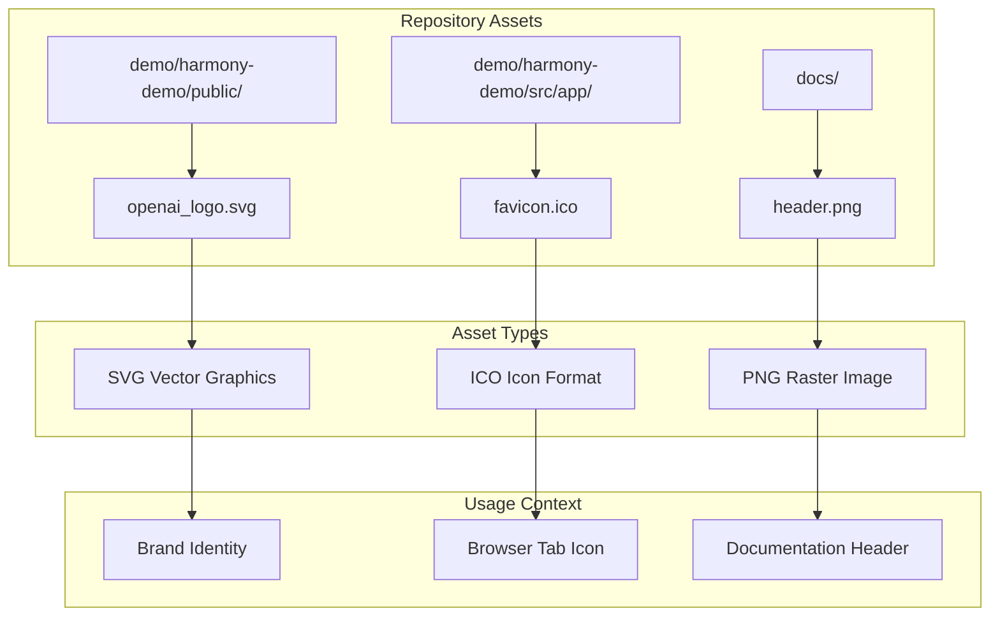
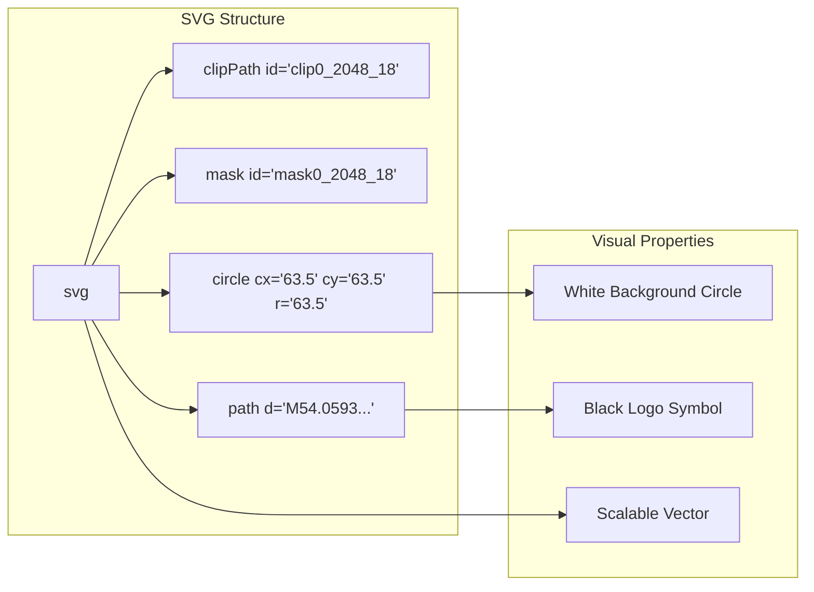
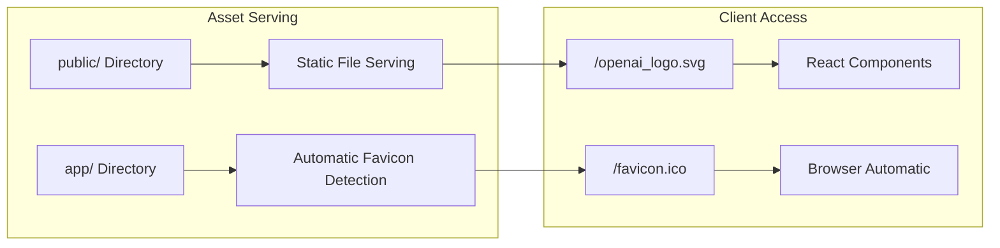

<!-- source: DeepWiki mcp.deepwiki.com · repo openai/harmony · page 5 Assets and Resources · fetched 2026-10-26 -->

# Assets and Resources

Relevant source files

The following files were used as context for generating this wiki page:

- [demo/harmony-demo/public/openai_logo.svg](demo/harmony-demo/public/openai_logo.svg)
- [demo/harmony-demo/src/app/favicon.ico](demo/harmony-demo/src/app/favicon.ico)
- [docs/header.png](docs/header.png)

This section documents the visual assets, logos, and supplementary files used throughout the `openai-harmony` project, particularly in the demo application and documentation. These resources support the branding and visual presentation of the harmony response format library.

## Asset Organization

The project contains a focused set of visual assets primarily located in the demo application's public directory structure and the root documentation folder. These assets serve the Next.js demo application and provide visual context for project documentation.

**Sources:** [demo/harmony-demo/public/openai_logo.svg:1-21](), [demo/harmony-demo/src/app/favicon.ico:1-80](), [docs/header.png:1-43]()

## OpenAI Logo Specification

The primary brand asset is the OpenAI logo implemented as an SVG vector graphic. This logo maintains the official OpenAI visual identity within the harmony demo application.

### Logo Technical Details

| Property | Value |
|----------|-------|
| Format | SVG (Scalable Vector Graphics) |
| Dimensions | 127×127 viewBox |
| Background | White circle fill |
| Logo | Black OpenAI symbol |
| File Size | ~2KB optimized vector |

The logo implementation uses SVG masking and clipping paths to achieve precise rendering at any scale while maintaining small file size.

**Sources:** [demo/harmony-demo/public/openai_logo.svg:1-21]()

## Documentation Header

The project includes a high-resolution PNG header image located in the `docs/` directory. This asset is used to provide visual branding for the repository's documentation and GitHub presence.

### Header Specifications

| Property | Value |
|----------|-------|
| Format | PNG (Portable Network Graphics) |
| Color Space | ICC Profile (Adobe RGB/sRGB) |
| Dimensions | 1025×310 pixels |
| Metadata | XML:com.adobe.xmp (Screenshot) |

The image contains embedded XMP metadata and an ICC profile to ensure consistent color rendering across different display devices.

**Sources:** [docs/header.png:1-26](), [docs/header.png:17-23]()

## Favicon Implementation

The demo application includes a multi-resolution favicon in ICO format to ensure proper display across different browsers and contexts.

### Favicon Specifications

| Property | Value |
|----------|-------|
| Format | ICO (Icon) |
| Location | `/src/app/favicon.ico` |
| Resolutions | Multiple embedded sizes (16x16, 32x32, 48x48) |
| Color Depth | 32-bit with alpha transparency |

The favicon appears to contain the OpenAI logo symbol optimized for small icon display contexts such as browser tabs and taskbar representations.

**Sources:** [demo/harmony-demo/src/app/favicon.ico:1-80]()

## Asset Usage in Demo Application

The assets integrate with the Next.js demo application through standard web conventions and framework-specific patterns.

### Integration Patterns

The SVG logo is accessible via the public directory serving mechanism, making it available at `/openai_logo.svg` for use in React components. The favicon follows Next.js App Router conventions by being placed in the `app` directory where it is automatically detected.

**Sources:** [demo/harmony-demo/public/openai_logo.svg:1-21](), [demo/harmony-demo/src/app/favicon.ico:1-80]()

## Asset Management Strategy

The project maintains a minimal but effective asset management approach focused on essential branding elements. This strategy prioritizes performance and maintainability while ensuring consistent visual identity across the library's demo and documentation.

### Key Principles

- **Minimal Asset Footprint**: Only essential visual assets are included to keep the repository lightweight.
- **Vector-First Approach**: SVG format is prioritized for the logo to ensure perfect scaling without quality loss.
- **Framework Conventions**: Assets are placed in directories that leverage Next.js built-in handling (e.g., `public/` and `src/app/`).
- **Standardized Formats**: Uses universal formats (SVG, ICO, PNG) for maximum compatibility.

**Sources:** [demo/harmony-demo/public/openai_logo.svg:1-21](), [demo/harmony-demo/src/app/favicon.ico:1-80](), [docs/header.png:1-43]()

---

