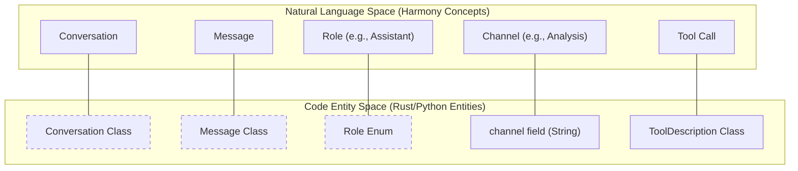
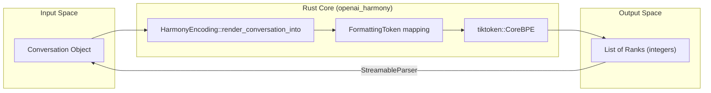

<!-- source: DeepWiki mcp.deepwiki.com · repo openai/harmony · page 6 Glossary · fetched 2026-10-26 -->

# Glossary

Relevant source files

The following files were used as context for generating this wiki page:

- [.github/workflows/CI.yml](.github/workflows/CI.yml)
- [Cargo.toml](Cargo.toml)
- [README.md](README.md)
- [docs/format.md](docs/format.md)
- [python/openai_harmony/__init__.py](python/openai_harmony/__init__.py)
- [run_checks.sh](run_checks.sh)
- [src/encoding.rs](src/encoding.rs)

This page provides definitions for codebase-specific terms, jargon, and domain concepts used throughout the Harmony library. It serves as a reference for onboarding engineers to understand the internal nomenclature of the `gpt-oss` response format and the multi-language build system.

## Harmony Format Concepts

### Roles
The model categorizes every message by a "role" which defines its position in the information hierarchy. This hierarchy is used to resolve instruction conflicts.
*   **System**: Used for high-level configuration such as reasoning effort, knowledge cutoffs, and built-in tools [docs/format.md:13-13]().
*   **Developer**: Contains instructions (the "system prompt") and function tool definitions [docs/format.md:14-14]().
*   **User**: Represents input from the human user [docs/format.md:15-15]().
*   **Assistant**: Output from the model, which may include text or tool calls [docs/format.md:16-16]().
*   **Tool**: Output from a specific tool call, where the tool name acts as the role [docs/format.md:17-17]().

**Code Entity:** `openai_harmony::chat::Role` [python/openai_harmony/__init__.py:89-96]().

### Channels
Assistant messages are further subdivided into channels to separate internal processing from user-facing output [docs/format.md:23-23]().
*   **Final**: Messages intended for the end-user [docs/format.md:27-27]().
*   **Analysis**: Used for Chain of Thought (CoT). These do not adhere to the same safety standards as `final` messages and should be hidden from users [docs/format.md:28-28]().
*   **Commentary**: Used for triggering function tool calls or generating preambles for multiple tool calls [docs/format.md:29-29]().

### Formatting Tokens
Abstract tokens used by the renderer to structure the conversation. During the encoding process, these are mapped to specific integer IDs (Ranks) from the tokenizer's vocabulary [src/encoding.rs:37-39]().

| Token | String Representation | Purpose |
| :--- | :--- | :--- |
| `Start` | `<|start|>` | Marks the beginning of a message block [src/encoding.rs:60-60](). |
| `Message` | `<|message|>` | Separates the header from the message content [src/encoding.rs:61-61](). |
| `EndMessage` | `<|end|>` | Standard message terminator [src/encoding.rs:62-62](). |
| `EndMessageDoneSampling` | `<|return|>` | Indicates the model has finished its turn [src/encoding.rs:63-63](). |
| `EndMessageAssistantToTool` | `<|call|>` | Signals a transition from assistant text to a tool call [src/encoding.rs:64-64](). |
| `ConstrainedFormat` | `<|constrain|>` | Used to specify expected output formats like JSON [src/encoding.rs:66-66](). |

**Code Entity:** `openai_harmony::encoding::FormattingToken` [src/encoding.rs:42-55]().

## Codebase and Tooling Terms

### FFI (Foreign Function Interface)
The mechanism by which the Rust core logic is exposed to Python. The project uses **PyO3** to create native Python extensions. The Rust code is compiled into a shared library (`.so` or `.pyd`) which is then imported by the pure-Python wrapper [README.md:132-140]().

### Maturin
The build system used to bridge the Rust and Python environments. It handles compiling the Rust crate and installing it into a Python virtual environment [README.md:169-182]().

### CoreBPE / Rank
*   **CoreBPE**: The core Byte Pair Encoding logic provided by the `tiktoken` library [src/encoding.rs:3-3]().
*   **Rank**: A type alias for the integer ID of a token in the vocabulary [src/encoding.rs:3-3]().

### Golden Files
Reference token-sequence fixtures located in the `test-data` directory. These are used to ensure that both the Rust and Python implementations produce identical, bit-perfect token sequences for the same input conversation [README.md:50-52]().

## Architecture Diagrams

### From Natural Language to Code Entities
This diagram maps the conceptual "Harmony Format" (Natural Language Space) to the specific structs and enums used in the implementation (Code Entity Space).

**Conceptual Mapping**

**Sources:** [python/openai_harmony/__init__.py:89-140](), [src/encoding.rs:16-21]().

### Data Flow: Rendering and Parsing
This diagram illustrates how a conversation moves from high-level objects through the Rust core to become tokens, and back again.

**System Logic Flow**

**Sources:** [src/encoding.rs:164-173](), [src/encoding.rs:90-91](), [README.md:136-140]().

## Domain Abbreviations

| Abbreviation | Full Term | Definition |
| :--- | :--- | :--- |
| **CoT** | Chain of Thought | The internal reasoning process of the model, typically output to the `analysis` channel [docs/format.md:28-28](). |
| **BPE** | Byte Pair Encoding | The subword tokenization method used by `tiktoken` [src/encoding.rs:3-3](). |
| **gpt-oss** | GPT Open Source Series | The specific series of models the Harmony format was designed for [README.md:4-6](). |
| **sdist** | Source Distribution | A Python package format containing the source code, used during the release process [CI.yml:169-175](). |

**Sources:**
*   `docs/format.md`
*   `src/encoding.rs`
*   `python/openai_harmony/__init__.py`
*   `README.md`
*   `.github/workflows/CI.yml`