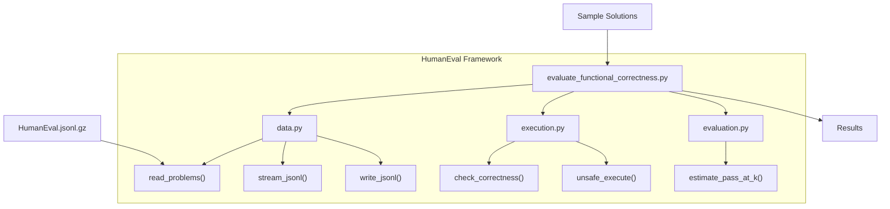
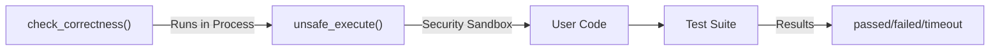
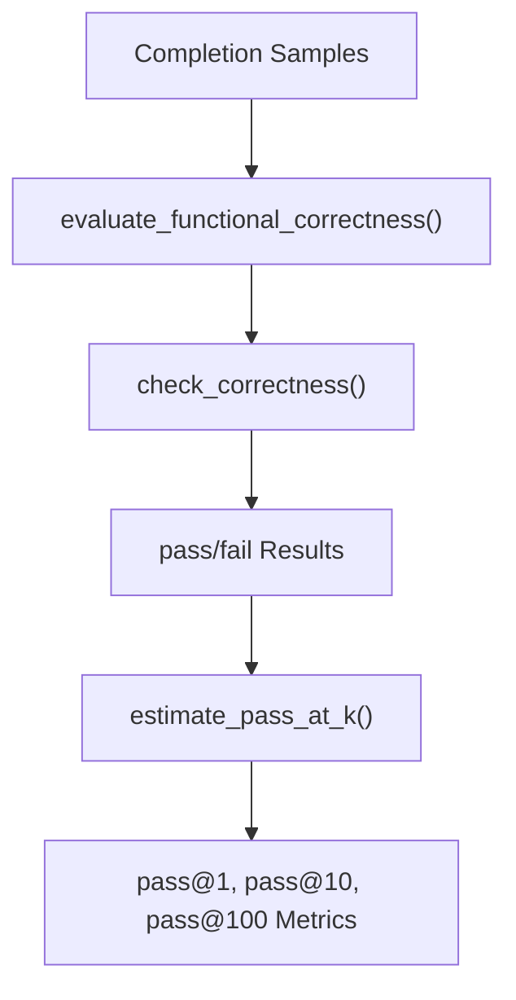
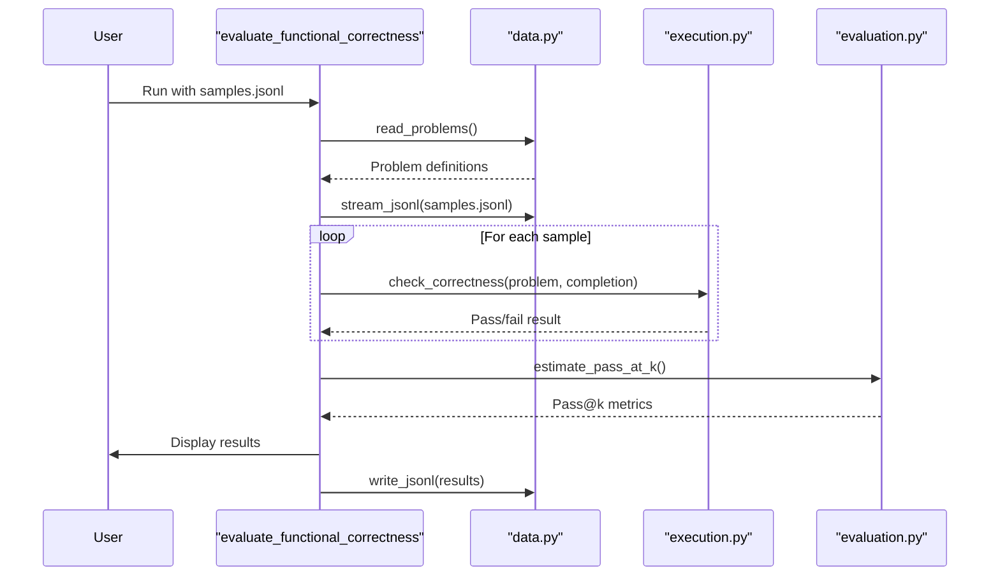

<!-- source: DeepWiki mcp.deepwiki.com · repo openai/human-eval · page 1 Overview · fetched 2026-10-26 -->

# Overview

<details>
<summary>Relevant source files</summary>

The following files were used as context for generating this wiki page:

- [README.md](README.md)
- [setup.py](setup.py)

</details>


## Purpose and Scope

This document provides an introduction to the HumanEval framework, a system designed to evaluate the functional correctness of code generated by large language models (LLMs). HumanEval consists of a dataset of programming problems and a comprehensive evaluation infrastructure that safely executes and tests untrusted code.

For detailed information about the evaluation pipeline, see [Evaluation Pipeline](#2.1). For security mechanisms, see [Security Model](#2.2).

Sources: [README.md:1-5]()

## System Architecture

HumanEval is structured as a Python package with components for data handling, code execution, and evaluation metrics.



**Diagram: HumanEval Component Architecture**

Sources: [README.md:42-54](), [setup.py:20-24]()

## Core Components

### 1. Dataset

The HumanEval dataset consists of hand-written programming problems designed to test code generation capabilities. Each problem includes a prompt, canonical solution, and test cases.

| Component | Description |
|-----------|-------------|
| Task ID | Unique identifier for each problem |
| Prompt | Problem description and function signature |
| Canonical Solution | Reference implementation |
| Test | Test cases to verify correctness |
| Entry Point | Function name to be called during evaluation |

Sources: [README.md:31-35]()

### 2. Data Processing

The `data.py` module handles loading problems and processing JSONL files:

- `read_problems()`: Loads problem definitions from HumanEval.jsonl.gz
- `stream_jsonl()`: Parses JSONL files containing completions
- `write_jsonl()`: Outputs evaluation results

Sources: [README.md:43-53]()

### 3. Code Execution Engine

The `execution.py` module provides secure execution of untrusted code:

- `check_correctness()`: Tests code against problem test cases
- `unsafe_execute()`: Runs code in a sandboxed environment with timeouts and security restrictions



**Diagram: Code Execution Flow**

Sources: [README.md:23-28](), [README.md:65-70]()

### 4. Evaluation Metrics

The `evaluation.py` module calculates Pass@k metrics:

- `evaluate_functional_correctness()`: Main evaluation function
- `estimate_pass_at_k()`: Calculates unbiased pass@k statistics



**Diagram: Evaluation Metrics Calculation**

Sources: [README.md:56-66](), [README.md:84-91]()

## Workflow

The typical workflow for using HumanEval is:

1. Generate code completions for the problems in the HumanEval dataset
2. Save completions in the required JSONL format
3. Run the evaluation script on the completions
4. Analyze the pass@k metrics and detailed results



**Diagram: HumanEval Execution Workflow**

Sources: [README.md:56-70]()

## Security Considerations

The HumanEval framework is designed to execute untrusted code, which presents significant security challenges. The system implements several safeguards:

- Code execution is disabled by default, requiring explicit activation
- Execution occurs in a sandboxed environment
- Timeout mechanisms prevent infinite loops
- Memory usage is monitored to prevent resource exhaustion

**Warning**: Users are strongly encouraged to run the evaluation only inside a robust security sandbox.

Sources: [README.md:23-28](), [README.md:95-100]()

## CLI Usage

The package installs a command-line tool that can be used to evaluate code completions:

```
evaluate_functional_correctness samples.jsonl [--k=<comma-separated-values>]
```

This will:
1. Read samples from the input file
2. Run test suites on each completion
3. Output detailed results to `samples.jsonl_results.jsonl`
4. Calculate and display pass@k metrics

Sources: [README.md:56-70](), [setup.py:20-24]()

---

