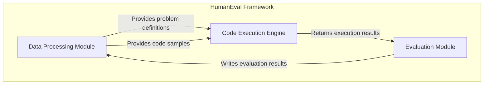
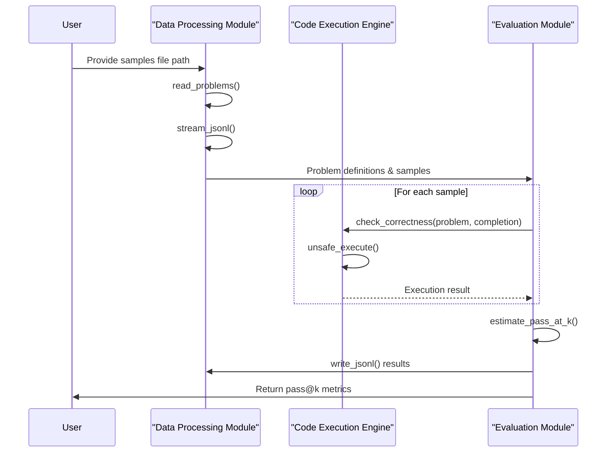
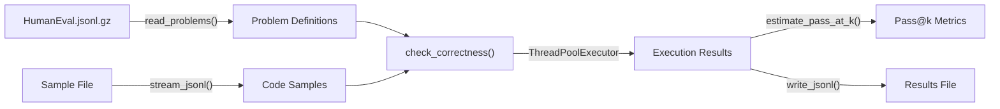
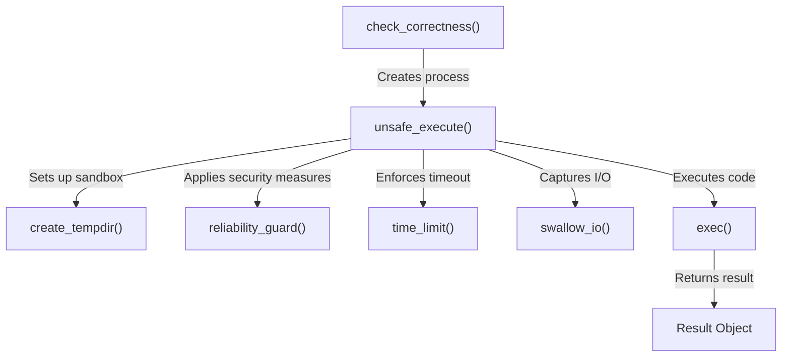
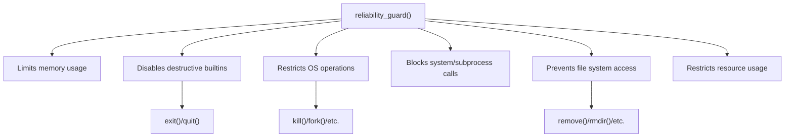
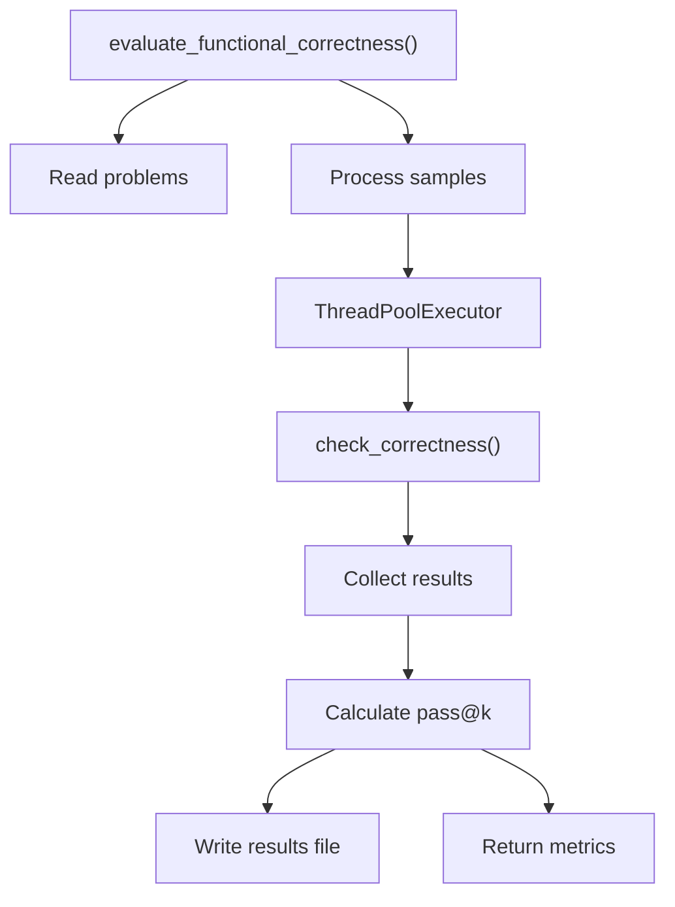

<!-- source: DeepWiki mcp.deepwiki.com · repo openai/human-eval · page 2 System Architecture · fetched 2026-10-26 -->

# System Architecture

<details>
<summary>Relevant source files</summary>

The following files were used as context for generating this wiki page:

- [README.md](README.md)
- [human_eval/data.py](human_eval/data.py)
- [human_eval/evaluation.py](human_eval/evaluation.py)
- [human_eval/execution.py](human_eval/execution.py)

</details>


## Purpose and Scope

This document describes the overall architecture of the HumanEval system, a framework for evaluating the functional correctness of code generated by large language models. The architecture section covers the high-level components, their interactions, and the data flow through the system. For detailed information on specific components, refer to [Core Components](#3), the [Evaluation Pipeline](#2.1), or the [Security Model](#2.2).

## System Overview

The HumanEval framework consists of three main components that work together to evaluate code samples:

1. **Data Processing Module**: Handles reading problem definitions and managing input/output of code samples and results
2. **Code Execution Engine**: Executes generated code samples in a secure sandbox with appropriate safeguards
3. **Evaluation Module**: Calculates metrics (particularly pass@k) based on execution results



Sources: [human_eval/data.py](), [human_eval/execution.py](), [human_eval/evaluation.py]()

## Component Interactions

The following diagram illustrates how the different components interact during the evaluation process:



Sources: [human_eval/evaluation.py:39-105](), [human_eval/execution.py:63-91]()

## Key System Components

The following diagram maps the code entities to their functional roles within the system:

```mermaid
classDiagram
    class DataProcessingModule {
        read_problems()
        stream_jsonl()
        write_jsonl()
    }
    
    class CodeExecutionEngine {
        check_correctness()
        unsafe_execute()
        reliability_guard()
        time_limit()
        create_tempdir()
    }
    
    class EvaluationModule {
        evaluate_functional_correctness()
        estimate_pass_at_k()
    }
    
    class Problem {
        task_id
        prompt
        canonical_solution
        test
        entry_point
    }
    
    class CodeSample {
        task_id
        completion
    }
    
    class Result {
        task_id
        completion
        passed
        result
    }
    
    DataProcessingModule --> Problem : processes
    DataProcessingModule --> CodeSample : processes
    DataProcessingModule --> Result : outputs
    CodeExecutionEngine --> CodeSample : executes
    CodeExecutionEngine --> Result : produces
    EvaluationModule --> Result : analyzes
    EvaluationModule --> "Pass@k Metrics" : calculates
```

Sources: [human_eval/data.py:11-49](), [human_eval/execution.py:12-91](), [human_eval/evaluation.py:13-105]()

## Data Flow Architecture

The data flow in the HumanEval system follows a pipeline pattern. The following diagram illustrates how data moves through the system:



Sources: [human_eval/evaluation.py:39-105](), [human_eval/data.py:11-49]()

## File Structure and Module Organization

The HumanEval codebase is organized into the following main modules:

| Module | File | Primary Functions | Purpose |
|--------|------|-------------------|---------|
| Data Processing | [data.py]() | `read_problems()`, `stream_jsonl()`, `write_jsonl()` | Handles dataset loading and result storage |
| Code Execution | [execution.py]() | `check_correctness()`, `unsafe_execute()`, `reliability_guard()` | Securely executes and tests code samples |
| Evaluation | [evaluation.py]() | `evaluate_functional_correctness()`, `estimate_pass_at_k()` | Calculates evaluation metrics |

Sources: [human_eval/data.py](), [human_eval/execution.py](), [human_eval/evaluation.py]()

## Execution Model

The execution of code samples follows a carefully designed process to ensure safety and reliability:



Sources: [human_eval/execution.py:12-91](), [human_eval/execution.py:94-162]()

## Security Architecture

Security is a critical aspect of the HumanEval system since it executes untrusted code. The `reliability_guard()` function implements a sandbox by disabling potentially dangerous operations:



Sources: [human_eval/execution.py:163-242](), [README.md:23-28]()

## Evaluation Process

The evaluation pipeline processes samples in parallel and calculates pass@k metrics:



Sources: [human_eval/evaluation.py:39-105]()

## Data Structures

The system uses the following key data structures:

| Data Structure | Description | Fields |
|----------------|-------------|--------|
| Problem | Represents a programming problem | `task_id`, `prompt`, `canonical_solution`, `test`, `entry_point` |
| Sample | Contains a generated code completion | `task_id`, `completion` |
| Result | Contains execution results | `task_id`, `completion_id`, `passed`, `result` |

Sources: [human_eval/data.py:11-49](), [human_eval/execution.py:63-91](), [human_eval/evaluation.py:39-105]()

## System Entry Points

The primary entry point to the HumanEval system is the `evaluate_functional_correctness()` function, which:

1. Reads problem definitions from the HumanEval dataset
2. Processes code samples from an input file
3. Executes each sample against its test suite
4. Calculates pass@k metrics
5. Writes detailed results to an output file

Sources: [human_eval/evaluation.py:39-105](), [README.md:56-71]()

---

