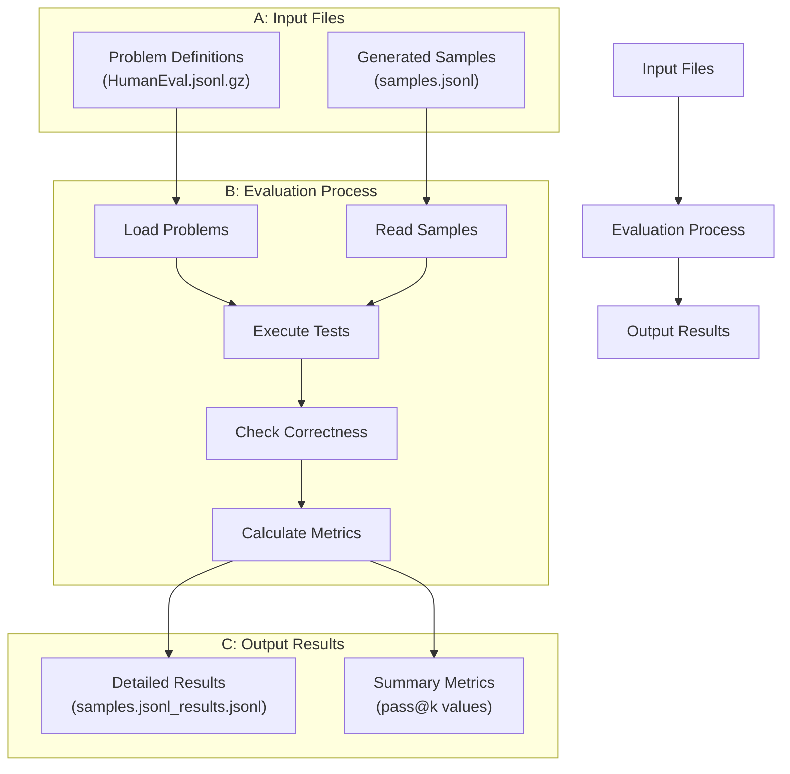
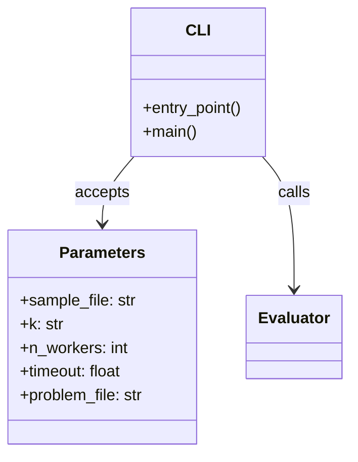
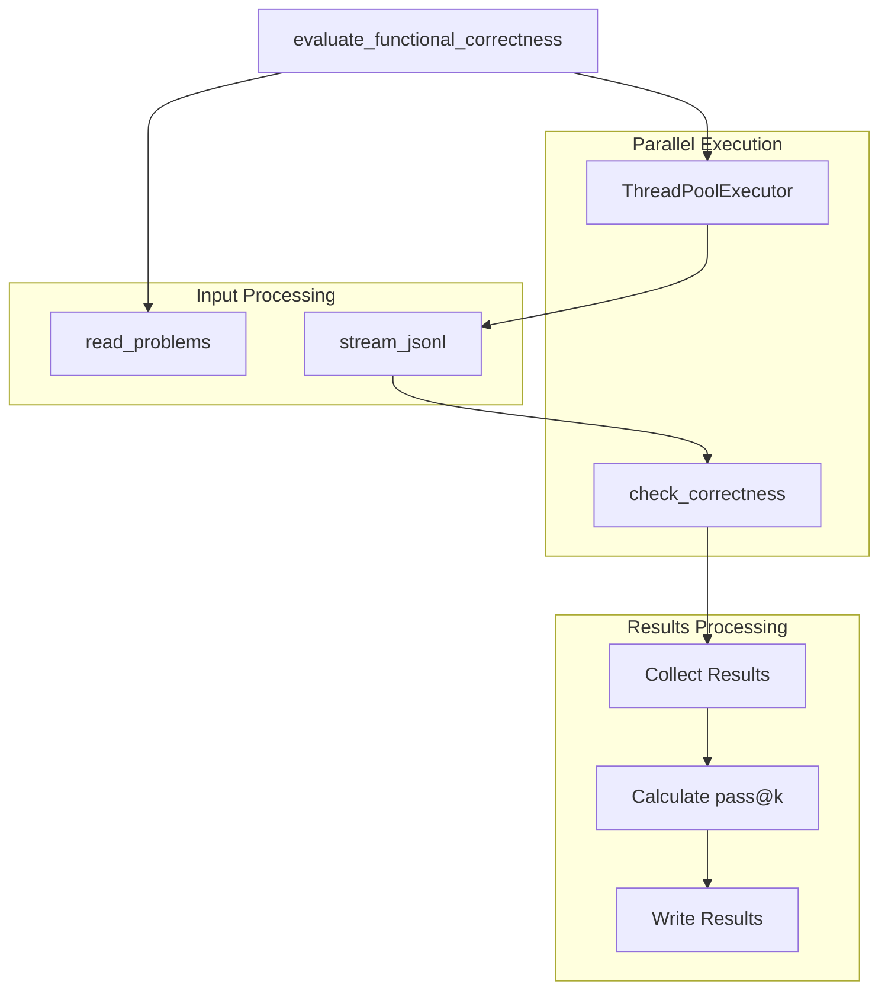
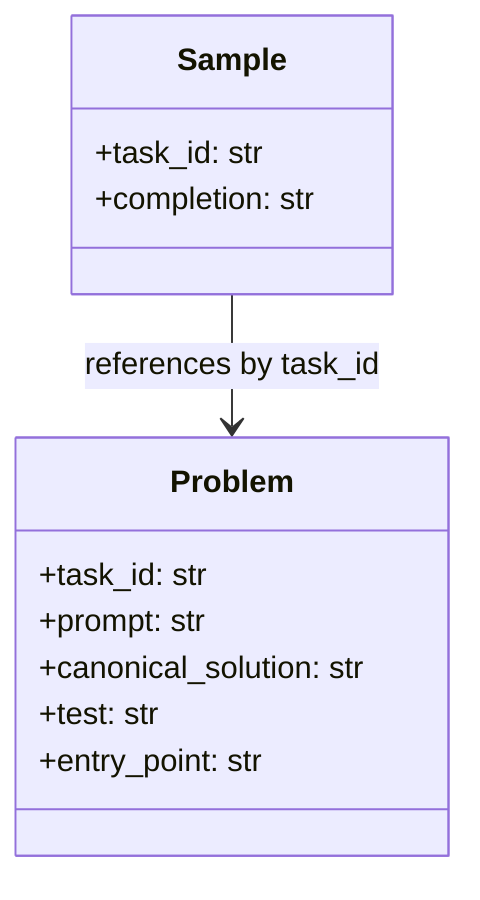
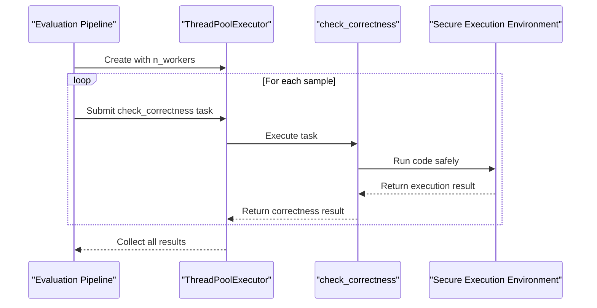
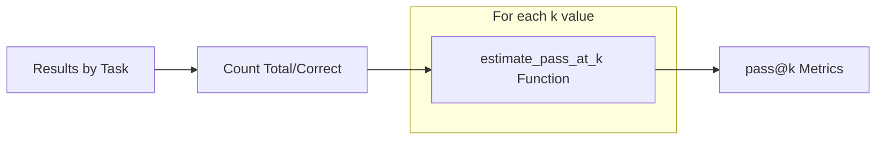
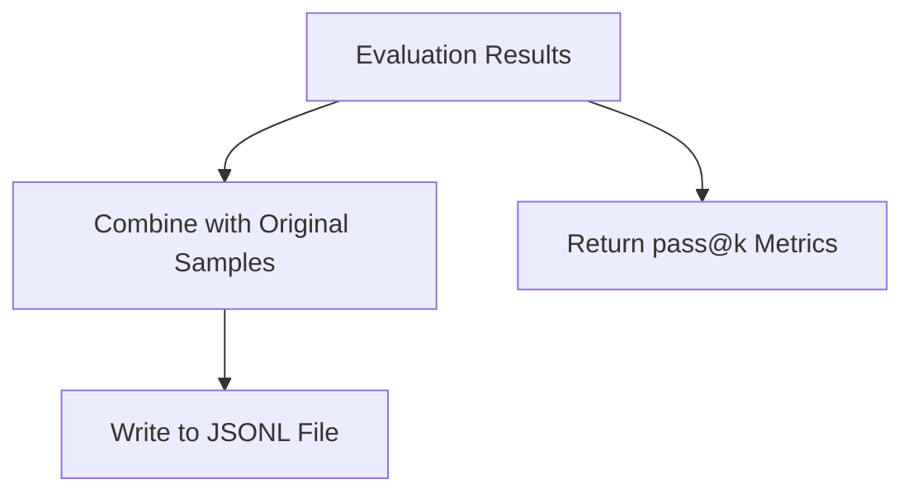
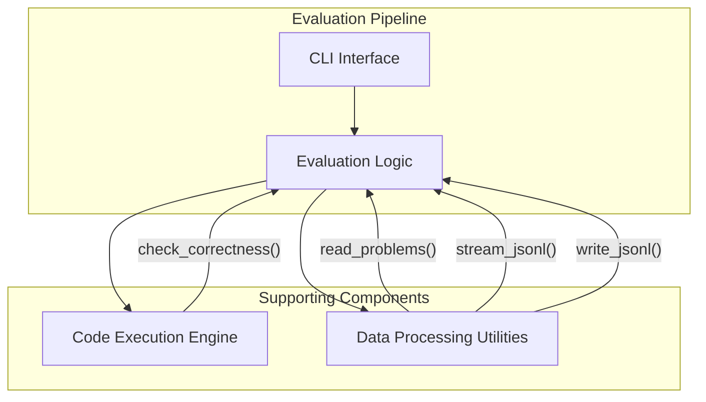
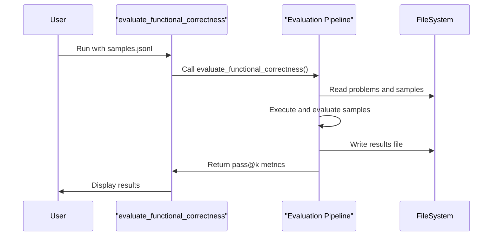

<!-- source: DeepWiki mcp.deepwiki.com · repo openai/human-eval · page 2.1 Evaluation Pipeline · fetched 2026-10-26 -->

# Evaluation Pipeline

<details>
<summary>Relevant source files</summary>

The following files were used as context for generating this wiki page:

- [README.md](README.md)
- [human_eval/evaluate_functional_correctness.py](human_eval/evaluate_functional_correctness.py)
- [human_eval/evaluation.py](human_eval/evaluation.py)

</details>


## Purpose and Scope

This document details the end-to-end pipeline for evaluating code samples in the HumanEval system. It covers the process flow from loading problem definitions and code samples through execution, evaluation, and results generation. For information about the security mechanisms used when executing untrusted code, see [Security Model](#2.2).

## Overview

The evaluation pipeline is the core workflow for assessing the functional correctness of code generated by language models. It processes a collection of code samples, tests each against predefined test cases, and computes metrics like pass@k to measure model performance.



Sources: [human_eval/evaluation.py:39-105](), [human_eval/evaluate_functional_correctness.py:8-21]()

## Pipeline Components

The evaluation pipeline consists of several key components that work together to process and evaluate code samples:

### Command-Line Interface

The entry point to the evaluation pipeline is the command-line tool `evaluate_functional_correctness`, which accepts parameters like the sample file path, k values for pass@k metrics, number of worker threads, and timeout duration.



Sources: [human_eval/evaluate_functional_correctness.py:1-28]()

### Core Evaluation Function

The central component is the `evaluate_functional_correctness` function, which orchestrates the entire evaluation process:



Sources: [human_eval/evaluation.py:39-105]()

## Pipeline Workflow in Detail

The evaluation pipeline follows these steps:

### 1. Problem Loading

The process begins by loading problem definitions from the specified problem file (by default, HUMAN_EVAL).

```
problems = read_problems(problem_file)
```

Each problem includes:
- A unique task ID
- A prompt describing the problem
- A canonical solution
- Test cases
- An entry point (function name)

Sources: [human_eval/evaluation.py:51]()

### 2. Sample Reading and Processing

The pipeline reads code samples from the provided sample file. Each sample contains:
- A task ID linking it to a specific problem
- A completion (the generated code to be evaluated)



Sources: [human_eval/evaluation.py:62-69]()

### 3. Parallel Execution

The pipeline executes code samples in parallel using ThreadPoolExecutor:



The `check_correctness` function tests each completion against the problem's test suite, with a timeout to prevent infinite loops or excessive resource consumption.

Sources: [human_eval/evaluation.py:54-69](), [human_eval/evaluation.py:74-76]()

### 4. Results Collection

Results from all code executions are collected and organized by task ID:

```python
for future in tqdm.tqdm(as_completed(futures), total=len(futures)):
    result = future.result()
    results[result["task_id"]].append((result["completion_id"], result))
```

Each result contains:
- The task ID
- The completion ID (index of this completion for the task)
- Whether the completion passed all tests
- Detailed execution result

Sources: [human_eval/evaluation.py:74-76]()

### 5. Metrics Calculation

The pipeline calculates pass@k metrics using the `estimate_pass_at_k` function:



The pass@k metric estimates the probability that at least one completion out of k randomly sampled completions will be correct.

Sources: [human_eval/evaluation.py:78-90](), [human_eval/evaluation.py:13-36]()

### 6. Results Output

Finally, the pipeline writes detailed results to a new JSONL file and returns the pass@k metrics:



The output file contains the original samples enriched with:
- A `result` field with details about the execution
- A `passed` field indicating whether the completion passed all tests

Sources: [human_eval/evaluation.py:92-105]()

## Integration with Other System Components

The evaluation pipeline interacts with other components of the HumanEval system:



Sources: [human_eval/evaluation.py:9-10](), [human_eval/evaluate_functional_correctness.py:4-5]()

## Usage Example

Below is a typical workflow for using the evaluation pipeline:

1. Generate code samples using a language model and save them in the required JSONL format
2. Run the evaluation command: `evaluate_functional_correctness samples.jsonl`
3. View the resulting metrics and detailed results in the output file `samples.jsonl_results.jsonl`



Sources: [README.md:56-66](), [human_eval/evaluate_functional_correctness.py:8-21]()

## Performance Considerations

The evaluation pipeline is designed for performance with several key optimizations:

1. **Parallel Execution**: Uses ThreadPoolExecutor to run multiple evaluations concurrently
2. **Progress Tracking**: Employs tqdm for progress visualization during long-running operations
3. **Efficient I/O**: Streams JSONL files rather than loading them entirely into memory

The number of worker threads and timeout duration can be adjusted to balance throughput and resource usage.

Sources: [human_eval/evaluation.py:54-69](), [human_eval/evaluate_functional_correctness.py:11-13]()

## Error Handling

The pipeline includes basic error handling to manage common issues:

1. **Timeouts**: Sets a maximum execution time for each sample to prevent hanging
2. **Assertion Checks**: Verifies that all problems are attempted
3. **Memory Issues**: The README notes potential memory-related errors and recommends freeing system resources if they occur

Sources: [human_eval/evaluation.py:71](), [README.md:93-100]()

---

