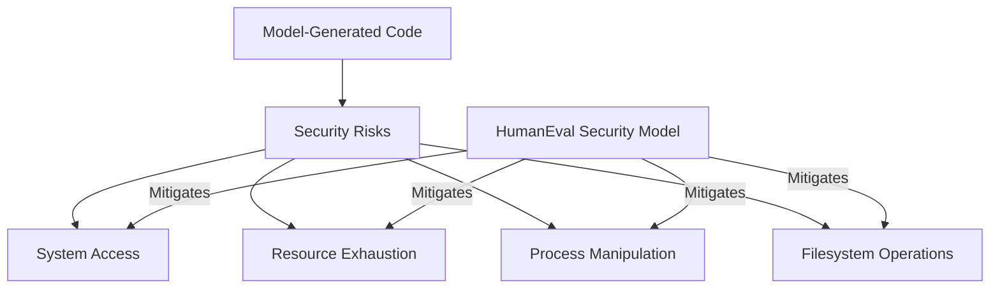
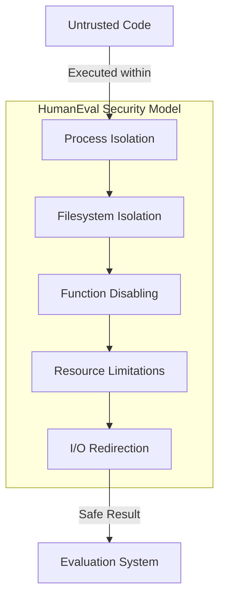
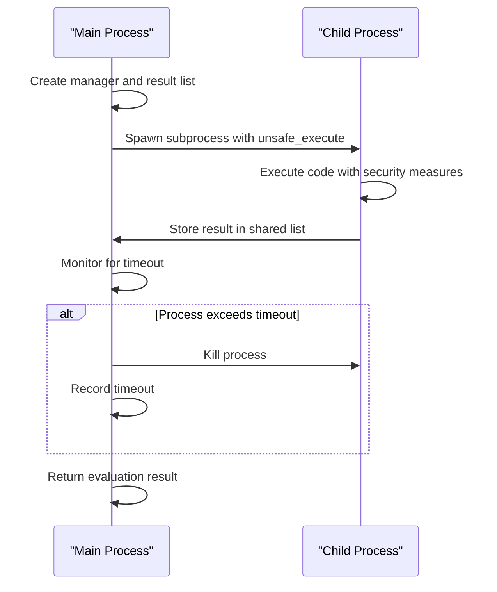
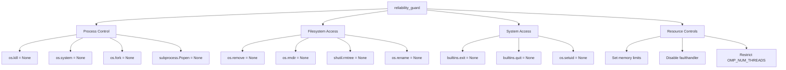

<!-- source: DeepWiki mcp.deepwiki.com · repo openai/human-eval · page 2.2 Security Model · fetched 2026-10-26 -->

# Security Model

<details>
<summary>Relevant source files</summary>

The following files were used as context for generating this wiki page:

- [README.md](README.md)
- [human_eval/execution.py](human_eval/execution.py)

</details>


## Purpose and Scope

This document details the security model implemented in the HumanEval framework to safely execute and evaluate untrusted code generated by language models. It covers the isolation mechanisms, resource limitations, function disabling, and other security measures designed to minimize risks associated with executing potentially malicious or unintentionally harmful code. For information about the overall evaluation pipeline, see [Evaluation Pipeline](#2.1).

## Security Challenges Overview

Executing untrusted code poses significant security risks. The HumanEval framework needs to evaluate code samples generated by AI models, which may contain:

- Malicious operations (either intentional or unintentional)
- Resource-exhausting code (infinite loops, memory leaks)
- System access attempts (file system, network, processes)
- Attempts to interfere with the evaluation process itself



Sources: [README.md:22-28](), [human_eval/execution.py:163-242]()

## Multi-Layered Security Approach

The security model implements multiple layers of protection to create a defense-in-depth approach:



Sources: [human_eval/execution.py:11-91]()

### Process Isolation

Code execution occurs in an isolated subprocess to prevent interference with the main evaluation process.

- The `check_correctness` function spawns a separate process to run the `unsafe_execute` function
- The process is monitored and killed if it exceeds the timeout
- Results are communicated through a managed list from the multiprocessing module



Sources: [human_eval/execution.py:63-91]()

### Filesystem Isolation

All code execution happens in a temporary directory that is created for each evaluation and deleted afterward.

- The `create_tempdir` context manager creates an isolated directory
- The `chdir` context manager changes to this directory during execution
- The temporary directory is automatically cleaned up after execution

Sources: [human_eval/execution.py:116-160]()

### Function Disabling

The `reliability_guard` function disables potentially dangerous operations by nullifying system functions that could be used maliciously:



The disabled functions fall into several categories:

| Category | Purpose | Examples of Disabled Functions |
|----------|---------|--------------------------------|
| Process Control | Prevent spawning/killing processes | `os.kill`, `os.system`, `os.fork`, `subprocess.Popen` |
| Filesystem Operations | Prevent file modifications | `os.remove`, `os.rmdir`, `shutil.rmtree`, `os.rename` |
| System Access | Prevent system manipulation | `builtins.exit`, `builtins.quit`, `os.setuid` |
| Module Access | Restrict problematic modules | `sys.modules["ipdb"]`, `sys.modules["resource"]` |

Sources: [human_eval/execution.py:163-242]()

### Resource Limitations

The security model implements both time and memory constraints:

1. **Time Limits**:
   - The `time_limit` context manager uses SIGALRM to enforce timeout
   - Default timeout is passed from the evaluation function
   - If execution exceeds the time limit, a TimeoutException is raised

2. **Memory Limits** (when specified):
   - Resource limits are set using the `resource` module
   - Limits applied to address space (RLIMIT_AS)
   - Limits applied to data segment (RLIMIT_DATA)
   - Limits applied to stack space (RLIMIT_STACK) on non-macOS systems

Sources: [human_eval/execution.py:94-105](), [human_eval/execution.py:176-182]()

### I/O Redirection

To prevent the executed code from interfering with the evaluation process through standard I/O:

- `swallow_io` context manager redirects stdout and stderr to a custom StringIO object
- The custom `WriteOnlyStringIO` class prevents reading from stdin
- All I/O operations are effectively silenced during execution

Sources: [human_eval/execution.py:107-145]()

## Execution Flow with Security Measures

The following diagram illustrates the complete flow of code execution with all security measures in place:

```mermaid
sequenceDiagram
    participant Main as "Main Process"
    participant Child as "Child Process"
    participant Code as "Untrusted Code"
    
    Main->>Main: prepare problem and completion
    Main->>Child: spawn process (check_correctness)
    activate Child
    
    Child->>Child: create temporary directory
    Child->>Child: change to temporary directory
    Child->>Child: apply reliability_guard
    Note over Child: Disable dangerous functions
    
    Child->>Child: prepare check_program
    Child->>Child: redirect I/O (swallow_io)
    Child->>Child: set time limit
    
    Child->>Code: exec(check_program)
    activate Code
    Note over Code: Untrusted code runs in restricted environment
    
    alt Code executes successfully
        Code-->>Child: execution completed
        Child->>Main: result = "passed"
    else Code times out
        Child->>Code: interrupt execution
        deactivate Code
        Child->>Main: result = "timed out"
    else Code raises exception
        Code-->>Child: throw exception
        deactivate Code
        Child->>Main: result = "failed: {error}"
    end
    
    Child->>Child: clean up temporary directory
    deactivate Child
    
    Main->>Main: process result
```

Sources: [human_eval/execution.py:11-62](), [human_eval/execution.py:63-91]()

## Implementation Details

### Execution Engine

The execution engine consists of two main functions:

1. `check_correctness`: The public API that handles process management and timeouts
2. `unsafe_execute`: The actual execution function running in an isolated process

The code flow is carefully designed:

1. The problem and completion are combined with test code
2. A sandboxed environment is prepared with all security measures
3. The code is executed with exception handling
4. Results are communicated back to the main process

Sources: [human_eval/execution.py:11-91]()

### Security Warning

The code contains explicit warnings about security risks:

```
"WARNING
This program exists to execute untrusted model-generated code. Although
it is highly unlikely that model-generated code will do something overtly
malicious in response to this test suite, model-generated code may act
destructively due to a lack of model capability or alignment.
Users are strongly encouraged to sandbox this evaluation suite so that it
does not perform destructive actions on their host or network."
```

Additionally, the README emphasizes:

```
"This program exists to run untrusted model-generated code. Users are strongly
encouraged not to do so outside of a robust security sandbox."
```

Sources: [human_eval/execution.py:40-49](), [README.md:22-28]()

## Limitations and Additional Precautions

Despite the comprehensive security measures, the HumanEval documentation explicitly states that these measures are not sufficient for complete security:

> "This function is NOT a security sandbox. Untrusted code, including, model-generated code, should not be blindly executed outside of one."

Users are encouraged to take additional precautions:

1. Run the entire evaluation inside a containerized environment or VM
2. Use privilege separation and non-root users
3. Apply network isolation to prevent external connections
4. Consider additional OS-level security mechanisms

Sources: [human_eval/execution.py:169-173]()

## Usage Considerations

By default, the actual execution code is commented out as a safety measure, requiring users to explicitly enable code execution after reading the security warnings. Users must uncomment the following line in execution.py to enable evaluation:

```python
exec(check_program, exec_globals)
```

When evaluating model-generated code, consider:

1. Understanding the security implications before enabling execution
2. Starting with known-safe sample code to test the environment
3. Gradually introducing model-generated code after verifying security measures
4. Monitoring system resources during evaluation

Sources: [README.md:22-28](), [human_eval/execution.py:40-50]()

---

