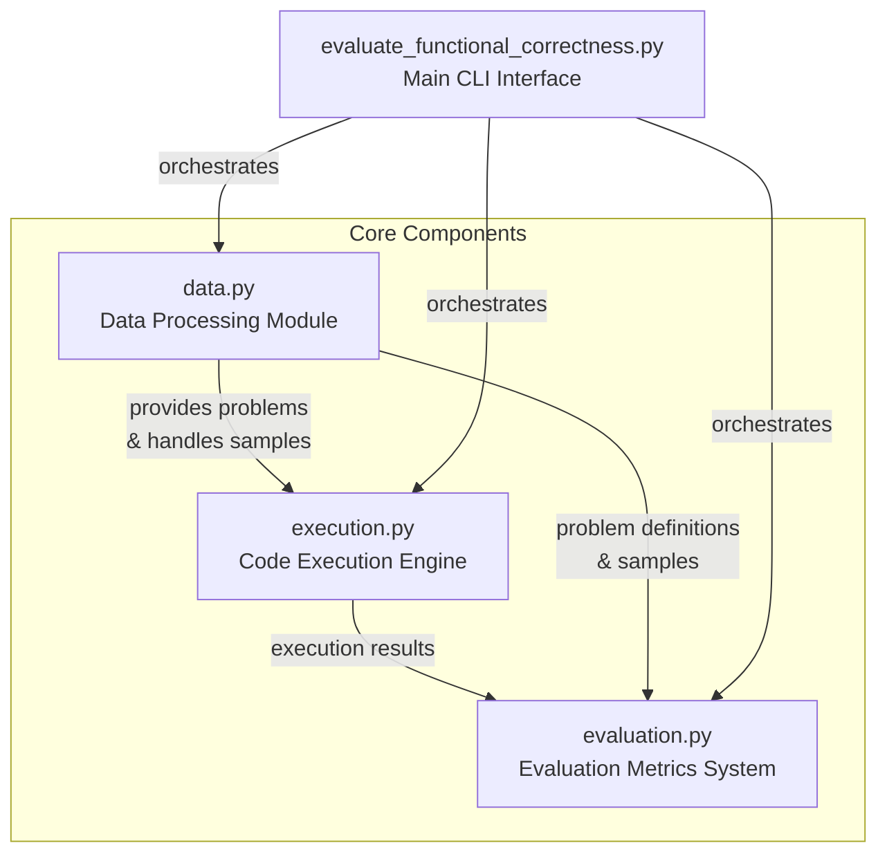
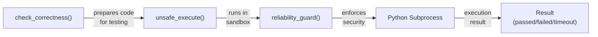
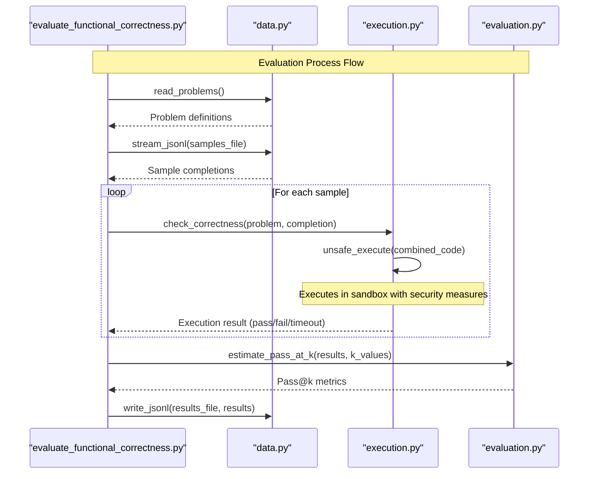
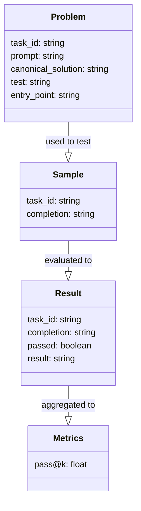
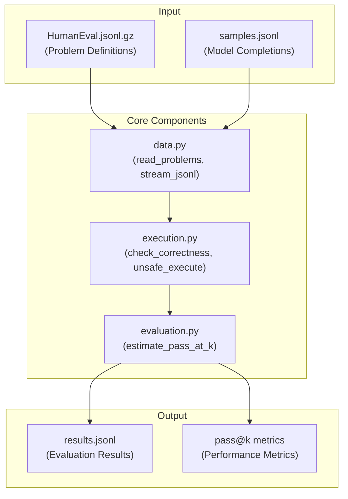

<!-- source: DeepWiki mcp.deepwiki.com · repo openai/human-eval · page 3 Core Components · fetched 2026-10-26 -->

# Core Components

Relevant source files

The following files were used as context for generating this wiki page:

- [README.md](README.md)
- [human_eval/__init__.py](human_eval/__init__.py)
- [requirements.txt](requirements.txt)

## Purpose and Scope

This document provides a comprehensive overview of the main functional components that make up the HumanEval framework. It describes the core modules, their responsibilities, and how they interact to evaluate the functional correctness of code generated by large language models. For a higher-level architectural view, see [System Architecture](#2), and for detailed information about specific components, refer to the focused pages on the [Data Processing Module](#3.1), [Code Execution Engine](#3.2), and [Evaluation Metrics](#3.3).

## Component Overview

The HumanEval framework consists of three primary components that work together to evaluate the functional correctness of generated code:

*Figure: Core Components and Their Relationships*

Sources: [README.md:22-45](), [README.md:56-90]()

## Data Processing Module

The Data Processing Module is responsible for loading problem definitions from the HumanEval dataset and handling input/output of sample files. It provides functionality to read problems, stream data in JSONL format, and write evaluation results.

### Key Functions and Responsibilities

| Function | Description |
|----------|-------------|
| `read_problems()` | Loads problem definitions from the HumanEval dataset |
| `stream_jsonl()` | Parses and yields data from JSONL files |
| `write_jsonl()` | Writes data to JSONL files |

The module handles the following data structures:
- Problem definitions (task_id, prompt, canonical_solution, test, entry_point)
- Sample completions (task_id, completion)
- Evaluation results (task_id, completion, passed, result)

For more detailed information, see the [Data Processing Module](#3.1) page.

Sources: [README.md:30-35](), [README.md:43-54]()

## Code Execution Engine

The Code Execution Engine safely executes generated code samples in a sandboxed environment and checks their functional correctness against test cases.

*Figure: Code Execution Engine Process Flow*

The execution engine places a strong emphasis on security, with mechanisms to prevent harmful code execution. This is critical since the system evaluates potentially untrusted code generated by AI models.

For detailed information on the execution pipeline and security measures, see the [Code Execution Engine](#3.2) page.

Sources: [README.md:23-28]()

## Evaluation Metrics System

The Evaluation Metrics System calculates the Pass@k metrics that quantify how well a model performs on the coding tasks at different sampling levels.

### Key Functions

| Function | Description |
|----------|-------------|
| `evaluate_functional_correctness()` | Main function that coordinates evaluation |
| `estimate_pass_at_k()` | Calculates pass@k metrics from execution results |

The system produces metrics that allow for standardized comparison of different models' code generation capabilities.

For detailed information on metrics calculation and interpretation, see the [Evaluation Metrics](#3.3) page.

Sources: [README.md:56-90]()

## Component Interaction

The following diagram illustrates how data flows through the HumanEval components during an evaluation process:

*Figure: Component Interaction During Evaluation Process*

Sources: [README.md:56-90]()

## Data Structures

The core components operate on these primary data structures:

*Figure: Core Data Structures*

Sources: [README.md:30-35](), [README.md:67-70]()

## Implementation Dependencies

The HumanEval framework relies on a few external libraries:

| Library | Purpose |
|---------|---------|
| tqdm | Progress bar for evaluation process |
| fire | Command-line interface handling |
| numpy | Numerical computations for metrics |

These dependencies are minimal, focusing on essential functionality while keeping the framework lightweight.

Sources: [requirements.txt:1-3]()

## Core Components Relationship to Evaluation Flow

*Figure: Core Components in the Evaluation Flow*

Sources: [README.md:56-70]()

---

