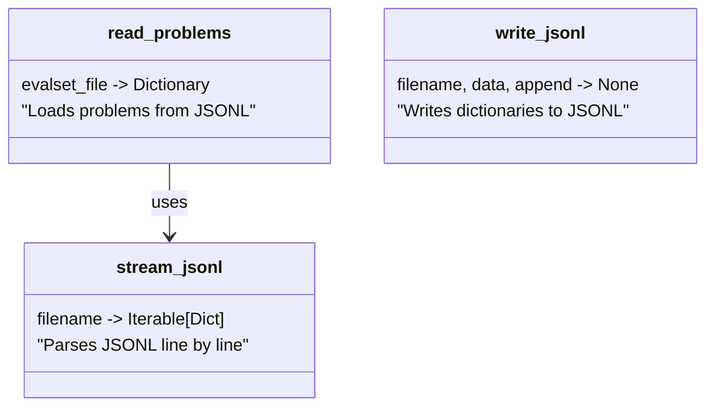
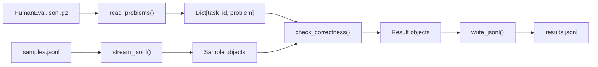
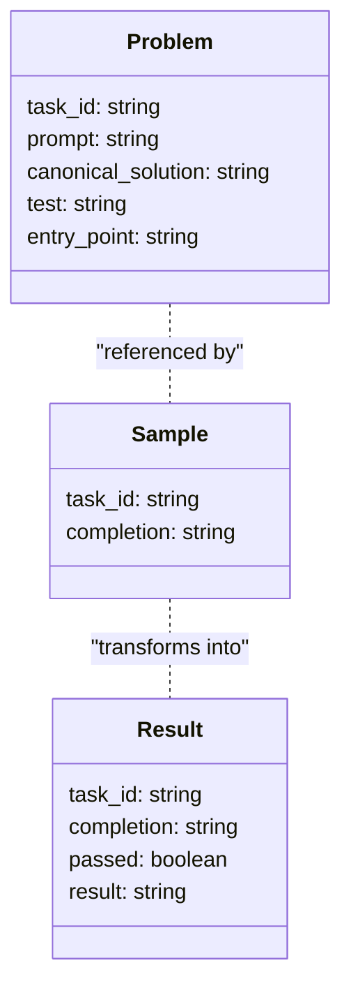

<!-- source: DeepWiki mcp.deepwiki.com · repo openai/human-eval · page 3.1 Data Processing Module · fetched 2026-10-26 -->

# Data Processing Module

<details>
<summary>Relevant source files</summary>

The following files were used as context for generating this wiki page:

- [data/HumanEval.jsonl.gz](data/HumanEval.jsonl.gz)
- [human_eval/data.py](human_eval/data.py)

</details>


The Data Processing Module provides utilities for loading, parsing, and saving data files in the HumanEval framework. It handles the reading of programming problems from the HumanEval dataset, streaming and parsing JSON Lines (JSONL) files, and writing evaluation results to output files. This module serves as the data interface layer that connects different components of the evaluation system.

For information about how the processed data is used to execute code, see [Code Execution Engine](#3.2). For details on how results are evaluated, see [Evaluation Metrics](#3.3).

## Data File Formats

### HumanEval Dataset

The primary dataset file is `HumanEval.jsonl.gz`, a gzipped JSONL file containing programming problems used for evaluation. Each problem is structured as follows:

| Field | Description |
|-------|-------------|
| task_id | Unique identifier for the problem (e.g., "HumanEval/1") |
| prompt | Problem description and function signature |
| canonical_solution | Reference solution for the problem |
| test | Test code to evaluate solutions |
| entry_point | Name of the function to be implemented |

Sources: [human_eval/data.py:8-12]()

### Sample and Result Formats

The module also handles code samples (solutions generated by models) and evaluation results in JSONL format:

**Sample Format:**
```json
{
  "task_id": "HumanEval/1",
  "completion": "def my_solution(args):\n    # implementation"
}
```

**Result Format:**
```json
{
  "task_id": "HumanEval/1",
  "completion": "def my_solution(args):\n    # implementation",
  "passed": true,
  "result": "passed"
}
```

Sources: [human_eval/data.py:15-49]()

## Core Functions

The module consists of three main functions that handle different aspects of data processing:

### Data Structure



Sources: [human_eval/data.py:11-49]()

### read_problems()

This function loads all problems from the HumanEval dataset into a dictionary keyed by task_id.

```python
def read_problems(evalset_file: str = HUMAN_EVAL) -> Dict[str, Dict]:
    return {task["task_id"]: task for task in stream_jsonl(evalset_file)}
```

The function:
- Takes an optional path to the dataset file (defaults to `HUMAN_EVAL` constant)
- Returns a dictionary where keys are task_ids and values are problem dictionaries
- Internally uses `stream_jsonl()` to parse the dataset file

Sources: [human_eval/data.py:11-12]()

### stream_jsonl()

This function parses a JSONL file line by line, yielding each parsed JSON object. It supports both plain and gzipped JSONL files.

The function:
- Takes a path to a JSONL file (with or without .gz extension)
- Yields each non-empty line as a parsed JSON dictionary
- Automatically handles gzip decompression when needed

Sources: [human_eval/data.py:15-29]()

### write_jsonl()

This function writes a sequence of dictionaries to a JSONL file. It supports both plain and gzipped output formats.

The function:
- Takes a path, an iterable of dictionaries, and an optional append flag
- Writes each dictionary as a JSON line to the file
- Automatically handles gzip compression when needed
- Can append to existing files when `append=True`

Sources: [human_eval/data.py:32-49]()

## Data Flow in the Evaluation Pipeline

The Data Processing Module plays a crucial role in the evaluation pipeline, handling data at multiple stages:



1. **Loading Problems**: The evaluation process begins by loading problems from the dataset using `read_problems()`
2. **Streaming Samples**: Code samples are read from input files using `stream_jsonl()`
3. **Writing Results**: After evaluation, results are written to output files using `write_jsonl()`

Sources: [human_eval/data.py:11-49]()

## System Integration

The Data Processing Module serves as a connector between various components of the HumanEval framework:

```mermaid
graph TD
    A["HumanEval Framework"] --> B["data.py"]
    B --> C["read_problems()"]
    B --> D["stream_jsonl()"]
    B --> E["write_jsonl()"]
    
    C --> F["HUMAN_EVAL constant"]
    F --> G["HumanEval.jsonl.gz"]
    D --> H["Sample JSONL Files"]
    E --> I["Results JSONL Files"]
    
    J["evaluate_functional_correctness.py"] --> C
    J --> D
    J --> E
    
    K["execution.py"] --> C: "Gets problem definitions"
    C --> L["evaluation.py"]: "Provides problems for metrics"
```

Sources: [human_eval/data.py:7-12]()

## Usage Examples

### Loading Problems

```python
from human_eval.data import read_problems

# Load all problems
problems = read_problems()
print(f"Loaded {len(problems)} problems")

# Access a specific problem
problem = problems["HumanEval/1"]
print(f"Problem: {problem['task_id']}")
print(f"Entry point: {problem['entry_point']}")
```

Sources: [human_eval/data.py:11-12]()

### Processing Samples

```python
from human_eval.data import stream_jsonl

# Stream samples from a file
for sample in stream_jsonl("samples.jsonl"):
    task_id = sample["task_id"]
    completion = sample["completion"]
    # Process the sample...
```

Sources: [human_eval/data.py:15-29]()

### Writing Results

```python
from human_eval.data import write_jsonl

# Create some results
results = [
    {"task_id": "HumanEval/1", "completion": "...", "passed": True, "result": "passed"},
    {"task_id": "HumanEval/2", "completion": "...", "passed": False, "result": "failed"}
]

# Write results to a file
write_jsonl("results.jsonl", results)
```

Sources: [human_eval/data.py:32-49]()

## Data Object Structures

The module processes three main types of data objects throughout the evaluation pipeline:



Sources: [human_eval/data.py:11-49]()

## Summary

The Data Processing Module forms the foundation of the HumanEval framework's data handling capabilities. It provides a consistent interface for:

1. Loading problem definitions from the HumanEval dataset
2. Streaming code samples from input files
3. Writing evaluation results to output files

The module implements automatic handling of compressed data formats and provides a clean API that is used throughout the evaluation pipeline. Its simplicity and focused design make it a key component in the overall architecture of the HumanEval framework.

Sources: [human_eval/data.py:1-50]()

---

