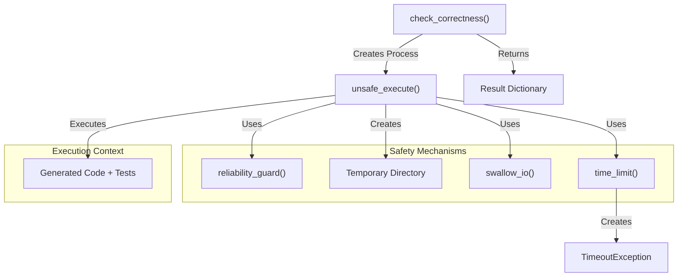
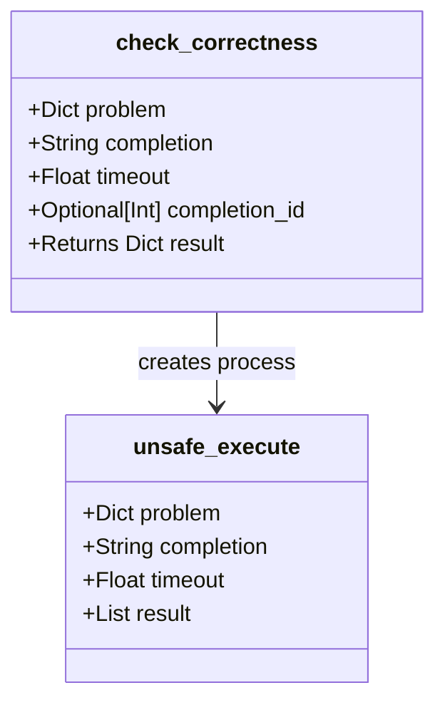
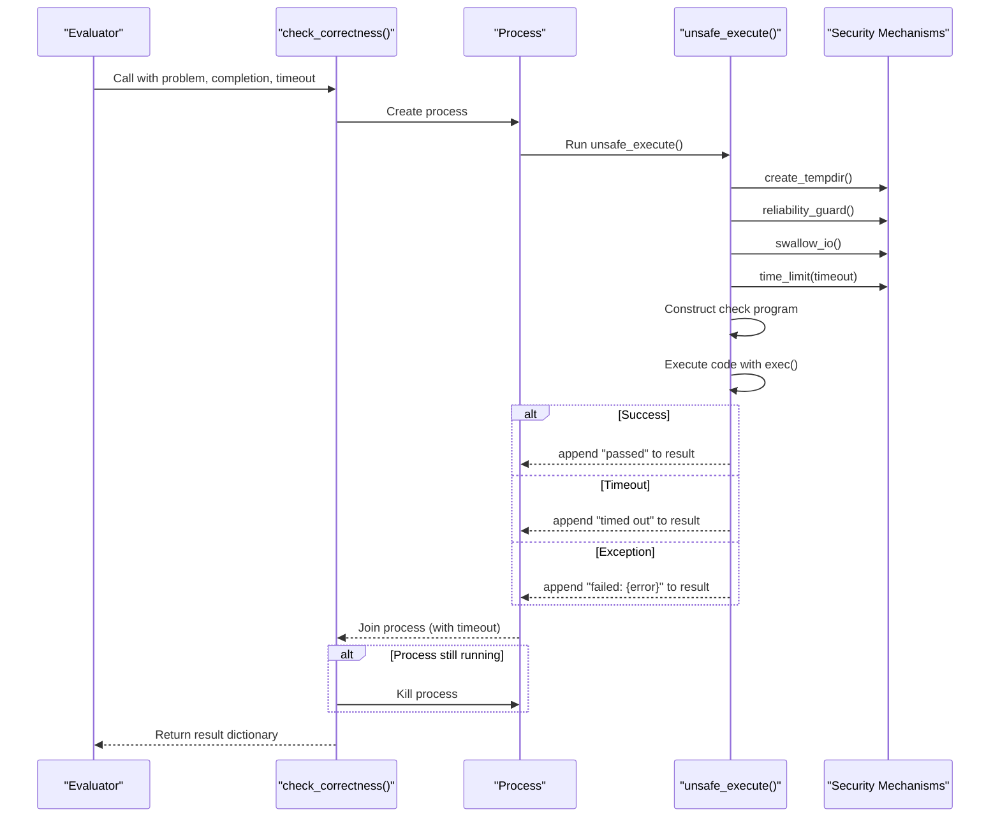
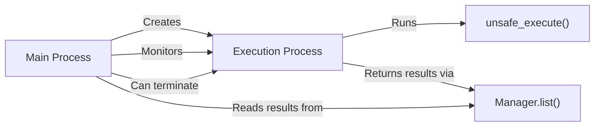
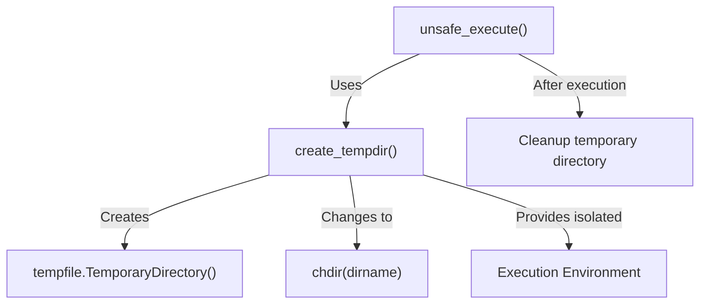
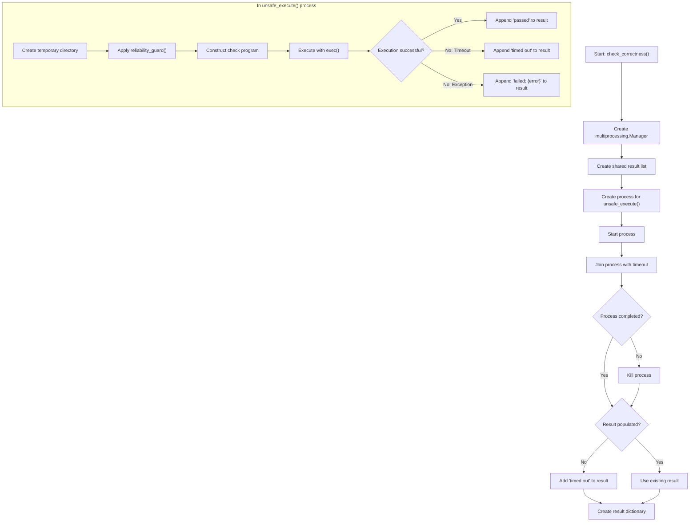
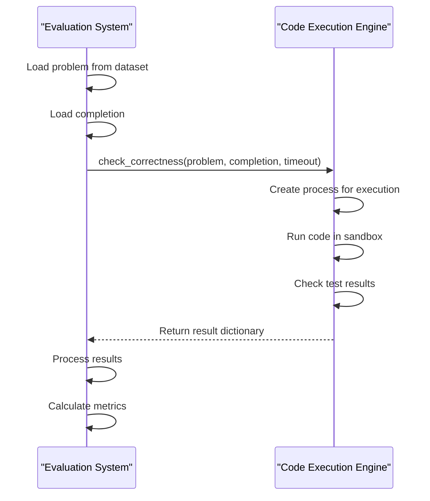

<!-- source: DeepWiki mcp.deepwiki.com · repo openai/human-eval · page 3.2 Code Execution Engine · fetched 2026-10-26 -->

# Code Execution Engine

<details>
<summary>Relevant source files</summary>

The following files were used as context for generating this wiki page:

- [human_eval/execution.py](human_eval/execution.py)

</details>


## Purpose and Scope

The Code Execution Engine is a critical component of the HumanEval framework responsible for securely executing and testing code samples in a controlled environment. This engine provides the mechanisms to run potentially untrusted code generated by language models while maintaining system safety. It handles code execution, timeout management, resource limitations, and security safeguards.

For information about how this component fits into the overall evaluation process, see [Evaluation Pipeline](#2.1). For details on the security principles implemented, see [Security Model](#2.2).

## Architecture Overview

The Code Execution Engine is designed around the principle of isolated, sandboxed execution with strict resource limitations and safety guards. The engine executes code samples against test cases and reports results without allowing potentially harmful operations.



Sources: [human_eval/execution.py:12-91](human_eval/execution.py:12-91)

## Key Components

### Execution Interface

The primary entry point for code execution is the `check_correctness()` function, which handles the high-level process of evaluating a code completion against a problem's test cases.



The function takes the following parameters:
- `problem`: Dictionary containing the problem specification, including prompt and test cases
- `completion`: String containing the code solution to be tested
- `timeout`: Maximum execution time allowed
- `completion_id` (optional): Identifier for tracking completions

It returns a dictionary with:
- `task_id`: Identifier for the problem
- `passed`: Boolean indicating whether the code passed all tests
- `result`: String describing the execution result ("passed", "failed", or "timed out")
- `completion_id`: The original completion ID if provided

Sources: [human_eval/execution.py:63-91](human_eval/execution.py:63-91)

### Execution Process

The actual execution happens in the `unsafe_execute()` function, which is run in a separate process for isolation. This function:

1. Creates a temporary directory for execution
2. Applies security restrictions via `reliability_guard()`
3. Constructs a complete program by concatenating the problem prompt, completion, test code, and check invocation
4. Executes the code using Python's `exec()` function
5. Captures and handles any errors or timeouts
6. Returns execution results



Sources: [human_eval/execution.py:12-60](human_eval/execution.py:12-60)

### Safety and Security Features

The Code Execution Engine implements several layers of security to prevent malicious or unintentionally harmful code from affecting the host system:

#### Process Isolation

Code execution occurs in a separate process, ensuring that any crashes, hangs, or resource exhaustion doesn't affect the main evaluation process.



Sources: [human_eval/execution.py:74-84](human_eval/execution.py:74-84)

#### Reliability Guard

The `reliability_guard()` function systematically disables potentially destructive functionality by nullifying dangerous system calls and limiting resource usage:

1. Memory limits using `resource.setrlimit()`
2. Disabling `exit()` and `quit()` functions
3. Nullifying destructive OS operations (`os.kill`, `os.system`, etc.)
4. Removing filesystem manipulation capabilities
5. Disabling process creation via `subprocess.Popen`
6. Blocking access to certain modules

This function serves as a protective barrier between the executed code and the host system.

Sources: [human_eval/execution.py:163-242](human_eval/execution.py:163-242)

#### I/O Redirection

The `swallow_io()` context manager redirects standard input, output, and error streams to a write-only buffer, preventing the executed code from reading or interfering with I/O operations:

```python
# WriteOnlyStringIO prevents reading operations
class WriteOnlyStringIO(io.StringIO):
    def read(self, *args, **kwargs): raise IOError
    def readline(self, *args, **kwargs): raise IOError
    def readlines(self, *args, **kwargs): raise IOError
    def readable(self, *args, **kwargs): return False
```

Sources: [human_eval/execution.py:107-141](human_eval/execution.py:107-141)

#### Temporary Directory Isolation

Code execution takes place in an isolated temporary directory via the `create_tempdir()` context manager, preventing access to the host filesystem:



Sources: [human_eval/execution.py:116-120](human_eval/execution.py:116-120), [human_eval/execution.py:148-160](human_eval/execution.py:148-160)

### Timeout Handling

The engine implements timeout handling using the `time_limit()` context manager, which uses the SIGALRM signal to enforce execution time constraints:

1. Sets a timer using `signal.setitimer()`
2. Registers a signal handler that raises a `TimeoutException`
3. Properly resets the timer when execution completes

This ensures that code execution doesn't exceed the specified time limit, preventing infinite loops or long-running computations from blocking the evaluation process.

Sources: [human_eval/execution.py:94-104](human_eval/execution.py:94-104), [human_eval/execution.py:123-124](human_eval/execution.py:123-124)

## Execution Workflow

The complete workflow of code execution follows these steps:



Sources: [human_eval/execution.py:12-91](human_eval/execution.py:12-91)

## Usage Example

The Code Execution Engine is typically used by the Evaluation System to process and test code completions:



The Code Execution Engine provides a reliable, secure way to test the functional correctness of code samples against predefined test cases, forming a crucial part of the HumanEval framework.

Sources: [human_eval/execution.py:63-91](human_eval/execution.py:63-91)

---

