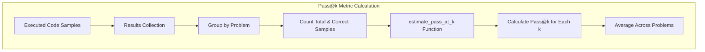
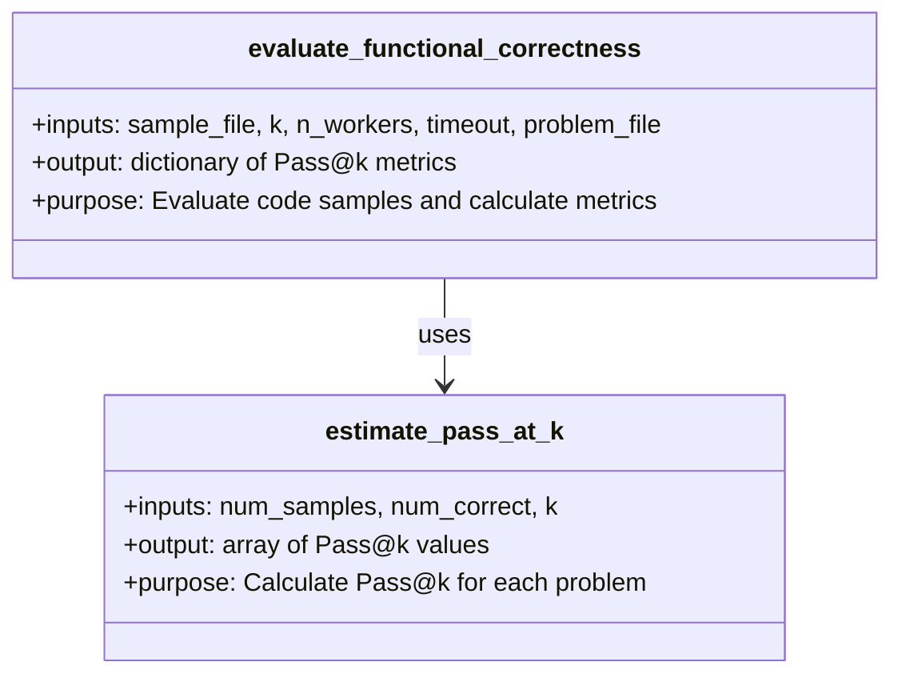
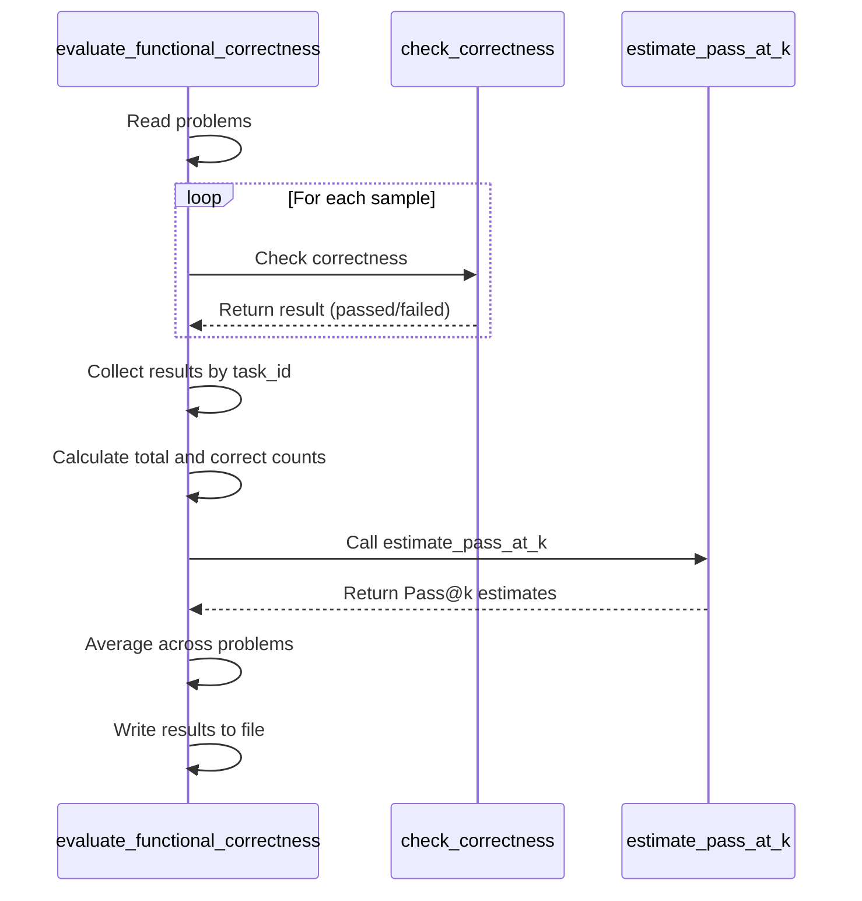
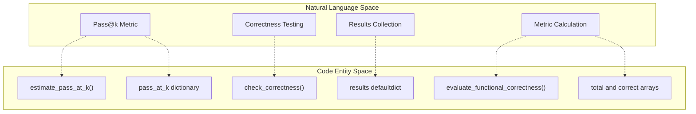
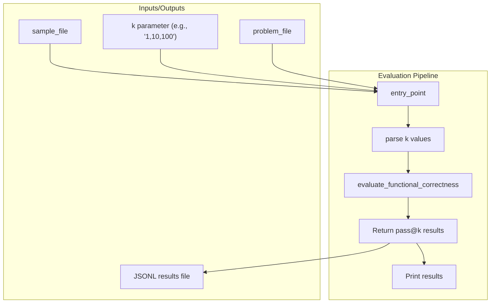
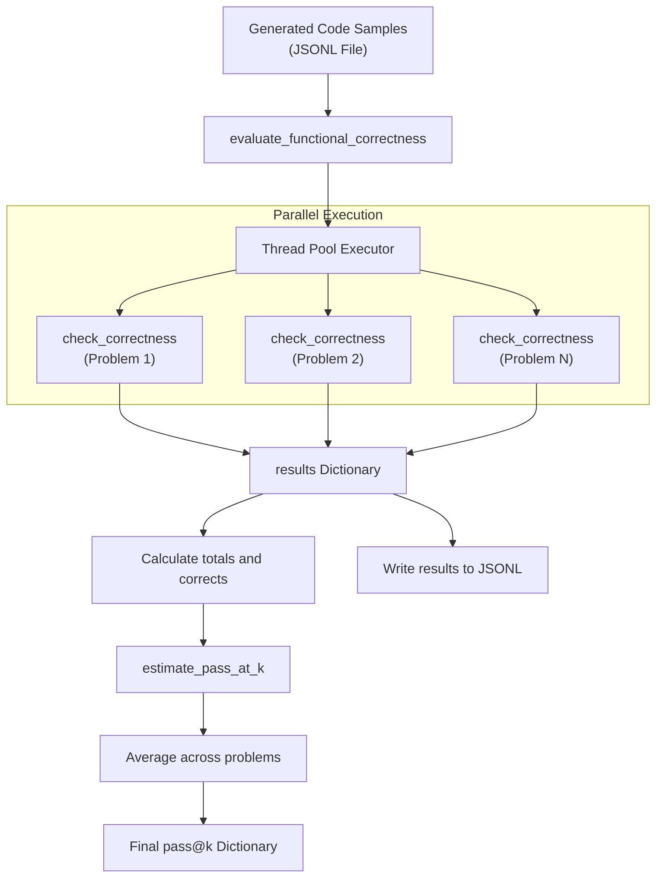

<!-- source: DeepWiki mcp.deepwiki.com · repo openai/human-eval · page 3.3 Evaluation Metrics · fetched 2026-10-26 -->

# Evaluation Metrics

<details>
<summary>Relevant source files</summary>

The following files were used as context for generating this wiki page:

- [human_eval/evaluate_functional_correctness.py](human_eval/evaluate_functional_correctness.py)
- [human_eval/evaluation.py](human_eval/evaluation.py)

</details>


This document details the evaluation metrics used in the HumanEval framework to assess the functional correctness of code generated by large language models. It focuses specifically on the Pass@k metric, its mathematical foundation, implementation, and usage within the evaluation pipeline. For information about the overall evaluation process, see [Evaluation Pipeline](#2.1), and for details on code execution, see [Code Execution Engine](#3.2).

## Pass@k Metric Overview

The Pass@k metric is the primary evaluation methodology in HumanEval. It estimates the probability that a model would correctly solve a programming problem if allowed k independently sampled attempts.

Pass@k is particularly valuable for evaluating code-generating models because:
- It accounts for the probabilistic nature of language model outputs
- It measures a model's ability to generate correct solutions from multiple tries
- It provides a more nuanced evaluation than simple accuracy

Sources: [human_eval/evaluation.py:13-36]()

## Mathematical Foundation

The Pass@k metric is calculated using the following formula:

$\text{Pass@k} = 1 - \frac{\binom{n-c}{k}}{\binom{n}{k}}$

Where:
- $n$ is the number of samples generated for a problem
- $c$ is the number of correct samples for that problem
- $k$ is the number of attempts considered (typically 1, 10, or 100)

This formula represents the probability that at least one sample in k randomly selected samples will be correct, given that c out of n total samples are correct.

The implementation of this formula can be found in the `estimator` function:

```python
def estimator(n: int, c: int, k: int) -> float:
    """
    Calculates 1 - comb(n - c, k) / comb(n, k).
    """
    if n - c < k:
        return 1.0
    return 1.0 - np.prod(1.0 - k / np.arange(n - c + 1, n + 1))
```

Sources: [human_eval/evaluation.py:13-36]()

## Pass@k Calculation Process

The following diagram illustrates how Pass@k metrics are calculated within the evaluation system:



Sources: [human_eval/evaluation.py:39-105]()

## Implementation Details

### Key Functions

The Pass@k metric is implemented through two main functions in the evaluation module:

1. **`estimate_pass_at_k`**: Calculates the Pass@k probability for each problem
2. **`evaluate_functional_correctness`**: Orchestrates the evaluation process and computes Pass@k metrics

The relationship between these functions and their inputs/outputs is illustrated below:



Sources: [human_eval/evaluation.py:13-36](), [human_eval/evaluation.py:39-105]()

### Calculation Process Details

The Pass@k calculation involves these key steps:

1. Execute code samples against test cases to determine correctness
2. Group results by problem ID
3. Count the total number of samples and correct solutions for each problem
4. Apply the Pass@k formula to each problem
5. Average the Pass@k values across all problems

This process is implemented in `evaluate_functional_correctness`:



Sources: [human_eval/evaluation.py:39-105]()

## Code Entity Mapping

The following diagram maps evaluation metric concepts to their actual code entities:



Sources: [human_eval/evaluation.py:13-36](), [human_eval/evaluation.py:39-105]()

## Usage in Main Pipeline

The evaluation metrics are integrated into the main HumanEval pipeline through the `entry_point` function in `evaluate_functional_correctness.py`:



Sources: [human_eval/evaluate_functional_correctness.py:8-21]()

## Result Format

The Pass@k metrics are returned as a dictionary with keys of the form `"pass@k"` and values representing the average Pass@k probability across all problems:

| Key | Value | Meaning |
|-----|-------|---------|
| `"pass@1"` | 0.35 | 35% chance of solving a problem with 1 attempt |
| `"pass@10"` | 0.62 | 62% chance of solving a problem with 10 attempts |
| `"pass@100"` | 0.84 | 84% chance of solving a problem with 100 attempts |

The metrics are calculated only for values of k that are applicable to all problems (where all problems have at least k samples):

```python
pass_at_k = {f"pass@{k}": estimate_pass_at_k(total, correct, k).mean()
             for k in ks if (total >= k).all()}
```

Sources: [human_eval/evaluation.py:88-90]()

## Detailed Evaluation Flow

This diagram shows the detailed flow of data during the evaluation process, focusing on how the Pass@k metrics are calculated:



Sources: [human_eval/evaluation.py:39-105]()

## Best Practices for Using Pass@k

- Use multiple k values (typically 1, 10, and 100) to get a comprehensive view of model performance
- Ensure sufficient samples per problem for reliable estimation (at least equal to the largest k value)
- Compare models using the same k values and sampling procedures
- Consider reporting confidence intervals for Pass@k metrics when comparing models

Sources: [human_eval/evaluate_functional_correctness.py:8-21](), [human_eval/evaluation.py:39-105]()

---

