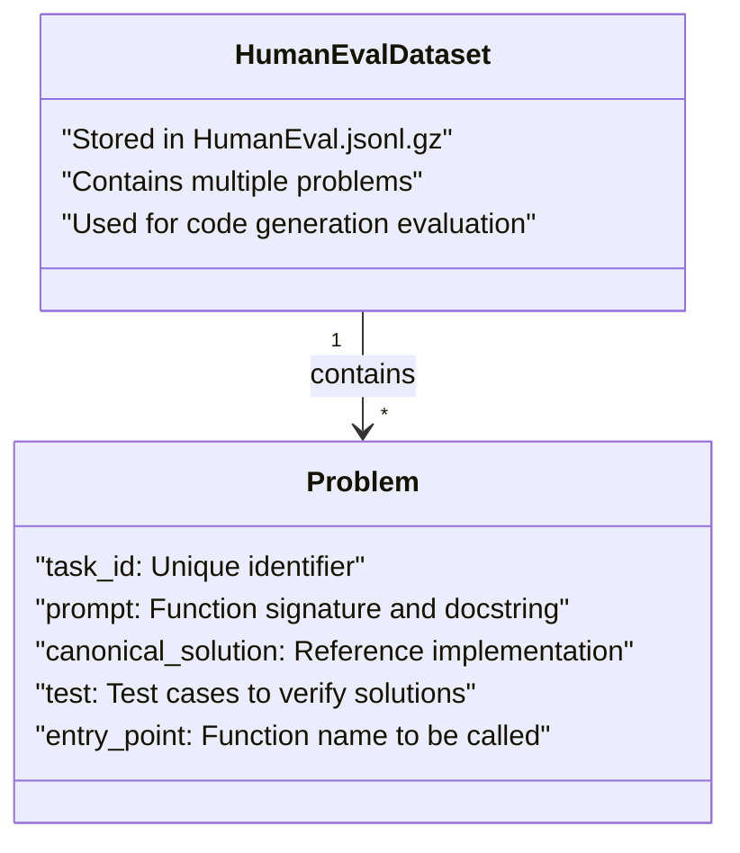
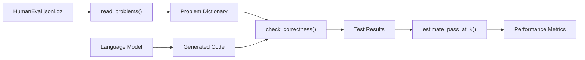
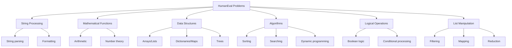
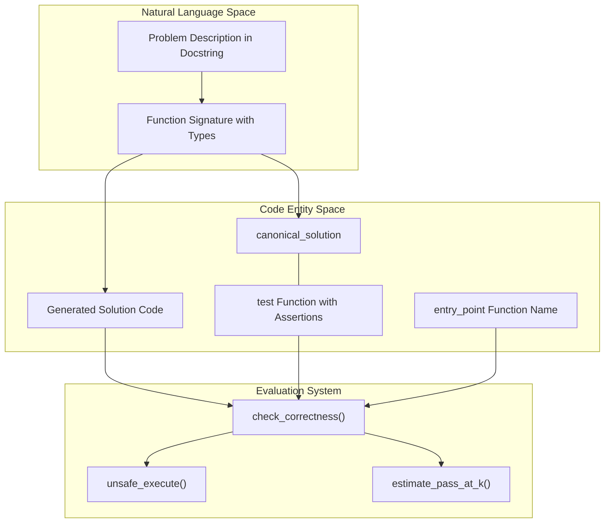
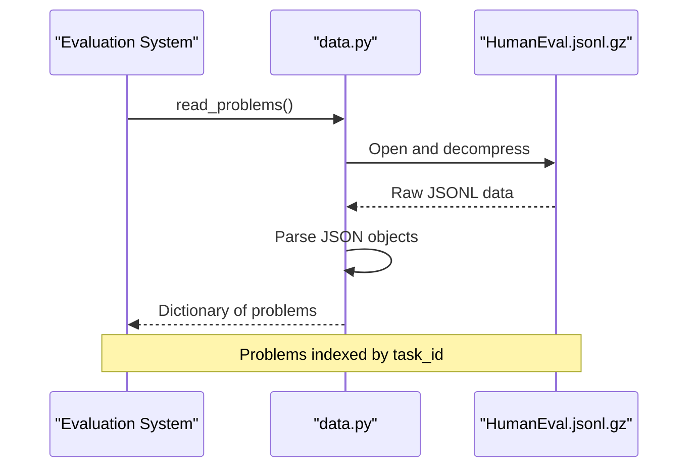

<!-- source: DeepWiki mcp.deepwiki.com · repo openai/human-eval · page 4 HumanEval Dataset · fetched 2026-10-26 -->

# HumanEval Dataset

<details>
<summary>Relevant source files</summary>

The following files were used as context for generating this wiki page:

- [data/HumanEval.jsonl.gz](data/HumanEval.jsonl.gz)
- [data/example_problem.jsonl](data/example_problem.jsonl)

</details>


The HumanEval dataset is a collection of programming problems designed to evaluate the functional correctness of code generated by large language models. It serves as a benchmark for assessing how well models can generate code that not only compiles but correctly solves specified programming tasks.

This page focuses on the overall structure and content of the dataset. For more detailed information about specific problem formatting, see [Problem Format](#4.1), and for details about sample input/output formatting, see [Sample Format](#4.2).

## Dataset Overview

The HumanEval dataset consists of hand-written programming problems, stored in a compressed JSONL format. Each problem provides a function signature, docstring, implementation, and test cases, allowing for automated evaluation of code generation capabilities.



Sources: [data/HumanEval.jsonl.gz](), [data/example_problem.jsonl]()

## Problem Structure

Each problem in the HumanEval dataset follows a consistent structure with the following components:

| Field | Description |
|-------|-------------|
| `task_id` | Unique identifier for the problem (e.g., "HumanEval/12") |
| `prompt` | Function signature and docstring describing the expected behavior |
| `canonical_solution` | Reference implementation that correctly solves the problem |
| `test` | Test code with assertions to verify the correctness of solutions |
| `entry_point` | Name of the function to be called during evaluation |

### Example Problem

```json
{
  "task_id": "test/0", 
  "prompt": "def return1():\n", 
  "canonical_solution": "    return 1", 
  "test": "def check(candidate):\n    assert candidate() == 1", 
  "entry_point": "return1"
}
```

Sources: [data/example_problem.jsonl]()

## Dataset Integration with Evaluation System

The HumanEval dataset is a central component in the evaluation pipeline for code generation models. It provides the problems against which model-generated code is tested.



Sources: [data/HumanEval.jsonl.gz]()

## Problem Types and Domains

The HumanEval dataset covers a diverse range of programming challenges spanning multiple domains:



Sources: [data/HumanEval.jsonl.gz]()

## From Problem Description to Code Evaluation

The following diagram illustrates how the HumanEval dataset bridges the gap between natural language problem descriptions and executable code evaluation:



Sources: [data/HumanEval.jsonl.gz](), [data/example_problem.jsonl]()

## Dataset Storage and Access

The HumanEval dataset is stored in a compressed JSONL format (`HumanEval.jsonl.gz`). The file contains one JSON object per line, with each object representing a complete problem. The dataset is accessed through the data processing module's `read_problems()` function, which loads and parses the problems into a dictionary for use in the evaluation system.



Sources: [data/HumanEval.jsonl.gz]()

## Dataset Usage

The HumanEval dataset serves multiple purposes within the functional correctness evaluation framework:

1. **Reference Problems**: Provides a standard set of programming tasks
2. **Ground Truth**: Contains canonical solutions for comparison
3. **Automated Testing**: Includes test cases to verify solution correctness
4. **Benchmarking**: Enables consistent comparison across different models
5. **Diverse Evaluation**: Covers a range of programming concepts and difficulty levels

When evaluating a language model's code generation capabilities, generated solutions are tested against the problems from this dataset, and metrics such as Pass@k are calculated to quantify performance.

Sources: [data/HumanEval.jsonl.gz](), [data/example_problem.jsonl]()

---

