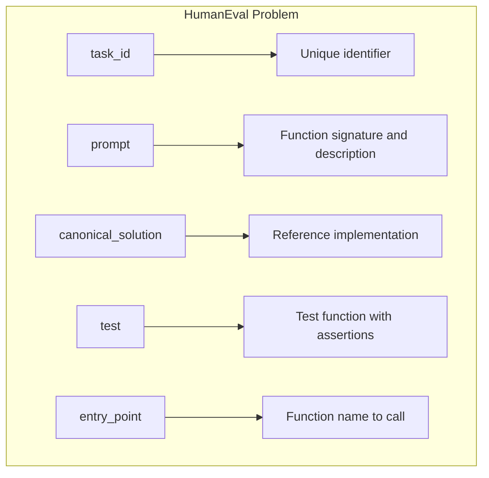
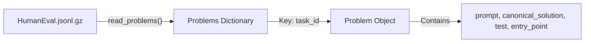
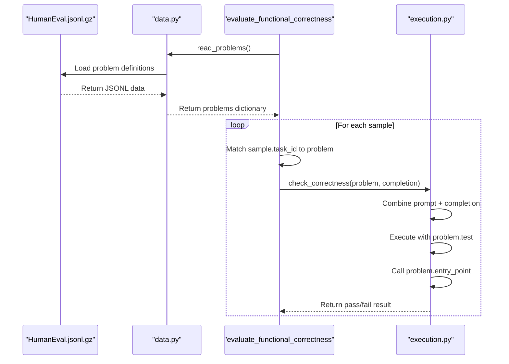
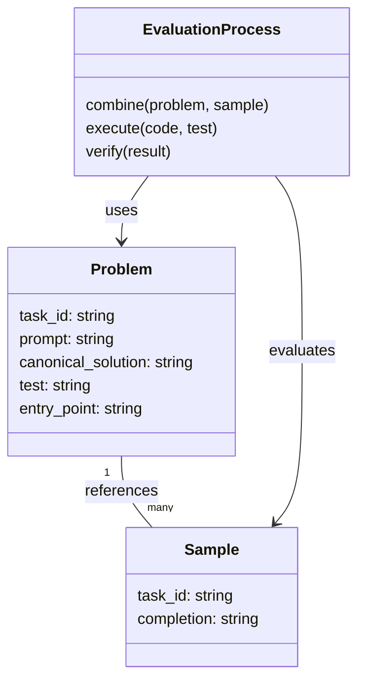
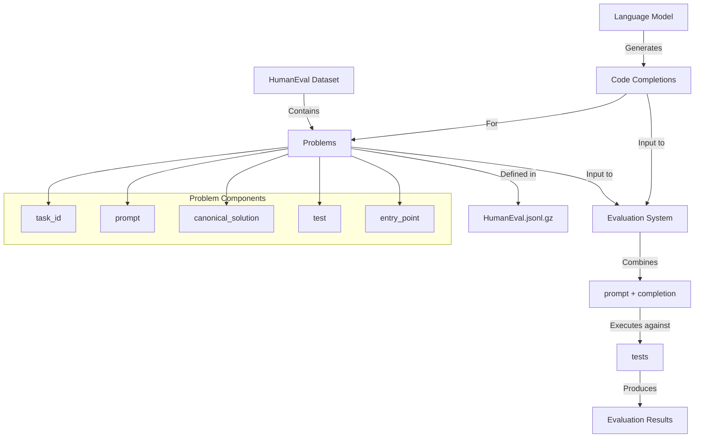

<!-- source: DeepWiki mcp.deepwiki.com · repo openai/human-eval · page 4.1 Problem Format · fetched 2026-10-26 -->

# Problem Format

<details>
<summary>Relevant source files</summary>

The following files were used as context for generating this wiki page:

- [README.md](README.md)
- [data/example_problem.jsonl](data/example_problem.jsonl)

</details>


This document describes the format of problems in the HumanEval dataset, which are the fundamental building blocks for evaluating the functional correctness of code generated by large language models. For information about the format of code samples submitted for evaluation, see [Sample Format](#4.2).

## Overview

In the HumanEval framework, a "problem" is a programming task that includes a function signature, description, reference solution, and test cases. Problems are stored in a standardized JSONL format and serve as the basis for evaluating how well language models can generate functionally correct code.



Sources: [README.md:34-35](), [data/example_problem.jsonl:1]()

## Problem Structure

Each problem in the HumanEval dataset is represented as a JSON object with the following fields:

| Field | Description | Example |
|-------|-------------|---------|
| `task_id` | Unique identifier for the problem | `"test/0"` |
| `prompt` | Function signature and description (code stub) | `"def return1():\n"` |
| `canonical_solution` | Reference implementation (correct solution) | `"    return 1"` |
| `test` | Test function with assertions to validate solutions | `"def check(candidate):\n    assert candidate() == 1"` |
| `entry_point` | Name of the function to be called during testing | `"return1"` |

Sources: [data/example_problem.jsonl:1]()

### Field Details

#### task_id

The `task_id` serves as a unique identifier for each problem. It allows the system to track and reference specific problems throughout the evaluation pipeline. Task IDs typically follow a pattern of a category or namespace followed by a number.

#### prompt

The `prompt` field contains the function signature and description of the programming task. This is what would be presented to a language model to complete. It typically includes:
- Function definition with parameters
- Docstrings or comments explaining the task
- Any necessary imports or context

The prompt intentionally leaves the function body implementation incomplete, as this is what the language model needs to generate.

#### canonical_solution

The `canonical_solution` contains the reference implementation that correctly solves the problem. This serves several purposes:
- Provides a verified solution for the problem
- Can be used as a benchmark for comparing generated solutions
- May be used for debugging the evaluation system itself

Note that the `canonical_solution` only includes the function body, not the function signature which is already in the `prompt`.

#### test

The `test` field contains a Python function named `check` that takes a `candidate` function as input and tests whether it correctly implements the required functionality. The test typically uses assertions to verify that the candidate function produces the expected outputs for various inputs.

These tests are executed in a sandbox environment to evaluate the correctness of generated code completions.

#### entry_point

The `entry_point` field specifies the name of the function that should be called during testing. This allows the evaluation system to know which function to pass to the test function.

Sources: [data/example_problem.jsonl:1]()

## Problem Storage and Loading

Problems in the HumanEval dataset are stored in a compressed JSONL (JSON Lines) format file called `HumanEval.jsonl.gz`. Each line in this file contains a JSON object representing a single problem.



The problems are loaded into memory using the `read_problems()` function from the data processing module. This function returns a dictionary where the keys are task IDs and the values are the corresponding problem objects.

Sources: [README.md:43-45]()

## Problem Example

Here's a complete example of a problem from the dataset:

```json
{
  "task_id": "test/0",
  "prompt": "def return1():\n",
  "canonical_solution": "    return 1",
  "test": "def check(candidate):\n    assert candidate() == 1",
  "entry_point": "return1"
}
```

This simple example demonstrates a problem that requires implementing a function that returns the value 1.

Sources: [data/example_problem.jsonl:1]()

## Problem Usage in Evaluation Workflow

Problems are a central component in the HumanEval evaluation workflow. Here's how they fit into the overall process:



During evaluation:
1. Problems are loaded from the dataset
2. For each code sample being evaluated:
   - The system identifies the corresponding problem using the `task_id`
   - It combines the problem's `prompt` with the sample's completion to form a complete function
   - The combined code is executed and tested using the problem's `test` function
   - The `entry_point` indicates which function to test

Sources: [README.md:56-70]()

## Problem-Sample Integration

The relationship between problems and the code samples being evaluated is a key aspect of the HumanEval framework:



When a language model generates code for a problem:
1. The code completion is stored as a "sample" with a reference to the original problem's `task_id`
2. During evaluation, the system matches the sample to its corresponding problem
3. The problem's `prompt` and the sample's `completion` are combined to form a complete function
4. The problem's `test` is used to verify if the implementation is correct

Sources: [README.md:31-35](), [README.md:48-53]()

## Problem Format in JSON Schema

Below is a formal JSON schema representation of the problem format:

```json
{
  "type": "object",
  "required": ["task_id", "prompt", "canonical_solution", "test", "entry_point"],
  "properties": {
    "task_id": {
      "type": "string",
      "description": "Unique identifier for the problem"
    },
    "prompt": {
      "type": "string",
      "description": "Function signature and problem description"
    },
    "canonical_solution": {
      "type": "string",
      "description": "Reference implementation that correctly solves the problem"
    },
    "test": {
      "type": "string",
      "description": "Test function to verify correctness of solutions"
    },
    "entry_point": {
      "type": "string",
      "description": "Name of the function to be called during testing"
    }
  }
}
```

Sources: [data/example_problem.jsonl:1]()

## Relationship to Overall Evaluation System

Problems are foundational components within the larger HumanEval evaluation system:



Sources: [README.md:3-5]()

Understanding the problem format is essential for both:
1. Creating new evaluation problems that follow the standardized structure
2. Interpreting evaluation results in the context of specific problems
3. Developing systems that interact with the HumanEval framework

---

