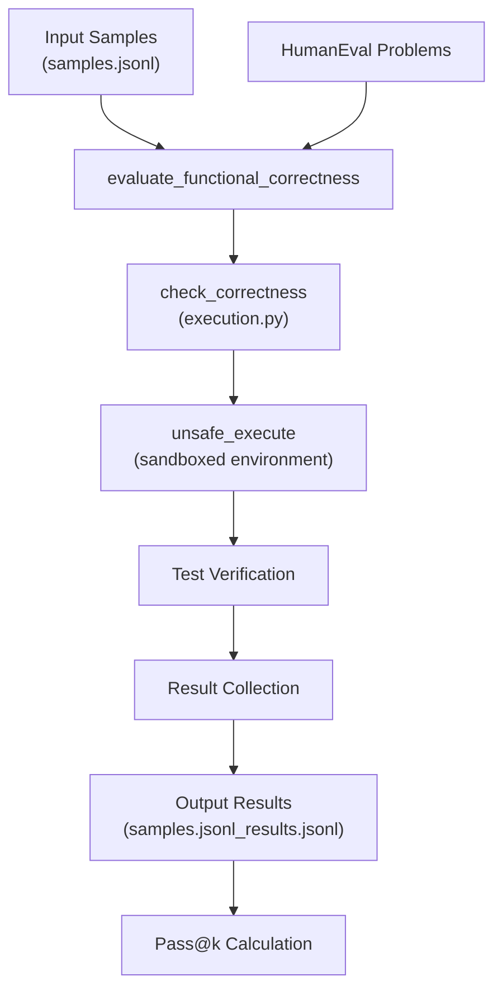
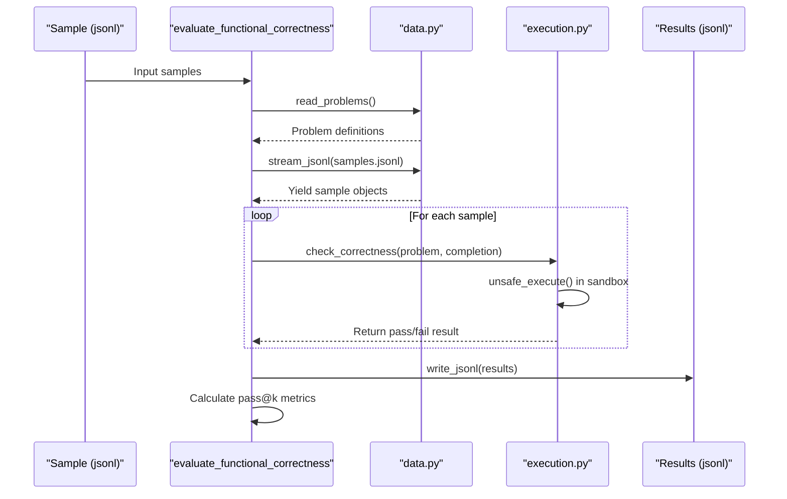

<!-- source: DeepWiki mcp.deepwiki.com · repo openai/human-eval · page 4.2 Sample Format · fetched 2026-10-26 -->

# Sample Format

<details>
<summary>Relevant source files</summary>

The following files were used as context for generating this wiki page:

- [README.md](README.md)
- [data/example_samples.jsonl](data/example_samples.jsonl)

</details>


## Purpose and Scope

This document describes the format specifications for code samples submitted to the HumanEval framework for evaluation and the result format produced after evaluation. It details the required structure of input samples and output results to enable proper functional correctness assessment. For information about the format of the problems themselves, see [Problem Format](#4.1).

## Input Sample Format

Code samples must be submitted in JSON Lines (jsonl) format where each line represents a single code completion to be evaluated against a specific problem.

### Sample Object Structure

```mermaid
classDiagram
    class "SampleObject" {
        task_id: string
        completion: string
    }
    
    note for "SampleObject" "task_id: HumanEval problem identifier\ncompletion: Generated code without the prompt"
```

### Format Specification

Each sample in the jsonl file must be a JSON object with the following fields:

| Field | Type | Description |
|-------|------|-------------|
| `task_id` | String | Identifier for the HumanEval problem this completion addresses |
| `completion` | String | The generated code completion only, without including the original prompt |

### Example Sample

```json
{"task_id": "test/0", "completion": "    return 1"}
```

Sources: [README.md:31-35](), [data/example_samples.jsonl:1-6]()

## Result Format

After evaluation, the system produces a result file with the original filename plus `_results.jsonl` suffix. Each line corresponds to the evaluation result for the respective input sample.

### Result Object Structure

```mermaid
classDiagram
    class "ResultObject" {
        task_id: string
        completion: string
        passed: boolean
        result: string
    }
    
    note for "ResultObject" "result is one of: 'passed', 'failed', or 'timed out'"
```

### Format Specification

Each result in the output jsonl file contains:

| Field | Type | Description |
|-------|------|-------------|
| `task_id` | String | The task ID from the original sample |
| `completion` | String | The code completion from the original sample |
| `passed` | Boolean | Whether the completion passed all tests |
| `result` | String | Execution result: "passed", "failed", or "timed out" |

Sources: [README.md:66-70]()

## Sample Processing Flow

The following diagram illustrates how samples are processed through the HumanEval evaluation system:



Sources: [README.md:56-71]()

## Data Flow Between Components



Sources: [README.md:56-82]()

## Example Sample Generation

The following code example demonstrates how to generate and save samples in the correct format:

```python
from human_eval.data import write_jsonl, read_problems

problems = read_problems()

num_samples_per_task = 200
samples = [
    dict(task_id=task_id, completion=generate_one_completion(problems[task_id]["prompt"]))
    for task_id in problems
    for _ in range(num_samples_per_task)
]
write_jsonl("samples.jsonl", samples)
```

Sources: [README.md:39-54]()

## Example Sample Evaluation

To evaluate the generated samples:

```bash
evaluate_functional_correctness samples.jsonl
```

This command:
1. Reads all samples from the input file
2. Executes each code sample against its corresponding test suite
3. Writes results to `samples.jsonl_results.jsonl`
4. Prints the overall pass@k metrics

Sample output:
```
Reading samples...
32800it [00:01, 23787.50it/s]
Running test suites...
100%|...| 32800/32800 [16:11<00:00, 33.76it/s]
Writing results to samples.jsonl_results.jsonl...
100%|...| 32800/32800 [00:00<00:00, 42876.84it/s]
{'pass@1': ..., 'pass@10': ..., 'pass@100': ...}
```

Sources: [README.md:56-66]()

## Special Sample Handling Cases

### Indentation

The HumanEval system handles various indentation styles in code completions, including spaces and tabs, as shown in the example samples:

```
{"task_id": "test/0", "completion": "    return 1"}
{"task_id": "test/0", "completion": "  return 1"}
{"task_id": "test/0", "completion": "\treturn 1"}
```

### Error Conditions

The evaluation system detects and reports several error conditions in the results:

1. **Timeout**: When code execution exceeds the time limit
   ```
   {"task_id": "test/0", "completion": "    import time\n    time.sleep(10)\n    return 1", "passed": false, "result": "timed out"}
   ```

2. **Security Violations**: When code attempts to perform unsafe operations
   ```
   {"task_id": "test/0", "completion": "    import subprocess\n    subprocess.check_output('rm -rf tmp')", "passed": false, "result": "failed"}
   ```

3. **Input Requirements**: Code that requires input will also fail
   ```
   {"task_id": "test/0", "completion": "    return input('enter a number')", "passed": false, "result": "failed"}
   ```

Sources: [data/example_samples.jsonl:1-6](), [README.md:66-70]()

## Best Practices

### Sample Preparation
- Ensure each completion contains only the solution code without the original prompt
- Use proper indentation that matches the expected function format
- Verify that task IDs match existing problems in the HumanEval dataset

### Result Analysis
- Monitor failed executions to identify common error patterns
- Use the pass@k metrics to evaluate the overall quality of generated completions
- For large-scale evaluations, consider running in batches to manage system resources

Sources: [README.md:31-91]()

---

