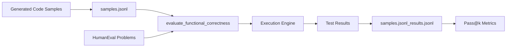
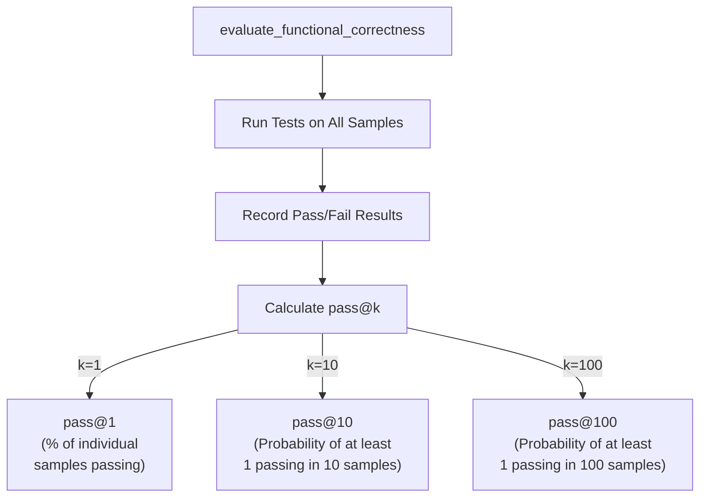
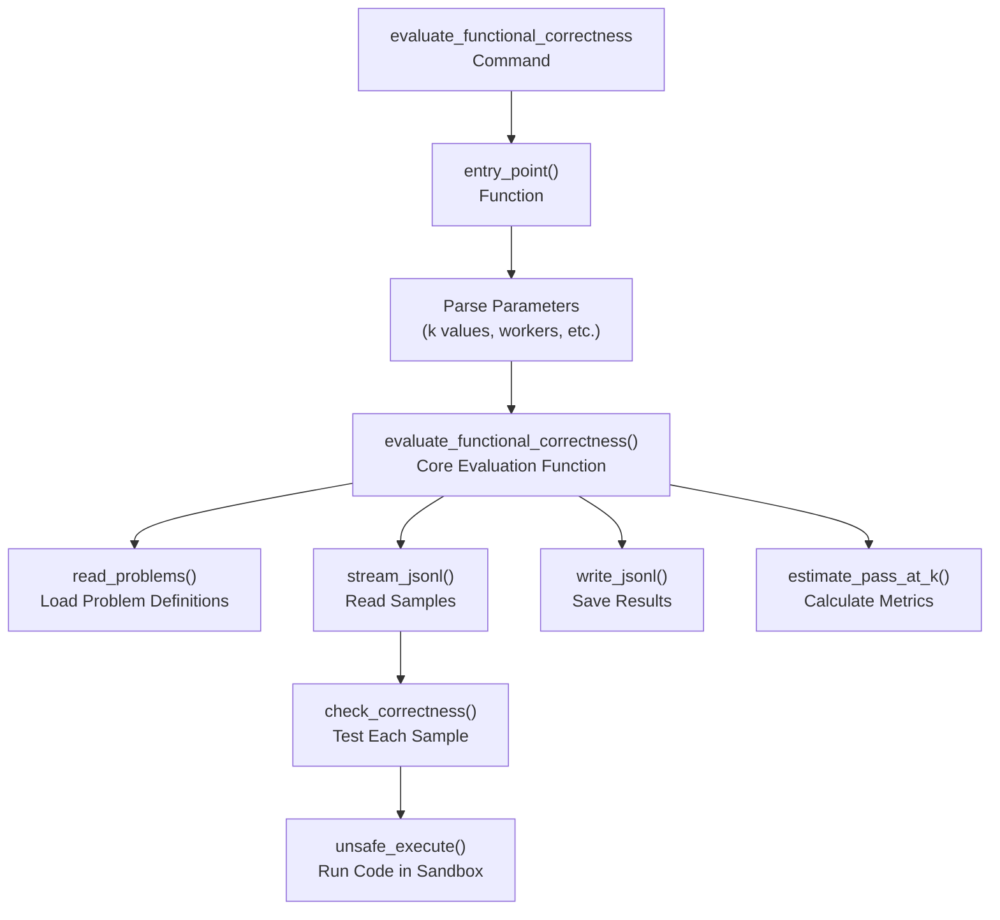

<!-- source: DeepWiki mcp.deepwiki.com · repo openai/human-eval · page 5 Usage Guide · fetched 2026-10-26 -->

# Usage Guide

<details>
<summary>Relevant source files</summary>

The following files were used as context for generating this wiki page:

- [README.md](README.md)
- [human_eval/evaluate_functional_correctness.py](human_eval/evaluate_functional_correctness.py)

</details>


This guide explains how to use the HumanEval framework to evaluate the functional correctness of code generated by language models. It covers installation, preparation of code samples, running evaluations, and interpreting results. For information about the HumanEval dataset structure, see [HumanEval Dataset](#4), and for details about the evaluation metrics, see [Evaluation Metrics](#3.3).

## Installation

HumanEval requires Python 3.7 or later. To install the package:

1. Clone the repository:
   ```bash
   git clone https://github.com/openai/human-eval
   ```

2. Install the package:
   ```bash
   cd human-eval
   pip install -e .
   ```

Sources: [README.md:7-19]()

## Preparing Code Samples

Before running evaluations, you need to prepare your generated code samples in the correct format.

### Sample Format

Samples must be provided in JSON Lines (jsonl) format, where each line contains a JSON object with:
- `task_id`: The identifier of the HumanEval problem
- `completion`: The generated code (without the problem prompt)

Example sample entry:
```json
{"task_id": "HumanEval/0", "completion": "def f(n):\n    return n + 4\n"}
```

### Sample Generation

Here's a template for generating and saving samples:

```python
from human_eval.data import write_jsonl, read_problems

problems = read_problems()

num_samples_per_task = 200
samples = [
    dict(task_id=task_id, completion=generate_one_completion(problems[task_id]["prompt"]))
    for task_id in problems
    for _ in range(num_samples_per_task)
]
write_jsonl("samples.jsonl", samples)
```

Where `generate_one_completion` is your function that generates code completions for a given prompt.

Sources: [README.md:30-54]()

## Evaluation Workflow

The workflow for evaluating code samples with HumanEval:



Sources: [README.md:56-66](), [human_eval/evaluate_functional_correctness.py:14-21]()

## Running Evaluations

### Security Warning

**Important**: The HumanEval framework executes untrusted model-generated code. Users are strongly encouraged to use a robust security sandbox. By default, the execution function is commented out in `execution.py` to ensure users acknowledge this risk.

### Basic Usage

To evaluate samples, run:

```bash
evaluate_functional_correctness samples.jsonl
```

This will:
1. Read samples from the specified file
2. Execute each code sample against the test cases
3. Write results to `samples.jsonl_results.jsonl`
4. Calculate and display pass@k metrics

### Command-Line Options

The evaluation command supports several options:

| Option | Description | Default |
|--------|-------------|---------|
| `--k` | Comma-separated list of k values for pass@k | `"1,10,100"` |
| `--n_workers` | Number of parallel workers | `4` |
| `--timeout` | Timeout for each execution in seconds | `3.0` |
| `--problem_file` | Path to the problem definitions file | `HUMAN_EVAL` constant |

Example with custom options:
```bash
evaluate_functional_correctness samples.jsonl --k=1,5,10 --n_workers=8 --timeout=5.0
```

Sources: [human_eval/evaluate_functional_correctness.py:8-21](), [README.md:83-90]()

## Understanding Results

### Results Format

The evaluation outputs results to a file named `<input_file>_results.jsonl`. Each line contains:
- `task_id`: The problem identifier
- `completion`: The generated code
- `passed`: Boolean indicating whether the solution passed all tests
- `result`: One of "passed", "timed out", or "failed"

### Interpreting Metrics

The evaluation calculates pass@k metrics, which estimate the probability that at least one correct solution appears in k independently sampled completions.



**Note**: For accurate pass@k calculations, you need at least k samples per task. The evaluation won't calculate pass@k values for cases with fewer samples than k.

Sources: [README.md:67-91]()

## Example Workflow

Here's a complete example workflow for evaluating language model code generation:

1. **Generate completions** for HumanEval problems
2. **Save samples** in JSONL format
3. **Run evaluation**:
   ```bash
   evaluate_functional_correctness samples.jsonl
   ```
4. **Review results** in the output file and console metrics

### Quick Verification

To verify your setup, you can use the example files provided with the repository:

```bash
evaluate_functional_correctness data/example_samples.jsonl --problem_file=data/example_problem.jsonl
```

This should yield approximately 0.5 pass@1, serving as a sanity check for your installation.

Sources: [README.md:72-82]()

## Troubleshooting

### Memory Issues

If you encounter this error:
```
malloc: can't allocate region
```

It indicates that the system is running out of RAM. Since this may cause some correct programs to fail, free some memory and try again.

### Other Issues

- Ensure your Python version is 3.7 or later
- Verify that your samples file follows the correct JSONL format
- Check that your code completions are syntactically valid Python
- Consider increasing the timeout if complex solutions are timing out

Sources: [README.md:93-100]()

## Implementation Details

The evaluation command-line tool has the following internal structure:



Sources: [human_eval/evaluate_functional_correctness.py:8-28]()

---

