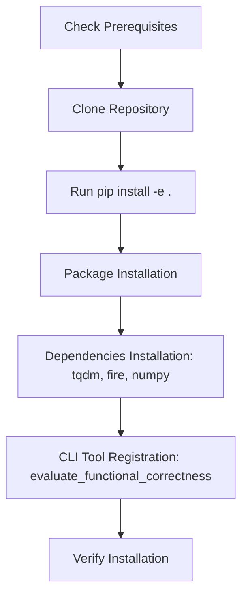
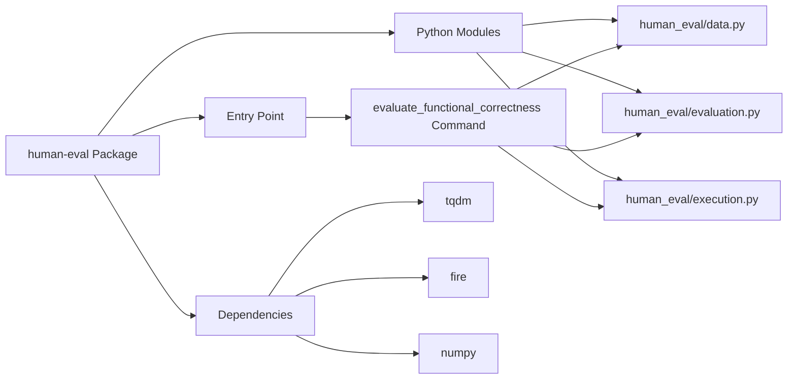

<!-- source: DeepWiki mcp.deepwiki.com · repo openai/human-eval · page 5.1 Installation · fetched 2026-10-26 -->

# Installation

<details>
<summary>Relevant source files</summary>

The following files were used as context for generating this wiki page:

- [requirements.txt](requirements.txt)
- [setup.py](setup.py)

</details>


## Purpose and Scope

This document provides instructions for installing the HumanEval package, which is used to evaluate the functional correctness of code generated by large language models. For information about using the package after installation, refer to [Command-Line Interface](#5.2) and [Example Workflow](#5.3).

Sources: [setup.py:7-25](), [requirements.txt:1-3]()

## Prerequisites

Before installing HumanEval, ensure you have:

- Python 3.6 or higher
- pip (Python package installer)
- Git (for repository cloning)

Sources: [setup.py:7-25]()

## Installation from Source

The HumanEval package is installed directly from the GitHub repository:

1. Clone the repository:
   ```bash
   git clone https://github.com/openai/human-eval.git
   cd human-eval
   ```

2. Install the package:
   ```bash
   pip install -e .
   ```

   The `-e` flag installs in "editable" mode, allowing code changes without reinstallation.

Sources: [setup.py:7-25]()

## Installation Workflow

### Installation Process Diagram



Sources: [setup.py:7-25](), [setup.py:20-24](), [requirements.txt:1-3]()

## Dependencies

The following dependencies are automatically installed:

| Package | Purpose |
|---------|---------|
| tqdm    | Progress bars for tracking evaluation progress |
| fire    | Command-line interface functionality |
| numpy   | Numerical computations for metrics |

Sources: [requirements.txt:1-3](), [setup.py:14-19]()

## Package Structure

### Component Relationship Diagram



Sources: [setup.py:8-13](), [setup.py:20-24](), [requirements.txt:1-3]()

## Verification

After installation, verify that the package is correctly installed:

```bash
evaluate_functional_correctness --help
```

This should display the help information for the tool, confirming that the entry point was correctly registered.

Sources: [setup.py:20-24]()

## Virtual Environment Installation (Recommended)

For a clean installation without package conflicts:

```bash
# Create a virtual environment
python -m venv human_eval_env

# Activate the environment
# On Windows
human_eval_env\Scripts\activate
# On macOS/Linux
source human_eval_env/bin/activate

# Install HumanEval
git clone https://github.com/openai/human-eval.git
cd human-eval
pip install -e .
```

## Troubleshooting

| Issue | Solution |
|-------|----------|
| Permission errors | Use `pip install --user -e .` or use a virtual environment |
| Command not found | Ensure Python's scripts directory is in your PATH |
| Dependency conflicts | Install in a clean virtual environment |
| Git clone errors | Verify Git is installed and you have internet access |

## Next Steps

After successful installation:
- Learn about CLI options in [Command-Line Interface](#5.2)
- Follow a complete example in [Example Workflow](#5.3)
- Explore the HumanEval dataset structure in [HumanEval Dataset](#4)

---

