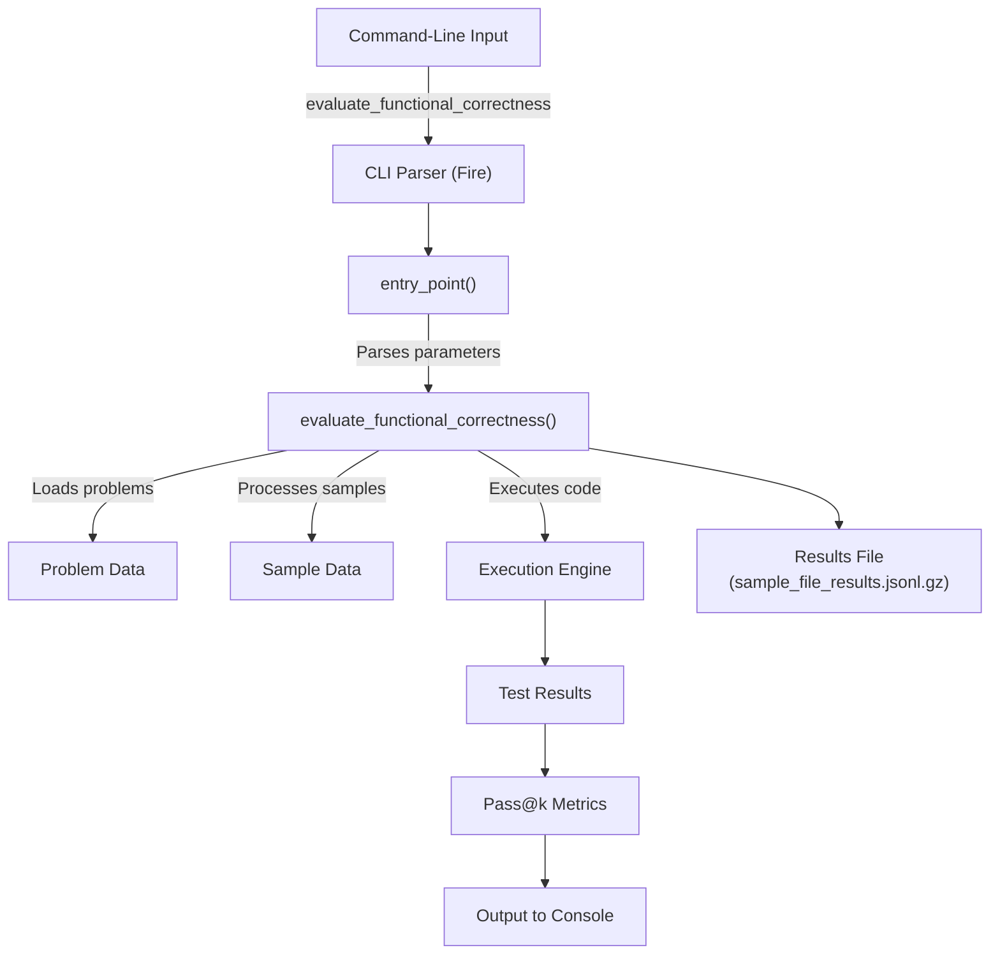
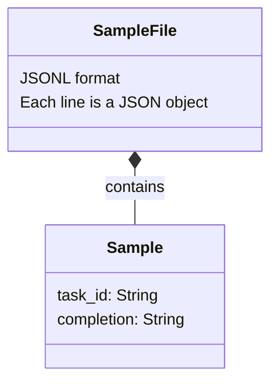
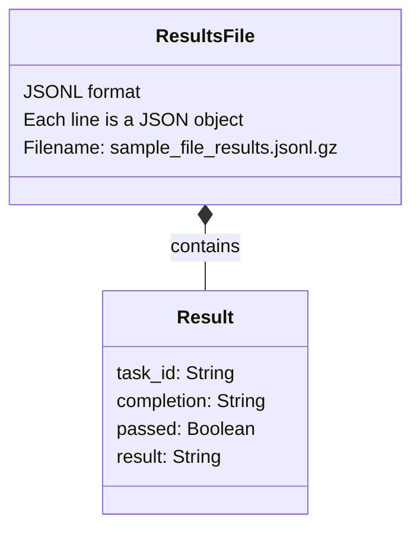
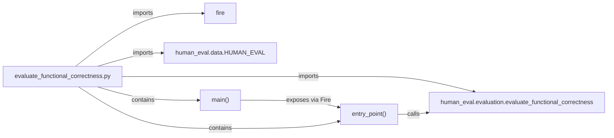

<!-- source: DeepWiki mcp.deepwiki.com · repo openai/human-eval · page 5.2 Command-Line Interface · fetched 2026-10-26 -->

# Command-Line Interface

<details>
<summary>Relevant source files</summary>

The following files were used as context for generating this wiki page:

- [README.md](README.md)
- [human_eval/evaluate_functional_correctness.py](human_eval/evaluate_functional_correctness.py)

</details>


## Purpose and Scope

This document describes the command-line interface (CLI) for the HumanEval framework, which enables users to evaluate the functional correctness of code samples generated by language models. The CLI provides a straightforward way to process sample files containing generated code and produce evaluation metrics.

For information about the overall evaluation pipeline, see [Evaluation Pipeline](#2.1). For installation instructions, see [Installation](#5.1).

## Overview

The HumanEval CLI is implemented using the Python Fire library, which automatically transforms the entry point function into a command-line interface. The main command `evaluate_functional_correctness` takes a file containing code samples and evaluates whether they correctly solve their corresponding programming problems.



**CLI Component Flow Diagram**

Sources: [human_eval/evaluate_functional_correctness.py:1-28](), [README.md:57-66]()

## Command Structure

The primary command is `evaluate_functional_correctness`, which accepts several parameters to customize the evaluation process.

### Basic Syntax

```
evaluate_functional_correctness <sample_file> [--k=<k_values>] [--n_workers=<n>] [--timeout=<seconds>] [--problem_file=<path>]
```

### Parameters

| Parameter | Description | Default | Required |
|-----------|-------------|---------|----------|
| `sample_file` | Path to the JSONL file containing code samples | N/A | Yes |
| `--k` | Comma-separated list of k values for pass@k metrics | "1,10,100" | No |
| `--n_workers` | Number of parallel workers for execution | 4 | No |
| `--timeout` | Maximum execution time per sample (seconds) | 3.0 | No |
| `--problem_file` | Path to the problem definitions file | HUMAN_EVAL | No |

Sources: [human_eval/evaluate_functional_correctness.py:8-14](), [README.md:84-91]()

## Input Format

The CLI expects samples to be provided in a JSON Lines (JSONL) format, where each line contains a single JSON object representing a sample. Each sample must include:

- `task_id`: The identifier of the corresponding HumanEval problem
- `completion`: The code completion (solution) without the prompt

Example sample format:

```json
{"task_id": "HumanEval/42", "completion": "def square(x):\n    return x * x"}
```



**Sample File Structure**

Sources: [README.md:30-37]()

## Output Format

The CLI produces two outputs:

1. **Console Output**: A dictionary of pass@k metrics printed to the standard output
2. **Results File**: A JSONL file at `<sample_file>_results.jsonl.gz` containing detailed results for each sample

The results file contains the original sample data with additional fields:

- `passed`: Boolean indicating whether the sample passed the tests
- `result`: String describing the execution result ("passed", "timed out", or "failed")



**Results File Structure**

Sources: [human_eval/evaluate_functional_correctness.py:16-18](), [README.md:67-70]()

## Usage Examples

### Basic Usage

Evaluate samples from a file and get pass@k metrics for k=1, 10, and 100:

```bash
evaluate_functional_correctness samples.jsonl
```

Expected output:

```
Reading samples...
32800it [00:01, 23787.50it/s]
Running test suites...
100%|...| 32800/32800 [16:11<00:00, 33.76it/s]
Writing results to samples.jsonl_results.jsonl...
100%|...| 32800/32800 [00:00<00:00, 42876.84it/s]
{'pass@1': 0.123, 'pass@10': 0.456, 'pass@100': 0.789}
```

### Specifying Custom k Values

Evaluate with specific k values (1 and 50):

```bash
evaluate_functional_correctness samples.jsonl --k=1,50
```

### Using a Custom Problem File

Evaluate against a specific problem file:

```bash
evaluate_functional_correctness samples.jsonl --problem_file=custom_problems.jsonl
```

### Example with All Options

```bash
evaluate_functional_correctness samples.jsonl --k=1,5,10 --n_workers=8 --timeout=5.0 --problem_file=problems.jsonl
```

Sources: [README.md:57-66](), [README.md:72-82]()

## Implementation Details

The CLI is implemented in the `evaluate_functional_correctness.py` file, which serves as the entry point for the command-line tool. The file contains:

1. The `entry_point` function (lines 8-21) that processes command-line arguments
2. The `main` function (lines 24-26) that uses the Fire library to expose the entry point



**CLI Implementation Structure**

Sources: [human_eval/evaluate_functional_correctness.py:1-28]()

## Integration with Data Generation

To use the CLI effectively, you'll typically need to generate sample completions first. The repository provides example code for generating samples in the correct format:

```python
from human_eval.data import write_jsonl, read_problems

problems = read_problems()

num_samples_per_task = 200
samples = [
    dict(task_id=task_id, completion=generate_one_completion(problems[task_id]["prompt"]))
    for task_id in problems
    for _ in range(num_samples_per_task)
]
write_jsonl("samples.jsonl", samples)
```

After generating samples, you can run the evaluation command:

```bash
evaluate_functional_correctness samples.jsonl
```

Sources: [README.md:39-54](), [README.md:57-58]()

## Troubleshooting

### Memory Issues

If you encounter a "malloc: can't allocate region" error, it indicates that the system is running out of RAM. Since this may cause some correct programs to fail, it's recommended to free some memory and try again.

### Input Format Issues

If your evaluation fails with parsing errors, check that:
- Your sample file follows the correct JSONL format
- Each sample has both `task_id` and `completion` fields
- The `task_id` values match the problem IDs in the problem file

Sources: [README.md:93-100]()

## Supplementary Information

For more information on how the evaluation works internally, see [Evaluation Metrics](#3.3) and [Code Execution Engine](#3.2).

For a complete workflow example, see [Example Workflow](#5.3).

---

