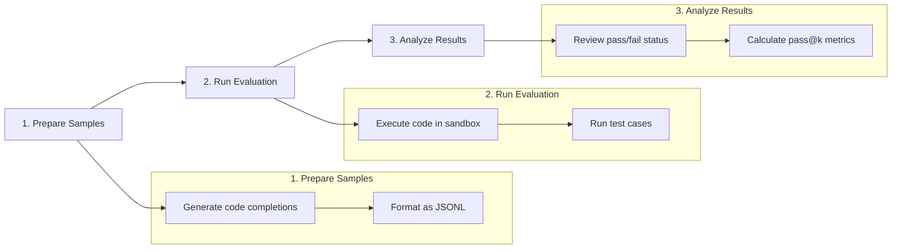
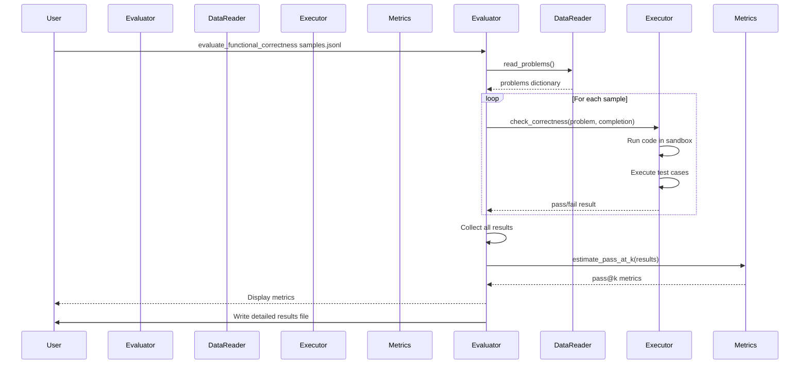
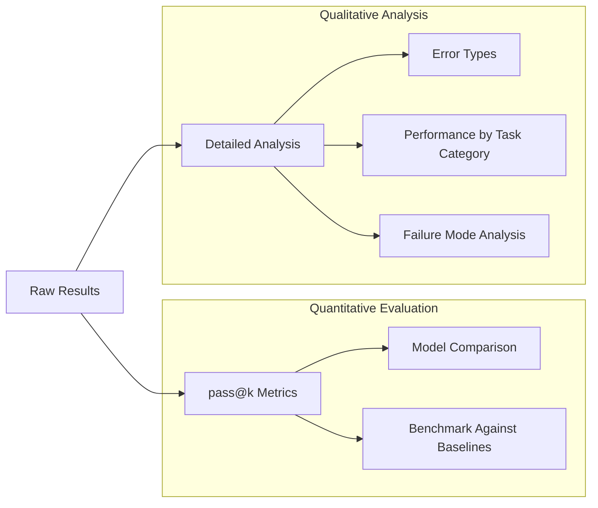

<!-- source: DeepWiki mcp.deepwiki.com · repo openai/human-eval · page 5.3 Example Workflow · fetched 2026-10-26 -->

# Example Workflow

<details>
<summary>Relevant source files</summary>

The following files were used as context for generating this wiki page:

- [README.md](README.md)
- [data/example_problem.jsonl](data/example_problem.jsonl)
- [data/example_samples.jsonl](data/example_samples.jsonl)

</details>


## Purpose and Scope

This document provides a step-by-step guide for using the HumanEval framework to evaluate code generation models. It walks through the complete workflow from preparing code samples to interpreting evaluation results. For installation instructions, see [Installation](#5.1), and for details about command-line options, see [Command-Line Interface](#5.2).

## Workflow Overview

The HumanEval evaluation workflow consists of three main phases:



Sources: [README.md:29-66]()

## Required Inputs and Expected Outputs

The workflow requires specific input formats and produces structured outputs:

```mermaid
classDiagram
    class "HumanEval Problem" {
        task_id: String
        prompt: String
        canonical_solution: String
        test: String
        entry_point: String
    }
    
    class "Model Completion" {
        task_id: String
        completion: String
    }
    
    class "Evaluation Result" {
        task_id: String
        completion: String
        passed: Boolean
        result: String
    }
    
    class "Aggregate Metrics" {
        pass@1: Float
        pass@10: Float
        pass@100: Float
    }
    
    "HumanEval Problem" --> "Model Completion" : provides prompt for
    "Model Completion" --> "Evaluation Result" : evaluated to produce
    "Evaluation Result" --> "Aggregate Metrics" : aggregated into
```

Sources: [data/example_problem.jsonl:1](), [data/example_samples.jsonl:1-6](), [README.md:67-70]()

## Step 1: Preparing Code Samples

### Sample Format

Each code sample must be formatted as a JSON object with two fields:
- `task_id`: The identifier of the HumanEval task
- `completion`: The generated code completion (without the prompt)

Multiple samples are stored in a JSON Lines (jsonl) file, with one sample per line:

| Field | Type | Description |
|-------|------|-------------|
| task_id | string | Identifier matching a problem in the HumanEval dataset |
| completion | string | Generated code that completes the prompt (without including the prompt) |

Example of a properly formatted sample:

```
{"task_id": "test/0", "completion": "    return 1"}
```

Sources: [data/example_samples.jsonl:4](), [README.md:30-35]()

### Generating Samples

This code example shows how to generate and save completions in the required format:

```python
from human_eval.data import write_jsonl, read_problems

problems = read_problems()

num_samples_per_task = 200
samples = [
    dict(task_id=task_id, completion=generate_one_completion(problems[task_id]["prompt"]))
    for task_id in problems
    for _ in range(num_samples_per_task)
]
write_jsonl("samples.jsonl", samples)
```

Replace `generate_one_completion` with your model's code generation function.

Sources: [README.md:39-54]()

## Step 2: Running the Evaluation

### Security Notice

The evaluation process runs untrusted code in a sandbox. Before running, you must uncomment the execution call in `execution.py` after understanding the security implications.

Sources: [README.md:23-28]()

### Execution Command

Run the evaluation using the command-line tool:

```bash
evaluate_functional_correctness samples.jsonl
```

This will:
1. Read all samples from the input file
2. Execute each completion in a sandboxed environment
3. Run the test cases for each problem
4. Save results to a new file: `samples.jsonl_results.jsonl`
5. Output pass@k metrics

Sources: [README.md:56-66]()

## Step 3: Interpreting Results

### Result Format

The evaluation produces a results file with the following fields for each sample:

| Field | Type | Description |
|-------|------|-------------|
| task_id | string | Problem identifier |
| completion | string | The evaluated code completion |
| passed | boolean | Whether the completion passed all tests |
| result | string | Execution result: "passed", "timed out", or "failed" |

Sources: [README.md:67-70]()

### Evaluation Process Details



Sources: [README.md:56-70]()

### Pass@k Metrics

The pass@k metric represents the probability that at least one of k samples generated by the model will pass. The default evaluation calculates:
- pass@1: The raw success rate (direct average)
- pass@10: Probability of at least one successful completion in 10 samples
- pass@100: Probability of at least one successful completion in 100 samples

Custom k values can be specified using the `--k` option.

Sources: [README.md:84-91]()

## Example Workflow with Sample Data

HumanEval includes example files to help you understand the workflow and verify your setup:

1. Example problem definition:
   - Located at `data/example_problem.jsonl`
   - Contains a simple function that returns 1

2. Example completions:
   - Located at `data/example_samples.jsonl`
   - Contains 6 different completions for the same problem, including:
     - Malicious code (attempting to delete files)
     - Time-consuming code (would trigger timeout)
     - Code requiring user input (not allowed)
     - Correct implementations (with different spacing)

3. Running the sanity check:
   ```bash
   evaluate_functional_correctness data/example_samples.jsonl --problem_file=data/example_problem.jsonl
   ```

4. Expected output:
   - Results file: `data/example_samples.jsonl_results.jsonl`
   - pass@1 metric: approximately 0.5 (since 3 of 6 samples pass)

Sources: [README.md:72-82](), [data/example_problem.jsonl:1](), [data/example_samples.jsonl:1-6]()

## Using the Results

The evaluation results can be used to:

1. Compare different code generation models
2. Analyze specific types of failures
3. Identify areas for model improvement
4. Benchmark against human performance



Sources: [README.md:56-91]()

## Troubleshooting

### Memory Issues

If you encounter this error message, the system is running out of RAM:
```
malloc: can't allocate region
```

Solution: Free some system memory and try again. The evaluation system requires minimal memory, but the executed code might consume significant resources.

Sources: [README.md:93-100]()

### Common Problems

| Issue | Possible Cause | Solution |
|-------|----------------|----------|
| Security exceptions | Not uncommenting execution code | Follow instructions in execution.py to enable execution |
| Invalid format errors | Incorrect JSONL formatting | Ensure samples follow the exact format shown in examples |
| Timeout errors | Code samples taking too long | Adjust timeout settings or optimize generated code |
| Zero pass@k values | All samples failing | Check sample format and verify problems file path |

Sources: [README.md:23-28](), [README.md:56-91]()