# Page: Overview

# Overview

<details>
<summary>Relevant source files</summary>

The following files were used as context for generating this wiki page:

- [README.md](README.md)
- [setup.py](setup.py)

</details>


## Purpose and Scope

This document provides an introduction to the HumanEval framework, a system designed to evaluate the functional correctness of code generated by large language models (LLMs). HumanEval consists of a dataset of programming problems and a comprehensive evaluation infrastructure that safely executes and tests untrusted code.

For detailed information about the evaluation pipeline, see [Evaluation Pipeline](#2.1). For security mechanisms, see [Security Model](#2.2).

Sources: [README.md:1-5]()

## System Architecture

HumanEval is structured as a Python package with components for data handling, code execution, and evaluation metrics.

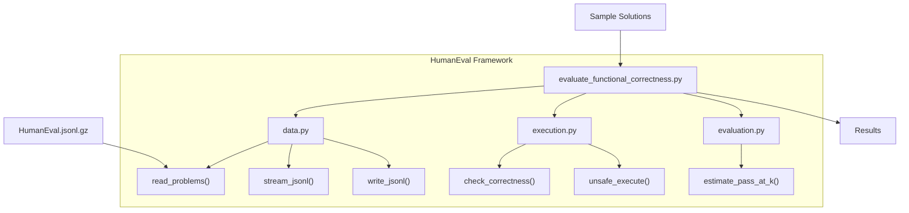

**Diagram: HumanEval Component Architecture**

Sources: [README.md:42-54](), [setup.py:20-24]()

## Core Components

### 1. Dataset

The HumanEval dataset consists of hand-written programming problems designed to test code generation capabilities. Each problem includes a prompt, canonical solution, and test cases.

| Component | Description |
|-----------|-------------|
| Task ID | Unique identifier for each problem |
| Prompt | Problem description and function signature |
| Canonical Solution | Reference implementation |
| Test | Test cases to verify correctness |
| Entry Point | Function name to be called during evaluation |

Sources: [README.md:31-35]()

### 2. Data Processing

The `data.py` module handles loading problems and processing JSONL files:

- `read_problems()`: Loads problem definitions from HumanEval.jsonl.gz
- `stream_jsonl()`: Parses JSONL files containing completions
- `write_jsonl()`: Outputs evaluation results

Sources: [README.md:43-53]()

### 3. Code Execution Engine

The `execution.py` module provides secure execution of untrusted code:

- `check_correctness()`: Tests code against problem test cases
- `unsafe_execute()`: Runs code in a sandboxed environment with timeouts and security restrictions

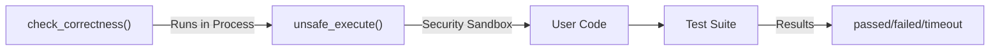

**Diagram: Code Execution Flow**

Sources: [README.md:23-28](), [README.md:65-70]()

### 4. Evaluation Metrics

The `evaluation.py` module calculates Pass@k metrics:

- `evaluate_functional_correctness()`: Main evaluation function
- `estimate_pass_at_k()`: Calculates unbiased pass@k statistics

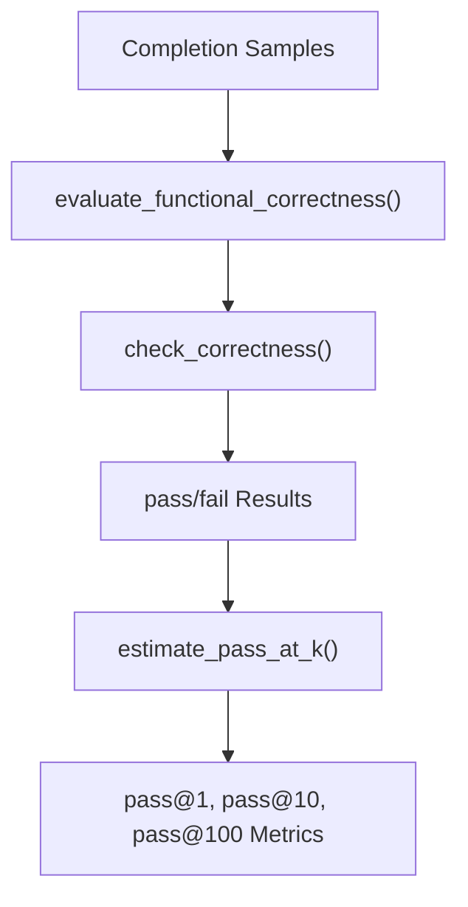

**Diagram: Evaluation Metrics Calculation**

Sources: [README.md:56-66](), [README.md:84-91]()

## Workflow

The typical workflow for using HumanEval is:

1. Generate code completions for the problems in the HumanEval dataset
2. Save completions in the required JSONL format
3. Run the evaluation script on the completions
4. Analyze the pass@k metrics and detailed results

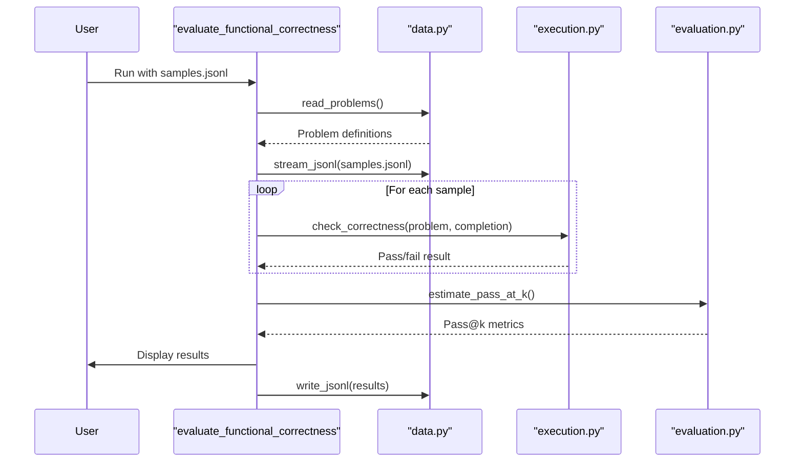

**Diagram: HumanEval Execution Workflow**

Sources: [README.md:56-70]()

## Security Considerations

The HumanEval framework is designed to execute untrusted code, which presents significant security challenges. The system implements several safeguards:

- Code execution is disabled by default, requiring explicit activation
- Execution occurs in a sandboxed environment
- Timeout mechanisms prevent infinite loops
- Memory usage is monitored to prevent resource exhaustion

**Warning**: Users are strongly encouraged to run the evaluation only inside a robust security sandbox.

Sources: [README.md:23-28](), [README.md:95-100]()

## CLI Usage

The package installs a command-line tool that can be used to evaluate code completions:

```
evaluate_functional_correctness samples.jsonl [--k=<comma-separated-values>]
```

This will:
1. Read samples from the input file
2. Run test suites on each completion
3. Output detailed results to `samples.jsonl_results.jsonl`
4. Calculate and display pass@k metrics

Sources: [README.md:56-70](), [setup.py:20-24]()

---

# Page: System Architecture

# System Architecture

<details>
<summary>Relevant source files</summary>

The following files were used as context for generating this wiki page:

- [README.md](README.md)
- [human_eval/data.py](human_eval/data.py)
- [human_eval/evaluation.py](human_eval/evaluation.py)
- [human_eval/execution.py](human_eval/execution.py)

</details>


## Purpose and Scope

This document describes the overall architecture of the HumanEval system, a framework for evaluating the functional correctness of code generated by large language models. The architecture section covers the high-level components, their interactions, and the data flow through the system. For detailed information on specific components, refer to [Core Components](#3), the [Evaluation Pipeline](#2.1), or the [Security Model](#2.2).

## System Overview

The HumanEval framework consists of three main components that work together to evaluate code samples:

1. **Data Processing Module**: Handles reading problem definitions and managing input/output of code samples and results
2. **Code Execution Engine**: Executes generated code samples in a secure sandbox with appropriate safeguards
3. **Evaluation Module**: Calculates metrics (particularly pass@k) based on execution results

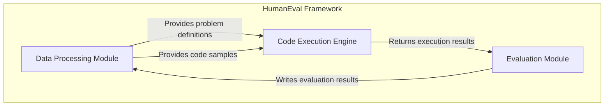

Sources: [human_eval/data.py](), [human_eval/execution.py](), [human_eval/evaluation.py]()

## Component Interactions

The following diagram illustrates how the different components interact during the evaluation process:

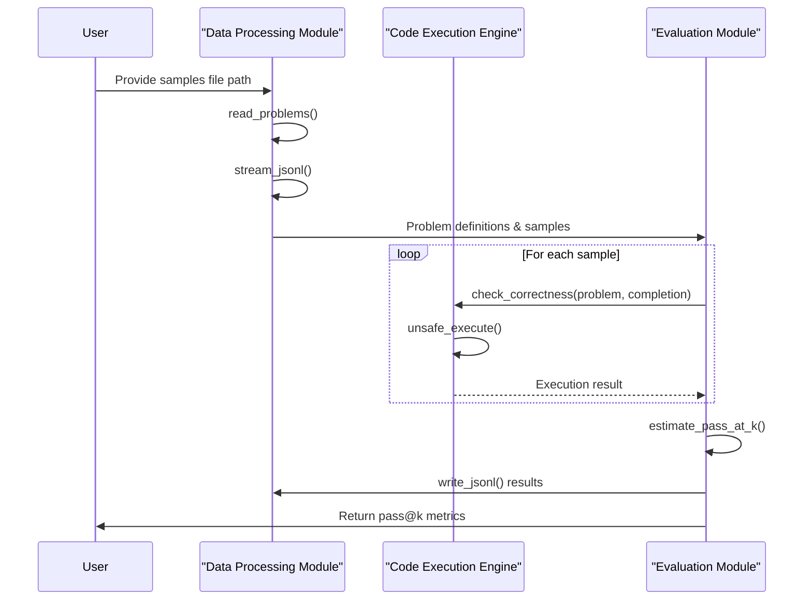

Sources: [human_eval/evaluation.py:39-105](), [human_eval/execution.py:63-91]()

## Key System Components

The following diagram maps the code entities to their functional roles within the system:

```mermaid
classDiagram
    class DataProcessingModule {
        read_problems()
        stream_jsonl()
        write_jsonl()
    }
    
    class CodeExecutionEngine {
        check_correctness()
        unsafe_execute()
        reliability_guard()
        time_limit()
        create_tempdir()
    }
    
    class EvaluationModule {
        evaluate_functional_correctness()
        estimate_pass_at_k()
    }
    
    class Problem {
        task_id
        prompt
        canonical_solution
        test
        entry_point
    }
    
    class CodeSample {
        task_id
        completion
    }
    
    class Result {
        task_id
        completion
        passed
        result
    }
    
    DataProcessingModule --> Problem : processes
    DataProcessingModule --> CodeSample : processes
    DataProcessingModule --> Result : outputs
    CodeExecutionEngine --> CodeSample : executes
    CodeExecutionEngine --> Result : produces
    EvaluationModule --> Result : analyzes
    EvaluationModule --> "Pass@k Metrics" : calculates
```

Sources: [human_eval/data.py:11-49](), [human_eval/execution.py:12-91](), [human_eval/evaluation.py:13-105]()

## Data Flow Architecture

The data flow in the HumanEval system follows a pipeline pattern. The following diagram illustrates how data moves through the system:

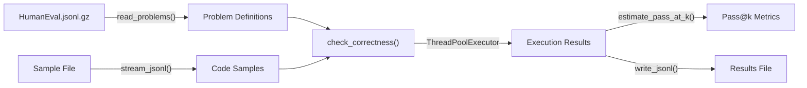

Sources: [human_eval/evaluation.py:39-105](), [human_eval/data.py:11-49]()

## File Structure and Module Organization

The HumanEval codebase is organized into the following main modules:

| Module | File | Primary Functions | Purpose |
|--------|------|-------------------|---------|
| Data Processing | [data.py]() | `read_problems()`, `stream_jsonl()`, `write_jsonl()` | Handles dataset loading and result storage |
| Code Execution | [execution.py]() | `check_correctness()`, `unsafe_execute()`, `reliability_guard()` | Securely executes and tests code samples |
| Evaluation | [evaluation.py]() | `evaluate_functional_correctness()`, `estimate_pass_at_k()` | Calculates evaluation metrics |

Sources: [human_eval/data.py](), [human_eval/execution.py](), [human_eval/evaluation.py]()

## Execution Model

The execution of code samples follows a carefully designed process to ensure safety and reliability:

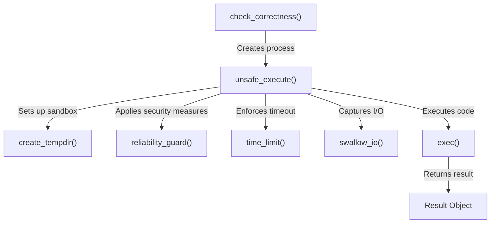

Sources: [human_eval/execution.py:12-91](), [human_eval/execution.py:94-162]()

## Security Architecture

Security is a critical aspect of the HumanEval system since it executes untrusted code. The `reliability_guard()` function implements a sandbox by disabling potentially dangerous operations:

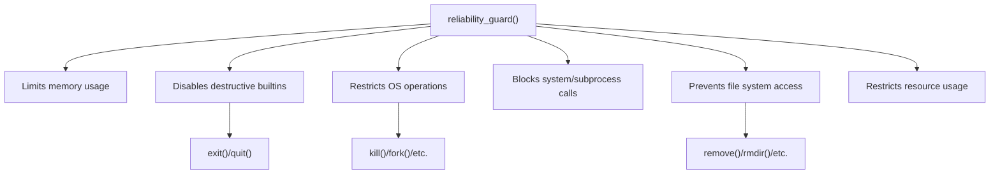

Sources: [human_eval/execution.py:163-242](), [README.md:23-28]()

## Evaluation Process

The evaluation pipeline processes samples in parallel and calculates pass@k metrics:

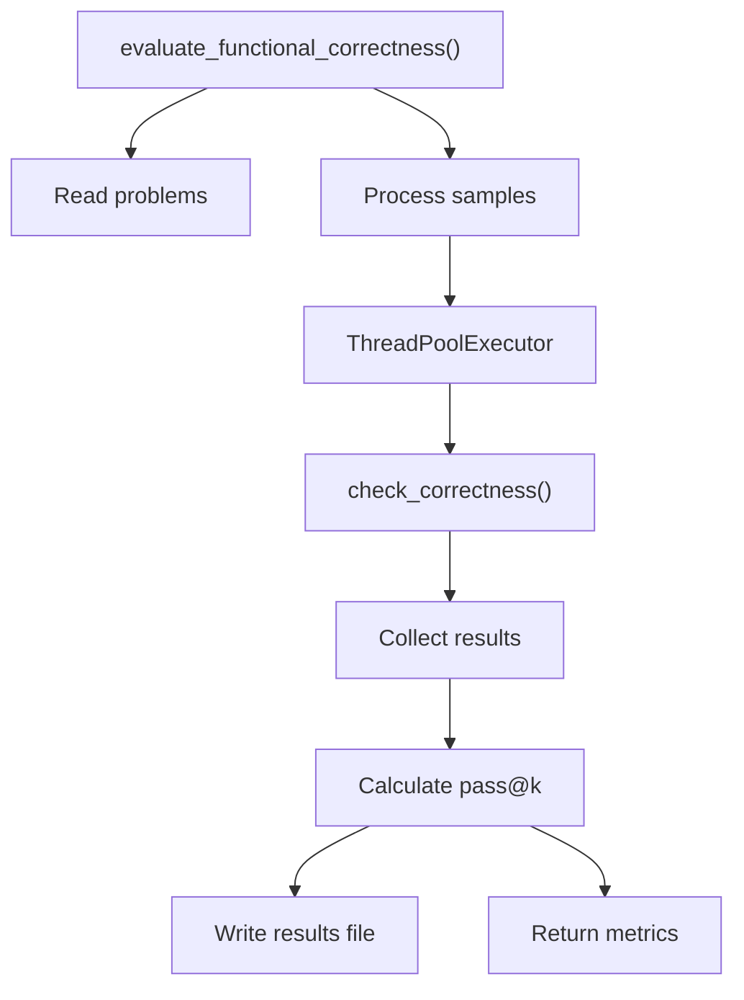

Sources: [human_eval/evaluation.py:39-105]()

## Data Structures

The system uses the following key data structures:

| Data Structure | Description | Fields |
|----------------|-------------|--------|
| Problem | Represents a programming problem | `task_id`, `prompt`, `canonical_solution`, `test`, `entry_point` |
| Sample | Contains a generated code completion | `task_id`, `completion` |
| Result | Contains execution results | `task_id`, `completion_id`, `passed`, `result` |

Sources: [human_eval/data.py:11-49](), [human_eval/execution.py:63-91](), [human_eval/evaluation.py:39-105]()

## System Entry Points

The primary entry point to the HumanEval system is the `evaluate_functional_correctness()` function, which:

1. Reads problem definitions from the HumanEval dataset
2. Processes code samples from an input file
3. Executes each sample against its test suite
4. Calculates pass@k metrics
5. Writes detailed results to an output file

Sources: [human_eval/evaluation.py:39-105](), [README.md:56-71]()

---

# Page: Evaluation Pipeline

# Evaluation Pipeline

<details>
<summary>Relevant source files</summary>

The following files were used as context for generating this wiki page:

- [README.md](README.md)
- [human_eval/evaluate_functional_correctness.py](human_eval/evaluate_functional_correctness.py)
- [human_eval/evaluation.py](human_eval/evaluation.py)

</details>


## Purpose and Scope

This document details the end-to-end pipeline for evaluating code samples in the HumanEval system. It covers the process flow from loading problem definitions and code samples through execution, evaluation, and results generation. For information about the security mechanisms used when executing untrusted code, see [Security Model](#2.2).

## Overview

The evaluation pipeline is the core workflow for assessing the functional correctness of code generated by language models. It processes a collection of code samples, tests each against predefined test cases, and computes metrics like pass@k to measure model performance.

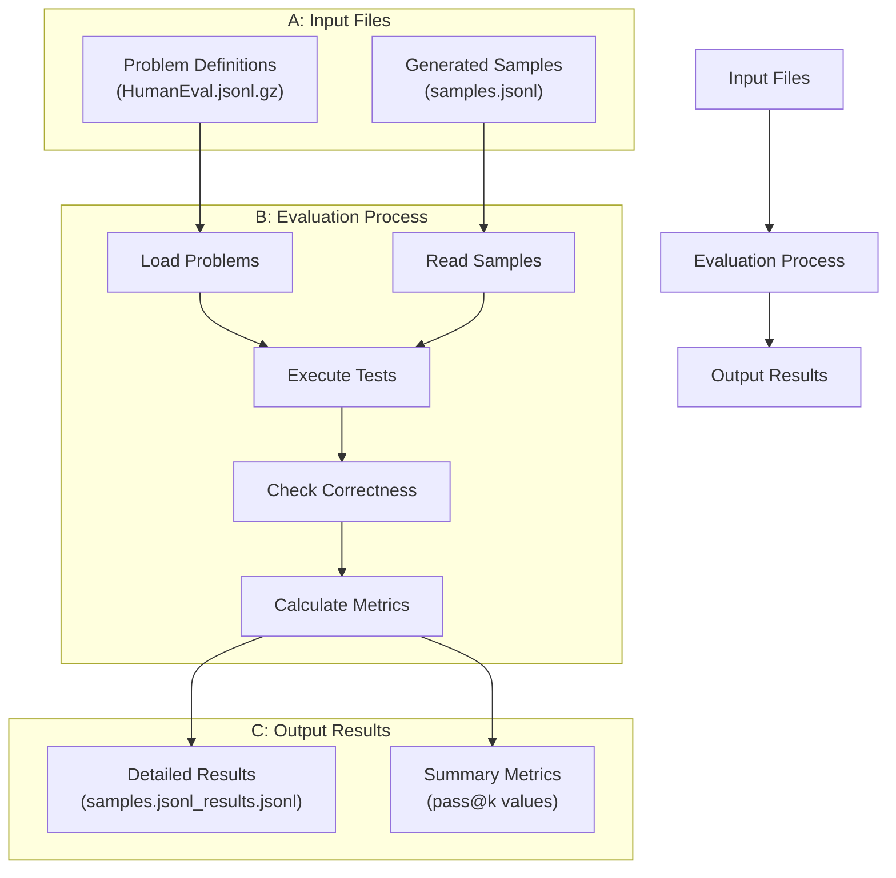

Sources: [human_eval/evaluation.py:39-105](), [human_eval/evaluate_functional_correctness.py:8-21]()

## Pipeline Components

The evaluation pipeline consists of several key components that work together to process and evaluate code samples:

### Command-Line Interface

The entry point to the evaluation pipeline is the command-line tool `evaluate_functional_correctness`, which accepts parameters like the sample file path, k values for pass@k metrics, number of worker threads, and timeout duration.

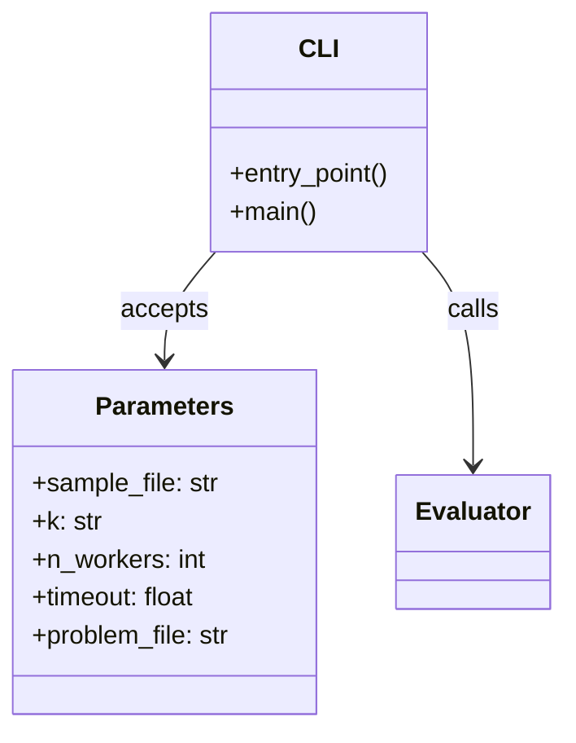

Sources: [human_eval/evaluate_functional_correctness.py:1-28]()

### Core Evaluation Function

The central component is the `evaluate_functional_correctness` function, which orchestrates the entire evaluation process:

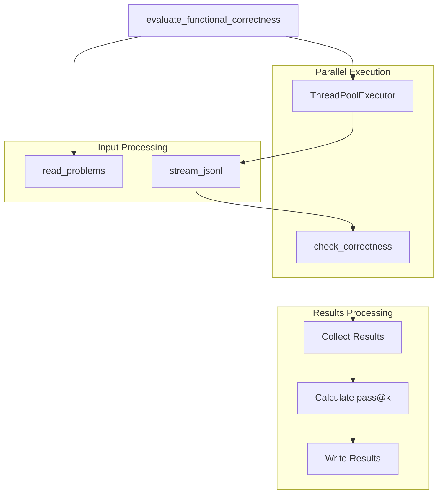

Sources: [human_eval/evaluation.py:39-105]()

## Pipeline Workflow in Detail

The evaluation pipeline follows these steps:

### 1. Problem Loading

The process begins by loading problem definitions from the specified problem file (by default, HUMAN_EVAL).

```
problems = read_problems(problem_file)
```

Each problem includes:
- A unique task ID
- A prompt describing the problem
- A canonical solution
- Test cases
- An entry point (function name)

Sources: [human_eval/evaluation.py:51]()

### 2. Sample Reading and Processing

The pipeline reads code samples from the provided sample file. Each sample contains:
- A task ID linking it to a specific problem
- A completion (the generated code to be evaluated)

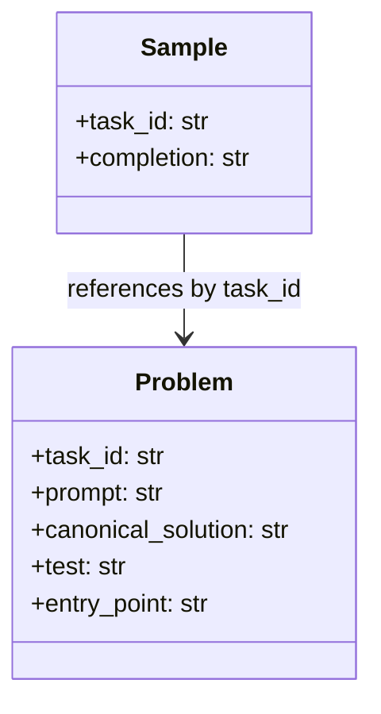

Sources: [human_eval/evaluation.py:62-69]()

### 3. Parallel Execution

The pipeline executes code samples in parallel using ThreadPoolExecutor:

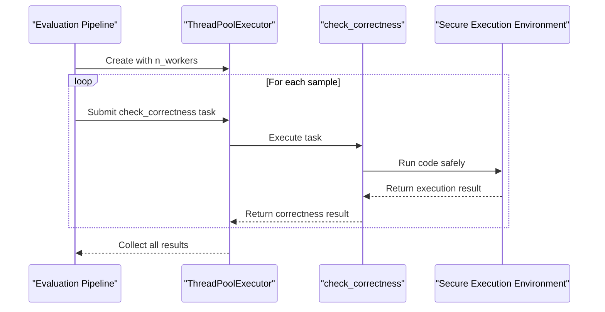

The `check_correctness` function tests each completion against the problem's test suite, with a timeout to prevent infinite loops or excessive resource consumption.

Sources: [human_eval/evaluation.py:54-69](), [human_eval/evaluation.py:74-76]()

### 4. Results Collection

Results from all code executions are collected and organized by task ID:

```python
for future in tqdm.tqdm(as_completed(futures), total=len(futures)):
    result = future.result()
    results[result["task_id"]].append((result["completion_id"], result))
```

Each result contains:
- The task ID
- The completion ID (index of this completion for the task)
- Whether the completion passed all tests
- Detailed execution result

Sources: [human_eval/evaluation.py:74-76]()

### 5. Metrics Calculation

The pipeline calculates pass@k metrics using the `estimate_pass_at_k` function:

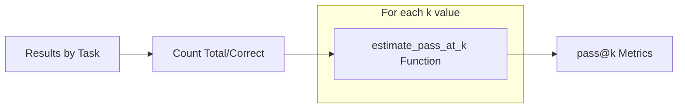

The pass@k metric estimates the probability that at least one completion out of k randomly sampled completions will be correct.

Sources: [human_eval/evaluation.py:78-90](), [human_eval/evaluation.py:13-36]()

### 6. Results Output

Finally, the pipeline writes detailed results to a new JSONL file and returns the pass@k metrics:

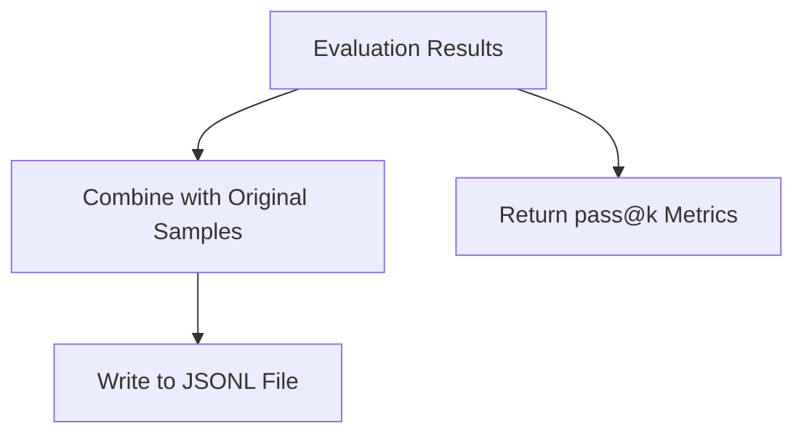

The output file contains the original samples enriched with:
- A `result` field with details about the execution
- A `passed` field indicating whether the completion passed all tests

Sources: [human_eval/evaluation.py:92-105]()

## Integration with Other System Components

The evaluation pipeline interacts with other components of the HumanEval system:

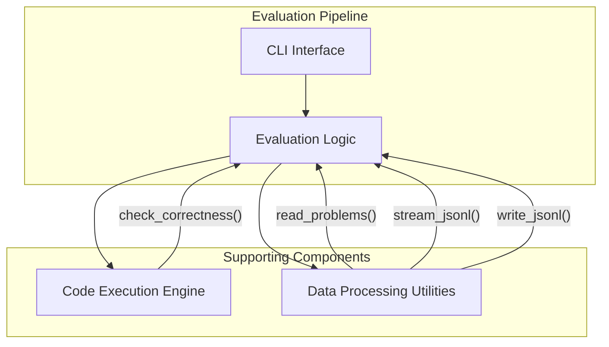

Sources: [human_eval/evaluation.py:9-10](), [human_eval/evaluate_functional_correctness.py:4-5]()

## Usage Example

Below is a typical workflow for using the evaluation pipeline:

1. Generate code samples using a language model and save them in the required JSONL format
2. Run the evaluation command: `evaluate_functional_correctness samples.jsonl`
3. View the resulting metrics and detailed results in the output file `samples.jsonl_results.jsonl`

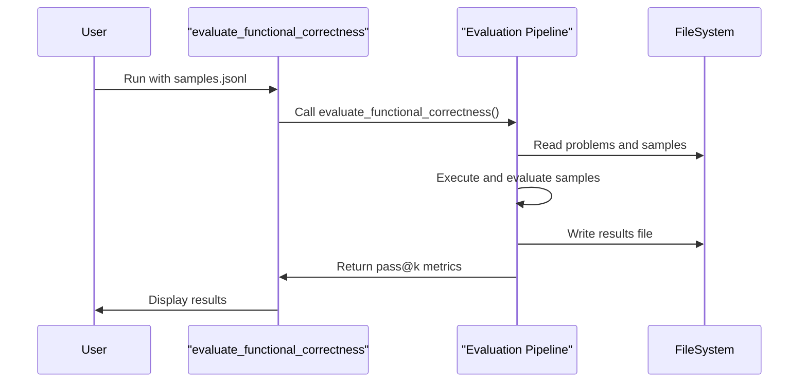

Sources: [README.md:56-66](), [human_eval/evaluate_functional_correctness.py:8-21]()

## Performance Considerations

The evaluation pipeline is designed for performance with several key optimizations:

1. **Parallel Execution**: Uses ThreadPoolExecutor to run multiple evaluations concurrently
2. **Progress Tracking**: Employs tqdm for progress visualization during long-running operations
3. **Efficient I/O**: Streams JSONL files rather than loading them entirely into memory

The number of worker threads and timeout duration can be adjusted to balance throughput and resource usage.

Sources: [human_eval/evaluation.py:54-69](), [human_eval/evaluate_functional_correctness.py:11-13]()

## Error Handling

The pipeline includes basic error handling to manage common issues:

1. **Timeouts**: Sets a maximum execution time for each sample to prevent hanging
2. **Assertion Checks**: Verifies that all problems are attempted
3. **Memory Issues**: The README notes potential memory-related errors and recommends freeing system resources if they occur

Sources: [human_eval/evaluation.py:71](), [README.md:93-100]()

---

# Page: Security Model

# Security Model

<details>
<summary>Relevant source files</summary>

The following files were used as context for generating this wiki page:

- [README.md](README.md)
- [human_eval/execution.py](human_eval/execution.py)

</details>


## Purpose and Scope

This document details the security model implemented in the HumanEval framework to safely execute and evaluate untrusted code generated by language models. It covers the isolation mechanisms, resource limitations, function disabling, and other security measures designed to minimize risks associated with executing potentially malicious or unintentionally harmful code. For information about the overall evaluation pipeline, see [Evaluation Pipeline](#2.1).

## Security Challenges Overview

Executing untrusted code poses significant security risks. The HumanEval framework needs to evaluate code samples generated by AI models, which may contain:

- Malicious operations (either intentional or unintentional)
- Resource-exhausting code (infinite loops, memory leaks)
- System access attempts (file system, network, processes)
- Attempts to interfere with the evaluation process itself

```mermaid
flowchart TD
    A["Model-Generated Code"] --> B["Security Risks"]
    B --> C["System Access"]
    B --> D["Resource Exhaustion"]
    B --> E["Process Manipulation"]
    B --> F["Filesystem Operations"]
    
    G["HumanEval Security Model"] -->|"Mitigates"| C
    G -->|"Mitigates"| D
    G -->|"Mitigates"| E
    G -->|"Mitigates"| F
```

Sources: [README.md:22-28](), [human_eval/execution.py:163-242]()

## Multi-Layered Security Approach

The security model implements multiple layers of protection to create a defense-in-depth approach:

```mermaid
flowchart TB
    subgraph "HumanEval Security Model"
        direction TB
        A["Process Isolation"] --> B["Filesystem Isolation"]
        B --> C["Function Disabling"]
        C --> D["Resource Limitations"]
        D --> E["I/O Redirection"]
    end
    
    F["Untrusted Code"] -->|"Executed within"| A
    E -->|"Safe Result"| G["Evaluation System"]
```

Sources: [human_eval/execution.py:11-91]()

### Process Isolation

Code execution occurs in an isolated subprocess to prevent interference with the main evaluation process.

- The `check_correctness` function spawns a separate process to run the `unsafe_execute` function
- The process is monitored and killed if it exceeds the timeout
- Results are communicated through a managed list from the multiprocessing module

```mermaid
sequenceDiagram
    participant Main as "Main Process"
    participant Child as "Child Process"
    
    Main->>Main: Create manager and result list
    Main->>Child: Spawn subprocess with unsafe_execute
    Child->>Child: Execute code with security measures
    Child->>Main: Store result in shared list
    Main->>Main: Monitor for timeout
    alt Process exceeds timeout
        Main->>Child: Kill process
        Main->>Main: Record timeout
    end
    Main->>Main: Return evaluation result
```

Sources: [human_eval/execution.py:63-91]()

### Filesystem Isolation

All code execution happens in a temporary directory that is created for each evaluation and deleted afterward.

- The `create_tempdir` context manager creates an isolated directory
- The `chdir` context manager changes to this directory during execution
- The temporary directory is automatically cleaned up after execution

Sources: [human_eval/execution.py:116-160]()

### Function Disabling

The `reliability_guard` function disables potentially dangerous operations by nullifying system functions that could be used maliciously:

```mermaid
flowchart TD
    A["reliability_guard"] --> B["Process Control"]
    A --> C["Filesystem Access"]
    A --> D["System Access"]
    A --> E["Resource Controls"]
    
    B --> B1["os.kill = None"]
    B --> B2["os.system = None"]
    B --> B3["os.fork = None"]
    B --> B4["subprocess.Popen = None"]
    
    C --> C1["os.remove = None"]
    C --> C2["os.rmdir = None"]
    C --> C3["shutil.rmtree = None"]
    C --> C4["os.rename = None"]
    
    D --> D1["builtins.exit = None"]
    D --> D2["builtins.quit = None"]
    D --> D3["os.setuid = None"]
    
    E --> E1["Set memory limits"]
    E --> E2["Disable faulthandler"]
    E --> E3["Restrict OMP_NUM_THREADS"]
```

The disabled functions fall into several categories:

| Category | Purpose | Examples of Disabled Functions |
|----------|---------|--------------------------------|
| Process Control | Prevent spawning/killing processes | `os.kill`, `os.system`, `os.fork`, `subprocess.Popen` |
| Filesystem Operations | Prevent file modifications | `os.remove`, `os.rmdir`, `shutil.rmtree`, `os.rename` |
| System Access | Prevent system manipulation | `builtins.exit`, `builtins.quit`, `os.setuid` |
| Module Access | Restrict problematic modules | `sys.modules["ipdb"]`, `sys.modules["resource"]` |

Sources: [human_eval/execution.py:163-242]()

### Resource Limitations

The security model implements both time and memory constraints:

1. **Time Limits**:
   - The `time_limit` context manager uses SIGALRM to enforce timeout
   - Default timeout is passed from the evaluation function
   - If execution exceeds the time limit, a TimeoutException is raised

2. **Memory Limits** (when specified):
   - Resource limits are set using the `resource` module
   - Limits applied to address space (RLIMIT_AS)
   - Limits applied to data segment (RLIMIT_DATA)
   - Limits applied to stack space (RLIMIT_STACK) on non-macOS systems

Sources: [human_eval/execution.py:94-105](), [human_eval/execution.py:176-182]()

### I/O Redirection

To prevent the executed code from interfering with the evaluation process through standard I/O:

- `swallow_io` context manager redirects stdout and stderr to a custom StringIO object
- The custom `WriteOnlyStringIO` class prevents reading from stdin
- All I/O operations are effectively silenced during execution

Sources: [human_eval/execution.py:107-145]()

## Execution Flow with Security Measures

The following diagram illustrates the complete flow of code execution with all security measures in place:

```mermaid
sequenceDiagram
    participant Main as "Main Process"
    participant Child as "Child Process"
    participant Code as "Untrusted Code"
    
    Main->>Main: prepare problem and completion
    Main->>Child: spawn process (check_correctness)
    activate Child
    
    Child->>Child: create temporary directory
    Child->>Child: change to temporary directory
    Child->>Child: apply reliability_guard
    Note over Child: Disable dangerous functions
    
    Child->>Child: prepare check_program
    Child->>Child: redirect I/O (swallow_io)
    Child->>Child: set time limit
    
    Child->>Code: exec(check_program)
    activate Code
    Note over Code: Untrusted code runs in restricted environment
    
    alt Code executes successfully
        Code-->>Child: execution completed
        Child->>Main: result = "passed"
    else Code times out
        Child->>Code: interrupt execution
        deactivate Code
        Child->>Main: result = "timed out"
    else Code raises exception
        Code-->>Child: throw exception
        deactivate Code
        Child->>Main: result = "failed: {error}"
    end
    
    Child->>Child: clean up temporary directory
    deactivate Child
    
    Main->>Main: process result
```

Sources: [human_eval/execution.py:11-62](), [human_eval/execution.py:63-91]()

## Implementation Details

### Execution Engine

The execution engine consists of two main functions:

1. `check_correctness`: The public API that handles process management and timeouts
2. `unsafe_execute`: The actual execution function running in an isolated process

The code flow is carefully designed:

1. The problem and completion are combined with test code
2. A sandboxed environment is prepared with all security measures
3. The code is executed with exception handling
4. Results are communicated back to the main process

Sources: [human_eval/execution.py:11-91]()

### Security Warning

The code contains explicit warnings about security risks:

```
"WARNING
This program exists to execute untrusted model-generated code. Although
it is highly unlikely that model-generated code will do something overtly
malicious in response to this test suite, model-generated code may act
destructively due to a lack of model capability or alignment.
Users are strongly encouraged to sandbox this evaluation suite so that it
does not perform destructive actions on their host or network."
```

Additionally, the README emphasizes:

```
"This program exists to run untrusted model-generated code. Users are strongly
encouraged not to do so outside of a robust security sandbox."
```

Sources: [human_eval/execution.py:40-49](), [README.md:22-28]()

## Limitations and Additional Precautions

Despite the comprehensive security measures, the HumanEval documentation explicitly states that these measures are not sufficient for complete security:

> "This function is NOT a security sandbox. Untrusted code, including, model-generated code, should not be blindly executed outside of one."

Users are encouraged to take additional precautions:

1. Run the entire evaluation inside a containerized environment or VM
2. Use privilege separation and non-root users
3. Apply network isolation to prevent external connections
4. Consider additional OS-level security mechanisms

Sources: [human_eval/execution.py:169-173]()

## Usage Considerations

By default, the actual execution code is commented out as a safety measure, requiring users to explicitly enable code execution after reading the security warnings. Users must uncomment the following line in execution.py to enable evaluation:

```python
exec(check_program, exec_globals)
```

When evaluating model-generated code, consider:

1. Understanding the security implications before enabling execution
2. Starting with known-safe sample code to test the environment
3. Gradually introducing model-generated code after verifying security measures
4. Monitoring system resources during evaluation

Sources: [README.md:22-28](), [human_eval/execution.py:40-50]()

---

# Page: Core Components

# Core Components

<details>
<summary>Relevant source files</summary>

The following files were used as context for generating this wiki page:

- [README.md](README.md)
- [human_eval/__init__.py](human_eval/__init__.py)
- [requirements.txt](requirements.txt)

</details>


## Purpose and Scope

This document provides a comprehensive overview of the main functional components that make up the HumanEval framework. It describes the core modules, their responsibilities, and how they interact to evaluate the functional correctness of code generated by large language models. For a higher-level architectural view, see [System Architecture](#2), and for detailed information about specific components, refer to the focused pages on the [Data Processing Module](#3.1), [Code Execution Engine](#3.2), and [Evaluation Metrics](#3.3).

## Component Overview

The HumanEval framework consists of three primary components that work together to evaluate the functional correctness of generated code:

```mermaid
flowchart TD
    subgraph "Core Components"
        A["data.py\nData Processing Module"] -->|"provides problems\n& handles samples"| B["execution.py\nCode Execution Engine"]
        B -->|"execution results"| C["evaluation.py\nEvaluation Metrics System"]
        A -->|"problem definitions\n& samples"| C
    end
    D["evaluate_functional_correctness.py\nMain CLI Interface"] -->|"orchestrates"| A
    D -->|"orchestrates"| B
    D -->|"orchestrates"| C
```

*Figure: Core Components and Their Relationships*

Sources: [README.md:22-45](), [README.md:56-90]()

## Data Processing Module

The Data Processing Module is responsible for loading problem definitions from the HumanEval dataset and handling input/output of sample files. It provides functionality to read problems, stream data in JSONL format, and write evaluation results.

### Key Functions and Responsibilities

| Function | Description |
|----------|-------------|
| `read_problems()` | Loads problem definitions from the HumanEval dataset |
| `stream_jsonl()` | Parses and yields data from JSONL files |
| `write_jsonl()` | Writes data to JSONL files |

The module handles the following data structures:
- Problem definitions (task_id, prompt, canonical_solution, test, entry_point)
- Sample completions (task_id, completion)
- Evaluation results (task_id, completion, passed, result)

For more detailed information, see the [Data Processing Module](#3.1) page.

Sources: [README.md:30-35](), [README.md:43-54]()

## Code Execution Engine

The Code Execution Engine safely executes generated code samples in a sandboxed environment and checks their functional correctness against test cases.

```mermaid
flowchart LR
    A["check_correctness()"] -->|"prepares code\nfor testing"| B["unsafe_execute()"]
    B -->|"runs in\nsandbox"| C["reliability_guard()"]
    C -->|"enforces\nsecurity"| D["Python Subprocess"]
    D -->|"execution\nresult"| E["Result\n(passed/failed/timeout)"]
```

*Figure: Code Execution Engine Process Flow*

The execution engine places a strong emphasis on security, with mechanisms to prevent harmful code execution. This is critical since the system evaluates potentially untrusted code generated by AI models.

For detailed information on the execution pipeline and security measures, see the [Code Execution Engine](#3.2) page.

Sources: [README.md:23-28]()

## Evaluation Metrics System

The Evaluation Metrics System calculates the Pass@k metrics that quantify how well a model performs on the coding tasks at different sampling levels.

### Key Functions

| Function | Description |
|----------|-------------|
| `evaluate_functional_correctness()` | Main function that coordinates evaluation |
| `estimate_pass_at_k()` | Calculates pass@k metrics from execution results |

The system produces metrics that allow for standardized comparison of different models' code generation capabilities.

For detailed information on metrics calculation and interpretation, see the [Evaluation Metrics](#3.3) page.

Sources: [README.md:56-90]()

## Component Interaction

The following diagram illustrates how data flows through the HumanEval components during an evaluation process:

```mermaid
sequenceDiagram
    participant CLI as "evaluate_functional_correctness.py"
    participant DPM as "data.py"
    participant EXE as "execution.py"
    participant EVA as "evaluation.py"
    
    Note over CLI,EVA: Evaluation Process Flow
    
    CLI->>DPM: read_problems()
    DPM-->>CLI: Problem definitions
    
    CLI->>DPM: stream_jsonl(samples_file)
    DPM-->>CLI: Sample completions
    
    loop For each sample
        CLI->>EXE: check_correctness(problem, completion)
        EXE->>EXE: unsafe_execute(combined_code)
        Note over EXE: Executes in sandbox with security measures
        EXE-->>CLI: Execution result (pass/fail/timeout)
    end
    
    CLI->>EVA: estimate_pass_at_k(results, k_values)
    EVA-->>CLI: Pass@k metrics
    
    CLI->>DPM: write_jsonl(results_file, results)
```

*Figure: Component Interaction During Evaluation Process*

Sources: [README.md:56-90]()

## Data Structures

The core components operate on these primary data structures:

```mermaid
classDiagram
    class Problem {
        task_id: string
        prompt: string
        canonical_solution: string
        test: string
        entry_point: string
    }
    
    class Sample {
        task_id: string
        completion: string
    }
    
    class Result {
        task_id: string
        completion: string
        passed: boolean
        result: string
    }
    
    class Metrics {
        pass@k: float
    }
    
    Problem --|> Sample: used to test
    Sample --|> Result: evaluated to
    Result --|> Metrics: aggregated to
```

*Figure: Core Data Structures*

Sources: [README.md:30-35](), [README.md:67-70]()

## Implementation Dependencies

The HumanEval framework relies on a few external libraries:

| Library | Purpose |
|---------|---------|
| tqdm | Progress bar for evaluation process |
| fire | Command-line interface handling |
| numpy | Numerical computations for metrics |

These dependencies are minimal, focusing on essential functionality while keeping the framework lightweight.

Sources: [requirements.txt:1-3]()

## Core Components Relationship to Evaluation Flow

```mermaid
flowchart TD
    subgraph "Input"
        A["HumanEval.jsonl.gz\n(Problem Definitions)"]
        B["samples.jsonl\n(Model Completions)"]
    end
    
    subgraph "Core Components" 
        C["data.py\n(read_problems, stream_jsonl)"]
        D["execution.py\n(check_correctness, unsafe_execute)"]
        E["evaluation.py\n(estimate_pass_at_k)"]
    end
    
    subgraph "Output"
        F["results.jsonl\n(Evaluation Results)"]
        G["pass@k metrics\n(Performance Metrics)"]
    end
    
    A --> C
    B --> C
    C --> D
    D --> E
    E --> F
    E --> G
```

*Figure: Core Components in the Evaluation Flow*

Sources: [README.md:56-70]()

---

# Page: Data Processing Module

# Data Processing Module

<details>
<summary>Relevant source files</summary>

The following files were used as context for generating this wiki page:

- [data/HumanEval.jsonl.gz](data/HumanEval.jsonl.gz)
- [human_eval/data.py](human_eval/data.py)

</details>


The Data Processing Module provides utilities for loading, parsing, and saving data files in the HumanEval framework. It handles the reading of programming problems from the HumanEval dataset, streaming and parsing JSON Lines (JSONL) files, and writing evaluation results to output files. This module serves as the data interface layer that connects different components of the evaluation system.

For information about how the processed data is used to execute code, see [Code Execution Engine](#3.2). For details on how results are evaluated, see [Evaluation Metrics](#3.3).

## Data File Formats

### HumanEval Dataset

The primary dataset file is `HumanEval.jsonl.gz`, a gzipped JSONL file containing programming problems used for evaluation. Each problem is structured as follows:

| Field | Description |
|-------|-------------|
| task_id | Unique identifier for the problem (e.g., "HumanEval/1") |
| prompt | Problem description and function signature |
| canonical_solution | Reference solution for the problem |
| test | Test code to evaluate solutions |
| entry_point | Name of the function to be implemented |

Sources: [human_eval/data.py:8-12]()

### Sample and Result Formats

The module also handles code samples (solutions generated by models) and evaluation results in JSONL format:

**Sample Format:**
```json
{
  "task_id": "HumanEval/1",
  "completion": "def my_solution(args):\n    # implementation"
}
```

**Result Format:**
```json
{
  "task_id": "HumanEval/1",
  "completion": "def my_solution(args):\n    # implementation",
  "passed": true,
  "result": "passed"
}
```

Sources: [human_eval/data.py:15-49]()

## Core Functions

The module consists of three main functions that handle different aspects of data processing:

### Data Structure

```mermaid
classDiagram
    class read_problems {
        evalset_file -> Dictionary
        "Loads problems from JSONL"
    }
    
    class stream_jsonl {
        filename -> Iterable[Dict]
        "Parses JSONL line by line"
    }
    
    class write_jsonl {
        filename, data, append -> None
        "Writes dictionaries to JSONL"
    }
    
    read_problems --> stream_jsonl: uses
```

Sources: [human_eval/data.py:11-49]()

### read_problems()

This function loads all problems from the HumanEval dataset into a dictionary keyed by task_id.

```python
def read_problems(evalset_file: str = HUMAN_EVAL) -> Dict[str, Dict]:
    return {task["task_id"]: task for task in stream_jsonl(evalset_file)}
```

The function:
- Takes an optional path to the dataset file (defaults to `HUMAN_EVAL` constant)
- Returns a dictionary where keys are task_ids and values are problem dictionaries
- Internally uses `stream_jsonl()` to parse the dataset file

Sources: [human_eval/data.py:11-12]()

### stream_jsonl()

This function parses a JSONL file line by line, yielding each parsed JSON object. It supports both plain and gzipped JSONL files.

The function:
- Takes a path to a JSONL file (with or without .gz extension)
- Yields each non-empty line as a parsed JSON dictionary
- Automatically handles gzip decompression when needed

Sources: [human_eval/data.py:15-29]()

### write_jsonl()

This function writes a sequence of dictionaries to a JSONL file. It supports both plain and gzipped output formats.

The function:
- Takes a path, an iterable of dictionaries, and an optional append flag
- Writes each dictionary as a JSON line to the file
- Automatically handles gzip compression when needed
- Can append to existing files when `append=True`

Sources: [human_eval/data.py:32-49]()

## Data Flow in the Evaluation Pipeline

The Data Processing Module plays a crucial role in the evaluation pipeline, handling data at multiple stages:

```mermaid
flowchart LR
    A["HumanEval.jsonl.gz"] --> B["read_problems()"]
    B --> C["Dict[task_id, problem]"]
    
    D["samples.jsonl"] --> E["stream_jsonl()"]
    E --> F["Sample objects"]
    
    C --> G["check_correctness()"]
    F --> G
    G --> H["Result objects"]
    
    H --> I["write_jsonl()"]
    I --> J["results.jsonl"]
```

1. **Loading Problems**: The evaluation process begins by loading problems from the dataset using `read_problems()`
2. **Streaming Samples**: Code samples are read from input files using `stream_jsonl()`
3. **Writing Results**: After evaluation, results are written to output files using `write_jsonl()`

Sources: [human_eval/data.py:11-49]()

## System Integration

The Data Processing Module serves as a connector between various components of the HumanEval framework:

```mermaid
graph TD
    A["HumanEval Framework"] --> B["data.py"]
    B --> C["read_problems()"]
    B --> D["stream_jsonl()"]
    B --> E["write_jsonl()"]
    
    C --> F["HUMAN_EVAL constant"]
    F --> G["HumanEval.jsonl.gz"]
    D --> H["Sample JSONL Files"]
    E --> I["Results JSONL Files"]
    
    J["evaluate_functional_correctness.py"] --> C
    J --> D
    J --> E
    
    K["execution.py"] --> C: "Gets problem definitions"
    C --> L["evaluation.py"]: "Provides problems for metrics"
```

Sources: [human_eval/data.py:7-12]()

## Usage Examples

### Loading Problems

```python
from human_eval.data import read_problems

# Load all problems
problems = read_problems()
print(f"Loaded {len(problems)} problems")

# Access a specific problem
problem = problems["HumanEval/1"]
print(f"Problem: {problem['task_id']}")
print(f"Entry point: {problem['entry_point']}")
```

Sources: [human_eval/data.py:11-12]()

### Processing Samples

```python
from human_eval.data import stream_jsonl

# Stream samples from a file
for sample in stream_jsonl("samples.jsonl"):
    task_id = sample["task_id"]
    completion = sample["completion"]
    # Process the sample...
```

Sources: [human_eval/data.py:15-29]()

### Writing Results

```python
from human_eval.data import write_jsonl

# Create some results
results = [
    {"task_id": "HumanEval/1", "completion": "...", "passed": True, "result": "passed"},
    {"task_id": "HumanEval/2", "completion": "...", "passed": False, "result": "failed"}
]

# Write results to a file
write_jsonl("results.jsonl", results)
```

Sources: [human_eval/data.py:32-49]()

## Data Object Structures

The module processes three main types of data objects throughout the evaluation pipeline:

```mermaid
classDiagram
    class Problem {
        task_id: string
        prompt: string
        canonical_solution: string
        test: string
        entry_point: string
    }
    
    class Sample {
        task_id: string
        completion: string
    }
    
    class Result {
        task_id: string
        completion: string
        passed: boolean
        result: string
    }
    
    Problem .. Sample: "referenced by"
    Sample .. Result: "transforms into"
```

Sources: [human_eval/data.py:11-49]()

## Summary

The Data Processing Module forms the foundation of the HumanEval framework's data handling capabilities. It provides a consistent interface for:

1. Loading problem definitions from the HumanEval dataset
2. Streaming code samples from input files
3. Writing evaluation results to output files

The module implements automatic handling of compressed data formats and provides a clean API that is used throughout the evaluation pipeline. Its simplicity and focused design make it a key component in the overall architecture of the HumanEval framework.

Sources: [human_eval/data.py:1-50]()

---

# Page: Code Execution Engine

# Code Execution Engine

<details>
<summary>Relevant source files</summary>

The following files were used as context for generating this wiki page:

- [human_eval/execution.py](human_eval/execution.py)

</details>


## Purpose and Scope

The Code Execution Engine is a critical component of the HumanEval framework responsible for securely executing and testing code samples in a controlled environment. This engine provides the mechanisms to run potentially untrusted code generated by language models while maintaining system safety. It handles code execution, timeout management, resource limitations, and security safeguards.

For information about how this component fits into the overall evaluation process, see [Evaluation Pipeline](#2.1). For details on the security principles implemented, see [Security Model](#2.2).

## Architecture Overview

The Code Execution Engine is designed around the principle of isolated, sandboxed execution with strict resource limitations and safety guards. The engine executes code samples against test cases and reports results without allowing potentially harmful operations.

```mermaid
flowchart TD
    A["check_correctness()"] -->|"Creates Process"| B["unsafe_execute()"]
    B -->|"Uses"| C["reliability_guard()"]
    B -->|"Creates"| D["Temporary Directory"]
    B -->|"Executes"| E["Generated Code + Tests"]
    B -->|"Uses"| F["swallow_io()"]
    B -->|"Uses"| G["time_limit()"]
    G -->|"Creates"| H["TimeoutException"]
    A -->|"Returns"| I["Result Dictionary"]
    
    subgraph "Safety Mechanisms"
        C
        D
        F
        G
    end
    
    subgraph "Execution Context"
        E
    end
```

Sources: [human_eval/execution.py:12-91](human_eval/execution.py:12-91)

## Key Components

### Execution Interface

The primary entry point for code execution is the `check_correctness()` function, which handles the high-level process of evaluating a code completion against a problem's test cases.

```mermaid
classDiagram
    class check_correctness {
        +Dict problem
        +String completion
        +Float timeout
        +Optional[Int] completion_id
        +Returns Dict result
    }
    
    class unsafe_execute {
        +Dict problem
        +String completion
        +Float timeout
        +List result
    }
    
    check_correctness --> unsafe_execute: creates process
```

The function takes the following parameters:
- `problem`: Dictionary containing the problem specification, including prompt and test cases
- `completion`: String containing the code solution to be tested
- `timeout`: Maximum execution time allowed
- `completion_id` (optional): Identifier for tracking completions

It returns a dictionary with:
- `task_id`: Identifier for the problem
- `passed`: Boolean indicating whether the code passed all tests
- `result`: String describing the execution result ("passed", "failed", or "timed out")
- `completion_id`: The original completion ID if provided

Sources: [human_eval/execution.py:63-91](human_eval/execution.py:63-91)

### Execution Process

The actual execution happens in the `unsafe_execute()` function, which is run in a separate process for isolation. This function:

1. Creates a temporary directory for execution
2. Applies security restrictions via `reliability_guard()`
3. Constructs a complete program by concatenating the problem prompt, completion, test code, and check invocation
4. Executes the code using Python's `exec()` function
5. Captures and handles any errors or timeouts
6. Returns execution results

```mermaid
sequenceDiagram
    participant E as "Evaluator"
    participant C as "check_correctness()"
    participant P as "Process"
    participant U as "unsafe_execute()"
    participant S as "Security Mechanisms"
    
    E->>C: Call with problem, completion, timeout
    C->>P: Create process
    P->>U: Run unsafe_execute()
    U->>S: create_tempdir()
    U->>S: reliability_guard()
    U->>S: swallow_io()
    U->>S: time_limit(timeout)
    
    U->>U: Construct check program
    U->>U: Execute code with exec()
    
    alt Success
        U-->>P: append "passed" to result
    else Timeout
        U-->>P: append "timed out" to result
    else Exception
        U-->>P: append "failed: {error}" to result
    end
    
    P-->>C: Join process (with timeout)
    
    alt Process still running
        C->>P: Kill process
    end
    
    C-->>E: Return result dictionary
```

Sources: [human_eval/execution.py:12-60](human_eval/execution.py:12-60)

### Safety and Security Features

The Code Execution Engine implements several layers of security to prevent malicious or unintentionally harmful code from affecting the host system:

#### Process Isolation

Code execution occurs in a separate process, ensuring that any crashes, hangs, or resource exhaustion doesn't affect the main evaluation process.

```mermaid
flowchart LR
    A["Main Process"] -->|"Creates"| B["Execution Process"]
    B -->|"Runs"| C["unsafe_execute()"]
    A -->|"Monitors"| B
    A -->|"Can terminate"| B
    B -->|"Returns results via"| D["Manager.list()"]
    A -->|"Reads results from"| D
```

Sources: [human_eval/execution.py:74-84](human_eval/execution.py:74-84)

#### Reliability Guard

The `reliability_guard()` function systematically disables potentially destructive functionality by nullifying dangerous system calls and limiting resource usage:

1. Memory limits using `resource.setrlimit()`
2. Disabling `exit()` and `quit()` functions
3. Nullifying destructive OS operations (`os.kill`, `os.system`, etc.)
4. Removing filesystem manipulation capabilities
5. Disabling process creation via `subprocess.Popen`
6. Blocking access to certain modules

This function serves as a protective barrier between the executed code and the host system.

Sources: [human_eval/execution.py:163-242](human_eval/execution.py:163-242)

#### I/O Redirection

The `swallow_io()` context manager redirects standard input, output, and error streams to a write-only buffer, preventing the executed code from reading or interfering with I/O operations:

```python
# WriteOnlyStringIO prevents reading operations
class WriteOnlyStringIO(io.StringIO):
    def read(self, *args, **kwargs): raise IOError
    def readline(self, *args, **kwargs): raise IOError
    def readlines(self, *args, **kwargs): raise IOError
    def readable(self, *args, **kwargs): return False
```

Sources: [human_eval/execution.py:107-141](human_eval/execution.py:107-141)

#### Temporary Directory Isolation

Code execution takes place in an isolated temporary directory via the `create_tempdir()` context manager, preventing access to the host filesystem:

```mermaid
flowchart TD
    A["unsafe_execute()"] -->|"Uses"| B["create_tempdir()"]
    B -->|"Creates"| C["tempfile.TemporaryDirectory()"]
    B -->|"Changes to"| D["chdir(dirname)"]
    B -->|"Provides isolated"| E["Execution Environment"]
    A -->|"After execution"| F["Cleanup temporary directory"]
```

Sources: [human_eval/execution.py:116-120](human_eval/execution.py:116-120), [human_eval/execution.py:148-160](human_eval/execution.py:148-160)

### Timeout Handling

The engine implements timeout handling using the `time_limit()` context manager, which uses the SIGALRM signal to enforce execution time constraints:

1. Sets a timer using `signal.setitimer()`
2. Registers a signal handler that raises a `TimeoutException`
3. Properly resets the timer when execution completes

This ensures that code execution doesn't exceed the specified time limit, preventing infinite loops or long-running computations from blocking the evaluation process.

Sources: [human_eval/execution.py:94-104](human_eval/execution.py:94-104), [human_eval/execution.py:123-124](human_eval/execution.py:123-124)

## Execution Workflow

The complete workflow of code execution follows these steps:

```mermaid
flowchart TD
    A["Start: check_correctness()"] --> B["Create multiprocessing.Manager"]
    B --> C["Create shared result list"]
    C --> D["Create process for unsafe_execute()"]
    D --> E["Start process"]
    E --> F["Join process with timeout"]
    
    F --> G{"Process completed?"}
    G -->|"No"| H["Kill process"]
    G -->|"Yes"| I{"Result populated?"}
    
    H --> I
    I -->|"No"| J["Add 'timed out' to result"]
    I -->|"Yes"| K["Use existing result"]
    
    J --> L["Create result dictionary"]
    K --> L
    
    subgraph "In unsafe_execute() process"
        M["Create temporary directory"] --> N["Apply reliability_guard()"]
        N --> O["Construct check program"]
        O --> P["Execute with exec()"]
        P --> Q{"Execution successful?"}
        Q -->|"Yes"| R["Append 'passed' to result"]
        Q -->|"No: Timeout"| S["Append 'timed out' to result"]
        Q -->|"No: Exception"| T["Append 'failed: {error}' to result"]
    end
```

Sources: [human_eval/execution.py:12-91](human_eval/execution.py:12-91)

## Usage Example

The Code Execution Engine is typically used by the Evaluation System to process and test code completions:

```mermaid
sequenceDiagram
    participant E as "Evaluation System"
    participant C as "Code Execution Engine"
    
    E->>E: Load problem from dataset
    E->>E: Load completion
    
    E->>C: check_correctness(problem, completion, timeout)
    
    C->>C: Create process for execution
    C->>C: Run code in sandbox
    C->>C: Check test results
    C-->>E: Return result dictionary
    
    E->>E: Process results
    E->>E: Calculate metrics
```

The Code Execution Engine provides a reliable, secure way to test the functional correctness of code samples against predefined test cases, forming a crucial part of the HumanEval framework.

Sources: [human_eval/execution.py:63-91](human_eval/execution.py:63-91)

---

# Page: Evaluation Metrics

# Evaluation Metrics

<details>
<summary>Relevant source files</summary>

The following files were used as context for generating this wiki page:

- [human_eval/evaluate_functional_correctness.py](human_eval/evaluate_functional_correctness.py)
- [human_eval/evaluation.py](human_eval/evaluation.py)

</details>


This document details the evaluation metrics used in the HumanEval framework to assess the functional correctness of code generated by large language models. It focuses specifically on the Pass@k metric, its mathematical foundation, implementation, and usage within the evaluation pipeline. For information about the overall evaluation process, see [Evaluation Pipeline](#2.1), and for details on code execution, see [Code Execution Engine](#3.2).

## Pass@k Metric Overview

The Pass@k metric is the primary evaluation methodology in HumanEval. It estimates the probability that a model would correctly solve a programming problem if allowed k independently sampled attempts.

Pass@k is particularly valuable for evaluating code-generating models because:
- It accounts for the probabilistic nature of language model outputs
- It measures a model's ability to generate correct solutions from multiple tries
- It provides a more nuanced evaluation than simple accuracy

Sources: [human_eval/evaluation.py:13-36]()

## Mathematical Foundation

The Pass@k metric is calculated using the following formula:

$\text{Pass@k} = 1 - \frac{\binom{n-c}{k}}{\binom{n}{k}}$

Where:
- $n$ is the number of samples generated for a problem
- $c$ is the number of correct samples for that problem
- $k$ is the number of attempts considered (typically 1, 10, or 100)

This formula represents the probability that at least one sample in k randomly selected samples will be correct, given that c out of n total samples are correct.

The implementation of this formula can be found in the `estimator` function:

```python
def estimator(n: int, c: int, k: int) -> float:
    """
    Calculates 1 - comb(n - c, k) / comb(n, k).
    """
    if n - c < k:
        return 1.0
    return 1.0 - np.prod(1.0 - k / np.arange(n - c + 1, n + 1))
```

Sources: [human_eval/evaluation.py:13-36]()

## Pass@k Calculation Process

The following diagram illustrates how Pass@k metrics are calculated within the evaluation system:

```mermaid
flowchart TD
    subgraph "Pass@k Metric Calculation"
        A["Executed Code Samples"] --> B["Results Collection"]
        B --> C["Group by Problem"]
        C --> D["Count Total & Correct Samples"]
        D --> E["estimate_pass_at_k Function"]
        E --> F["Calculate Pass@k for Each k"]
        F --> G["Average Across Problems"]
    end
```

Sources: [human_eval/evaluation.py:39-105]()

## Implementation Details

### Key Functions

The Pass@k metric is implemented through two main functions in the evaluation module:

1. **`estimate_pass_at_k`**: Calculates the Pass@k probability for each problem
2. **`evaluate_functional_correctness`**: Orchestrates the evaluation process and computes Pass@k metrics

The relationship between these functions and their inputs/outputs is illustrated below:

```mermaid
classDiagram
    class estimate_pass_at_k {
        +inputs: num_samples, num_correct, k
        +output: array of Pass@k values
        +purpose: Calculate Pass@k for each problem
    }
    
    class evaluate_functional_correctness {
        +inputs: sample_file, k, n_workers, timeout, problem_file
        +output: dictionary of Pass@k metrics
        +purpose: Evaluate code samples and calculate metrics
    }
    
    evaluate_functional_correctness --> estimate_pass_at_k: uses
```

Sources: [human_eval/evaluation.py:13-36](), [human_eval/evaluation.py:39-105]()

### Calculation Process Details

The Pass@k calculation involves these key steps:

1. Execute code samples against test cases to determine correctness
2. Group results by problem ID
3. Count the total number of samples and correct solutions for each problem
4. Apply the Pass@k formula to each problem
5. Average the Pass@k values across all problems

This process is implemented in `evaluate_functional_correctness`:

```mermaid
sequenceDiagram
    participant EF as evaluate_functional_correctness
    participant CC as check_correctness
    participant EP as estimate_pass_at_k
    
    EF->>EF: Read problems
    loop For each sample
        EF->>CC: Check correctness
        CC-->>EF: Return result (passed/failed)
    end
    EF->>EF: Collect results by task_id
    EF->>EF: Calculate total and correct counts
    EF->>EP: Call estimate_pass_at_k
    EP-->>EF: Return Pass@k estimates
    EF->>EF: Average across problems
    EF->>EF: Write results to file
```

Sources: [human_eval/evaluation.py:39-105]()

## Code Entity Mapping

The following diagram maps evaluation metric concepts to their actual code entities:

```mermaid
graph TD
    subgraph "Natural Language Space"
        A["Pass@k Metric"]
        B["Correctness Testing"]
        C["Results Collection"]
        D["Metric Calculation"]
    end
    
    subgraph "Code Entity Space"
        E["evaluate_functional_correctness()"]
        F["estimate_pass_at_k()"]
        G["check_correctness()"]
        H["pass_at_k dictionary"]
        I["results defaultdict"]
        J["total and correct arrays"]
    end
    
    A -.-> F
    A -.-> H
    B -.-> G
    C -.-> I
    D -.-> E
    D -.-> J
```

Sources: [human_eval/evaluation.py:13-36](), [human_eval/evaluation.py:39-105]()

## Usage in Main Pipeline

The evaluation metrics are integrated into the main HumanEval pipeline through the `entry_point` function in `evaluate_functional_correctness.py`:

```mermaid
graph TD
    subgraph "Evaluation Pipeline"
        A["entry_point"] --> B["parse k values"]
        B --> C["evaluate_functional_correctness"]
        C --> D["Return pass@k results"]
        D --> E["Print results"]
    end
    
    subgraph "Inputs/Outputs"
        F["sample_file"] --> A
        G["k parameter (e.g., '1,10,100')"] --> A
        H["problem_file"] --> A
        D --> I["JSONL results file"]
    end
```

Sources: [human_eval/evaluate_functional_correctness.py:8-21]()

## Result Format

The Pass@k metrics are returned as a dictionary with keys of the form `"pass@k"` and values representing the average Pass@k probability across all problems:

| Key | Value | Meaning |
|-----|-------|---------|
| `"pass@1"` | 0.35 | 35% chance of solving a problem with 1 attempt |
| `"pass@10"` | 0.62 | 62% chance of solving a problem with 10 attempts |
| `"pass@100"` | 0.84 | 84% chance of solving a problem with 100 attempts |

The metrics are calculated only for values of k that are applicable to all problems (where all problems have at least k samples):

```python
pass_at_k = {f"pass@{k}": estimate_pass_at_k(total, correct, k).mean()
             for k in ks if (total >= k).all()}
```

Sources: [human_eval/evaluation.py:88-90]()

## Detailed Evaluation Flow

This diagram shows the detailed flow of data during the evaluation process, focusing on how the Pass@k metrics are calculated:

```mermaid
flowchart TD
    A["Generated Code Samples\n(JSONL File)"] --> B["evaluate_functional_correctness"]
    B --> C["Thread Pool Executor"]
    
    subgraph "Parallel Execution"
        C --> D["check_correctness\n(Problem 1)"]
        C --> E["check_correctness\n(Problem 2)"]
        C --> F["check_correctness\n(Problem N)"]
    end
    
    D --> G["results Dictionary"]
    E --> G
    F --> G
    
    G --> H["Calculate totals and corrects"]
    H --> I["estimate_pass_at_k"]
    I --> J["Average across problems"]
    J --> K["Final pass@k Dictionary"]
    
    G --> L["Write results to JSONL"]
```

Sources: [human_eval/evaluation.py:39-105]()

## Best Practices for Using Pass@k

- Use multiple k values (typically 1, 10, and 100) to get a comprehensive view of model performance
- Ensure sufficient samples per problem for reliable estimation (at least equal to the largest k value)
- Compare models using the same k values and sampling procedures
- Consider reporting confidence intervals for Pass@k metrics when comparing models

Sources: [human_eval/evaluate_functional_correctness.py:8-21](), [human_eval/evaluation.py:39-105]()

---

# Page: HumanEval Dataset

# HumanEval Dataset

<details>
<summary>Relevant source files</summary>

The following files were used as context for generating this wiki page:

- [data/HumanEval.jsonl.gz](data/HumanEval.jsonl.gz)
- [data/example_problem.jsonl](data/example_problem.jsonl)

</details>


The HumanEval dataset is a collection of programming problems designed to evaluate the functional correctness of code generated by large language models. It serves as a benchmark for assessing how well models can generate code that not only compiles but correctly solves specified programming tasks.

This page focuses on the overall structure and content of the dataset. For more detailed information about specific problem formatting, see [Problem Format](#4.1), and for details about sample input/output formatting, see [Sample Format](#4.2).

## Dataset Overview

The HumanEval dataset consists of hand-written programming problems, stored in a compressed JSONL format. Each problem provides a function signature, docstring, implementation, and test cases, allowing for automated evaluation of code generation capabilities.

```mermaid
classDiagram
    class HumanEvalDataset {
        "Stored in HumanEval.jsonl.gz"
        "Contains multiple problems"
        "Used for code generation evaluation"
    }
    
    class Problem {
        "task_id: Unique identifier"
        "prompt: Function signature and docstring"
        "canonical_solution: Reference implementation"
        "test: Test cases to verify solutions"
        "entry_point: Function name to be called"
    }
    
    HumanEvalDataset "1" --> "*" Problem : contains
```

Sources: [data/HumanEval.jsonl.gz](), [data/example_problem.jsonl]()

## Problem Structure

Each problem in the HumanEval dataset follows a consistent structure with the following components:

| Field | Description |
|-------|-------------|
| `task_id` | Unique identifier for the problem (e.g., "HumanEval/12") |
| `prompt` | Function signature and docstring describing the expected behavior |
| `canonical_solution` | Reference implementation that correctly solves the problem |
| `test` | Test code with assertions to verify the correctness of solutions |
| `entry_point` | Name of the function to be called during evaluation |

### Example Problem

```json
{
  "task_id": "test/0", 
  "prompt": "def return1():\n", 
  "canonical_solution": "    return 1", 
  "test": "def check(candidate):\n    assert candidate() == 1", 
  "entry_point": "return1"
}
```

Sources: [data/example_problem.jsonl]()

## Dataset Integration with Evaluation System

The HumanEval dataset is a central component in the evaluation pipeline for code generation models. It provides the problems against which model-generated code is tested.

```mermaid
flowchart LR
    A["HumanEval.jsonl.gz"] --> B["read_problems()"]
    B --> C["Problem Dictionary"]
    
    D["Language Model"] --> E["Generated Code"]
    
    C --> F["check_correctness()"]
    E --> F
    
    F --> G["Test Results"]
    G --> H["estimate_pass_at_k()"]
    H --> I["Performance Metrics"]
```

Sources: [data/HumanEval.jsonl.gz]()

## Problem Types and Domains

The HumanEval dataset covers a diverse range of programming challenges spanning multiple domains:

```mermaid
graph TD
    A["HumanEval Problems"] --> B["String Processing"]
    A --> C["Mathematical Functions"]
    A --> D["Data Structures"]
    A --> E["Algorithms"]
    A --> F["Logical Operations"]
    A --> G["List Manipulation"]
    
    B --> B1["String parsing"]
    B --> B2["Formatting"]
    
    C --> C1["Arithmetic"]
    C --> C2["Number theory"]
    
    D --> D1["Arrays/Lists"]
    D --> D2["Dictionaries/Maps"]
    D --> D3["Trees"]
    
    E --> E1["Sorting"]
    E --> E2["Searching"]
    E --> E3["Dynamic programming"]
    
    F --> F1["Boolean logic"]
    F --> F2["Conditional processing"]
    
    G --> G1["Filtering"]
    G --> G2["Mapping"]
    G --> G3["Reduction"]
```

Sources: [data/HumanEval.jsonl.gz]()

## From Problem Description to Code Evaluation

The following diagram illustrates how the HumanEval dataset bridges the gap between natural language problem descriptions and executable code evaluation:

```mermaid
graph TD
    subgraph "Natural Language Space"
        A["Problem Description in Docstring"]
        B["Function Signature with Types"]
    end
    
    subgraph "Code Entity Space"
        C["canonical_solution"]
        D["test Function with Assertions"]
        E["Generated Solution Code"]
        F["entry_point Function Name"]
    end
    
    subgraph "Evaluation System"
        G["check_correctness()"]
        H["unsafe_execute()"]
        I["estimate_pass_at_k()"]
    end
    
    A --> B
    B --> C
    B --> E
    C --- D
    E --> G
    D --> G
    F --> G
    G --> H
    G --> I
```

Sources: [data/HumanEval.jsonl.gz](), [data/example_problem.jsonl]()

## Dataset Storage and Access

The HumanEval dataset is stored in a compressed JSONL format (`HumanEval.jsonl.gz`). The file contains one JSON object per line, with each object representing a complete problem. The dataset is accessed through the data processing module's `read_problems()` function, which loads and parses the problems into a dictionary for use in the evaluation system.

```mermaid
sequenceDiagram
    participant E as "Evaluation System"
    participant D as "data.py"
    participant H as "HumanEval.jsonl.gz"
    
    E->>D: read_problems()
    D->>H: Open and decompress
    H-->>D: Raw JSONL data
    D->>D: Parse JSON objects
    D-->>E: Dictionary of problems
    
    Note over E,H: Problems indexed by task_id
```

Sources: [data/HumanEval.jsonl.gz]()

## Dataset Usage

The HumanEval dataset serves multiple purposes within the functional correctness evaluation framework:

1. **Reference Problems**: Provides a standard set of programming tasks
2. **Ground Truth**: Contains canonical solutions for comparison
3. **Automated Testing**: Includes test cases to verify solution correctness
4. **Benchmarking**: Enables consistent comparison across different models
5. **Diverse Evaluation**: Covers a range of programming concepts and difficulty levels

When evaluating a language model's code generation capabilities, generated solutions are tested against the problems from this dataset, and metrics such as Pass@k are calculated to quantify performance.

Sources: [data/HumanEval.jsonl.gz](), [data/example_problem.jsonl]()

---

# Page: Problem Format

# Problem Format

<details>
<summary>Relevant source files</summary>

The following files were used as context for generating this wiki page:

- [README.md](README.md)
- [data/example_problem.jsonl](data/example_problem.jsonl)

</details>


This document describes the format of problems in the HumanEval dataset, which are the fundamental building blocks for evaluating the functional correctness of code generated by large language models. For information about the format of code samples submitted for evaluation, see [Sample Format](#4.2).

## Overview

In the HumanEval framework, a "problem" is a programming task that includes a function signature, description, reference solution, and test cases. Problems are stored in a standardized JSONL format and serve as the basis for evaluating how well language models can generate functionally correct code.

```mermaid
graph TD
    subgraph "HumanEval Problem"
        A["task_id"] --> B["Unique identifier"]
        C["prompt"] --> D["Function signature and description"]
        E["canonical_solution"] --> F["Reference implementation"]
        G["test"] --> H["Test function with assertions"]
        I["entry_point"] --> J["Function name to call"]
    end
```

Sources: [README.md:34-35](), [data/example_problem.jsonl:1]()

## Problem Structure

Each problem in the HumanEval dataset is represented as a JSON object with the following fields:

| Field | Description | Example |
|-------|-------------|---------|
| `task_id` | Unique identifier for the problem | `"test/0"` |
| `prompt` | Function signature and description (code stub) | `"def return1():\n"` |
| `canonical_solution` | Reference implementation (correct solution) | `"    return 1"` |
| `test` | Test function with assertions to validate solutions | `"def check(candidate):\n    assert candidate() == 1"` |
| `entry_point` | Name of the function to be called during testing | `"return1"` |

Sources: [data/example_problem.jsonl:1]()

### Field Details

#### task_id

The `task_id` serves as a unique identifier for each problem. It allows the system to track and reference specific problems throughout the evaluation pipeline. Task IDs typically follow a pattern of a category or namespace followed by a number.

#### prompt

The `prompt` field contains the function signature and description of the programming task. This is what would be presented to a language model to complete. It typically includes:
- Function definition with parameters
- Docstrings or comments explaining the task
- Any necessary imports or context

The prompt intentionally leaves the function body implementation incomplete, as this is what the language model needs to generate.

#### canonical_solution

The `canonical_solution` contains the reference implementation that correctly solves the problem. This serves several purposes:
- Provides a verified solution for the problem
- Can be used as a benchmark for comparing generated solutions
- May be used for debugging the evaluation system itself

Note that the `canonical_solution` only includes the function body, not the function signature which is already in the `prompt`.

#### test

The `test` field contains a Python function named `check` that takes a `candidate` function as input and tests whether it correctly implements the required functionality. The test typically uses assertions to verify that the candidate function produces the expected outputs for various inputs.

These tests are executed in a sandbox environment to evaluate the correctness of generated code completions.

#### entry_point

The `entry_point` field specifies the name of the function that should be called during testing. This allows the evaluation system to know which function to pass to the test function.

Sources: [data/example_problem.jsonl:1]()

## Problem Storage and Loading

Problems in the HumanEval dataset are stored in a compressed JSONL (JSON Lines) format file called `HumanEval.jsonl.gz`. Each line in this file contains a JSON object representing a single problem.

```mermaid
flowchart LR
    A["HumanEval.jsonl.gz"] -->|"read_problems()"| B["Problems Dictionary"]
    B -->|"Key: task_id"| C["Problem Object"]
    C -->|"Contains"| D["prompt, canonical_solution, test, entry_point"]
```

The problems are loaded into memory using the `read_problems()` function from the data processing module. This function returns a dictionary where the keys are task IDs and the values are the corresponding problem objects.

Sources: [README.md:43-45]()

## Problem Example

Here's a complete example of a problem from the dataset:

```json
{
  "task_id": "test/0",
  "prompt": "def return1():\n",
  "canonical_solution": "    return 1",
  "test": "def check(candidate):\n    assert candidate() == 1",
  "entry_point": "return1"
}
```

This simple example demonstrates a problem that requires implementing a function that returns the value 1.

Sources: [data/example_problem.jsonl:1]()

## Problem Usage in Evaluation Workflow

Problems are a central component in the HumanEval evaluation workflow. Here's how they fit into the overall process:

```mermaid
sequenceDiagram
    participant ProblemDB as "HumanEval.jsonl.gz"
    participant DataModule as "data.py"
    participant Evaluator as "evaluate_functional_correctness"
    participant Executor as "execution.py"
    
    Evaluator->>DataModule: read_problems()
    DataModule->>ProblemDB: Load problem definitions
    ProblemDB-->>DataModule: Return JSONL data
    DataModule-->>Evaluator: Return problems dictionary
    
    loop For each sample
        Evaluator->>Evaluator: Match sample.task_id to problem
        Evaluator->>Executor: check_correctness(problem, completion)
        Executor->>Executor: Combine prompt + completion
        Executor->>Executor: Execute with problem.test
        Executor->>Executor: Call problem.entry_point
        Executor-->>Evaluator: Return pass/fail result
    end
```

During evaluation:
1. Problems are loaded from the dataset
2. For each code sample being evaluated:
   - The system identifies the corresponding problem using the `task_id`
   - It combines the problem's `prompt` with the sample's completion to form a complete function
   - The combined code is executed and tested using the problem's `test` function
   - The `entry_point` indicates which function to test

Sources: [README.md:56-70]()

## Problem-Sample Integration

The relationship between problems and the code samples being evaluated is a key aspect of the HumanEval framework:

```mermaid
classDiagram
    class Problem {
        task_id: string
        prompt: string
        canonical_solution: string
        test: string
        entry_point: string
    }
    
    class Sample {
        task_id: string
        completion: string
    }
    
    class EvaluationProcess {
        combine(problem, sample)
        execute(code, test)
        verify(result)
    }
    
    Problem "1" -- "many" Sample: references
    EvaluationProcess --> Problem: uses
    EvaluationProcess --> Sample: evaluates
```

When a language model generates code for a problem:
1. The code completion is stored as a "sample" with a reference to the original problem's `task_id`
2. During evaluation, the system matches the sample to its corresponding problem
3. The problem's `prompt` and the sample's `completion` are combined to form a complete function
4. The problem's `test` is used to verify if the implementation is correct

Sources: [README.md:31-35](), [README.md:48-53]()

## Problem Format in JSON Schema

Below is a formal JSON schema representation of the problem format:

```json
{
  "type": "object",
  "required": ["task_id", "prompt", "canonical_solution", "test", "entry_point"],
  "properties": {
    "task_id": {
      "type": "string",
      "description": "Unique identifier for the problem"
    },
    "prompt": {
      "type": "string",
      "description": "Function signature and problem description"
    },
    "canonical_solution": {
      "type": "string",
      "description": "Reference implementation that correctly solves the problem"
    },
    "test": {
      "type": "string",
      "description": "Test function to verify correctness of solutions"
    },
    "entry_point": {
      "type": "string",
      "description": "Name of the function to be called during testing"
    }
  }
}
```

Sources: [data/example_problem.jsonl:1]()

## Relationship to Overall Evaluation System

Problems are foundational components within the larger HumanEval evaluation system:

```mermaid
flowchart TD
    A["HumanEval Dataset"] -->|"Contains"| B["Problems"]
    B -->|"Defined in"| C["HumanEval.jsonl.gz"]
    
    D["Language Model"] -->|"Generates"| E["Code Completions"]
    E -->|"For"| B
    
    B -->|"Input to"| F["Evaluation System"]
    E -->|"Input to"| F
    
    F -->|"Combines"| G["prompt + completion"]
    G -->|"Executes against"| H["tests"]
    H -->|"Produces"| I["Evaluation Results"]
    
    subgraph "Problem Components"
        B1["task_id"]
        B2["prompt"]
        B3["canonical_solution"]
        B4["test"]
        B5["entry_point"]
    end
    
    B --> B1
    B --> B2
    B --> B3
    B --> B4
    B --> B5
```

Sources: [README.md:3-5]()

Understanding the problem format is essential for both:
1. Creating new evaluation problems that follow the standardized structure
2. Interpreting evaluation results in the context of specific problems
3. Developing systems that interact with the HumanEval framework

---

# Page: Sample Format

# Sample Format

<details>
<summary>Relevant source files</summary>

The following files were used as context for generating this wiki page:

- [README.md](README.md)
- [data/example_samples.jsonl](data/example_samples.jsonl)

</details>


## Purpose and Scope

This document describes the format specifications for code samples submitted to the HumanEval framework for evaluation and the result format produced after evaluation. It details the required structure of input samples and output results to enable proper functional correctness assessment. For information about the format of the problems themselves, see [Problem Format](#4.1).

## Input Sample Format

Code samples must be submitted in JSON Lines (jsonl) format where each line represents a single code completion to be evaluated against a specific problem.

### Sample Object Structure

```mermaid
classDiagram
    class "SampleObject" {
        task_id: string
        completion: string
    }
    
    note for "SampleObject" "task_id: HumanEval problem identifier\ncompletion: Generated code without the prompt"
```

### Format Specification

Each sample in the jsonl file must be a JSON object with the following fields:

| Field | Type | Description |
|-------|------|-------------|
| `task_id` | String | Identifier for the HumanEval problem this completion addresses |
| `completion` | String | The generated code completion only, without including the original prompt |

### Example Sample

```json
{"task_id": "test/0", "completion": "    return 1"}
```

Sources: [README.md:31-35](), [data/example_samples.jsonl:1-6]()

## Result Format

After evaluation, the system produces a result file with the original filename plus `_results.jsonl` suffix. Each line corresponds to the evaluation result for the respective input sample.

### Result Object Structure

```mermaid
classDiagram
    class "ResultObject" {
        task_id: string
        completion: string
        passed: boolean
        result: string
    }
    
    note for "ResultObject" "result is one of: 'passed', 'failed', or 'timed out'"
```

### Format Specification

Each result in the output jsonl file contains:

| Field | Type | Description |
|-------|------|-------------|
| `task_id` | String | The task ID from the original sample |
| `completion` | String | The code completion from the original sample |
| `passed` | Boolean | Whether the completion passed all tests |
| `result` | String | Execution result: "passed", "failed", or "timed out" |

Sources: [README.md:66-70]()

## Sample Processing Flow

The following diagram illustrates how samples are processed through the HumanEval evaluation system:

```mermaid
flowchart TD
    A["Input Samples\n(samples.jsonl)"] --> B["evaluate_functional_correctness"]
    C["HumanEval Problems"] --> B
    B --> D["check_correctness\n(execution.py)"]
    D --> E["unsafe_execute\n(sandboxed environment)"]
    E --> F["Test Verification"]
    F --> G["Result Collection"]
    G --> H["Output Results\n(samples.jsonl_results.jsonl)"]
    H --> I["Pass@k Calculation"]
```

Sources: [README.md:56-71]()

## Data Flow Between Components

```mermaid
sequenceDiagram
    participant Sample as "Sample (jsonl)"
    participant Evaluator as "evaluate_functional_correctness"
    participant DataModule as "data.py"
    participant Executor as "execution.py"
    participant Results as "Results (jsonl)"
    
    Sample->>Evaluator: Input samples
    Evaluator->>DataModule: read_problems()
    DataModule-->>Evaluator: Problem definitions
    Evaluator->>DataModule: stream_jsonl(samples.jsonl)
    DataModule-->>Evaluator: Yield sample objects
    
    loop For each sample
        Evaluator->>Executor: check_correctness(problem, completion)
        Executor->>Executor: unsafe_execute() in sandbox
        Executor-->>Evaluator: Return pass/fail result
    end
    
    Evaluator->>Results: write_jsonl(results)
    Evaluator->>Evaluator: Calculate pass@k metrics
```

Sources: [README.md:56-82]()

## Example Sample Generation

The following code example demonstrates how to generate and save samples in the correct format:

```python
from human_eval.data import write_jsonl, read_problems

problems = read_problems()

num_samples_per_task = 200
samples = [
    dict(task_id=task_id, completion=generate_one_completion(problems[task_id]["prompt"]))
    for task_id in problems
    for _ in range(num_samples_per_task)
]
write_jsonl("samples.jsonl", samples)
```

Sources: [README.md:39-54]()

## Example Sample Evaluation

To evaluate the generated samples:

```bash
evaluate_functional_correctness samples.jsonl
```

This command:
1. Reads all samples from the input file
2. Executes each code sample against its corresponding test suite
3. Writes results to `samples.jsonl_results.jsonl`
4. Prints the overall pass@k metrics

Sample output:
```
Reading samples...
32800it [00:01, 23787.50it/s]
Running test suites...
100%|...| 32800/32800 [16:11<00:00, 33.76it/s]
Writing results to samples.jsonl_results.jsonl...
100%|...| 32800/32800 [00:00<00:00, 42876.84it/s]
{'pass@1': ..., 'pass@10': ..., 'pass@100': ...}
```

Sources: [README.md:56-66]()

## Special Sample Handling Cases

### Indentation

The HumanEval system handles various indentation styles in code completions, including spaces and tabs, as shown in the example samples:

```
{"task_id": "test/0", "completion": "    return 1"}
{"task_id": "test/0", "completion": "  return 1"}
{"task_id": "test/0", "completion": "\treturn 1"}
```

### Error Conditions

The evaluation system detects and reports several error conditions in the results:

1. **Timeout**: When code execution exceeds the time limit
   ```
   {"task_id": "test/0", "completion": "    import time\n    time.sleep(10)\n    return 1", "passed": false, "result": "timed out"}
   ```

2. **Security Violations**: When code attempts to perform unsafe operations
   ```
   {"task_id": "test/0", "completion": "    import subprocess\n    subprocess.check_output('rm -rf tmp')", "passed": false, "result": "failed"}
   ```

3. **Input Requirements**: Code that requires input will also fail
   ```
   {"task_id": "test/0", "completion": "    return input('enter a number')", "passed": false, "result": "failed"}
   ```

Sources: [data/example_samples.jsonl:1-6](), [README.md:66-70]()

## Best Practices

### Sample Preparation
- Ensure each completion contains only the solution code without the original prompt
- Use proper indentation that matches the expected function format
- Verify that task IDs match existing problems in the HumanEval dataset

### Result Analysis
- Monitor failed executions to identify common error patterns
- Use the pass@k metrics to evaluate the overall quality of generated completions
- For large-scale evaluations, consider running in batches to manage system resources

Sources: [README.md:31-91]()

---

# Page: Usage Guide

# Usage Guide

<details>
<summary>Relevant source files</summary>

The following files were used as context for generating this wiki page:

- [README.md](README.md)
- [human_eval/evaluate_functional_correctness.py](human_eval/evaluate_functional_correctness.py)

</details>


This guide explains how to use the HumanEval framework to evaluate the functional correctness of code generated by language models. It covers installation, preparation of code samples, running evaluations, and interpreting results. For information about the HumanEval dataset structure, see [HumanEval Dataset](#4), and for details about the evaluation metrics, see [Evaluation Metrics](#3.3).

## Installation

HumanEval requires Python 3.7 or later. To install the package:

1. Clone the repository:
   ```bash
   git clone https://github.com/openai/human-eval
   ```

2. Install the package:
   ```bash
   cd human-eval
   pip install -e .
   ```

Sources: [README.md:7-19]()

## Preparing Code Samples

Before running evaluations, you need to prepare your generated code samples in the correct format.

### Sample Format

Samples must be provided in JSON Lines (jsonl) format, where each line contains a JSON object with:
- `task_id`: The identifier of the HumanEval problem
- `completion`: The generated code (without the problem prompt)

Example sample entry:
```json
{"task_id": "HumanEval/0", "completion": "def f(n):\n    return n + 4\n"}
```

### Sample Generation

Here's a template for generating and saving samples:

```python
from human_eval.data import write_jsonl, read_problems

problems = read_problems()

num_samples_per_task = 200
samples = [
    dict(task_id=task_id, completion=generate_one_completion(problems[task_id]["prompt"]))
    for task_id in problems
    for _ in range(num_samples_per_task)
]
write_jsonl("samples.jsonl", samples)
```

Where `generate_one_completion` is your function that generates code completions for a given prompt.

Sources: [README.md:30-54]()

## Evaluation Workflow

The workflow for evaluating code samples with HumanEval:

```mermaid
flowchart LR
    A["Generated Code Samples"] --> B["samples.jsonl"]
    B --> C["evaluate_functional_correctness"]
    D["HumanEval Problems"] --> C
    C --> E["Execution Engine"]
    E --> F["Test Results"]
    F --> G["samples.jsonl_results.jsonl"]
    G --> H["Pass@k Metrics"]
```

Sources: [README.md:56-66](), [human_eval/evaluate_functional_correctness.py:14-21]()

## Running Evaluations

### Security Warning

**Important**: The HumanEval framework executes untrusted model-generated code. Users are strongly encouraged to use a robust security sandbox. By default, the execution function is commented out in `execution.py` to ensure users acknowledge this risk.

### Basic Usage

To evaluate samples, run:

```bash
evaluate_functional_correctness samples.jsonl
```

This will:
1. Read samples from the specified file
2. Execute each code sample against the test cases
3. Write results to `samples.jsonl_results.jsonl`
4. Calculate and display pass@k metrics

### Command-Line Options

The evaluation command supports several options:

| Option | Description | Default |
|--------|-------------|---------|
| `--k` | Comma-separated list of k values for pass@k | `"1,10,100"` |
| `--n_workers` | Number of parallel workers | `4` |
| `--timeout` | Timeout for each execution in seconds | `3.0` |
| `--problem_file` | Path to the problem definitions file | `HUMAN_EVAL` constant |

Example with custom options:
```bash
evaluate_functional_correctness samples.jsonl --k=1,5,10 --n_workers=8 --timeout=5.0
```

Sources: [human_eval/evaluate_functional_correctness.py:8-21](), [README.md:83-90]()

## Understanding Results

### Results Format

The evaluation outputs results to a file named `<input_file>_results.jsonl`. Each line contains:
- `task_id`: The problem identifier
- `completion`: The generated code
- `passed`: Boolean indicating whether the solution passed all tests
- `result`: One of "passed", "timed out", or "failed"

### Interpreting Metrics

The evaluation calculates pass@k metrics, which estimate the probability that at least one correct solution appears in k independently sampled completions.

```mermaid
graph TD
    A["evaluate_functional_correctness"] --> B["Run Tests on All Samples"]
    B --> C["Record Pass/Fail Results"]
    C --> D["Calculate pass@k"]
    D -- "k=1" --> E["pass@1\n(% of individual\nsamples passing)"]
    D -- "k=10" --> F["pass@10\n(Probability of at least\n1 passing in 10 samples)"]
    D -- "k=100" --> G["pass@100\n(Probability of at least\n1 passing in 100 samples)"]
```

**Note**: For accurate pass@k calculations, you need at least k samples per task. The evaluation won't calculate pass@k values for cases with fewer samples than k.

Sources: [README.md:67-91]()

## Example Workflow

Here's a complete example workflow for evaluating language model code generation:

1. **Generate completions** for HumanEval problems
2. **Save samples** in JSONL format
3. **Run evaluation**:
   ```bash
   evaluate_functional_correctness samples.jsonl
   ```
4. **Review results** in the output file and console metrics

### Quick Verification

To verify your setup, you can use the example files provided with the repository:

```bash
evaluate_functional_correctness data/example_samples.jsonl --problem_file=data/example_problem.jsonl
```

This should yield approximately 0.5 pass@1, serving as a sanity check for your installation.

Sources: [README.md:72-82]()

## Troubleshooting

### Memory Issues

If you encounter this error:
```
malloc: can't allocate region
```

It indicates that the system is running out of RAM. Since this may cause some correct programs to fail, free some memory and try again.

### Other Issues

- Ensure your Python version is 3.7 or later
- Verify that your samples file follows the correct JSONL format
- Check that your code completions are syntactically valid Python
- Consider increasing the timeout if complex solutions are timing out

Sources: [README.md:93-100]()

## Implementation Details

The evaluation command-line tool has the following internal structure:

```mermaid
graph TD
    A["evaluate_functional_correctness\nCommand"] --> B["entry_point()\nFunction"]
    B --> C["Parse Parameters\n(k values, workers, etc.)"]
    C --> D["evaluate_functional_correctness()\nCore Evaluation Function"]
    D --> E["read_problems()\nLoad Problem Definitions"]
    D --> F["stream_jsonl()\nRead Samples"]
    F --> G["check_correctness()\nTest Each Sample"]
    G --> H["unsafe_execute()\nRun Code in Sandbox"]
    D --> I["write_jsonl()\nSave Results"]
    D --> J["estimate_pass_at_k()\nCalculate Metrics"]
```

Sources: [human_eval/evaluate_functional_correctness.py:8-28]()

---

# Page: Installation

# Installation

<details>
<summary>Relevant source files</summary>

The following files were used as context for generating this wiki page:

- [requirements.txt](requirements.txt)
- [setup.py](setup.py)

</details>


## Purpose and Scope

This document provides instructions for installing the HumanEval package, which is used to evaluate the functional correctness of code generated by large language models. For information about using the package after installation, refer to [Command-Line Interface](#5.2) and [Example Workflow](#5.3).

Sources: [setup.py:7-25](), [requirements.txt:1-3]()

## Prerequisites

Before installing HumanEval, ensure you have:

- Python 3.6 or higher
- pip (Python package installer)
- Git (for repository cloning)

Sources: [setup.py:7-25]()

## Installation from Source

The HumanEval package is installed directly from the GitHub repository:

1. Clone the repository:
   ```bash
   git clone https://github.com/openai/human-eval.git
   cd human-eval
   ```

2. Install the package:
   ```bash
   pip install -e .
   ```

   The `-e` flag installs in "editable" mode, allowing code changes without reinstallation.

Sources: [setup.py:7-25]()

## Installation Workflow

### Installation Process Diagram

```mermaid
flowchart TD
    A["Check Prerequisites"] --> B["Clone Repository"]
    B --> C["Run pip install -e ."]
    C --> D["Package Installation"]
    D --> E["Dependencies Installation: tqdm, fire, numpy"]
    E --> F["CLI Tool Registration: evaluate_functional_correctness"]
    F --> G["Verify Installation"]
```

Sources: [setup.py:7-25](), [setup.py:20-24](), [requirements.txt:1-3]()

## Dependencies

The following dependencies are automatically installed:

| Package | Purpose |
|---------|---------|
| tqdm    | Progress bars for tracking evaluation progress |
| fire    | Command-line interface functionality |
| numpy   | Numerical computations for metrics |

Sources: [requirements.txt:1-3](), [setup.py:14-19]()

## Package Structure

### Component Relationship Diagram

```mermaid
flowchart LR
    A["human-eval Package"] --> B["Python Modules"]
    A --> C["Entry Point"]
    A --> D["Dependencies"]
    
    B --> B1["human_eval/data.py"]
    B --> B2["human_eval/evaluation.py"]
    B --> B3["human_eval/execution.py"]
    
    C --> C1["evaluate_functional_correctness Command"]
    
    D --> D1["tqdm"]
    D --> D2["fire"]
    D --> D3["numpy"]
    
    C1 --> B1
    C1 --> B2
    C1 --> B3
```

Sources: [setup.py:8-13](), [setup.py:20-24](), [requirements.txt:1-3]()

## Verification

After installation, verify that the package is correctly installed:

```bash
evaluate_functional_correctness --help
```

This should display the help information for the tool, confirming that the entry point was correctly registered.

Sources: [setup.py:20-24]()

## Virtual Environment Installation (Recommended)

For a clean installation without package conflicts:

```bash
# Create a virtual environment
python -m venv human_eval_env

# Activate the environment
# On Windows
human_eval_env\Scripts\activate
# On macOS/Linux
source human_eval_env/bin/activate

# Install HumanEval
git clone https://github.com/openai/human-eval.git
cd human-eval
pip install -e .
```

## Troubleshooting

| Issue | Solution |
|-------|----------|
| Permission errors | Use `pip install --user -e .` or use a virtual environment |
| Command not found | Ensure Python's scripts directory is in your PATH |
| Dependency conflicts | Install in a clean virtual environment |
| Git clone errors | Verify Git is installed and you have internet access |

## Next Steps

After successful installation:
- Learn about CLI options in [Command-Line Interface](#5.2)
- Follow a complete example in [Example Workflow](#5.3)
- Explore the HumanEval dataset structure in [HumanEval Dataset](#4)

---

# Page: Command-Line Interface

# Command-Line Interface

<details>
<summary>Relevant source files</summary>

The following files were used as context for generating this wiki page:

- [README.md](README.md)
- [human_eval/evaluate_functional_correctness.py](human_eval/evaluate_functional_correctness.py)

</details>


## Purpose and Scope

This document describes the command-line interface (CLI) for the HumanEval framework, which enables users to evaluate the functional correctness of code samples generated by language models. The CLI provides a straightforward way to process sample files containing generated code and produce evaluation metrics.

For information about the overall evaluation pipeline, see [Evaluation Pipeline](#2.1). For installation instructions, see [Installation](#5.1).

## Overview

The HumanEval CLI is implemented using the Python Fire library, which automatically transforms the entry point function into a command-line interface. The main command `evaluate_functional_correctness` takes a file containing code samples and evaluates whether they correctly solve their corresponding programming problems.

```mermaid
flowchart TD
    A["Command-Line Input"] -->|"evaluate_functional_correctness"| B["CLI Parser (Fire)"]
    B --> C["entry_point()"]
    C -->|"Parses parameters"| D["evaluate_functional_correctness()"]
    D -->|"Loads problems"| E["Problem Data"]
    D -->|"Processes samples"| F["Sample Data"]
    D -->|"Executes code"| G["Execution Engine"]
    G --> H["Test Results"]
    H --> I["Pass@k Metrics"]
    I --> J["Output to Console"]
    D --> K["Results File\n(sample_file_results.jsonl.gz)"]
```

**CLI Component Flow Diagram**

Sources: [human_eval/evaluate_functional_correctness.py:1-28](), [README.md:57-66]()

## Command Structure

The primary command is `evaluate_functional_correctness`, which accepts several parameters to customize the evaluation process.

### Basic Syntax

```
evaluate_functional_correctness <sample_file> [--k=<k_values>] [--n_workers=<n>] [--timeout=<seconds>] [--problem_file=<path>]
```

### Parameters

| Parameter | Description | Default | Required |
|-----------|-------------|---------|----------|
| `sample_file` | Path to the JSONL file containing code samples | N/A | Yes |
| `--k` | Comma-separated list of k values for pass@k metrics | "1,10,100" | No |
| `--n_workers` | Number of parallel workers for execution | 4 | No |
| `--timeout` | Maximum execution time per sample (seconds) | 3.0 | No |
| `--problem_file` | Path to the problem definitions file | HUMAN_EVAL | No |

Sources: [human_eval/evaluate_functional_correctness.py:8-14](), [README.md:84-91]()

## Input Format

The CLI expects samples to be provided in a JSON Lines (JSONL) format, where each line contains a single JSON object representing a sample. Each sample must include:

- `task_id`: The identifier of the corresponding HumanEval problem
- `completion`: The code completion (solution) without the prompt

Example sample format:

```json
{"task_id": "HumanEval/42", "completion": "def square(x):\n    return x * x"}
```

```mermaid
classDiagram
    class SampleFile {
        JSONL format
        Each line is a JSON object
    }
    
    class Sample {
        task_id: String
        completion: String
    }
    
    SampleFile *-- Sample: contains
```

**Sample File Structure**

Sources: [README.md:30-37]()

## Output Format

The CLI produces two outputs:

1. **Console Output**: A dictionary of pass@k metrics printed to the standard output
2. **Results File**: A JSONL file at `<sample_file>_results.jsonl.gz` containing detailed results for each sample

The results file contains the original sample data with additional fields:

- `passed`: Boolean indicating whether the sample passed the tests
- `result`: String describing the execution result ("passed", "timed out", or "failed")

```mermaid
classDiagram
    class ResultsFile {
        JSONL format
        Each line is a JSON object
        Filename: sample_file_results.jsonl.gz
    }
    
    class Result {
        task_id: String
        completion: String
        passed: Boolean
        result: String
    }
    
    ResultsFile *-- Result: contains
```

**Results File Structure**

Sources: [human_eval/evaluate_functional_correctness.py:16-18](), [README.md:67-70]()

## Usage Examples

### Basic Usage

Evaluate samples from a file and get pass@k metrics for k=1, 10, and 100:

```bash
evaluate_functional_correctness samples.jsonl
```

Expected output:

```
Reading samples...
32800it [00:01, 23787.50it/s]
Running test suites...
100%|...| 32800/32800 [16:11<00:00, 33.76it/s]
Writing results to samples.jsonl_results.jsonl...
100%|...| 32800/32800 [00:00<00:00, 42876.84it/s]
{'pass@1': 0.123, 'pass@10': 0.456, 'pass@100': 0.789}
```

### Specifying Custom k Values

Evaluate with specific k values (1 and 50):

```bash
evaluate_functional_correctness samples.jsonl --k=1,50
```

### Using a Custom Problem File

Evaluate against a specific problem file:

```bash
evaluate_functional_correctness samples.jsonl --problem_file=custom_problems.jsonl
```

### Example with All Options

```bash
evaluate_functional_correctness samples.jsonl --k=1,5,10 --n_workers=8 --timeout=5.0 --problem_file=problems.jsonl
```

Sources: [README.md:57-66](), [README.md:72-82]()

## Implementation Details

The CLI is implemented in the `evaluate_functional_correctness.py` file, which serves as the entry point for the command-line tool. The file contains:

1. The `entry_point` function (lines 8-21) that processes command-line arguments
2. The `main` function (lines 24-26) that uses the Fire library to expose the entry point

```mermaid
flowchart LR
    A["evaluate_functional_correctness.py"] -->|"imports"| B["fire"]
    A -->|"imports"| C["human_eval.data.HUMAN_EVAL"]
    A -->|"imports"| D["human_eval.evaluation.evaluate_functional_correctness"]
    
    E["entry_point()"] -->|"calls"| D
    F["main()"] -->|"exposes via Fire"| E
    
    A -->|"contains"| E
    A -->|"contains"| F
```

**CLI Implementation Structure**

Sources: [human_eval/evaluate_functional_correctness.py:1-28]()

## Integration with Data Generation

To use the CLI effectively, you'll typically need to generate sample completions first. The repository provides example code for generating samples in the correct format:

```python
from human_eval.data import write_jsonl, read_problems

problems = read_problems()

num_samples_per_task = 200
samples = [
    dict(task_id=task_id, completion=generate_one_completion(problems[task_id]["prompt"]))
    for task_id in problems
    for _ in range(num_samples_per_task)
]
write_jsonl("samples.jsonl", samples)
```

After generating samples, you can run the evaluation command:

```bash
evaluate_functional_correctness samples.jsonl
```

Sources: [README.md:39-54](), [README.md:57-58]()

## Troubleshooting

### Memory Issues

If you encounter a "malloc: can't allocate region" error, it indicates that the system is running out of RAM. Since this may cause some correct programs to fail, it's recommended to free some memory and try again.

### Input Format Issues

If your evaluation fails with parsing errors, check that:
- Your sample file follows the correct JSONL format
- Each sample has both `task_id` and `completion` fields
- The `task_id` values match the problem IDs in the problem file

Sources: [README.md:93-100]()

## Supplementary Information

For more information on how the evaluation works internally, see [Evaluation Metrics](#3.3) and [Code Execution Engine](#3.2).

For a complete workflow example, see [Example Workflow](#5.3).

---

# Page: Example Workflow

# Example Workflow

<details>
<summary>Relevant source files</summary>

The following files were used as context for generating this wiki page:

- [README.md](README.md)
- [data/example_problem.jsonl](data/example_problem.jsonl)
- [data/example_samples.jsonl](data/example_samples.jsonl)

</details>


## Purpose and Scope

This document provides a step-by-step guide for using the HumanEval framework to evaluate code generation models. It walks through the complete workflow from preparing code samples to interpreting evaluation results. For installation instructions, see [Installation](#5.1), and for details about command-line options, see [Command-Line Interface](#5.2).

## Workflow Overview

The HumanEval evaluation workflow consists of three main phases:

```mermaid
flowchart LR
    A["1. Prepare Samples"] --> B["2. Run Evaluation"] --> C["3. Analyze Results"]
    
    subgraph "1. Prepare Samples"
        A1["Generate code completions"]
        A2["Format as JSONL"]
    end
    
    subgraph "2. Run Evaluation"
        B1["Execute code in sandbox"]
        B2["Run test cases"]
    end
    
    subgraph "3. Analyze Results"
        C1["Review pass/fail status"]
        C2["Calculate pass@k metrics"]
    end
    
    A --> A1 --> A2
    B --> B1 --> B2
    C --> C1 --> C2
```

Sources: [README.md:29-66]()

## Required Inputs and Expected Outputs

The workflow requires specific input formats and produces structured outputs:

```mermaid
classDiagram
    class "HumanEval Problem" {
        task_id: String
        prompt: String
        canonical_solution: String
        test: String
        entry_point: String
    }
    
    class "Model Completion" {
        task_id: String
        completion: String
    }
    
    class "Evaluation Result" {
        task_id: String
        completion: String
        passed: Boolean
        result: String
    }
    
    class "Aggregate Metrics" {
        pass@1: Float
        pass@10: Float
        pass@100: Float
    }
    
    "HumanEval Problem" --> "Model Completion" : provides prompt for
    "Model Completion" --> "Evaluation Result" : evaluated to produce
    "Evaluation Result" --> "Aggregate Metrics" : aggregated into
```

Sources: [data/example_problem.jsonl:1](), [data/example_samples.jsonl:1-6](), [README.md:67-70]()

## Step 1: Preparing Code Samples

### Sample Format

Each code sample must be formatted as a JSON object with two fields:
- `task_id`: The identifier of the HumanEval task
- `completion`: The generated code completion (without the prompt)

Multiple samples are stored in a JSON Lines (jsonl) file, with one sample per line:

| Field | Type | Description |
|-------|------|-------------|
| task_id | string | Identifier matching a problem in the HumanEval dataset |
| completion | string | Generated code that completes the prompt (without including the prompt) |

Example of a properly formatted sample:

```
{"task_id": "test/0", "completion": "    return 1"}
```

Sources: [data/example_samples.jsonl:4](), [README.md:30-35]()

### Generating Samples

This code example shows how to generate and save completions in the required format:

```python
from human_eval.data import write_jsonl, read_problems

problems = read_problems()

num_samples_per_task = 200
samples = [
    dict(task_id=task_id, completion=generate_one_completion(problems[task_id]["prompt"]))
    for task_id in problems
    for _ in range(num_samples_per_task)
]
write_jsonl("samples.jsonl", samples)
```

Replace `generate_one_completion` with your model's code generation function.

Sources: [README.md:39-54]()

## Step 2: Running the Evaluation

### Security Notice

The evaluation process runs untrusted code in a sandbox. Before running, you must uncomment the execution call in `execution.py` after understanding the security implications.

Sources: [README.md:23-28]()

### Execution Command

Run the evaluation using the command-line tool:

```bash
evaluate_functional_correctness samples.jsonl
```

This will:
1. Read all samples from the input file
2. Execute each completion in a sandboxed environment
3. Run the test cases for each problem
4. Save results to a new file: `samples.jsonl_results.jsonl`
5. Output pass@k metrics

Sources: [README.md:56-66]()

## Step 3: Interpreting Results

### Result Format

The evaluation produces a results file with the following fields for each sample:

| Field | Type | Description |
|-------|------|-------------|
| task_id | string | Problem identifier |
| completion | string | The evaluated code completion |
| passed | boolean | Whether the completion passed all tests |
| result | string | Execution result: "passed", "timed out", or "failed" |

Sources: [README.md:67-70]()

### Evaluation Process Details

```mermaid
sequenceDiagram
    participant User
    participant "evaluate_functional_correctness" as Evaluator
    participant "read_problems()" as DataReader
    participant "check_correctness()" as Executor
    participant "estimate_pass_at_k()" as Metrics

    User->>Evaluator: evaluate_functional_correctness samples.jsonl
    Evaluator->>DataReader: read_problems()
    DataReader-->>Evaluator: problems dictionary
    
    loop For each sample
        Evaluator->>Executor: check_correctness(problem, completion)
        Executor->>Executor: Run code in sandbox
        Executor->>Executor: Execute test cases
        Executor-->>Evaluator: pass/fail result
    end
    
    Evaluator->>Evaluator: Collect all results
    Evaluator->>Metrics: estimate_pass_at_k(results)
    Metrics-->>Evaluator: pass@k metrics
    Evaluator-->>User: Display metrics
    Evaluator->>User: Write detailed results file
```

Sources: [README.md:56-70]()

### Pass@k Metrics

The pass@k metric represents the probability that at least one of k samples generated by the model will pass. The default evaluation calculates:
- pass@1: The raw success rate (direct average)
- pass@10: Probability of at least one successful completion in 10 samples
- pass@100: Probability of at least one successful completion in 100 samples

Custom k values can be specified using the `--k` option.

Sources: [README.md:84-91]()

## Example Workflow with Sample Data

HumanEval includes example files to help you understand the workflow and verify your setup:

1. Example problem definition:
   - Located at `data/example_problem.jsonl`
   - Contains a simple function that returns 1

2. Example completions:
   - Located at `data/example_samples.jsonl`
   - Contains 6 different completions for the same problem, including:
     - Malicious code (attempting to delete files)
     - Time-consuming code (would trigger timeout)
     - Code requiring user input (not allowed)
     - Correct implementations (with different spacing)

3. Running the sanity check:
   ```bash
   evaluate_functional_correctness data/example_samples.jsonl --problem_file=data/example_problem.jsonl
   ```

4. Expected output:
   - Results file: `data/example_samples.jsonl_results.jsonl`
   - pass@1 metric: approximately 0.5 (since 3 of 6 samples pass)

Sources: [README.md:72-82](), [data/example_problem.jsonl:1](), [data/example_samples.jsonl:1-6]()

## Using the Results

The evaluation results can be used to:

1. Compare different code generation models
2. Analyze specific types of failures
3. Identify areas for model improvement
4. Benchmark against human performance

```mermaid
flowchart LR
    A["Raw Results"] --> B["pass@k Metrics"]
    A --> C["Detailed Analysis"]
    
    subgraph "Quantitative Evaluation"
        B --> B1["Model Comparison"]
        B --> B2["Benchmark Against Baselines"]
    end
    
    subgraph "Qualitative Analysis"
        C --> C1["Error Types"]
        C --> C2["Performance by Task Category"]
        C --> C3["Failure Mode Analysis"]
    end
```

Sources: [README.md:56-91]()

## Troubleshooting

### Memory Issues

If you encounter this error message, the system is running out of RAM:
```
malloc: can't allocate region
```

Solution: Free some system memory and try again. The evaluation system requires minimal memory, but the executed code might consume significant resources.

Sources: [README.md:93-100]()

### Common Problems

| Issue | Possible Cause | Solution |
|-------|----------------|----------|
| Security exceptions | Not uncommenting execution code | Follow instructions in execution.py to enable execution |
| Invalid format errors | Incorrect JSONL formatting | Ensure samples follow the exact format shown in examples |
| Timeout errors | Code samples taking too long | Adjust timeout settings or optimize generated code |
| Zero pass@k values | All samples failing | Check sample format and verify problems file path |

Sources: [README.md:23-28](), [README.md:56-91]()