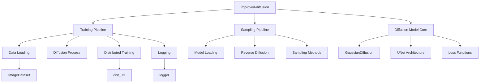
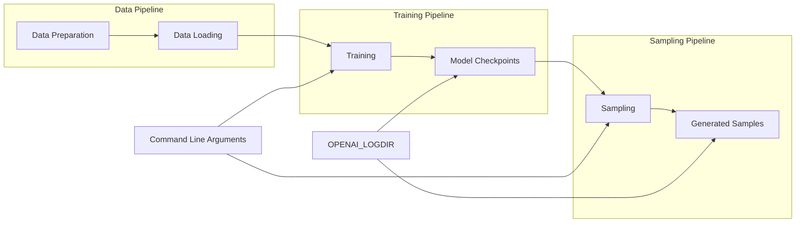
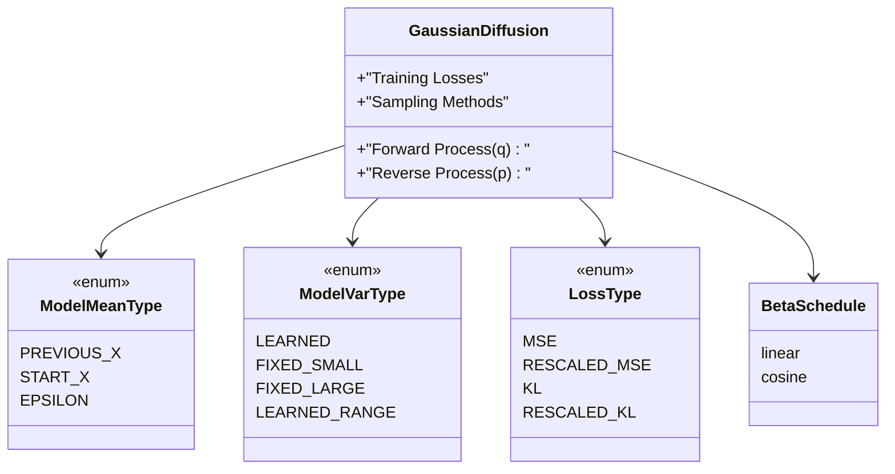
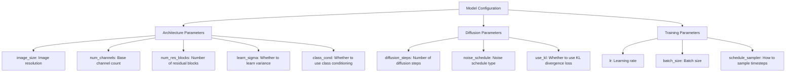
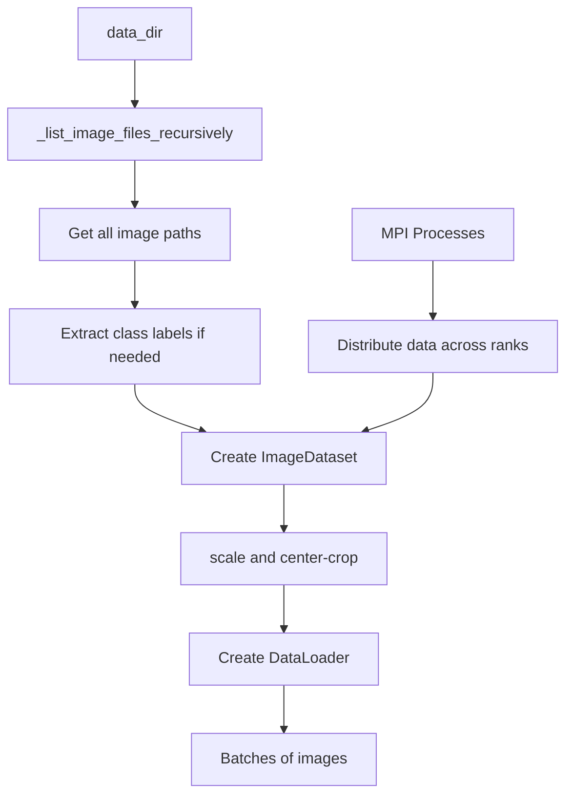
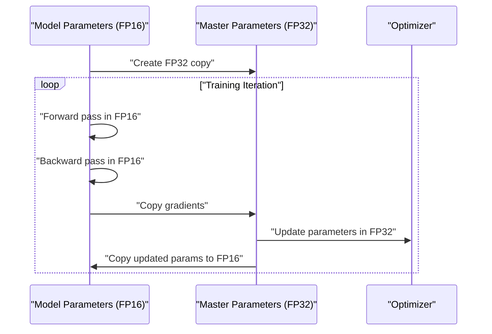
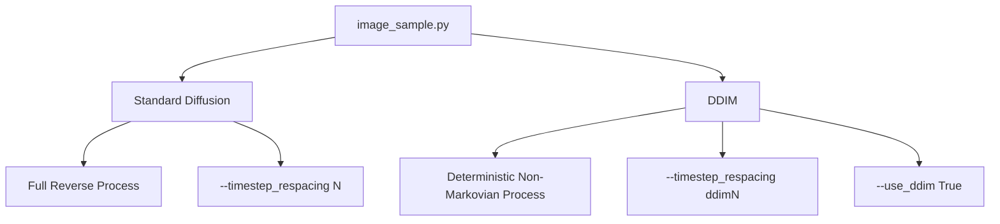

<!-- source: DeepWiki mcp.deepwiki.com · repo openai/improved-diffusion · page 1 Overview · fetched 2026-10-26 -->

# Overview

Relevant source files

The following files were used as context for generating this wiki page:

- [README.md](README.md)
- [improved_diffusion/__init__.py](improved_diffusion/__init__.py)

## Purpose and Scope

This page provides an overview of the `improved-diffusion` repository, which implements denoising diffusion probabilistic models (DDPMs) as described in the paper "Improved Denoising Diffusion Probabilistic Models". The repository contains code for training diffusion models on image data and generating high-quality samples from trained models.

Diffusion models work by gradually adding noise to data through a forward process and then learning to reverse this process to generate new samples. This repository implements several improvements to the basic diffusion model, including:

- Learned variance for the reverse process
- Different noise schedules (linear and cosine)
- Importance sampling for the variational lower bound (VLB)
- Support for class-conditional models

For installation instructions, see [Installation and Setup](#1.1).
For information about using the command-line tools, see [Command-Line Interface](#1.2).

## System Architecture

### System Components Diagram

The repository is organized into three main components:

1. **Training Pipeline**: Implemented primarily in `scripts/image_train.py`, handles data loading, model training, and checkpoint saving.
2. **Sampling Pipeline**: Implemented in `scripts/image_sample.py`, loads trained models and generates new samples.
3. **Diffusion Model Core**: Implemented in the `improved_diffusion` module, contains the core diffusion process implementation.

Sources: [README.md:1-146]()

## Workflow

### Training and Sampling Workflow

The workflow begins with data preparation, where images are organized into directories. The data loading component reads and preprocesses these images for training. The training process learns to reverse the diffusion process and periodically saves model checkpoints. These checkpoints can then be loaded for sampling to generate new images.

Command line arguments control both the training and sampling processes, allowing configuration of model architecture, diffusion process parameters, and training hyperparameters.

Sources: [README.md:19-26](), [README.md:58-59](), [README.md:60-70]()

## Key Components

### Gaussian Diffusion

The core of the implementation is the `GaussianDiffusion` class, which implements both the forward process (gradually adding noise) and the reverse process (removing noise). The model's behavior is configured through several options:

- **Model Mean Type**: What the model predicts (previous x, start x, or epsilon)
- **Model Variance Type**: How variance is handled (learned, fixed small, fixed large, or learned range)
- **Loss Type**: The training objective (MSE, rescaled MSE, KL, or rescaled KL)
- **Beta Schedule**: The noise addition rate (linear or cosine)

Sources: [README.md:29-42]()

### Model Configuration

The model is configured through command-line arguments, which are organized into three categories:

1. **Architecture Parameters**: Control the structure and capacity of the model
2. **Diffusion Parameters**: Define how the diffusion process works
3. **Training Parameters**: Specify optimization settings

The README provides several example configurations for different datasets:

| Model Type | Dataset | Key Parameters |
|------------|---------|----------------|
| Unconditional | ImageNet-64 | 128 channels, 3 res blocks, cosine schedule |
| Unconditional | CIFAR-10 | 128 channels, 3 res blocks, 0.3 dropout, cosine schedule |
| Class-conditional | ImageNet-64 | 192 channels, 3 res blocks, cosine schedule |
| Unconditional | LSUN bedroom | 128 channels, 2 res blocks, attention at resolution 16 |

Sources: [README.md:29-35](), [README.md:84-146]()

### Data Processing

The data processing system takes a directory of images as input. For class-conditional models, labels are extracted from filenames (format: "mylabel_filename.jpg"). All images are automatically scaled and center-cropped during loading.

For distributed training, data is distributed across multiple processes using MPI, with utilities for parameter synchronization and device assignment.

Sources: [README.md:19-26](), [README.md:50-56]()

## Advanced Features

### Mixed-Precision Training

The repository supports mixed-precision training, where most operations are performed in 16-bit floating-point format (FP16) but gradient updates are done in 32-bit precision (FP32). This reduces memory usage and potentially increases training speed while maintaining numerical stability.

In lieu of distributed training, the `--microbatch` argument can be used to process large batches in smaller chunks to reduce memory usage.

Sources: [README.md:50-56]()

### Sampling Methods

The repository supports two main sampling methods:

1. **Standard Diffusion**: The full reverse process as described in the original diffusion models
2. **DDIM (Denoising Diffusion Implicit Models)**: A deterministic non-Markovian sampling process that can generate samples in fewer steps

Both methods support "timestep respacing," which allows for generating samples with fewer steps than were used during training. For example, `--timestep_respacing 250` uses 250 steps for sampling, while `--timestep_respacing ddim250` uses the uniform stride from the DDIM paper.

Sources: [README.md:73-76]()

## Pre-trained Models

The repository includes checkpoints and hyperparameters for several pre-trained models:

| Model Type | Dataset | Checkpoint Link |
|------------|---------|----------------|
| Unconditional | ImageNet-64 | imagenet64_uncond_100M_1500K.pt |
| Unconditional | CIFAR-10 | cifar10_uncond_50M_500K.pt |
| Class-conditional | ImageNet-64 | imagenet64_cond_270M_250K.pt |
| Upsampling | 256x256 | upsample_cond_500K.pt |
| Unconditional | LSUN bedroom | lsun_uncond_100M_1200K_bs128.pt |

These models vary in architecture, diffusion parameters, and training settings, showcasing the flexibility of the framework.

Sources: [README.md:78-146]()

## Summary

The `improved-diffusion` repository provides a complete implementation of improved denoising diffusion probabilistic models. It includes code for training models on various image datasets and generating high-quality samples. The implementation supports numerous improvements over the base diffusion model, including learned variance, different noise schedules, and importance sampling. The repository also includes several pre-trained models that can be used for generating samples out of the box.

For more detailed information about specific components, see the following pages:
- [Training Pipeline](#2.1)
- [Sampling Pipeline](#2.2)
- [Gaussian Diffusion](#3.1)

Sources: [README.md:1-4](), [README.md:5-8]()

---

