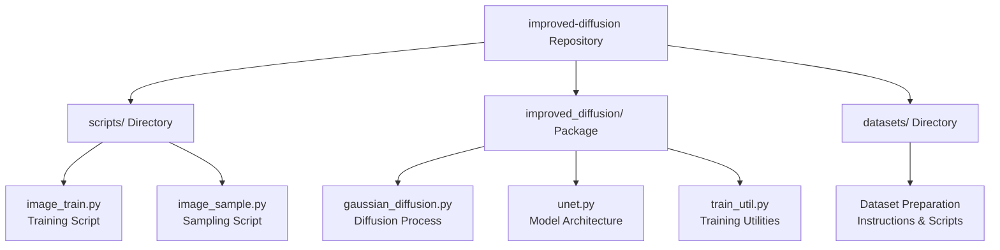
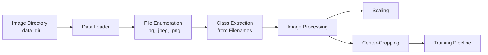
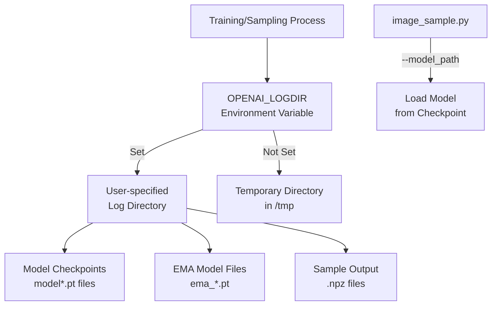
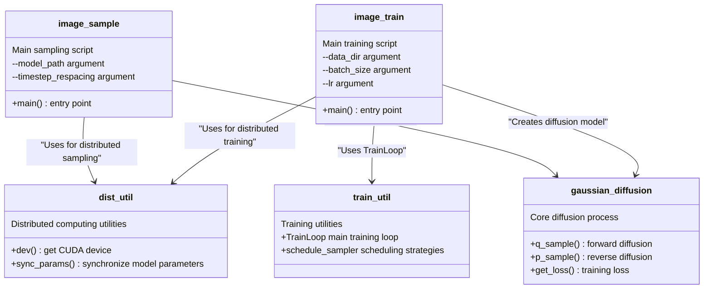

<!-- source: DeepWiki mcp.deepwiki.com · repo openai/improved-diffusion · page 1.1 Installation and Setup · fetched 2026-10-26 -->

# Installation and Setup

<details>
<summary>Relevant source files</summary>

The following files were used as context for generating this wiki page:

- [.gitignore](.gitignore)
- [README.md](README.md)

</details>


This page guides you through the process of installing the improved-diffusion package and setting up your environment for training and sampling with diffusion models. For information about running specific commands and configuration options, see [Command-Line Interface](#1.2).

## Prerequisites

Before installing the improved-diffusion package, ensure you have:

- Python 3.x
- pip package manager
- Git
- GPU with CUDA support (recommended for training)
- MPI implementation (for distributed training)
- Sufficient disk space for datasets and model checkpoints

## Installation Steps

### Repository Structure



### Step-by-Step Installation

1. Clone the repository:
   ```bash
   git clone https://github.com/openai/improved-diffusion.git
   ```

2. Navigate to the repository directory:
   ```bash
   cd improved-diffusion
   ```

3. Install the package:
   ```bash
   pip install -e .
   ```

This installs the `improved_diffusion` package in development mode, which allows you to make changes to the code while using the package.

Sources: [README.md:9-17]()

## Data Preparation

The training code reads images from a directory. This section explains how to prepare your data.

### Data Processing Flow



### Standard Datasets

The repository includes instructions for preparing commonly used datasets:

| Dataset | Location | Description |
|---------|----------|-------------|
| ImageNet | datasets/imagenet | High-resolution images with 1000 classes |
| LSUN Bedrooms | datasets/lsun | Large-scale bedroom scene images |
| CIFAR-10 | datasets/cifar10 | Small 32×32 images with 10 classes |

### Custom Dataset Creation

To create your own dataset:

1. Place all images in a directory with `.jpg`, `.jpeg`, or `.png` extensions
2. For class-conditional models, name files with a label prefix: `mylabel1_XXX.jpg`, `mylabel2_YYY.jpg`
3. Subdirectories are automatically enumerated, allowing for recursive organization

The data loading pipeline automatically scales and center-crops the images during training. Simply pass `--data_dir path/to/images` to the training script.

Sources: [README.md:19-25]()

## Environment Configuration

### Logging System



### Key Environment Variables

| Variable | Purpose | Default | Notes |
|----------|---------|---------|-------|
| OPENAI_LOGDIR | Directory for logs and saved models | Temporary dir in `/tmp` | Set this for persistent storage |
| CUDA_VISIBLE_DEVICES | Controls which GPUs are used | All available GPUs | Format: comma-separated list of device IDs |

Sources: [README.md:57-58]()

## Distributed Training Setup

For training on multiple GPUs or machines:

1. Install an MPI implementation (e.g., OpenMPI)
2. Launch with `mpiexec` to use multiple GPUs
3. Divide the batch size by the number of GPUs

Example command for distributed training:
```bash
mpiexec -n $NUM_GPUS python scripts/image_train.py --data_dir path/to/images $MODEL_FLAGS $DIFFUSION_FLAGS $TRAIN_FLAGS
```

For memory-constrained environments, use the `--microbatch` flag:
```bash
python scripts/image_train.py --data_dir path/to/images --microbatch 16 $MODEL_FLAGS $DIFFUSION_FLAGS $TRAIN_FLAGS
```

Sources: [README.md:50-56]()

## Code Architecture



This diagram shows the key code entities and their relationships, illustrating how the scripts interact with the core diffusion implementation.

Sources: [README.md:27-45]()

## Verification and Next Steps

To verify successful installation, run:

```bash
python -c "import improved_diffusion; print('Installation successful')"
```

After completing the installation and setup:

1. **Configure and train a model**: See [Command-Line Interface](#1.2) for training options
2. **Sample from a trained model**: See [Command-Line Interface](#1.2) for sampling parameters
3. **Learn about diffusion models**: See [Core Concepts](#2) for theoretical background
4. **Explore advanced features**: See [Gaussian Diffusion](#3.1) for implementation details

Sources: [README.md:61-76]()

---

