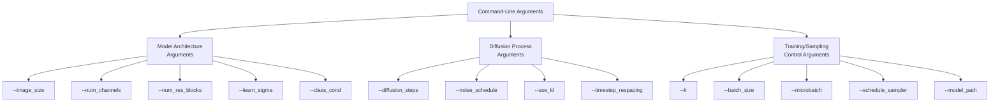
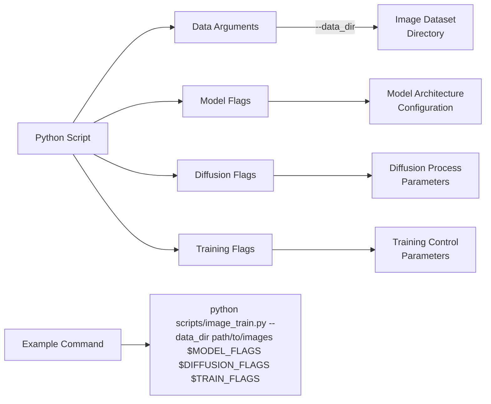
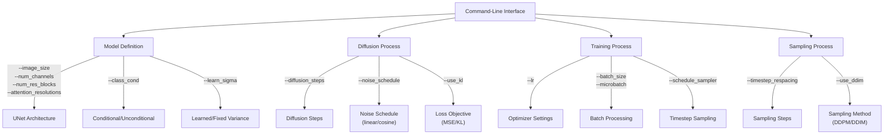
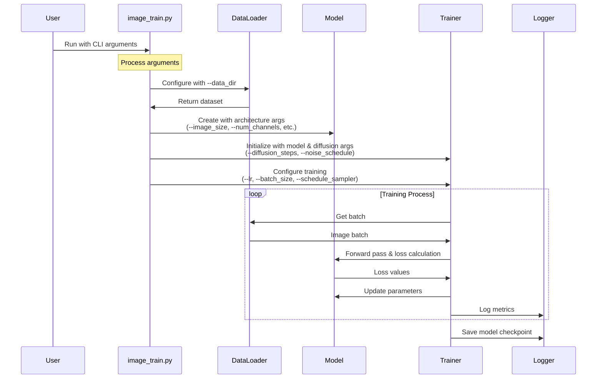
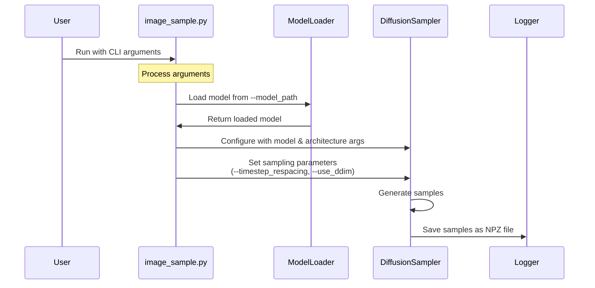

<!-- source: DeepWiki mcp.deepwiki.com · repo openai/improved-diffusion · page 1.2 Command-Line Interface · fetched 2026-10-26 -->

# Command-Line Interface

<details>
<summary>Relevant source files</summary>

The following files were used as context for generating this wiki page:

- [README.md](README.md)

</details>


This document provides a comprehensive guide to the command-line interface of the improved-diffusion repository. It covers the available command-line arguments for both the training and sampling scripts, explaining how they affect model architecture, diffusion process parameters, and training/sampling behavior. For information about installation, see [Installation and Setup](#1.1), and for data preparation details, see [Data Management](#4).

## Overview of Command-Line Arguments

The improved-diffusion repository provides two main scripts with command-line interfaces:
- `image_train.py` - For training diffusion models
- `image_sample.py` - For sampling from trained models

Command-line arguments are logically organized into three main categories:



Sources: [README.md:28-76](https://github.com/openai/improved-diffusion/blob/main/README.md)

## Argument Organization in Practice

The repository's examples typically organize arguments into these groups for clarity:



Sources: [README.md:28-48](https://github.com/openai/improved-diffusion/blob/main/README.md)

## Training Arguments

### Model Architecture Arguments

These arguments define the structure and capabilities of the neural network model:

| Argument | Description | Example Values |
|----------|-------------|----------------|
| `--image_size` | Size of images to train on (square) | 32, 64, 256 |
| `--num_channels` | Base channel count for the model | 128, 192 |
| `--num_res_blocks` | Number of residual blocks per downsample | 2, 3 |
| `--learn_sigma` | Whether to learn the variance parameter | True, False |
| `--class_cond` | Whether to use class-conditional model | True, False |
| `--dropout` | Dropout rate | 0.0, 0.3 |
| `--attention_resolutions` | Resolutions at which to apply attention | 16 |
| `--num_heads` | Number of attention heads | 1 |
| `--use_scale_shift_norm` | Use scale and shift for normalization | True, False |

Sources: [README.md:29-42](https://github.com/openai/improved-diffusion/blob/main/README.md), [README.md:80-146](https://github.com/openai/improved-diffusion/blob/main/README.md)

### Diffusion Process Arguments

These arguments control how the diffusion process works:

| Argument | Description | Example Values |
|----------|-------------|----------------|
| `--diffusion_steps` | Number of steps in diffusion process | 1000, 4000 |
| `--noise_schedule` | Schedule for adding noise | linear, cosine |
| `--use_kl` | Use KL divergence for variance loss | True, False |
| `--rescale_learned_sigmas` | Rescale learned sigmas | True, False |
| `--rescale_timesteps` | Rescale timesteps | True, False |

Sources: [README.md:29-42](https://github.com/openai/improved-diffusion/blob/main/README.md), [README.md:80-146](https://github.com/openai/improved-diffusion/blob/main/README.md)

### Training Control Arguments

These arguments affect the training process itself:

| Argument | Description | Example Values |
|----------|-------------|----------------|
| `--lr` | Learning rate | 1e-4, 3e-4, 2e-5 |
| `--batch_size` | Batch size for training | 128, 256, 2048 |
| `--microbatch` | Microbatch size for memory-constrained training | 1, 4, 16 |
| `--schedule_sampler` | Timestep sampling strategy | uniform, loss-second-moment |
| `--data_dir` | Directory containing training images | path/to/images |

Sources: [README.md:29-42](https://github.com/openai/improved-diffusion/blob/main/README.md), [README.md:50-58](https://github.com/openai/improved-diffusion/blob/main/README.md)

## Sampling Arguments

These arguments control the generation of samples from a trained model:

| Argument | Description | Example Values |
|----------|-------------|----------------|
| `--model_path` | Path to the trained model checkpoint | /path/to/model.pt |
| `--timestep_respacing` | Modify number of diffusion steps for sampling | 250, ddim250 |
| `--use_ddim` | Whether to use DDIM sampling | True, False |

Sources: [README.md:60-76](https://github.com/openai/improved-diffusion/blob/main/README.md)

## Relationship Between CLI Arguments and System Components



Sources: [README.md:28-76](https://github.com/openai/improved-diffusion/blob/main/README.md)

## Training Workflow with Command-Line Arguments



Sources: [README.md:28-58](https://github.com/openai/improved-diffusion/blob/main/README.md)

## Sampling Workflow with Command-Line Arguments



Sources: [README.md:60-76](https://github.com/openai/improved-diffusion/blob/main/README.md)

## Common Usage Examples

### Basic Training Example

```bash
MODEL_FLAGS="--image_size 64 --num_channels 128 --num_res_blocks 3"
DIFFUSION_FLAGS="--diffusion_steps 4000 --noise_schedule linear"
TRAIN_FLAGS="--lr 1e-4 --batch_size 128"

python scripts/image_train.py --data_dir path/to/images $MODEL_FLAGS $DIFFUSION_FLAGS $TRAIN_FLAGS
```

### Training with Learned Sigmas and Cosine Schedule

```bash
MODEL_FLAGS="--image_size 64 --num_channels 128 --num_res_blocks 3 --learn_sigma True"
DIFFUSION_FLAGS="--diffusion_steps 4000 --noise_schedule cosine"
TRAIN_FLAGS="--lr 1e-4 --batch_size 128"

python scripts/image_train.py --data_dir path/to/images $MODEL_FLAGS $DIFFUSION_FLAGS $TRAIN_FLAGS
```

### Training Class-Conditional Model

```bash
MODEL_FLAGS="--image_size 64 --num_channels 192 --num_res_blocks 3 --learn_sigma True --class_cond True"
DIFFUSION_FLAGS="--diffusion_steps 4000 --noise_schedule cosine --rescale_learned_sigmas False --rescale_timesteps False"
TRAIN_FLAGS="--lr 3e-4 --batch_size 2048"

python scripts/image_train.py --data_dir path/to/images $MODEL_FLAGS $DIFFUSION_FLAGS $TRAIN_FLAGS
```

### Distributed Training with MPI

```bash
MODEL_FLAGS="--image_size 64 --num_channels 128 --num_res_blocks 3"
DIFFUSION_FLAGS="--diffusion_steps 4000 --noise_schedule linear"
TRAIN_FLAGS="--lr 1e-4 --batch_size 32" # Batch size divided by number of GPUs

mpiexec -n 4 python scripts/image_train.py --data_dir path/to/images $MODEL_FLAGS $DIFFUSION_FLAGS $TRAIN_FLAGS
```

### Basic Sampling

```bash
MODEL_FLAGS="--image_size 64 --num_channels 128 --num_res_blocks 3"
DIFFUSION_FLAGS="--diffusion_steps 4000 --noise_schedule linear"

python scripts/image_sample.py --model_path /path/to/model.pt $MODEL_FLAGS $DIFFUSION_FLAGS
```

### Sampling with Fewer Steps

```bash
MODEL_FLAGS="--image_size 64 --num_channels 128 --num_res_blocks 3"
DIFFUSION_FLAGS="--diffusion_steps 4000 --noise_schedule linear --timestep_respacing 250"

python scripts/image_sample.py --model_path /path/to/model.pt $MODEL_FLAGS $DIFFUSION_FLAGS
```

### Sampling with DDIM

```bash
MODEL_FLAGS="--image_size 64 --num_channels 128 --num_res_blocks 3"
DIFFUSION_FLAGS="--diffusion_steps 4000 --noise_schedule linear --timestep_respacing ddim250 --use_ddim True"

python scripts/image_sample.py --model_path /path/to/model.pt $MODEL_FLAGS $DIFFUSION_FLAGS
```

Sources: [README.md:28-146](https://github.com/openai/improved-diffusion/blob/main/README.md)

## Special Notes on Argument Usage

1. **Batch Size in Distributed Training**: When using distributed training with MPI, you must manually divide the `--batch_size` argument by the number of GPUs (ranks).

2. **Memory Constraints**: For memory-limited scenarios, use `--microbatch` with small values (e.g., 16 or even 1) to reduce memory usage.

3. **Logging Directory**: Results, logs, and saved models are written to a directory determined by the `OPENAI_LOGDIR` environment variable. If not set, a temporary directory in `/tmp` is created.

4. **EMA Models**: When sampling, prefer checkpoints with names like `ema_0.9999_200000.pt` over those like `model200000.pt`, as EMA models produce better samples.

5. **DDIM Sampling**: To use DDIM sampling, enable it with `--use_ddim True` and set `--timestep_respacing` to values like `ddim250`.

Sources: [README.md:50-76](https://github.com/openai/improved-diffusion/blob/main/README.md)

---

