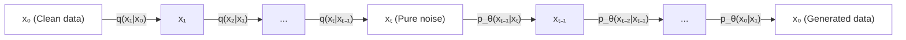
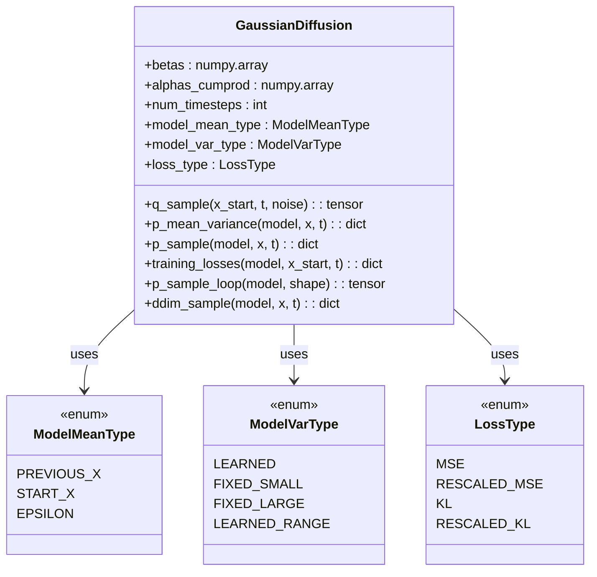
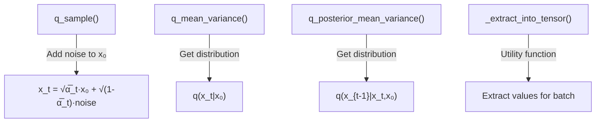
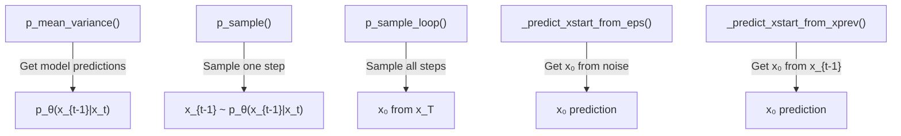
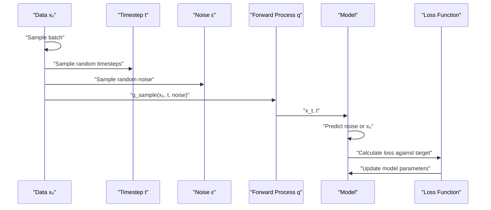
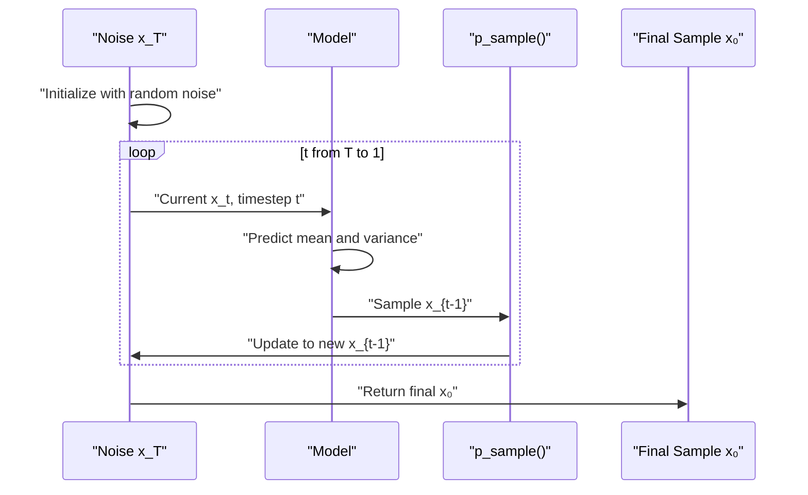
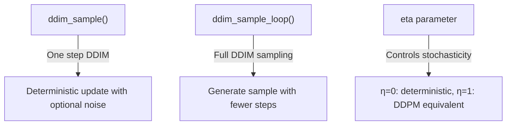
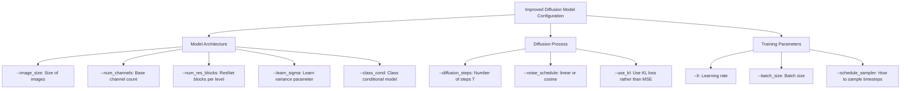
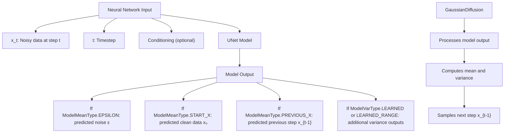

<!-- source: DeepWiki mcp.deepwiki.com · repo openai/improved-diffusion · page 2 Core Concepts · fetched 2026-10-26 -->

# Core Concepts

<details>
<summary>Relevant source files</summary>

The following files were used as context for generating this wiki page:

- [README.md](README.md)
- [improved_diffusion/gaussian_diffusion.py](improved_diffusion/gaussian_diffusion.py)

</details>


## Introduction

This document explains the fundamental concepts of diffusion models as implemented in the improved-diffusion repository. It covers the theoretical framework, core components, and their interactions in both training and sampling processes. For implementation details of specific processes, see [Training Pipeline](#2.1) and [Sampling Pipeline](#2.2).

## Diffusion Models Fundamentals

Diffusion Probabilistic Models operate through two key processes:

1. **Forward Process (q)**: A fixed Markov chain that gradually adds noise to data
2. **Reverse Process (p)**: A learned Markov chain that gradually removes noise to generate data

### Forward and Reverse Diffusion Process



Sources: [improved_diffusion/gaussian_diffusion.py:1-7]()

### Mathematical Formulation

The forward process adds noise by:

x_t = √(α̅_t) * x_0 + √(1 - α̅_t) * ε

Where:
- α_t = 1 - β_t (β_t is the noise level at step t)
- α̅_t = ∏_{s=1}^t α_s (cumulative product)
- ε is Gaussian noise

The reverse process denoises by learning:

p_θ(x_{t-1} | x_t) = N(x_{t-1}; μ_θ(x_t, t), Σ_θ(x_t, t))

Sources: [improved_diffusion/gaussian_diffusion.py:140-169]()

## Core Components

The implementation centers around the `GaussianDiffusion` class and several enumeration types that configure its behavior.

### Diffusion System Architecture



Sources: [improved_diffusion/gaussian_diffusion.py:101-126]()

### Model Mean Types

The `ModelMeanType` enum determines what the neural network predicts:

| Enum Value | Description | Implementation |
|------------|-------------|----------------|
| `PREVIOUS_X` | Model predicts x_{t-1} directly | [improved_diffusion/gaussian_diffusion.py:300-304]() |
| `START_X` | Model predicts x_0 (the clean data) | [improved_diffusion/gaussian_diffusion.py:306-307]() |
| `EPSILON` | Model predicts ε (the noise) - most common | [improved_diffusion/gaussian_diffusion.py:309-311]() |

Sources: [improved_diffusion/gaussian_diffusion.py:65-72]()

### Model Variance Types

The `ModelVarType` enum configures how the variance of the reverse process is determined:

| Enum Value | Description | Implementation |
|------------|-------------|----------------|
| `LEARNED` | Model outputs log variance directly | [improved_diffusion/gaussian_diffusion.py:265-267]() |
| `FIXED_SMALL` | Uses fixed posterior variance | [improved_diffusion/gaussian_diffusion.py:285-288]() |
| `FIXED_LARGE` | Uses fixed larger variance (β_t) | [improved_diffusion/gaussian_diffusion.py:281-284]() |
| `LEARNED_RANGE` | Model outputs interpolation factor between min/max variance | [improved_diffusion/gaussian_diffusion.py:269-276]() |

Sources: [improved_diffusion/gaussian_diffusion.py:75-86]()

### Loss Types

The `LossType` enum defines the training objective:

| Enum Value | Description | Implementation |
|------------|-------------|----------------|
| `MSE` | Mean squared error between prediction and target | [improved_diffusion/gaussian_diffusion.py:709-746]() |
| `RESCALED_MSE` | MSE with rescaled variance learning term | [improved_diffusion/gaussian_diffusion.py:729-732]() |
| `KL` | Kullback-Leibler divergence (variational lower bound) | [improved_diffusion/gaussian_diffusion.py:698-706]() |
| `RESCALED_KL` | KL rescaled by timesteps for better estimation | [improved_diffusion/gaussian_diffusion.py:707-708]() |

Sources: [improved_diffusion/gaussian_diffusion.py:89-98]()

### Beta Schedules

The beta schedule determines the noise addition rate in the forward process:

| Schedule | Description | Implementation |
|----------|-------------|----------------|
| `linear` | Linear schedule from 0.0001 to 0.02 | [improved_diffusion/gaussian_diffusion.py:27-35]() |
| `cosine` | Cosine schedule for smoother noise addition | [improved_diffusion/gaussian_diffusion.py:36-40]() |

Sources: [improved_diffusion/gaussian_diffusion.py:18-42]()

## Forward Process Implementation

The forward process (adding noise) is implemented in several methods:

### Forward Process Functions



Sources: [improved_diffusion/gaussian_diffusion.py:171-230](), [improved_diffusion/gaussian_diffusion.py:828-841]()

The forward process adds noise according to the predetermined schedule using `q_sample()`, which directly implements the formula:

```
x_t = sqrt_alphas_cumprod[t] * x_start + sqrt_one_minus_alphas_cumprod[t] * noise
```

## Reverse Process Implementation

The reverse process (denoising) is implemented in these key methods:

### Reverse Process Functions



Sources: [improved_diffusion/gaussian_diffusion.py:232-387]()

## Training Process

During training, the model learns to reverse the diffusion process:

### Training Workflow



Sources: [improved_diffusion/gaussian_diffusion.py:677-750]()

The training loss depends on the loss type:
- For `MSE` and `RESCALED_MSE`: Mean squared error between prediction and target
- For `KL` and `RESCALED_KL`: Variational lower bound using KL divergence

## Sampling Process

During sampling, the model generates new data starting from noise:

### Sampling Workflow



Sources: [improved_diffusion/gaussian_diffusion.py:389-477]()

### DDIM Sampling

The implementation also supports Denoising Diffusion Implicit Models (DDIM) sampling, which enables faster generation with fewer steps:



Sources: [improved_diffusion/gaussian_diffusion.py:479-640]()

## Precomputed Diffusion Parameters

The `GaussianDiffusion` class precomputes various quantities used throughout the diffusion process:

| Parameter | Description | Formula |
|-----------|-------------|---------|
| `alphas` | Complement of beta values | 1 - β_t |
| `alphas_cumprod` | Cumulative product of alphas | ∏_{s=1}^t α_s |
| `sqrt_alphas_cumprod` | Square root of alphas_cumprod | √(∏_{s=1}^t α_s) |
| `sqrt_one_minus_alphas_cumprod` | Square root of complement | √(1 - ∏_{s=1}^t α_s) |
| `posterior_variance` | Variance for q(x_{t-1}\|x_t,x_0) | β_t·(1-α̅_{t-1})/(1-α̅_t) |
| `posterior_mean_coef1` | First coefficient for posterior mean | β_t·√α̅_{t-1}/(1-α̅_t) |
| `posterior_mean_coef2` | Second coefficient for posterior mean | (1-α̅_{t-1})·√α_t/(1-α̅_t) |

Sources: [improved_diffusion/gaussian_diffusion.py:140-169]()

## Configuration Options

The model can be configured with various parameters specified as command-line arguments:

### Model Configuration



Sources: [README.md:29-43]()

## Model-to-Diffusion Integration

The neural network model integrates with the diffusion process as follows:

### Model-Diffusion Integration



Sources: [improved_diffusion/gaussian_diffusion.py:232-267]()

The model's output is processed by the `GaussianDiffusion` class to compute the parameters of the reverse distribution and sample the next step in the denoising process.

---

