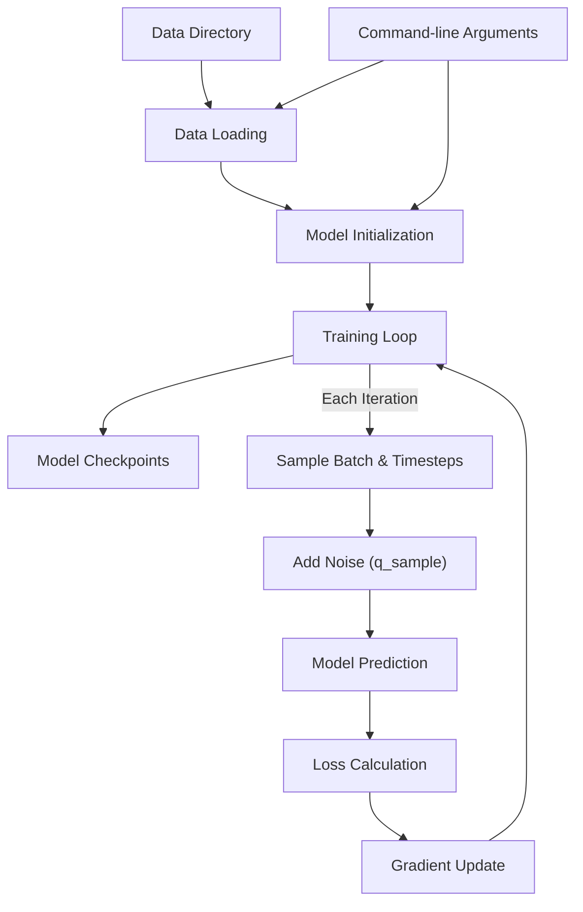
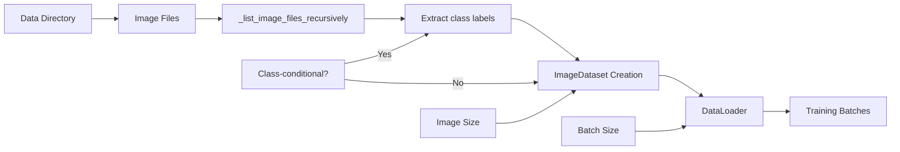
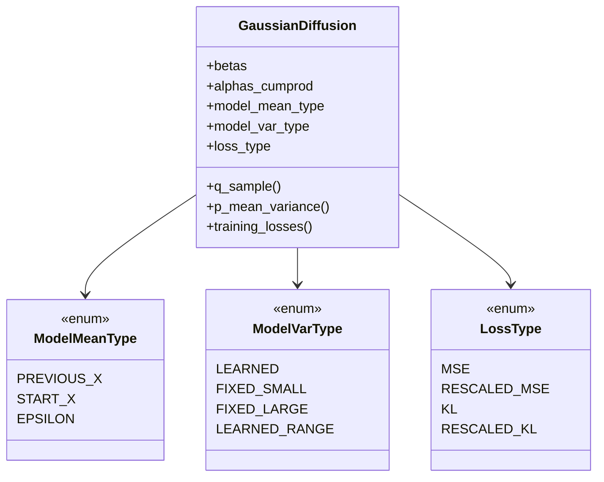
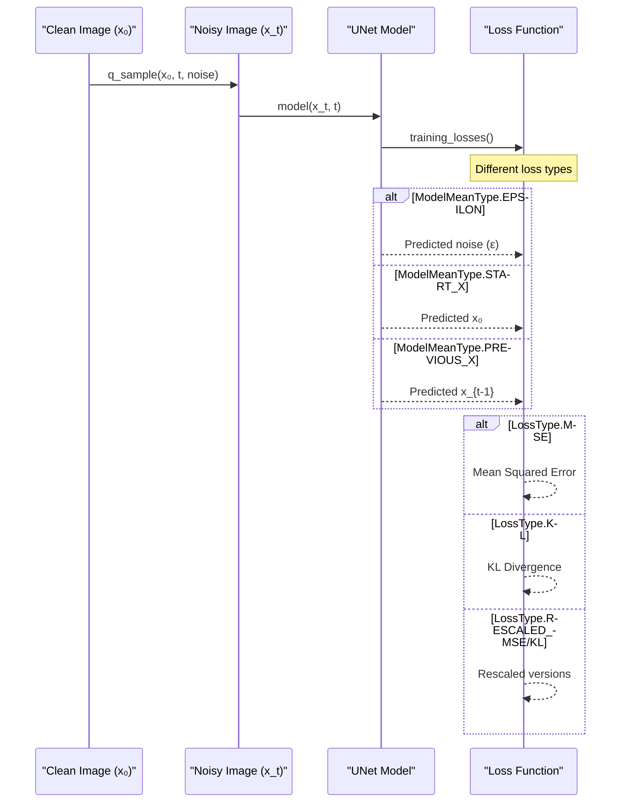
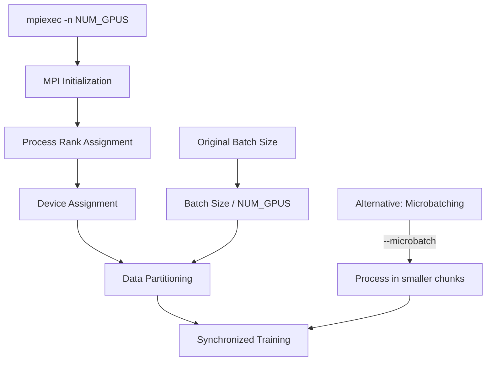
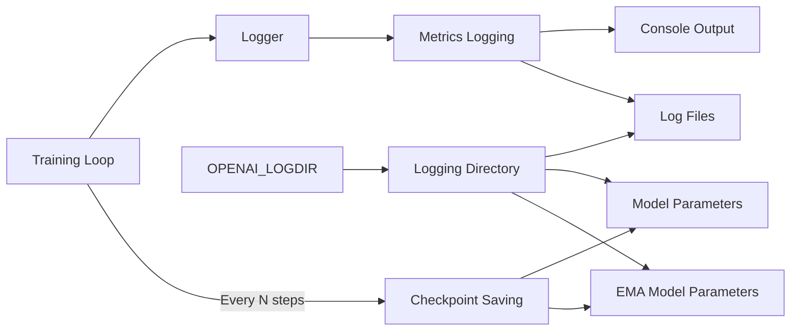

<!-- source: DeepWiki mcp.deepwiki.com · repo openai/improved-diffusion · page 2.1 Training Pipeline · fetched 2026-10-26 -->

# Training Pipeline

<details>
<summary>Relevant source files</summary>

The following files were used as context for generating this wiki page:

- [README.md](README.md)
- [improved_diffusion/gaussian_diffusion.py](improved_diffusion/gaussian_diffusion.py)

</details>


This page documents the training pipeline for the Improved Diffusion repository, explaining how the system trains denoising diffusion probabilistic models (DDPMs). For information about sampling from trained models, see [Sampling Pipeline](#2.2).

## Overview

The training pipeline transforms clean images into a trained diffusion model through an iterative process of adding noise and then learning to reverse this process. It implements the procedures outlined in the "Improved Denoising Diffusion Probabilistic Models" paper with enhancements for stability and performance.



Sources: [README.md:25-59]()

## Training Configuration

The training pipeline is configured through command-line arguments, which can be organized into three categories:

| Category | Flag Group | Purpose | Examples |
|----------|------------|---------|----------|
| Model Architecture | MODEL_FLAGS | Define the model structure | `--image_size`, `--num_channels`, `--learn_sigma` |
| Diffusion Process | DIFFUSION_FLAGS | Configure the noise addition process | `--diffusion_steps`, `--noise_schedule` |
| Training Parameters | TRAIN_FLAGS | Set optimization hyperparameters | `--lr`, `--batch_size` |

Training is initiated through the `image_train.py` script, which accepts these configuration flags:

```
python scripts/image_train.py --data_dir path/to/images $MODEL_FLAGS $DIFFUSION_FLAGS $TRAIN_FLAGS
```

Sources: [README.md:27-46]()

## Data Pipeline

The training pipeline begins with loading and preprocessing image data:



Key characteristics:

- Images are automatically scaled and center-cropped
- For class-conditional training, labels are extracted from filenames (format: "label_XXX.jpg")
- Subdirectories are automatically enumerated
- In distributed training, the dataset is partitioned across ranks

Sources: [README.md:19-25]()

## Diffusion Process

The core of the training is the diffusion process, implemented in the `GaussianDiffusion` class:



During each training iteration:

1. A batch of clean images (x₀) is sampled
2. Random timesteps (t) are sampled for each image
3. Noise is added via `q_sample()` to produce noisy images (x_t)
4. The model predicts either the noise, original image, or previous timestep
5. Loss is calculated based on the prediction and target
6. Model parameters are updated via gradient descent

Sources: [improved_diffusion/gaussian_diffusion.py:101-171](), [improved_diffusion/gaussian_diffusion.py:677-750]()

## Forward Process and Loss Calculation

The training process involves two key components:



The `training_losses` method in `GaussianDiffusion` handles this process:

1. Adds noise to the clean image using `q_sample`
2. Feeds the noisy image to the model
3. Calculates the appropriate loss based on model predictions
4. Returns a dictionary with loss values

Sources: [improved_diffusion/gaussian_diffusion.py:677-750]()

## Distributed Training

The pipeline supports distributed training through MPI (Message Passing Interface):



Key aspects of distributed training:

- Run with `mpiexec -n NUM_GPUS python scripts/image_train.py ...`
- Must divide batch size by number of ranks
- Alternative: use `--microbatch` flag for memory-constrained scenarios
- Gradient synchronization happens automatically across processes

Sources: [README.md:50-56]()

## Logging and Checkpoints

Training progress is tracked through the logging system, which saves both metrics and model checkpoints:



Important details:

- Logs and checkpoints are written to `OPENAI_LOGDIR` environment variable
- If not set, a temporary directory in `/tmp` is used
- EMA (Exponential Moving Average) checkpoints are saved with names like `ema_0.9999_200000.pt`
- Regular model checkpoints are saved as `model200000.pt`
- EMA checkpoints typically produce better samples

Sources: [README.md:58-62]()

## Training Tips

Based on the paper and repository:

1. **Loss Functions**:
   - `L_hybrid` (combination of MSE and VLB terms) often performs best
   - Enable with `--learn_sigma True` in model flags

2. **Noise Schedule**:
   - Cosine schedule typically outperforms linear
   - Set with `--noise_schedule cosine`

3. **Importance Sampling**:
   - For improved training stability, use:
     - `--use_kl True` (DIFFUSION_FLAGS)
     - `--schedule_sampler loss-second-moment` (TRAIN_FLAGS)

4. **Class-Conditional Training**:
   - Enable with `--class_cond True` in MODEL_FLAGS
   - Requires properly formatted filenames ("class_XXX.jpg")

Sources: [README.md:37-46](), [README.md:87-146]()

---

