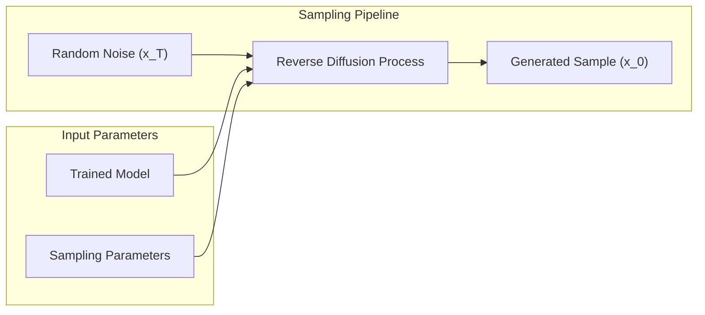
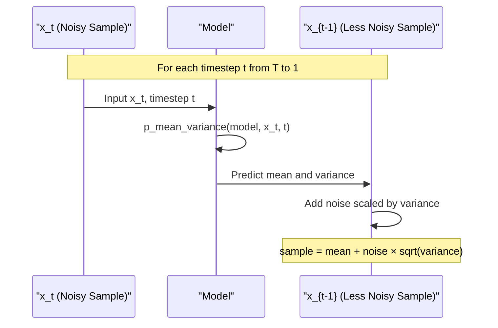
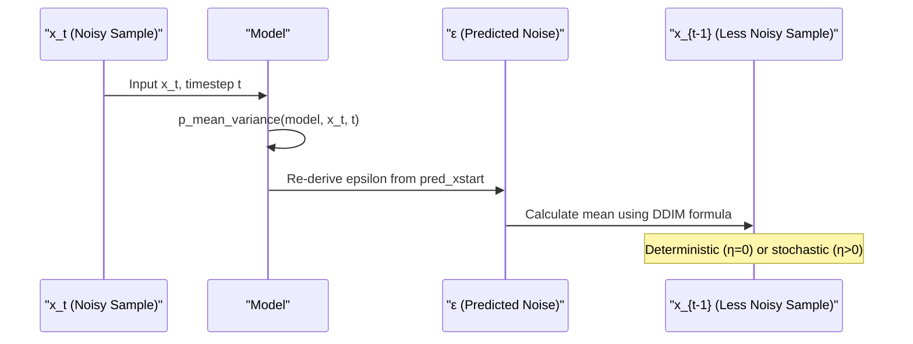
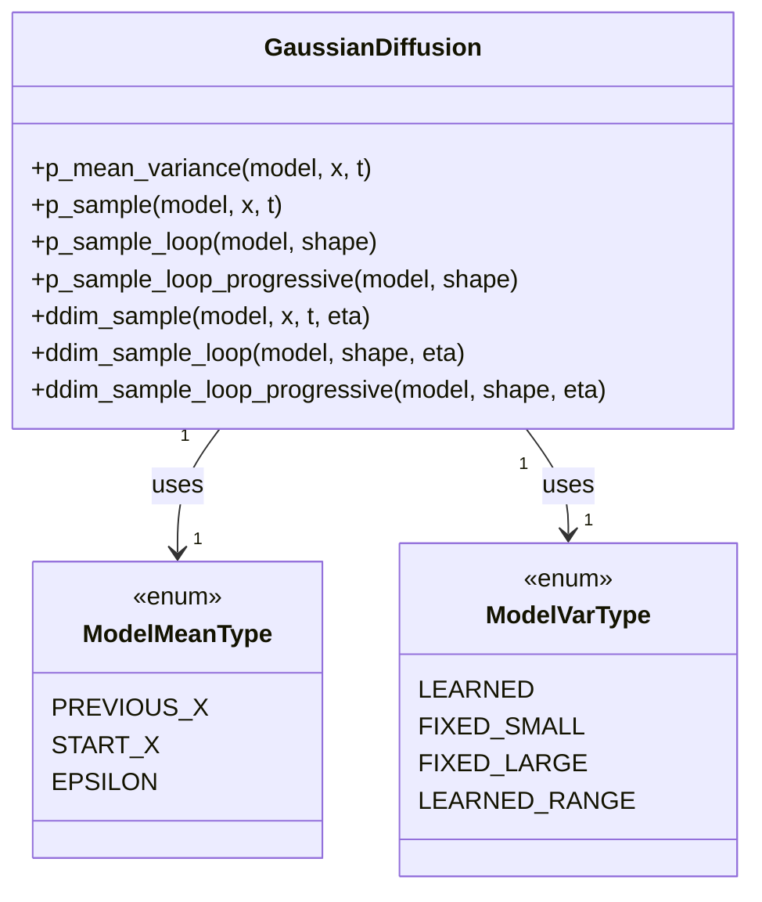
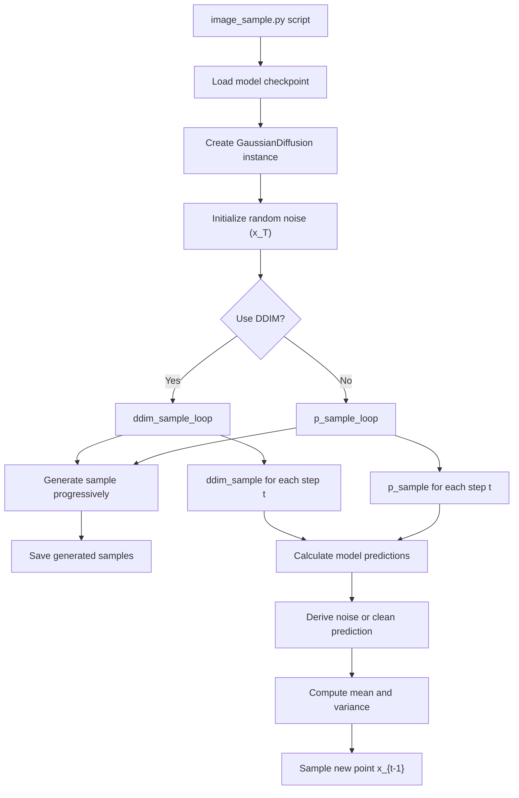
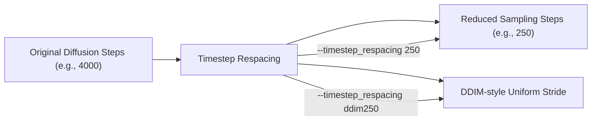

<!-- source: DeepWiki mcp.deepwiki.com · repo openai/improved-diffusion · page 2.2 Sampling Pipeline · fetched 2026-10-26 -->

# Sampling Pipeline

<details>
<summary>Relevant source files</summary>

The following files were used as context for generating this wiki page:

- [README.md](README.md)
- [improved_diffusion/gaussian_diffusion.py](improved_diffusion/gaussian_diffusion.py)

</details>


The Sampling Pipeline in the improved-diffusion repository is responsible for generating images from trained diffusion models. This component takes trained model checkpoints and performs the reverse diffusion process to create new samples. This page focuses on the implementation details of how samples are generated, including both standard diffusion sampling and DDIM sampling methods.

For information about the training process, see [Training Pipeline](#2.1).

## Overview of the Sampling Process

The sampling process starts with random noise and progressively denoises it by reversing the diffusion process using a trained model. This reverse process corresponds to the p-distribution in the diffusion framework, which approximates the true posterior distribution.



The core sampling pipeline consists of several key steps:
1. Loading a trained model checkpoint
2. Generating initial random noise
3. Progressively denoising the sample using the model
4. Producing the final generated image

Sources: [README.md:61-77](), [improved_diffusion/gaussian_diffusion.py:389-429]()

## Sampling Methods

The codebase implements two primary sampling methods:

### Standard Diffusion Sampling

The standard diffusion sampling process follows the stochastic reverse process defined in the diffusion model framework. It adds carefully calibrated noise at each step of the reverse process:



This method is implemented in the `p_sample` function, which samples x_{t-1} from x_t using the model predictions. The `p_sample_loop` function calls `p_sample` repeatedly to generate a complete sample from random noise.

Sources: [improved_diffusion/gaussian_diffusion.py:356-388](), [improved_diffusion/gaussian_diffusion.py:389-429]()

### DDIM Sampling

DDIM (Denoising Diffusion Implicit Models) sampling is an alternative deterministic sampling method that often produces higher quality samples with fewer steps:



DDIM sampling allows for fewer sampling steps while maintaining quality, making it more efficient than standard diffusion. The parameter η controls the stochasticity, with η=0 making the process deterministic.

Sources: [improved_diffusion/gaussian_diffusion.py:479-522](), [improved_diffusion/gaussian_diffusion.py:562-592]()

## Core Implementation

The sampling pipeline is primarily implemented in the `GaussianDiffusion` class, which provides methods for both standard diffusion and DDIM sampling.



The key sampling methods include:

1. **`p_mean_variance`**: Calculates the mean and variance for the reverse diffusion step, as well as a prediction of x_0.

2. **`p_sample`**: Samples a single timestep x_{t-1} from x_t using the model and adding noise. 

3. **`p_sample_loop`**: Generates a complete sample by repeatedly calling `p_sample`, going from random noise to the final sample.

4. **`ddim_sample`**: Implements DDIM sampling for a single timestep.

5. **`ddim_sample_loop`**: Generates a complete sample using DDIM sampling.

Sources: [improved_diffusion/gaussian_diffusion.py:232-326](), [improved_diffusion/gaussian_diffusion.py:356-477](), [improved_diffusion/gaussian_diffusion.py:479-641]()

## Detailed Sampling Process Flow



The sampling process begins with the `image_sample.py` script, which loads a trained model checkpoint and creates an instance of the `GaussianDiffusion` class. Based on command-line arguments, it either uses standard diffusion sampling (`p_sample_loop`) or DDIM sampling (`ddim_sample_loop`) to generate samples.

Sources: [improved_diffusion/gaussian_diffusion.py:389-429](), [improved_diffusion/gaussian_diffusion.py:562-592]()

## Timestep Respacing

The codebase supports "timestep respacing", which allows sampling with a different number of steps than what was used during training. This is particularly useful for accelerating the sampling process:



Timestep respacing can significantly reduce the number of diffusion steps needed for sampling, making the generation process much faster. The `--timestep_respacing` argument can be passed to the `image_sample.py` script to control this behavior.

Sources: [README.md:74-76]()

## Practical Usage

To generate samples from a trained model, you can use the `image_sample.py` script with appropriate arguments. Here are some example commands:

### Basic Sampling Command

```
python scripts/image_sample.py --model_path /path/to/model.pt --image_size 64 --num_channels 128 --num_res_blocks 3
```

### Using DDIM Sampling

```
python scripts/image_sample.py --model_path /path/to/model.pt --image_size 64 --num_channels 128 --num_res_blocks 3 --use_ddim True
```

### Controlling Number of Sampling Steps

```
python scripts/image_sample.py --model_path /path/to/model.pt --image_size 64 --num_channels 128 --num_res_blocks 3 --timestep_respacing 250
```

The sampling script saves results to a logging directory determined by the `OPENAI_LOGDIR` environment variable. Samples are saved as a large `npz` file, with `arr_0` containing the batch of samples.

Sources: [README.md:61-77]()

## Model Parameters and Sampling

The model parameters specified during training must match those used during sampling. The following table shows the key parameters for different datasets:

| Dataset | Image Size | Channels | Res Blocks | Learn Sigma | Diffusion Steps | Noise Schedule |
|---------|-----------|----------|------------|-------------|-----------------|----------------|
| ImageNet-64 (Uncond) | 64 | 128 | 3 | True | 4000 | cosine |
| CIFAR-10 (Uncond) | 32 | 128 | 3 | True | 4000 | cosine |
| ImageNet-64 (Cond) | 64 | 192 | 3 | True | 4000 | cosine |
| LSUN bedroom | 256 | 128 | 2 | True | 1000 | linear |

When sampling, these parameters must be consistent with those used during training to ensure proper model loading and generation.

Sources: [README.md:84-138]()

## Conclusion

The sampling pipeline in the improved-diffusion repository provides flexible and efficient methods for generating samples from diffusion models. By supporting both standard diffusion sampling and DDIM sampling, along with adjustable timestep respacing, the pipeline allows for trade-offs between sample quality and generation speed.

---

